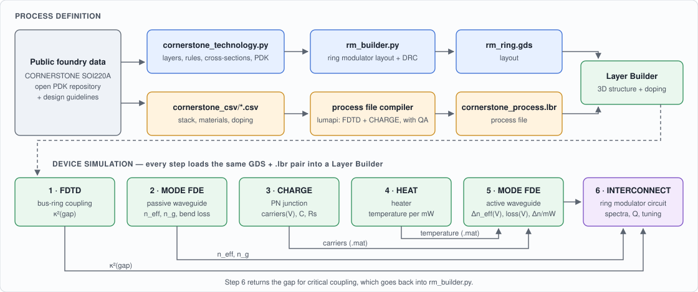
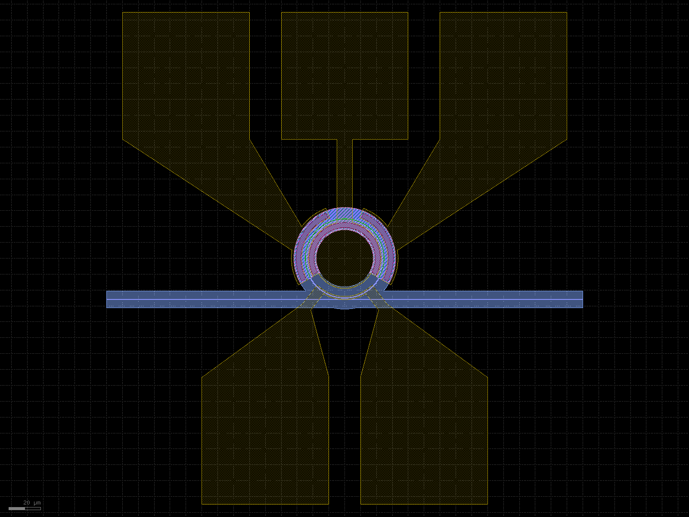
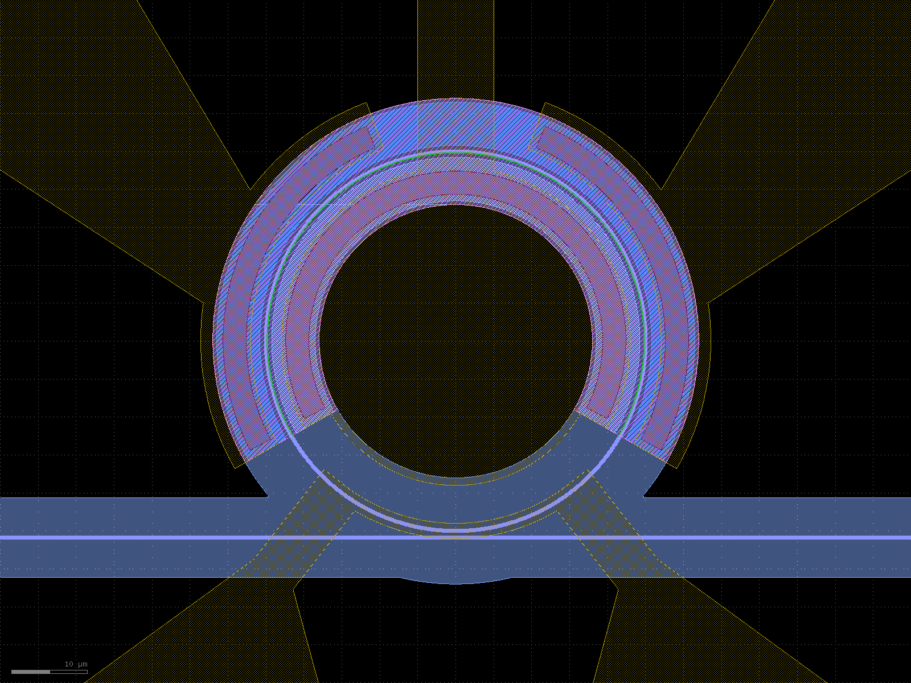
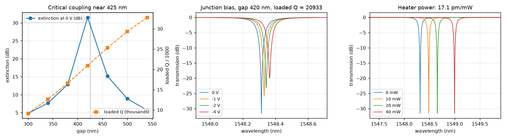

# photonics-layout-cookbook

**A foundry-compatible silicon-photonics design flow, worked through on an open active PDK: from the gdsfactory technology file to the layout, the Lumerical process file, and the device and circuit simulations of a heater-tuned microring modulator.**

[English](README.md) | [简体中文](README_zh-CN.md)


Most students learn to simulate a ring modulator from a drawing made inside the simulator, with a
layer stack typed in by hand. A foundry works the other way round. The process is fixed, the
layout is the only thing you hand in, and the simulation has to describe what that layout becomes
in that process. This repository shows that flow end to end, on a process whose data is public.

<p align="center">
  
</p>

The process is described twice, from the same public sources: once for layout (a gdsfactory PDK)
and once for simulation (a Lumerical Layer Builder process file). A device is drawn with the first
and simulated with the second. No simulation script contains a thickness, a material or a doping
level.

## The flow in five parts

| part | file | what it does |
|---|---|---|
| Technology | [cornerstone_technology.py](cornerstone_technology.py) | The foundry process as a gdsfactory PDK: layers with their official names, design rules, layer stack, cross-sections. |
| Design rules | [cornerstone_drc.py](cornerstone_drc.py) | Checks a layout against the published rules, in pure Python. |
| Device | [rm_builder.py](rm_builder.py) | Draws the ring modulator from the PDK cross-sections, checks it, writes the GDS. |
| Process file | [cornerstone_process_file_py/](cornerstone_process_file_py/) | The same process as CSV tables, compiled into `cornerstone_process.lbr` through `lumapi`. |
| Simulation | [lumerical_simulations/ring_modulator/](lumerical_simulations/ring_modulator/) | Six steps through FDTD, MODE, CHARGE, HEAT and INTERCONNECT, each loading GDS + `.lbr`. |

## The process: CORNERSTONE SOI 220 nm active

[CORNERSTONE](https://www.cornerstone.sotonfab.co.uk/) is an open-source, licence-free silicon
photonics foundry at the University of Southampton. Its active platform, `SOI220A`, offers three
silicon etches, four implants and one metal layer. Everything used here comes from two public
documents:

- the official PDK repository [cornerstone-uos/cornerstone-pdk](https://github.com/cornerstone-uos/cornerstone-pdk), folder `SOI220A`: layer names and numbers, per-layer rules, cross-sections, building blocks;
- the [design guidelines of the 220 nm SOI active MPW call #47](https://cornerstone.sotonfab.co.uk/wp-content/uploads/2025/10/CORNERSTONE-47th-Call-Design-Guidelines_final-1.pdf): process flow, doping, rules between layers, mask processing.

| GDS | official layer name | meaning |
|---|---|---|
| 3/0 | `Si_Etch2_LF_120nm` | waveguide core; drawn shapes keep the full 220 nm |
| 5/0 | `Si_Etch3_LF_100nm_to_BOX` | rib protect; drawn shapes keep a 100 nm slab |
| 6/0 | `Si_Etch1_DUV_DF_70nm` | grating couplers, etched 70 nm |
| 7/0, 8/0 | `P_Implant_Low_DF`, `N_Implant_Low_DF` | low-dose implants that form the junction |
| 9/0, 11/0 | `P_Implant_Hi_DF`, `N_Implant_Hi_DF` | high-dose implants for ohmic contacts |
| 12/0 | `Via_DF` | via through the top cladding |
| 13/0 | `Electrode_LF` | Al electrodes, pads and heater filaments |

Three properties of this process shape the device, and the code models each of them:

- **One metal layer.** Heaters are drawn in the electrode layer. The junction electrodes and the
  heater therefore share the ring: the junction takes the upper 240°, the heater the lower 76°.
- **A self-aligned n implant.** It enters the rib through the sidewall, about 110 nm deep, wherever
  the mask edge is drawn inside the core. The junction is not where the mask edge is.
- **Mask processing by the foundry.** Trenches are generated around every waveguide, and the
  high-dose implants are merged into the slab. The process file reproduces this.

Where each number comes from, and where the public sources disagree, is documented in
[cornerstone_csv/README.md](cornerstone_process_file_py/cornerstone_csv/README.md).

## The worked example

<p align="center">
  
  
</p>

A 25 µm rib ring with a point coupler. GSG pads in the north drive the PN section. Two pads in the
south feed the heater above the undoped part of the ring.

| result | value | from |
|---|---|---|
| power coupling | κ² = 3.73 · exp(−gap / 101.6 nm) | step 1, FDTD |
| effective and group index | 2.5515 and 3.912 | step 2, MODE |
| junction capacitance at 0 V and −4 V | 0.43 and 0.22 fF/µm | step 3, CHARGE |
| heater efficiency | 1.37 K/mW in the heated section | step 4, HEAT |
| modulation efficiency VπL at −2 V | 1.4 V·cm | step 5, MODE |
| gap for critical coupling | 425 nm | step 6, INTERCONNECT |
| loaded Q and free spectral range | 20 900 and 3.90 nm | step 6 |
| resonance shift at −4 V | 50 pm | step 6 |
| thermal tuning | 17.1 pm/mW | step 6 |

<p align="center">
  
</p>

Step 6 returns the gap for critical coupling, and that value is the default gap of the layout.
The method, the settings that matter and the limits of each step are in
[lumerical_simulations/ring_modulator/README.md](lumerical_simulations/ring_modulator/README.md).
These are simulation results. They have not been compared with a fabricated device.

## Quick start

Layout, DRC and tests need only Python. The process file and the simulations need Ansys Lumerical.

```bash
# 1. environment (uv: https://docs.astral.sh/uv/)
git clone https://github.com/q3430468220-tech/photonics-layout-cookbook.git
cd photonics-layout-cookbook
uv sync

# 2. the PDK: list the layers, write the KLayout technology
uv run python cornerstone_technology.py

# 3. the device: GDS, DRC report, preview images
uv run python rm_builder.py

# 4. the process file (Lumerical with FDTD and CHARGE licences)
uv run python cornerstone_process_file_py/cornerstone_process_file_compiler.py

# 5. the six simulation steps
cd lumerical_simulations/ring_modulator/scripts
uv run python coupling_coefficient_fdtd.py --dry   # coarse first; see the folder's README for the rest

# tests and lint (no Lumerical needed)
uv run pytest
uv run ruff check .
```

Lumerical is found through the environment variable `LUMERICAL_ROOT`, or in its usual install
locations:

```bash
# PowerShell
$env:LUMERICAL_ROOT = "C:\Program Files\ANSYS Inc\v251\Lumerical"
# bash
export LUMERICAL_ROOT=/opt/lumerical/v251
```

Keep the clone on a path without non-ASCII characters. Lumerical solvers can fail otherwise.

### Using the pieces in your own scripts

```python
import gdsfactory as gf
import cornerstone_technology as t  # importing it activates the PDK
import rm_builder as rm
from cornerstone_drc import run_drc

phase_shifter = gf.components.straight(length=500, cross_section="rib_1550nm_TE_pn")
ring = rm.ring_modulator(radius=30, gap=0.40)

assert run_drc(ring).passed
t.write_gds_for_lumerical(ring, "ring.gds")  # flat, with the layer the process file needs
```

In Lumerical, by script or in the Layer Builder dialog:

```text
addlayerbuilder;
loadgdsfile("ring.gds");
loadprocessfile("cornerstone_process.lbr");
```

## Repository layout

```text
photonics-layout-cookbook/
├── cornerstone_technology.py        the PDK: layers, rules, stack, cross-sections, cells
├── cornerstone_drc.py               design-rule check (klayout.db)
├── rm_builder.py                    ring modulator layout
├── rm_ring.gds                      its output, ready for the Layer Builder
├── lumerical_env.py                 finds Lumerical and imports lumapi
│
├── cornerstone_process_file_py/
│   ├── cornerstone_process_file_compiler.py   CSV tables → .lbr, with a read-back check
│   ├── cornerstone_process.lbr                the compiled process file
│   └── cornerstone_csv/                       stack, doping, materials, variations + README
│
├── lumerical_simulations/ring_modulator/
│   ├── scripts/                     common.py and one script per step
│   ├── 1_coupling_coefficient/ … 6_interconnect_ring_modulator/   layouts and result summaries
│   ├── plots/                       one plot script and its figures per step
│   └── README.md                    method, results and pitfalls of each step
│
├── klayout_tech/                    layers.lyp and tech.lyt for KLayout
├── assets/                          figures of this README
├── tests/                           pytest: PDK, layout, DRC, process tables
└── legacy/                          the v0.1 package, kept for reference
```

## Adapting the flow to another process

1. Copy `cornerstone_technology.py` and replace the constants, the layer map, the rules and the
   cross-sections. Keep the foundry's own layer names.
2. Copy `cornerstone_csv/` and fill the tables from the same documents. Tag every number with its
   source, and mark what you had to assume.
3. Run the compiler. Its read-back check compares the `.lbr` with the tables.
4. Check one known cross-section in MODE before anything else. A wrong layer expression shows up
   as a wrong effective index.
5. Only use public data in a public repository. Never commit a PDK you received under an NDA.

## Limitations and disclaimer

- The values are for teaching and for setting up simulations. Before a tape-out, take every number
  from the design guidelines of the call you submit to, and run the foundry's own DRC.
- Several inputs are assumptions and are tagged as such: sidewall angle, implant depth profiles,
  aluminium resistivity, a planar top cladding.
- The public sources disagree on the oxide thicknesses. This repository follows the design
  guidelines; see the table in [cornerstone_csv/README.md](cornerstone_process_file_py/cornerstone_csv/README.md).
- The code is written against gdsfactory 9.5x and Lumerical 2025 R1.
- This project is not affiliated with or endorsed by CORNERSTONE, the University of Southampton,
  Ansys or the gdsfactory team. "Ansys" and "Lumerical" are trademarks of Ansys, Inc.

## Roadmap, contributing, citing

Planned next: a compact model from the six steps, more devices on the same process, and a second
open process. See [ROADMAP.md](ROADMAP.md). Contributions are welcome, especially new devices and
new open processes; see [CONTRIBUTING.md](CONTRIBUTING.md). If the cookbook helps your research or
teaching, please cite it through [CITATION.cff](CITATION.cff). The code is released under the
[MIT licence](LICENSE).

## References

- CORNERSTONE, [open PDK repository](https://github.com/cornerstone-uos/cornerstone-pdk) and [design guidelines for the 220 nm SOI active MPW call #47](https://cornerstone.sotonfab.co.uk/wp-content/uploads/2025/10/CORNERSTONE-47th-Call-Design-Guidelines_final-1.pdf)
- Ansys Optics, [Layer builder - Simulation object](https://optics.ansys.com/hc/en-us/articles/360034382394-Layer-builder-Simulation-object)
- Ansys Optics, [Ring Modulator](https://optics.ansys.com/hc/en-us/articles/360042322794-Ring-Modulator)
- Ansys Optics, [Workshop: Designing Foundry-Compatible Photonic Components and Circuits](https://optics.ansys.com/hc/en-us/articles/31257798958611-Workshop-Designing-Foundry-Compatible-Photonic-Components-and-Circuits)
- gdsfactory, [documentation](https://gdsfactory.github.io/gdsfactory/)
