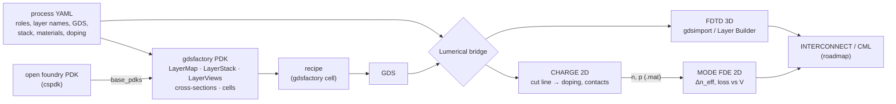

# photonics-layout-cookbook

**Silicon-photonics layout recipes with [gdsfactory](https://github.com/gdsfactory/gdsfactory) — on open foundry PDKs, from defining the PDK to single devices and full architectures, with a seamless bridge into Ansys Lumerical.**

[English](README.md) | [简体中文](README_zh-CN.md)


Many photonics students can simulate a ring modulator in Lumerical but have never drawn one that a foundry would accept. Layout is usually learned by copying a senior's GDS, foundry PDKs sit behind NDAs, and the simulation model ends up disconnected from the layout. This repository teaches layout the other way round: you first learn how a **gdsfactory PDK** describes a foundry process, then every device is a short, readable **gdsfactory recipe** drawn on an **open foundry process**, and every GDS it produces can be **imported straight into Lumerical** (FDTD, MODE, CHARGE) without retyping a single dimension.

<p align="center">
  <br>
  <br>
  <em>Recipe 01: a PN microring modulator on CORNERSTONE 220 nm SOI (top), and the cross-section the bridge extracts from the GDS for CHARGE and MODE-FDE (bottom).</em>
</p>

## What is inside

The cookbook has four parts, kept separate so that each can be learned and replaced on its own.

**Process files** (`src/photonics_cookbook/process/data/*.yaml`) describe one foundry platform in a single place: for every layer its *role* (`core`, `slab`, `n`, `ppp`, `via`, `metal` …), its PDK name and GDS numbers, the vertical stack, Lumerical material names, implant type and dose, and its KLayout colours. The first one is the open [CORNERSTONE](https://www.cornerstone.sotonfab.co.uk/) 220 nm SOI active platform.

**The PDK** (`src/photonics_cookbook/pdk`) turns a process file into a complete gdsfactory `Pdk` — LayerMap, LayerStack, LayerViews, the `rib_pn` cross-section and the cookbook cells — and *extends* the foundry's open gdsfactory PDK (here [`cspdk`](https://github.com/gdsfactory/cspdk)) so that all its cells and models keep working. A step-by-step tutorial first writes a small PDK entirely by hand, following the [official gdsfactory PDK tutorial](https://gdsfactory.github.io/gdsfactory/notebooks/08_pdk.html), and then shows the generated one. See [docs/pdk-tutorial.md](docs/pdk-tutorial.md).

**Recipes** (`src/photonics_cookbook/devices`, `cells.py`, `examples/`) draw devices on roles, never on raw GDS numbers, either as polygons (`ring_modulator`) or by extruding a PDK cross-section (`straight_pn`). In-plane dimensions of the single devices follow the official Ansys Lumerical application examples, so you can cross-check your simulation against Ansys' own files.

**The Lumerical bridge** (`src/photonics_cookbook/lumerical`) reads *only* the GDS and the process file and writes ready-to-run Lumerical scripts. Because it never looks at Python objects, it also works for layouts made in KLayout or by a foundry PCell.

| generated script | Lumerical product | what it does |
|---|---|---|
| `<cell>_geometry3d.lsf` | FDTD / MODE | `gdsimport` of every drawn layer with z-range and material, plus BOX/cladding |
| `<cell>_fdtd3d.lsf` | FDTD | geometry + 3D FDTD region sized to the optical layers + one port per gdsfactory optical port |
| `<cell>_layerbuilder.lsf` | FDTD / MODE | builds a Layer Builder from script and lets Lumerical write the foundry `.lbr` process file |
| `<cell>_charge2d.lsf` | CHARGE | 2D cut through the layout: silicon, implants, vias as contacts, bias sweep, carrier export |
| `<cell>_fde2d.lsf` | MODE (FDE) | same cut and frame; imports the CHARGE carriers, sweeps bias, reports Δn_eff, loss, pm/V |



## Quick start

The project uses [uv](https://docs.astral.sh/uv/) for a reproducible Python environment.

```bash
# 1. install uv (once)            Windows PowerShell:  irm https://astral.sh/uv/install.ps1 | iex
curl -LsSf https://astral.sh/uv/install.sh | sh

# 2. get the code and the environment (Python 3.12, gdsfactory, cspdk, klayout ...)
git clone https://github.com/q3430468220-tech/photonics-layout-cookbook.git
cd photonics-layout-cookbook
uv sync                     # creates .venv and uv.lock

# 3. check the set-up and meet the foundry PDK (cspdk)
uv run python examples/00_getting_started/00_check_environment.py

# 4. learn how a gdsfactory PDK is defined, then inspect the cookbook PDK
uv run python examples/00_getting_started/01_define_your_pdk.py
uv run photonics-cookbook show-process cornerstone_si220_active
uv run photonics-cookbook check-pdk cornerstone_si220_active
uv run photonics-cookbook pdk-info
uv run photonics-cookbook write-klayout-tech -o build/klayout_tech   # layer colours for KLayout

# 5. recipe 01: draw the ring modulator, then export it to Lumerical
uv run python examples/01_devices/01_ring_modulator/01_layout.py
uv run python examples/01_devices/01_ring_modulator/02_export_to_lumerical.py

# 6. (optional, needs Lumerical + licence) run CHARGE -> MODE through lumapi
#    PowerShell: $env:LUMERICAL_ROOT="C:\Program Files\ANSYS Inc\v251\Lumerical"
uv run python examples/01_devices/01_ring_modulator/03_run_lumerical.py

# tests and lint
uv run pytest
uv run ruff check .
```

In your own scripts, activate the PDK before drawing (since gdsfactory 9.29 none is active by default):

```python
import gdsfactory as gf
from photonics_cookbook.pdk import activate_pdk

activate_pdk("cornerstone_si220_active")        # cspdk.si220 + implants, vias, metal
ring = gf.get_component("ring_modulator", radius=10, gap=0.2)
pn = gf.get_component("straight_pn", length=500)     # rib_pn cross-section, extruded
mmi = gf.get_component("mmi1x2")                     # cspdk cells still work
ring.write_gds("ring.gds")
```

Outputs go to `build/` (ignored by git). **Lumerical solvers can fail on folders with non-ASCII characters** (for example a path containing Chinese); keep the clone on an ASCII path or point the build directory elsewhere with `PHOTONICS_BUILD_DIR=D:\photonics_build`. To view layouts, install [KLayout](https://www.klayout.de/), load `build/klayout_tech/layers.lyp` for the layer colours, or install the `klive` KLayout plug-in and call `c.show()`.

## Repository layout

```text
photonics-layout-cookbook/
├── pyproject.toml / .python-version     uv project (Python 3.12)
├── src/photonics_cookbook/
│   ├── process/                         foundry process files
│   │   ├── model.py                     roles, PDK names, stack, materials, doping (+ validation)
│   │   ├── upstream.py                  check against / bootstrap from a gdsfactory PDK
│   │   └── data/cornerstone_si220_active.yaml, _template.yaml
│   ├── pdk/                             gdsfactory PDKs generated from the process files
│   │   ├── builder.py                   LayerMap, LayerStack, LayerViews, rib_pn, Pdk(base_pdks=...)
│   │   ├── __init__.py                  get_pdk / activate_pdk / write_klayout_tech
│   │   └── cornerstone_si220_active.py  PDK, LAYER, LAYER_STACK, LAYER_VIEWS (like cspdk)
│   ├── geometry.py                      tool-independent polygons + ports
│   ├── devices/                         recipe maths (pure Python, unit-tested)
│   │   ├── ring_modulator.py            doped ring with GSG pads
│   │   └── pn_waveguide.py              PN rib sections (rib_pn) and straight
│   ├── cells.py                         gdsfactory cells: ring_modulator, straight_pn
│   ├── lumerical/                       GDS -> Lumerical bridge
│   │   ├── gds_reader.py  cutline.py    read GDS (KLayout), extract 2D cuts
│   │   ├── scripts_3d.py  scripts_2d.py FDTD / Layer Builder / CHARGE / FDE writers
│   │   ├── export.py                    export_lumerical(): one call, all scripts
│   │   └── runner.py                    run scripts through lumapi
│   ├── plotting.py  cli.py  paths.py
├── examples/
│   ├── 00_getting_started/              00_check_environment, 01_define_your_pdk
│   └── 01_devices/01_ring_modulator/    01_layout → 02_export → 03_run_lumerical
├── docs/                                pdk-tutorial.md, process-adapters.md, lumerical-bridge.md, images/
├── tests/                               pytest (gdsfactory tests skip if not installed)
└── ROADMAP.md  CONTRIBUTING.md  LICENSE
```

## Roadmap

The curriculum starts with the foundations and then grows in three levels. Each recipe ships with a layout, a Lumerical export and a short explanation of the design choices. See [ROADMAP.md](ROADMAP.md) for the full plan, including which Ansys example each device follows.

| level | recipe | Lumerical chain | status |
|---|---|---|---|
| 0 · foundations | environment, meeting an open foundry PDK | — | **v0.1** |
| | defining a gdsfactory PDK: by hand, then generated from a process file on top of cspdk | KLayout tech, Lumerical names in the LayerStack | **v0.1** |
| 1 · devices | microring modulator (lateral PN) | CHARGE → FDE → FDTD coupler → INTERCONNECT | **v0.1** |
| | PN depletion phase shifter (`straight_pn` from `rib_pn`; pads and travelling-wave electrodes next) | CHARGE → FDE, TW electrode | in progress |
| | PIN phase shifter / MZM, thermo-optic phase shifter | CHARGE / HEAT → FDE | planned |
| | Ge photodetector (vertical / lateral) | FDTD → CHARGE | planned |
| | passives: grating & edge coupler, MMI, DC, y-branch | FDTD / EME / varFDTD | planned |
| 2 · modules | MZI unit cell → Clements / Reck N×N mesh | INTERCONNECT netlist | planned |
| | add-drop and high-order ring filters, WDM mux/demux | FDTD + INTERCONNECT | planned |
| 3 · architectures | WDM optical interconnect link, MZI switch fabric, optical I/O (OIO) tile | INTERCONNECT | planned |

Foundry adapters planned next: SiEPIC EBeam (`ubcpdk`), the gdsfactory generic PDK, VTT 3 µm SOI and Luxtelligence thin-film lithium niobate.

## Design principles

One process file per platform is the single source of truth: it generates the gdsfactory PDK and drives the Lumerical bridge, so layout and simulation can never disagree about a layer. Extend, don't copy: the cookbook PDK builds on the foundry's open gdsfactory PDK through `base_pdks` and only adds what is missing. The GDS is the contract: anything downstream (Lumerical, DRC, another tool) reads the GDS and the process file, never Python objects. Recipes use roles instead of layer numbers, so foundry knowledge lives in exactly one place. Every number has a source: process files cite the public design documents they come from, and device defaults cite the Ansys example they follow. And layouts are simulation-ready by construction: each cell stores the hints the simulator needs (cut line, bend radius, doped length, contact layers) in `component.info`.

## Status and limitations

This is an alpha. The 3D `gdsimport`, CHARGE and FDE routes use documented script commands; the Layer Builder route is marked experimental because some of its property names differ between Lumerical versions (every uncertain call is wrapped in `try` and reported). Generated scripts target Lumerical 2022 R1 or newer. The PDK code is written against gdsfactory 9.5x and cspdk 2.x. Please open an issue with your versions if something fails.

## Disclaimer

Layer numbers, stack and doping values in the process files are taken from publicly available foundry documents and are meant for teaching and simulation set-up. **Before any tape-out, always use the design manual and PDK of the specific run you submit to.** This project is not affiliated with or endorsed by Ansys, CORNERSTONE / University of Southampton or the gdsfactory team. "Ansys" and "Lumerical" are trademarks of Ansys, Inc.

## Contributing, citing, licence

Contributions are very welcome, especially new recipes and new foundry adapters; see [CONTRIBUTING.md](CONTRIBUTING.md). If this cookbook helps your research or teaching, please cite it via [CITATION.cff](CITATION.cff). Code is released under the [MIT licence](LICENSE).

Built on the shoulders of [gdsfactory](https://github.com/gdsfactory/gdsfactory), [cspdk](https://github.com/gdsfactory/cspdk), [KLayout](https://www.klayout.de/) and the [Ansys Optics application gallery](https://optics.ansys.com/hc/en-us).
