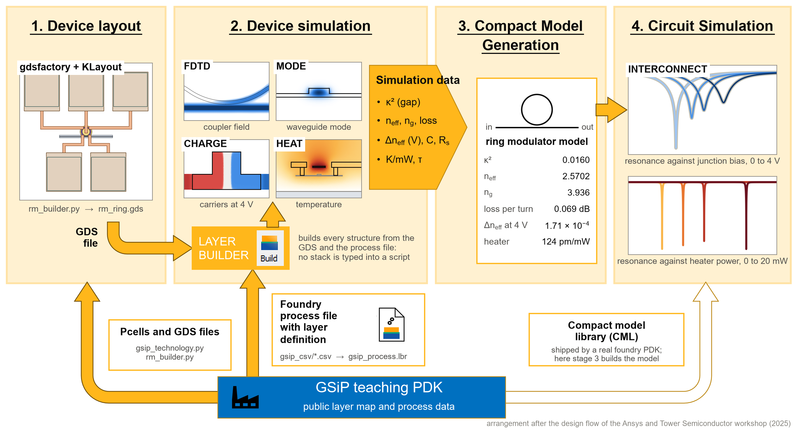
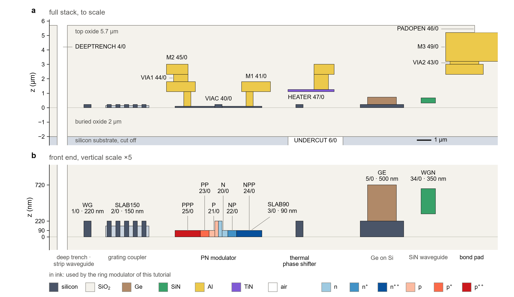
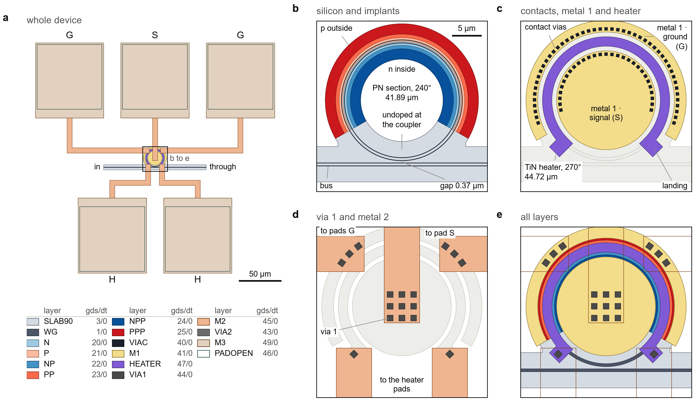
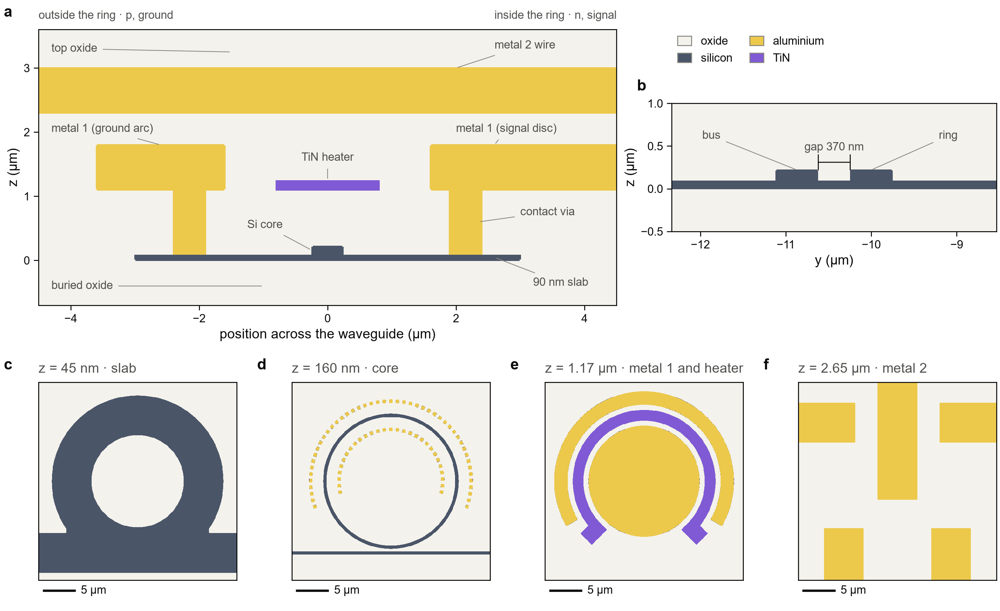
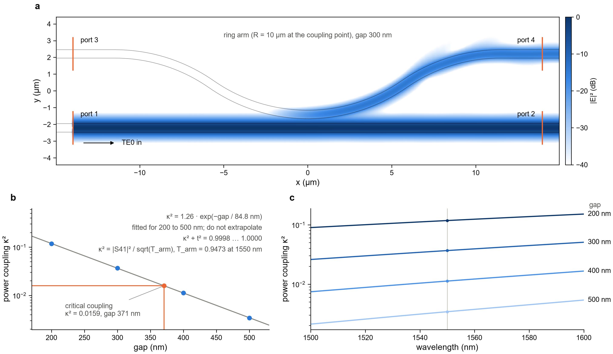
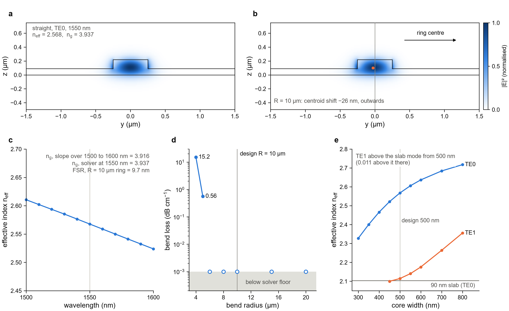
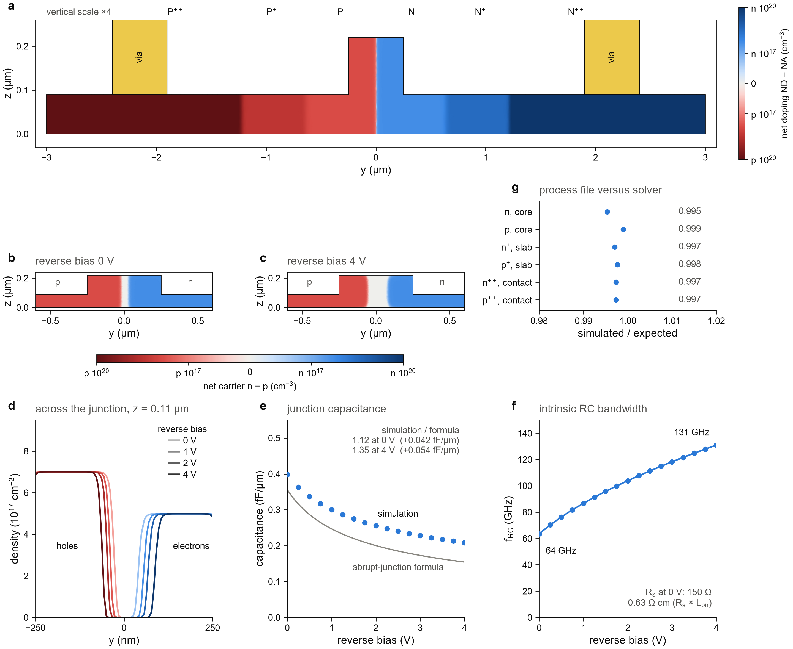
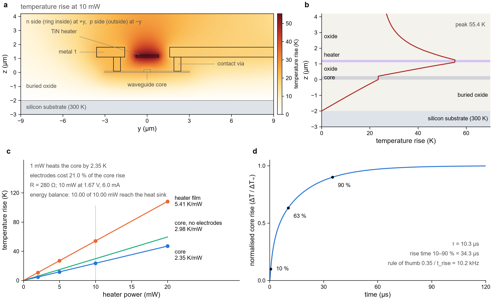
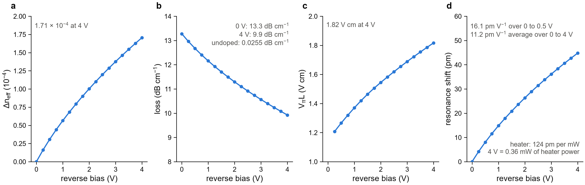
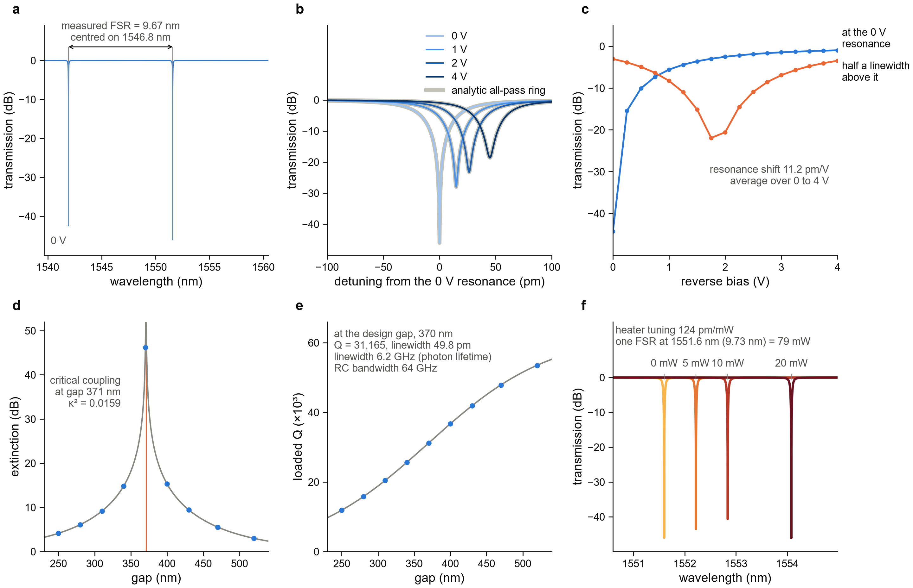

# photonics-layout-cookbook

用 [gdsfactory](https://github.com/gdsfactory/gdsfactory) 画版图、用 Ansys Lumerical 做仿真的硅光设计教程。从一套 PDK（工艺设计套件）出发，画出一个微环调制器，再对这份版图做仿真：FDTD 算耦合器，MODE 算波导，CHARGE 和 HEAT 算 PN 结和加热器，INTERCONNECT 算电路。

[English](README.md) | [简体中文](README_zh-CN.md)


做微环调制器仿真，常见的做法是在仿真软件里直接画结构，手工填入膜层厚度和材料。给代工厂做设计时情况不同：工艺是固定的，交付的是版图，仿真要回答的是这份版图按这套工艺做出来是什么样。这个仓库拿一个器件，从版图到电路完整做一遍，代码可以直接运行，也可以随便改。

<p align="center"></p>

*设计流程。这张图参照了 Ansys 与 Tower Semiconductor 研讨会（2025）的一页幻灯片，图中的版图、曲线和数值都来自本仓库。*

这里用的是一套叫 GSiP（generic silicon photonics，通用硅光）的教学工艺。同一套工艺写成了两份：一份是画版图用的 gdsfactory PDK，一份是 Lumerical 的 Layer Builder 用的工艺文件。Layer Builder 是把版图文件（GDS）搭成三维结构的工具。测试会检查两份描述是否一致。画版图用前者，仿真用后者，所以没有哪个仿真脚本需要手工定义结构，厚度、材料和掺杂都来自工艺文件。

## 教程目录

一共五章，建议按顺序读，前两章不需要 Lumerical。各章正文目前是英文，本页是中文概览。

| | 章节 | 内容 |
|---|---|---|
| 1 | [PDK](docs/pdk.md) | 图层、膜层堆叠、截面和设计规则，以及怎样把它们写成代码 |
| 2 | [器件](docs/device.md) | 画微环调制器，再用设计规则检查（DRC）和连通性检查验证版图 |
| 3 | [工艺文件](gsip_process_file_py/README.md) | 把同一套工艺写成 Layer Builder 用的表格，以及如何核对 |
| 4 | [仿真](lumerical_simulations/ring_modulator/README.md) | 从耦合器到电路共七步，以及每一步的易错点 |
| 5 | [换成自己的工艺](docs/your_foundry.md) | 把流程搬到真实的代工厂 PDK 上，同时不泄露保密数据 |

## 快速开始

需要 Python 3.12 或 3.13，以及 [uv](https://docs.astral.sh/uv/)。如果打算跑仿真，请把仓库放在不含中文等非 ASCII 字符的路径下，否则 Lumerical 求解器可能报错。

**版图和测试**（不需要 Lumerical）：

```bash
git clone https://github.com/q3430468220-tech/photonics-layout-cookbook.git
cd photonics-layout-cookbook
uv sync

uv run python gsip_technology.py     # 列出图层和膜层堆叠，生成 KLayout 用的图层配色
uv run python rm_builder.py          # 画微环调制器，跑 DRC，输出 rm_ring.gds
uv run pytest                        # 85 项测试
```

`rm_builder.py` 最后会打印 `DRC passed: 0 errors, 0 warnings`。生成的 `rm_ring.gds` 可以用免费的版图软件 [KLayout](https://www.klayout.de) 打开，图层配色在 `klayout_tech/layers.lyp`。

**图片**（不需要 Lumerical）。仿真结果已经保存在仓库里，第 4 章的每张图都可以直接重画。绘图脚本都在 `figures/` 下，例如：

```bash
uv run python lumerical_simulations/ring_modulator/figures/fig2_passive.py
```

**仿真**（需要带 FDTD、MODE、CHARGE、HEAT 和 INTERCONNECT 的 Lumerical）。脚本会在常见的安装目录里找 Lumerical，装在别处时请设置 `LUMERICAL_ROOT`。各步按顺序运行，结果写进各自的文件夹，每一步做什么见第 4 章。注释里的时间是在作者的电脑上测的。

```bash
export LUMERICAL_ROOT=/opt/lumerical/v251        # PowerShell: $env:LUMERICAL_ROOT = "C:\Program Files\ANSYS Inc\v251\Lumerical"
uv run python gsip_process_file_py/gsip_process_file_compiler.py   # 可选：由 CSV 表格重新生成 gsip_process.lbr

cd lumerical_simulations/ring_modulator/scripts
uv run python layer_builder_check.py             # 第 0 步，约半分钟
uv run python coupling_coefficient_fdtd.py       # 第 1 步，约 30 分钟
uv run python passive_mode_fde.py                # 第 2 步，约 7 分钟
uv run python charge_profile.py                  # 第 3 步，约 9 分钟
uv run python heat_profile.py                    # 第 4 步，约 3 分钟
uv run python active_mode_fde.py                 # 第 5 步，约 1 分钟
uv run python ring_modulator_interconnect.py     # 第 6 步，不到 1 分钟
```

## PDK

<p align="center"></p>

*整套工艺的截面图：a 是按比例画出的完整膜层，b 是硅、锗和氮化硅这几层，纵向放大了五倍。底部深色字标出的是微环调制器用到的部分。*

这套 PDK 描述的是一个教学工艺。它沿用 Chrostowski 和 Hochberg 教材里的通用工艺，图层编号取自开源的 gdsfactory 通用 PDK。它不对应任何一家代工厂，其中的数值不能用于流片。商业代工厂的完整有源工艺都受保密协议约束，不能公开，所以教程自己定义了一套。

| 类别 | 图层及 GDS 编号（层号/数据类型） | 说明 |
|---|---|---|
| 硅 | `WG` 1/0、`SLAB150` 2/0、`SLAB90` 3/0 | 220 nm 芯层，150 nm 和 90 nm 平板层 |
| 离子注入 | `N` 20/0、`P` 21/0、`NP` 22/0、`PP` 23/0、`NPP` 24/0、`PPP` 25/0 | n 型和 p 型各有轻、中、重三档，5 × 10¹⁷ 至 5 × 10²⁰ cm⁻³ |
| 锗、氮化硅 | `GE` 5/0、`GEN` 26/0、`GEP` 27/0、`WGN` 34/0 | 500 nm 锗，350 nm 氮化硅 |
| 接触孔与金属 | `VIAC` 40/0、`M1` 41/0、`VIA1` 44/0、`M2` 45/0、`VIA2` 43/0、`M3` 49/0、`PADOPEN` 46/0 | 铝，三层金属 |
| 加热器 | `HEATER` 47/0 | 150 nm 氮化钛（TiN），10 Ω/sq |
| 沟槽 | `DEEPTRENCH` 4/0、`UNDERCUT` 6/0 | 端面深槽，用于隔热的衬底底切 |

[gsip_technology.py](gsip_technology.py) 里的工艺数值都标了出处：[B] 教材，[BJ] 教材工艺所依据的 Baehr-Jones 等人的论文，[GF] gdsfactory 通用 PDK，[T] 本仓库自定的教学取值，旁边写了理由。

## 微环调制器

<p align="center"></p>

*[rm_builder.py](rm_builder.py) 画出的器件：a 是整体，b 到 d 各显示一组图层，e 是全部图层。*

器件是一个半径 10 µm 的脊形波导微环，旁边是一根总线波导。PN 结覆盖环的 240°，n 区在环内侧。TiN 加热器在芯层正上方，覆盖 270°。金属 2 引出到五个焊盘：PN 结用地、信号、地（G-S-G）三个，加热器用两个（H）。

| 参数 | 默认值 | 说明 |
|---|---|---|
| `radius` | 10 µm | 周长 62.83 µm |
| `width` | 0.5 µm | 芯层高 220 nm，两侧是 90 nm 平板层 |
| `gap` | 0.37 µm | 总线和环之间的间距，这个值对应临界耦合（见第 6 步） |
| `pn_angle` | 240° | 结长 41.89 µm，占环的 67% |
| `heater_angle` | 270° | 两端接触区之间的加热器长 44.72 µm，电阻 280 Ω |

同一个函数可以画其他尺寸。参数不满足设计规则时（比如半径小于 10 µm 的下限），它会报错并指出是哪条规则。在仓库根目录下运行：

```python
import gsip_technology as t          # 导入即激活 PDK
import rm_builder as rm
from gsip_drc import run_drc

ring = rm.ring_modulator(radius=12, gap=0.40)
print(run_drc(ring).summary())       # DRC passed: 0 errors, 0 warnings
t.write_gds_for_lumerical(ring, "build/ring_r12.gds", cellname="ring_r12")
```

用 Lumerical 的脚本语言，三条命令就能把版图搭成结构。第 0 到 5 步都是这样开头的，由 [scripts/common.py](lumerical_simulations/ring_modulator/scripts/common.py) 里的 `add_layer_builder` 完成。第 0 步载入整个器件，后面各步只载入自己要仿真的那一段。

```text
addlayerbuilder;
loadgdsfile("rm_ring.gds");
loadprocessfile("gsip_process_file_py/gsip_process.lbr");
```

## 仿真结果

仿真分七步。第 0 步检查结构；第 1 到 5 步各算器件的一项特性，依次是耦合、波导模式、PN 结、加热器、调制；第 6 步把这些结果放进微环的电路仿真。这些是教学工艺的仿真结果，还没有和实测数据对比过。每一步的方法和局限见第 4 章。

### 第 0 步：结构检查

<p align="center"></p>

这一步先确认 Layer Builder 搭出来的结构对不对。图中是模式求解器看到的材料分布，两个竖直截面，四个水平截面。脚本还列出了十个位置的折射率，从衬底一直到金属 2，旁边标着那里应有的材料，十处全部吻合。

### 第 1 步：耦合（FDTD）

<p align="center"></p>

κ² 是从总线波导耦合进环的功率比例。它随间距指数下降，从 200 nm 时的 0.118 降到 500 nm 时的 0.0034，在这个范围内符合 κ² = 1.26 · exp(−gap / 84.8 nm)。网格加密后 κ² 变化 2%，这一步的精度大致就是这个水平。

### 第 2 步：波导模式（MODE）

<p align="center"></p>

脊形直波导的有效折射率是 2.568，群折射率是 3.94。按环的 10 µm 半径弯曲后，有效折射率是 2.570，弯曲损耗小到求解器分辨不出。损耗要到半径小于 6 µm 才出现，所以 10 µm 的设计规则留有余量。自由光谱范围，也就是相邻谐振峰的间隔，是 9.7 nm。子图 e 显示 0.5 µm 宽的芯层并非严格单模：第二个 TE 模已经是导模，有效折射率只比平板模式高 0.011。

这一步对网格很敏感。用均匀的 20 nm 网格时，同一根弯曲波导在这一步较宽的仿真窗口里算出 2.5765，在第 5 步用的较窄窗口里算出 2.5693。原因是硅的表面没有落在网格线上，而网格线的位置又随窗口变化。现在脚本让每个硅表面都落在网格线上，两个窗口算出来都是 2.570。

### 第 3 步：PN 结（CHARGE）

<p align="center"></p>

结电容从 0 V 时的 0.40 fF/µm 降到反偏 4 V 时的 0.21 fF/µm，0 V 时的串联电阻是 150 Ω。按 41.89 µm 的结长算，RC 带宽在 0 V 时是 64 GHz，反偏 4 V 时升到 131 GHz。子图 g 对比了求解器实际用到的掺杂和工艺表格，两者相差不到 0.5%。

### 第 4 步：加热器（HEAT）

<p align="center"></p>

加热器每毫瓦功率使芯层升温 2.35 K。如果没有 PN 结的电极，温升会是 2.98 K：电极的金属紧挨着加热器，带走了大约五分之一的热量。功率阶跃之后，芯层温度以约 10 µs 的时间常数稳定下来。脚本还核对了能量平衡：输入 10.00 mW，流入热沉的也是 10.00 mW。

### 第 5 步：调制（MODE）

<p align="center"></p>

把第 3 步的载流子分布和第 4 步的温度场代入模式求解器。反偏 4 V 时有效折射率变化 1.7 × 10⁻⁴，谐振波长移动 45 pm。由此得到 V_π·L = 1.8 V·cm，即半波电压与长度的乘积，越小越好。加热器每毫瓦移动 124 pm，也就是说 PN 结加 4 V 的效果相当于加热器的 0.36 mW。所以工作点由加热器来定，PN 结在工作点附近做调制。

### 第 6 步：电路中的微环（INTERCONNECT）

<p align="center"></p>

第 1 到 5 步的结果成为 INTERCONNECT 里一个微环元件的参数。光在环里走一圈损耗 0.069 dB，其中波导占 0.014 dB，PN 结的自由载流子占 0.056 dB。κ² 等于一圈损耗掉的功率比例（0.0159）时，微环处于临界耦合，对应的间距是 371 nm，所以版图取 0.37 µm。在这个间距下，有载 Q 值是 31 000，仿真得到的消光比是 46 dB。谐振峰宽 50 pm，换成频率是 6 GHz，对应 26 ps 的光子寿命。结的 RC 带宽是这个 6 GHz 的十倍，所以限制调制器速度的是光子寿命，不是 PN 结。

## 局限

- 工艺模型是理想化的：侧壁垂直，每个注入区内掺杂均匀，金属全部按铝处理，TiN 用体材料参数。
- CHARGE 和 HEAT 用的是直波导的二维截面，只有模式求解器考虑了弯曲。
- 没有计入加热器和波导上方金属对光的吸收。
- 电路模型不含自热效应，也没有焊盘和走线的射频模型。
- 2.2 dB/cm 的波导损耗取自相近工艺的公开文献，不是仿真得到的。
- 网格精度：有效折射率约 5 × 10⁻⁴，κ² 约 2%。临界耦合附近的消光比对 κ² 非常敏感：κ² 大 1% 是 40 dB，小 1% 是 77 dB，而不是 46 dB。所以仿真只能说明谐振很深，给不出确切的深度。

## 换成自己的工艺

流程不变，要换的是工艺内容：`gsip_technology.py` 里的图层表、膜层堆叠和设计规则，以及 `gsip_process_file_py/gsip_csv/` 里的表格，后者按代工厂的设计手册来填。编译之后先跑第 0 步，再做其他步骤。[第 5 章](docs/your_foundry.md)按顺序讲了整个过程，以及每个阶段该拿什么来对照。代工厂的数据请放在私有仓库里，保密协议下拿到的内容不要进公开仓库。

[more_processes/cornerstone_soi220a/](more_processes/cornerstone_soi220a/README.md) 把同样的流程用在一条真实的开放工艺上。那条工艺只有一层金属，也没有专门的加热器层，做出来的器件相当不同。这个例子保持 v0.2 发布时的样子，v0.3 的修正还没有同步过去，具体缺哪些见它的 README。

## 路线图

先做单元器件，再做由它们组成的电路和链路。完整表格见 [ROADMAP.md](ROADMAP.md)。

| 方向 | 计划 |
|---|---|
| 无源器件 | 条形波导、耦合器与分束器、交叉波导、光栅耦合器和端面耦合器、微环滤波器、马赫-曾德尔干涉仪、氮化硅波导 |
| 有源器件 | 热光、PN 和 PIN 移相器，可变光衰减器，马赫-曾德尔调制器，锗光电探测器，可调滤波器 |
| 光计算 | 马赫-曾德尔干涉仪网格、微环权重阵列（weight bank）：版图与链路仿真 |
| 光交换 | 开关单元和 N×N 开关阵列：版图、损耗与串扰 |
| 光互联 | 波分复用发射端、解复用器和接收端：版图、链路预算、眼图 |

## 仓库结构

```text
photonics-layout-cookbook/
├── gsip_technology.py        PDK：图层、膜层堆叠、截面、设计规则
├── gsip_drc.py               设计规则检查
├── rm_builder.py             微环调制器，输出 rm_ring.gds
├── gsip_process_file_py/     工艺表格（CSV）、编译脚本、编译好的 gsip_process.lbr
├── lumerical_simulations/
│   └── ring_modulator/       scripts/、每一步的结果文件夹、figures/
├── docs/                     第 1、2、5 章
├── assets/                   本页的图片及其绘图脚本
├── tests/                    PDK、版图、DRC、连通性、工艺表格、图片
├── more_processes/           同一套流程在 CORNERSTONE SOI220A 上的实现
├── figstyle.py               统一的绘图风格
├── lumerical_env.py          查找 Lumerical 并导入 lumapi
└── klayout_tech/             KLayout 的图层配色
```

## 参与和许可

欢迎贡献，见 [CONTRIBUTING.md](CONTRIBUTING.md)。如果这份教程对你的研究或教学有帮助，请按 [CITATION.cff](CITATION.cff) 引用。代码采用 [MIT 许可](LICENSE)。

设计流程图里有三个图标取自研讨会幻灯片，不在 MIT 许可范围内，见[版权说明](assets/third_party/ansys_workshop/NOTICE.md)。本项目与 Ansys、Tower Semiconductor、CORNERSTONE、教材作者及 gdsfactory 团队均无隶属或背书关系。“Ansys”和“Lumerical”是 ANSYS, Inc. 的商标。

## 参考资料

- L. Chrostowski and M. Hochberg, *Silicon Photonics Design: From Devices to Systems*, Cambridge University Press, 2015, [doi:10.1017/CBO9781316084168](https://doi.org/10.1017/CBO9781316084168)
- T. Baehr-Jones et al., "A 25 Gb/s Silicon Photonics Platform", [arXiv:1203.0767](https://arxiv.org/abs/1203.0767)
- M. Nedeljkovic, R. Soref and G. Z. Mashanovich, "Free-carrier electrorefraction and electroabsorption modulation predictions for silicon over the 1–14 µm infrared wavelength range", IEEE Photonics Journal 3, 1171 (2011), [doi:10.1109/JPHOT.2011.2171930](https://doi.org/10.1109/JPHOT.2011.2171930)
- gdsfactory：[代码仓库](https://github.com/gdsfactory/gdsfactory)、[文档](https://gdsfactory.github.io/gdsfactory/)
- SiEPIC-Tools（含 GSiP 库）：[代码仓库](https://github.com/SiEPIC/SiEPIC-Tools)
- Ansys Optics：[Layer builder](https://optics.ansys.com/hc/en-us/articles/360034382394-Layer-builder-Simulation-object)、[Ring Modulator](https://optics.ansys.com/hc/en-us/articles/360042322794-Ring-Modulator)、[Workshop: Designing Foundry-Compatible Photonic Components and Circuits](https://optics.ansys.com/hc/en-us/articles/31257798958611-Workshop-Designing-Foundry-Compatible-Photonic-Components-and-Circuits)
- CORNERSTONE：[开放 PDK 仓库](https://github.com/cornerstone-uos/cornerstone-pdk)
