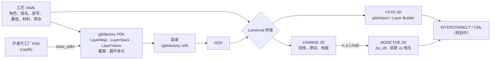

# photonics-layout-cookbook（光子芯片版图菜谱）

**用 [gdsfactory](https://github.com/gdsfactory/gdsfactory) 画光子芯片版图：基于开源代工厂 PDK，从定义 PDK 讲起，到单元器件、功能模块和系统架构，并且版图可以无缝导入 Ansys Lumerical 仿真。**

[English](README.md) | [简体中文](README_zh-CN.md)


很多硅光方向的同学会用 Lumerical 仿真微环调制器，却从来没画过一张能交给代工厂的版图：版图往往靠拷贝师兄师姐的 GDS 学，代工厂 PDK 又要签保密协议，仿真模型和真实版图之间也常常是“两张皮”。这个项目反过来教版图：先弄懂 **gdsfactory 的 PDK** 是怎样描述一家代工厂工艺的，然后每个器件都是一段简短、可读的 **gdsfactory 菜谱**，画在一个 **开源代工厂工艺** 上，生成的 GDS 可以 **直接导入 Lumerical**（FDTD、MODE、CHARGE），一个尺寸都不用手抄。

<p align="center">
  <br>
  <br>
  <em>菜谱 01：CORNERSTONE 220 nm SOI 上的横向 PN 微环调制器（上），以及桥接工具从 GDS 中自动提取、用于 CHARGE 和 MODE-FDE 的截面（下）。</em>
</p>

## 项目包含什么

项目分成四个相互解耦的部分，每一部分都可以单独学习、单独替换。

**工艺文件**（`src/photonics_cookbook/process/data/*.yaml`）：在一个文件里描述一个代工厂平台。每个图层都写明它的 *角色*（`core` 全厚度硅、`slab` 平板区、`n`、`ppp`（P++）、`via`、`metal` 等）、在 PDK 里的层名和 GDS 层号、纵向叠层、Lumerical 材料名、掺杂类型和浓度，以及在 KLayout 里的显示颜色。第一个适配的是开放的 [CORNERSTONE](https://www.cornerstone.sotonfab.co.uk/)（南安普顿大学）220 nm SOI 有源工艺。

**PDK**（`src/photonics_cookbook/pdk`）：把工艺文件自动生成一个完整的 gdsfactory `Pdk`，包括 LayerMap（层名表）、LayerStack（纵向叠层）、LayerViews（KLayout 显示）、`rib_pn` 截面（带掺杂的脊波导）和项目自己的器件单元。它在代工厂已有的开源 gdsfactory PDK（这里是 [`cspdk`](https://github.com/gdsfactory/cspdk)）之上*扩展*，原有的单元和模型照样能用。配套教程先按 [gdsfactory 官方 PDK 教程](https://gdsfactory.github.io/gdsfactory/notebooks/08_pdk.html) 的步骤从零手写一个小 PDK，再讲自动生成的版本，详见 [docs/pdk-tutorial.md](docs/pdk-tutorial.md)。

**菜谱（器件绘制）**（`src/photonics_cookbook/devices`、`cells.py`、`examples/`）：器件只画在图层角色上，不写死层号。画法有两种：直接画多边形（`ring_modulator`），或者沿路径挤出 PDK 里的截面（`straight_pn`）。单元器件的平面尺寸参照 Ansys Lumerical 官方应用案例，方便你把自己的仿真结果和官方文件对照。

**Lumerical 桥接**（`src/photonics_cookbook/lumerical`）：只读取 GDS 和工艺文件，就能生成可直接运行的 Lumerical 脚本。因为它不依赖 Python 对象，所以用 KLayout 手画的版图、代工厂 PCell 生成的版图同样适用。

| 生成的脚本 | Lumerical 模块 | 作用 |
|---|---|---|
| `<cell>_geometry3d.lsf` | FDTD / MODE | 对每个绘制图层执行 `gdsimport`（带 z 范围和材料），并加上埋氧层/包层 |
| `<cell>_fdtd3d.lsf` | FDTD | 几何 + 按光学层自动确定的 3D FDTD 区域 + 与 gdsfactory 光端口一一对应的 port |
| `<cell>_layerbuilder.lsf` | FDTD / MODE | 用脚本搭建 Layer Builder，再让 Lumerical 自己写出该工艺的 `.lbr` 文件 |
| `<cell>_charge2d.lsf` | CHARGE | 沿切线截取版图：硅、注入区、通孔作为电极、偏压扫描、载流子分布导出 |
| `<cell>_fde2d.lsf` | MODE（FDE） | 同一切线、同一坐标系；导入 CHARGE 载流子，扫描偏压，给出 Δn_eff、损耗、pm/V |



## 快速开始

项目使用 [uv](https://docs.astral.sh/uv/) 管理可复现的 Python 环境。

```bash
# 1. 安装 uv（只需一次）        Windows PowerShell:  irm https://astral.sh/uv/install.ps1 | iex
curl -LsSf https://astral.sh/uv/install.sh | sh

# 2. 获取代码并建立环境（Python 3.12、gdsfactory、cspdk、klayout 等）
git clone https://github.com/q3430468220-tech/photonics-layout-cookbook.git
cd photonics-layout-cookbook
uv sync                     # 自动创建 .venv 并生成 uv.lock

# 3. 检查环境，认识代工厂的开源 PDK（cspdk）
uv run python examples/00_getting_started/00_check_environment.py

# 4. 学习如何定义 gdsfactory PDK，再查看本项目生成的 PDK
uv run python examples/00_getting_started/01_define_your_pdk.py
uv run photonics-cookbook show-process cornerstone_si220_active
uv run photonics-cookbook check-pdk cornerstone_si220_active
uv run photonics-cookbook pdk-info
uv run photonics-cookbook write-klayout-tech -o build/klayout_tech   # 导出 KLayout 图层颜色

# 5. 菜谱 01：画微环调制器，并导出到 Lumerical
uv run python examples/01_devices/01_ring_modulator/01_layout.py
uv run python examples/01_devices/01_ring_modulator/02_export_to_lumerical.py

# 6.（可选，需要本机安装 Lumerical 和许可证）通过 lumapi 依次运行 CHARGE -> MODE
#    PowerShell: $env:LUMERICAL_ROOT="C:\Program Files\ANSYS Inc\v251\Lumerical"
uv run python examples/01_devices/01_ring_modulator/03_run_lumerical.py

# 测试与代码检查
uv run pytest
uv run ruff check .
```

在自己的脚本里，画图之前先激活 PDK（gdsfactory 9.29 以后默认不激活任何 PDK）：

```python
import gdsfactory as gf
from photonics_cookbook.pdk import activate_pdk

activate_pdk("cornerstone_si220_active")        # cspdk.si220 + 注入层、通孔、金属
ring = gf.get_component("ring_modulator", radius=10, gap=0.2)
pn = gf.get_component("straight_pn", length=500)     # 用 rib_pn 截面挤出的 PN 波导
mmi = gf.get_component("mmi1x2")                     # cspdk 原有的单元照样能用
ring.write_gds("ring.gds")
```

国内网络下载慢时，可以给 uv 配置 PyPI 镜像，例如 `uv sync --default-index https://pypi.tuna.tsinghua.edu.cn/simple`，或设置环境变量 `UV_DEFAULT_INDEX`。uv 首次运行会自动下载 Python 3.12，如果这一步也很慢，可以先自行安装 Python 3.12，uv 会直接使用它。

输出文件在 `build/` 目录（已被 git 忽略）。**Lumerical 求解器在包含中文等非 ASCII 字符的路径下可能无法写入临时数据文件**（典型报错是 `failed to open data file ...~#xxx.data`）。请把仓库放在纯英文路径下，或用环境变量把输出目录指到纯英文路径，例如 `PHOTONICS_BUILD_DIR=D:\photonics_build`。查看版图请安装 [KLayout](https://www.klayout.de/) 直接打开 GDS，加载 `build/klayout_tech/layers.lyp` 即可显示图层颜色和层名；也可以安装 KLayout 的 `klive` 插件后在 Python 里调用 `c.show()`。

## 目录结构

```text
photonics-layout-cookbook/
├── pyproject.toml / .python-version     uv 项目（Python 3.12）
├── src/photonics_cookbook/
│   ├── process/                         代工厂工艺文件
│   │   ├── model.py                     角色、PDK 层名、叠层、材料、掺杂（含校验）
│   │   ├── upstream.py                  与 gdsfactory PDK 核对 / 从 PDK 生成草稿
│   │   └── data/cornerstone_si220_active.yaml, _template.yaml
│   ├── pdk/                             由工艺文件生成的 gdsfactory PDK
│   │   ├── builder.py                   LayerMap、LayerStack、LayerViews、rib_pn、Pdk(base_pdks=...)
│   │   ├── __init__.py                  get_pdk / activate_pdk / write_klayout_tech
│   │   └── cornerstone_si220_active.py  PDK、LAYER、LAYER_STACK、LAYER_VIEWS（用法同 cspdk）
│   ├── geometry.py                      与工具无关的多边形 + 端口
│   ├── devices/                         器件几何计算（纯 Python，有单元测试）
│   │   ├── ring_modulator.py            带 GSG 焊盘的掺杂微环
│   │   └── pn_waveguide.py              PN 脊波导截面（rib_pn）和直波导
│   ├── cells.py                         gdsfactory 单元：ring_modulator、straight_pn
│   ├── lumerical/                       GDS -> Lumerical 桥接
│   │   ├── gds_reader.py  cutline.py    读取 GDS（KLayout）、提取二维截面
│   │   ├── scripts_3d.py  scripts_2d.py FDTD / Layer Builder / CHARGE / FDE 脚本生成
│   │   ├── export.py                    export_lumerical()：一次调用生成全部脚本
│   │   └── runner.py                    通过 lumapi 运行脚本
│   ├── plotting.py  cli.py  paths.py
├── examples/
│   ├── 00_getting_started/              00_check_environment、01_define_your_pdk
│   └── 01_devices/01_ring_modulator/    01_layout → 02_export → 03_run_lumerical
├── docs/                                pdk-tutorial.md、process-adapters.md、lumerical-bridge.md、images/
├── tests/                               pytest（未安装 gdsfactory 时相关测试自动跳过）
└── ROADMAP.md  CONTRIBUTING.md  LICENSE
```

## 学习路线（Roadmap）

内容从基础开始，再分三个层级逐步更新。每个菜谱都包含版图、Lumerical 导出脚本和设计思路说明。完整计划（以及每个器件对应哪个 Ansys 官方案例）见 [ROADMAP.md](ROADMAP.md)。

| 层级 | 菜谱 | Lumerical 仿真链 | 状态 |
|---|---|---|---|
| 0 · 基础 | 环境配置、认识开源代工厂 PDK | — | **v0.1** |
| | 定义 gdsfactory PDK：先手写，再由工艺文件在 cspdk 之上自动生成 | KLayout 技术文件，LayerStack 中带 Lumerical 材料名 | **v0.1** |
| 1 · 单元器件 | 微环调制器（横向 PN 结） | CHARGE → FDE → FDTD 耦合区 → INTERCONNECT | **v0.1** |
| | PN 耗尽型移相器（已有由 `rib_pn` 挤出的 `straight_pn`；焊盘与行波电极待补） | CHARGE → FDE、行波电极 | 进行中 |
| | PIN 移相器 / MZM、热光移相器 | CHARGE / HEAT → FDE | 规划中 |
| | 锗探测器（垂直 / 横向） | FDTD → CHARGE | 规划中 |
| | 无源器件：光栅/端面耦合器、MMI、定向耦合器、Y 分支 | FDTD / EME / varFDTD | 规划中 |
| 2 · 功能模块 | MZI 单元 → Clements / Reck N×N 网络 | INTERCONNECT 网表 | 规划中 |
| | 上下载微环滤波器、高阶微环滤波器、WDM 复用/解复用 | FDTD + INTERCONNECT | 规划中 |
| 3 · 系统架构 | WDM 光互连链路、MZI 光交换阵列、光 I/O（OIO）芯粒 | INTERCONNECT | 规划中 |

接下来计划适配的代工厂/PDK：SiEPIC EBeam（`ubcpdk`）、gdsfactory 通用 PDK、VTT 3 µm SOI、Luxtelligence 薄膜铌酸锂。

## 设计原则

每个平台一个工艺文件，作为唯一的数据来源：它既生成 gdsfactory PDK，又驱动 Lumerical 桥接，所以版图和仿真对同一个图层的理解永远一致。只扩展、不复制：项目的 PDK 通过 `base_pdks` 建立在代工厂已有的开源 gdsfactory PDK 之上，只补充缺少的部分。GDS 是“契约”：下游的一切（Lumerical、DRC、其他工具）只读取 GDS 和工艺文件，不依赖 Python 对象。器件代码只用图层角色，不写死层号，代工厂相关知识只存在于一个地方。每个数字都有出处：工艺文件注明来源的公开设计文档，器件默认参数注明参照的 Ansys 案例。版图天生“可仿真”：每个单元都把仿真需要的提示（切线位置、弯曲半径、掺杂长度、电极所在层）存进 `component.info`。

## 当前状态与局限

目前是 alpha 版本。3D `gdsimport`、CHARGE 和 FDE 三条路线只用到官方文档中的脚本命令；Layer Builder 路线标记为实验性，因为它的部分属性名在不同 Lumerical 版本之间有差异（所有不确定的调用都包在 `try` 里并会打印提示）。生成的脚本面向 Lumerical 2022 R1 及以上版本；PDK 部分基于 gdsfactory 9.5x 和 cspdk 2.x 编写。如果遇到报错，欢迎附上你的软件版本号提 issue。

## 免责声明

工艺文件中的层号、叠层和掺杂数据来自代工厂公开资料，仅用于教学和仿真设置。**正式流片前，务必以你所投片批次的设计手册和 PDK 为准。** 本项目与 Ansys、CORNERSTONE / 南安普顿大学以及 gdsfactory 团队无隶属或背书关系。“Ansys”和“Lumerical”是 Ansys, Inc. 的商标。

## 参与贡献、引用与许可证

非常欢迎贡献，尤其是新的器件菜谱和新的代工厂适配，详见 [CONTRIBUTING.md](CONTRIBUTING.md)。如果本项目对你的科研或教学有帮助，请通过 [CITATION.cff](CITATION.cff) 引用。代码以 [MIT 许可证](LICENSE) 发布。

本项目基于 [gdsfactory](https://github.com/gdsfactory/gdsfactory)、[cspdk](https://github.com/gdsfactory/cspdk)、[KLayout](https://www.klayout.de/) 和 [Ansys Optics 应用案例库](https://optics.ansys.com/hc/en-us) 构建。
