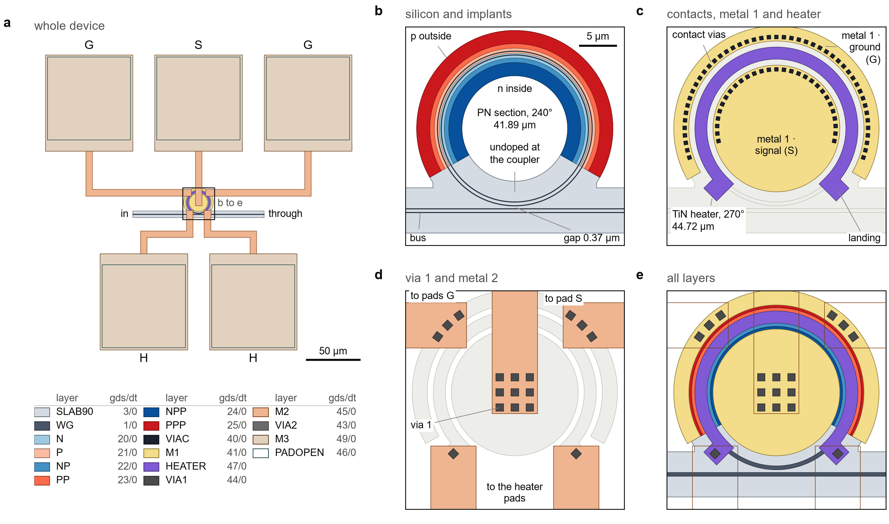

Previous: [Chapter 1, The PDK](pdk.md) | [Course map](../README.md) | Next: [Chapter 3, The process file](../gsip_process_file_py/README.md)

# Chapter 2. The device: drawing a heater-tuned ring modulator, and checking it

This chapter draws one device from first principles. The device is a microring modulator. A
ring is a closed rib waveguide next to a straight bus. A PN junction in the ring changes the
refractive index when a voltage is applied, and a heater above the ring shifts the resonance
with heat. The layout comes from one Python file, `rm_builder.py`, which uses the process
defined in chapter 1, `gsip_technology.py`.

By the end you should be able to:

- say why every polygon of the device is where it is;
- change the radius, the gap or the angles, and keep the device clean in the design-rule check;
- write a builder for your own device in the same style;
- run a design-rule check (DRC) and read its output.

Two words first. A **DRC** is a program that measures a layout against a list of rules, such as
the minimum width of a wire or the enclosure of a via. A **GDS** file is the standard binary
file that holds mask layouts. Each polygon in it sits on a layer, identified by two numbers,
`layer/datatype`.

Commands in this chapter run from the repository root, with the environment made by `uv`.

## 1. The device in one picture

<p align="center"></p>

**Figure 1.** The device taken apart, layer group by layer group. Panel a shows the whole device
with the five pads. Panels b to e zoom into the ring and add one group of layers at a time. The
figure is drawn by `assets/scripts/rm_layout.py` from `rm_ring.gds`, so every number in it comes
from the layout.

Read the device as a stack of jobs. Each part has one job, and each job uses one or two layers.

| part | layers | job |
|---|---|---|
| ring | WG, SLAB90, N, P, NP, PP, NPP, PPP | Guides the light around a 10 µm circle. The arc of 240° carries the PN junction. |
| bus | WG, SLAB90 | The straight waveguide that feeds light past the ring. Ports o1 (in) and o2 (through). |
| coupler | WG, SLAB90 (where the two slabs meet) | The 0.37 µm gap where the ring and bus cores run close enough to exchange light. |
| contact vias | VIAC | Connect the implants of the junction to metal 1. |
| metal 1 disc and arc | M1 | The electrodes of the junction. The disc inside the ring is signal (S). The arc outside is ground (G). |
| heater | HEATER | A TiN film above the core, 270° of arc. Resistive, so current through it heats the core. |
| via 1 | VIA1 | Connects metal 1 and the heater to metal 2. |
| metal 2 | M2 | Routes the electrodes and the heater to the pads, 6 µm wide. |
| via 2 | VIA2 | Connects metal 2 to the pads. |
| pads | M3, PADOPEN | Five 80 µm pads for probing or bonding. G S G in the north, H H in the south. |

The layer numbers are in the `LayerMapGSiP` class of `gsip_technology.py`, which chapter 1
explains. The layer names in this table are the names the code uses.

## 2. The design decisions

A layout is a list of decisions. For each decision the table gives the value, the reason and the
place where the decision is tested later in the course. Read the reason as the question a student
would ask. The simulation column points to the chapter 4 step that checks the decision.

| decision | value | reason | tested later |
|---|---|---|---|
| ring radius | 10 µm (circumference 62.83 µm) | The rule `rib_bend_radius` in `DESIGN_RULES` is 10 µm. It is a teaching value, and the builder refuses a smaller ring. Tighter bends lose much more light. | Step 2: bend loss is 15.2 dB/cm at 4 µm, 0.56 dB/cm at 5 µm, and below the solver floor from 6 µm up. |
| rib waveguide | 0.5 µm core, 220 nm, on a 90 nm slab 6 µm wide | A rib keeps a slab for the implants and the contacts. | Step 2: at 0.5 µm the second TE mode (TE1) is guided, but only just: n_eff 2.115 against the slab mode 2.104. |
| PN junction | 240° of the ring, centred on north, 41.89 µm (67 %) | Most of the ring is modulated, the bottom stays free for the bus. | Step 3: the junction is 5 nm from the drawn position. |
| coupler undoped | no implant at the bottom of the ring | The implants stop short of the bus side, so the coupler region has no doping. | Steps 1 and 6: the coupling and the loss are computed for the layout as drawn. |
| n inside, p outside | n (signal) inside the ring, p (ground) outside | The signal disc is the inner electrode, the ground arc is the outer one. | Step 3: n core at 4.977e17 against 5e17 in the process. |
| contact vias | 0.5 µm squares, near edge 1.9 µm from the core centre line | The via sits 0.65 µm inside the N++ edge and 0.6 µm from the slab edge, so both margins hold. | Step 3: the doping seen by the solver matches the process within 0.5 %. |
| metal 1 disc and arc | disc edge 1.6 µm inside the core centre line, arc from 1.6 µm to 3.6 µm outside | The metal keeps 0.8 µm from the heater, and the contact vias lie inside the metal. | Step 4: the electrodes cost 21 % of the heater's efficiency. |
| TiN heater | arc 1.6 µm wide above the core, 270°, free filament 44.72 µm, 280 Ω | The free filament is 71 % of the ring: the 270° arc less the two landings. The landings are where via 1 connects it. | Step 4: 2.35 K/mW in the heated section. Step 5: 123.6 pm/mW for the ring. |
| metal 1 to heater distance | 0.8 µm in the layout, 0.6 µm rule | The two films lie in one plane. They must not touch or come close. | DRC: 0 errors (section 7). |
| metal 2 routing | 6 µm wide wires, S crosses the ring | The signal must reach the pad in the north, across the heater and metal 1. | Layer order: metal 2 is above both. |
| GSG pads | 80 µm, 100 µm pitch, 95 µm from the centre | Three pads in a row give a ground-signal-ground arrangement for the junction. | Not simulated: the circuit model has no RF model of pads. |
| two heater pads | H1, H2 south, 80 µm | The heater needs two contacts, one at each landing. | Step 4: 10 mW needs 1.67 V and 6.0 mA in the free filament. |

The question "why is the heater not on metal 1?" comes up first. The answer is in the process.
The heater is a thin film (TiN, 0.15 µm thick, from z = 1.10 µm to 1.25 µm). Metal 1 is an
aluminium layer of 0.7 µm, from z = 1.10 µm to 1.80 µm. Both start on the same oxide surface.
A heater is a resistor: current must flow through its filament from one landing to the other. If
metal 1 touched the heater, it would short the filament. The builder keeps 0.8 µm between the two,
and the DRC requires 0.6 µm. This is why the metal 1 electrodes stop short of the heater, and why
the heater is an arc of its own.

The other question is "why two descriptions of one process?" The layout needs geometry and rules.
The simulator needs thicknesses, materials and doping. Chapter 3 writes the same process as tables
for the simulator. Both use the same numbers. Chapter 1 explains where those numbers come from.

## 3. How the builder is organised

`rm_builder.py` has five cells and a set of helpers. Each cell is a function decorated with
`@gf.cell`. A cell is built once and cached. The cells are:

| cell | what it draws | ports |
|---|---|---|
| `ring` | the closed ring, the slab of the ring and the six implants | none |
| `bus` | a straight rib waveguide, 120 µm long, centred on the origin | o1, o2 |
| `pn_contacts` | the contact vias, metal 1 disc and arc, and via 1 on the disc and the arc | S, G1, G2 (on metal 2) |
| `heater` | the TiN arc and its two landings, with via 1 on each landing | H1, H2 (on metal 2) |
| `ring_modulator` | assembles the four cells above, places the bus, draws the metal 2 traces and the pads | G1, S, G2, H1, H2 (on metal 3), o1, o2 |

The device cell is the one you call. The others are its parts. Here is how `ring_modulator`
assembles them. These lines are quoted from the file:

```python
c = gf.Component()
c << ring(radius=radius, width=width, pn_angle=pn_angle, p_inside=p_inside)
b = c << bus(length=bus_length, width=width)
b.dmovey(y_bus)
e = c << pn_contacts(radius=radius, pn_angle=pn_angle)
h = c << heater(radius=radius, heater_angle=heater_angle)
```

The bus is moved down with `dmovey(y_bus)`. `y_bus` is the height of the bus centre line,
`-(radius + width + gap)`. The top edge of the bus core then sits `gap` below the outer edge of the
ring core. The gap is the edge-to-edge distance.

The `ring` cell builds its geometry in one extrusion:

```python
a0, a1, _, _ = _angles(pn_angle, 0)
passive = gf.get_cross_section("rib", width=width, width_slab=SLAB_WIDTH, radius=radius)
loop = gf.path.extrude(gf.Path(_arc_points(radius, 269.5, 630.5)), cross_section=passive)
```

`_angles` turns the angles around north into start and end angles. Read it once. The angle 90° is
north, and each angle is measured counter-clockwise from the east. A `pn_angle` of 240° gives
`a0 = -30` and `a1 = 210`, an arc from south-east to south-west through north.

Helpers that you will reuse in your own builder:

- `_arc_points(radius, a0, a1)` returns points on a circle, at 0.5° steps.
- `_sector(r0, r1, a0, a1)` returns an annular sector, the shape of a heater arc.
- `_box(centre, radial, tangential, angle)` returns a rectangle that points along an angle.
- `_via_row(c, layer, radius, a0, a1, size, pitch)` places squares along an arc (section 5).
- `_wire(c, points, start_reach, end_reach=0.0, width=6.0)` draws a metal 2 wire through a list of
  points (section 5).

## 4. The layers, in the order of the figure

The figure is built in the order a process is built: silicon first, then contacts, then the
metals. Read each panel with the question "what does this layer do?"

**Panel a, the whole device.** Five pads of metal 3 (light squares), the metal 2 traces that
connect them, and the ring with its bus in the middle. The thin inner outline of each pad is the
passivation opening (PADOPEN). The letters G, S and H name the ports. The `in` and `through`
labels mark o1 and o2.

**Panel b, silicon and implants.** The grey slab is SLAB90, the 90 nm slab of the rib. The core
(WG) is drawn as an outline on top of it. The six implants are opaque and nested. On the n side,
going outwards from the core: N (light blue), then N+ (NP), then N++ (NPP, dark blue). The p side
is mirrored: P (light red), then P+ (PP), then P++ (PPP, dark red). N covers the whole n side,
N+ covers everything beyond 0.65 µm from the core centre, and N++ covers everything beyond
1.25 µm. The nesting follows the cross-section `rib_pn` in `gsip_technology.py`.

**Panel c, contacts, metal 1 and heater.** Two rows of black squares are the contact vias
(VIAC): one inside the ring, one outside. Metal 1 (yellow) is the disc inside and the arc outside.
The purple arc is the heater (HEATER). Its landings reach out at the ends. The heater and metal 1
start at the same height, z = 1.10 µm, but they are separate films, and the 0.8 µm distance keeps
them apart.

**Panel d, via 1 and metal 2.** Dark squares are via 1 (VIA1). They land on metal 1 at the disc
and the arc, and on the heater landings. Metal 2 (orange) carries the signal straight up over the
ring, and the two ground wires sideways above the outer electrode, then up to their pads. The two
heater wires leave the landings downwards, below this window. Panel a shows them crossing the bus
to the heater pads.

**Panel e, all layers.** Every layer stacked, bottom to top, with opaque fills, so that a layer
above hides the layers below it where they overlap. Metal 2 is drawn as an outline here so that
the ring and the crossings stay visible. The outline of the signal wire crosses the heater, and
the outlines of the heater wires cross the bus at the bottom.

Metal 2 lies from z = 2.30 µm to 3.00 µm, which is 2.1 µm above the top of the core. The signal
wire crosses the ring at that height, and the heater wires cross the bus. The figure is a plan
view, so it cannot show this. The absorption of the metal 2 wires, and of the heater and the
metal 1 electrodes, is not modelled in any simulation of this course. The mode solver window ends
0.88 µm of oxide above the core, below these metals, and the optical results hold only for the
structure as the simulations draw it.

Because the figure shows one device, not a process, the colours follow the PDK colours of the
layer table. The table in panel a is the legend for all five panels.

## 5. Lessons the code carries

The comments and tests in the code teach more than the parameters do. Four of them are worth
reading closely.

**Exact polygons where the slabs meet, not a boolean clean-up.** The ring slab is an annulus, and
the bus slab is a band. Where the outer circle of the ring crosses the upper edge of the bus
slab, the two outlines separate at a shallow angle. They leave a thin wedge of missing slab. The
wedge is narrower than the minimum space of 0.3 µm, so the DRC would flag it. The function
`_slab_fillets` fills each wedge with an explicit four-point polygon. The fillet overlaps both
slabs, so that the merged outline has no seam.

```python
for fillet in _slab_fillets(radius, y_bus):
    c.add_polygon(fillet, layer=t.SLAB90)
c.flatten()
slab = c.get_region(t.SLAB90, merge=True)
```

Why not let a boolean operation clean up the wedge? A union of two slabs gives an outline with
many small vertices, and the result depends on the tolerance. Explicit fillets give the same
outline each time, and a reader can check the numbers in the code.

**An odd number of vias, so that one sits on the symmetry axis.** The cross-section figures of
chapter 4 cut the device at x = 0. A via must be on that line to show in every row. `_via_row`
computes how many squares fit along the arc, then makes the count odd. An even count would leave
the middle of the row empty:

```python
count = max(int(length // pitch), 1)
count -= 1 - count % 2
start = (length - (count - 1) * pitch) / 2
```

The first line counts the squares that fit. The second line subtracts one when the count is even.
The third line centres the row on the arc. The via centres are at 7.85 µm and 12.15 µm from the
ring centre. Their near edges are 1.9 µm from the core centre line at 10 µm. The test
`test_a_contact_via_sits_on_the_symmetry_axis` checks that both rows have a via at x = 0.

**Constant-width Manhattan wires on metal 2.** `_wire` draws each segment as a rectangle of the
same width, with square corners. A diagonal segment is refused with an error. A wire of one width
along its whole length is easy to check, and its width matches the width of the port.

```python
if abs(x1 - x0) > 1e-9 and abs(y1 - y0) > 1e-9:
    raise ValueError("a wire segment must be horizontal or vertical")
```

The two free ends of a wire need care. A wire that ran half its width past its last via 1 can
come too close to a neighbour. In one tested variant with a 120° junction, such a wire came to
0.83 µm from its neighbour, below the 1.0 µm metal 2 space. So each free end stops where the
enclosure rule needs it to stop, plus 0.1 µm. The function `_reach_beyond` measures that distance
from the corners of the via 1 squares, rotated squares included.

**One more lesson in the ring itself.** The ring is extruded as one closed path, from 269.5° to
630.5°. The path overlaps itself by 1°, and the result is merged. This removes the seam where a
closed path starts and ends. The implant arcs are extruded separately and then clipped to the
slab, because the end faces of two extrusions can differ by 1 nm.

## 6. Parameters and what the builder rejects

`ring_modulator` takes these parameters. Each one has a default that matches the simulated
device.

| parameter | default | what it changes | checked by |
|---|---|---|---|
| `radius` | 10.0 µm | ring radius, centre line | at least the rib bend radius of 10 µm |
| `width` | 0.5 µm | core width of ring and bus | none directly |
| `gap` | 0.37 µm | edge-to-edge gap between ring and bus | at least the minimum space of 0.2 µm |
| `pn_angle` | 240.0° | the doped arc, centred on north | heater clearance to the outer electrode |
| `heater_angle` | 270.0° | the heater arc, centred on north | heater clearance to the electrode and to the bus |
| `p_inside` | False | False: n inside. True: p inside. | none |
| `bus_length` | 120.0 µm | length of the bus, ports at its ends | none |
| `pad_size` | 80.0 µm | pad edge length | none |
| `pad_pitch` | 100.0 µm | spacing of pads within a row | none |
| `pad_distance` | 95.0 µm | distance of the pad centres from the ring centre | none |

The builder refuses four kinds of input. Each one raises a `ValueError`, with a message that
tells you what to change. The checks run in this order, and the first one that fails raises.

- **`radius ... is below the rib bend radius`.** The radius must be at least 10 µm, the value of
  `DESIGN_RULES["rib_bend_radius"]`. For `radius=8.0` the message is `radius 8.0 um is below the
  rib bend radius, 10.0 um (gsip_technology.DESIGN_RULES['rib_bend_radius'])`.
- **`heater_angle must exceed pn_angle by more`.** The outer electrode of metal 1 ends at
  `pn_angle`. The heater landing must stay clear of it by at least 0.8 µm (the rule of 0.6 µm
  plus 0.2 µm of margin). For `pn_angle=240.0` and `heater_angle=240.0` the message is `heater_angle
  must exceed pn_angle by more: -1.20 um between the outer electrode and a heater landing, need
  0.80 um`. The message gives the clearance it found.
- **`gap ... is below the minimum space of the waveguide layer`.** The gap must be at least 0.2 µm.
  For `gap=0.15` the message is `gap 0.15 um is below the minimum space of the waveguide layer`.
- **`the clearance between the heater and the bus core is ...`.** The heater is drawn as a
  polygon, with its two landings, and the lowest point of that polygon must lie at least 0.5 µm
  above the top edge of the bus core. The message gives the measured clearance, the rule, the
  lowest point of the heater and the top of the bus core. For `pn_angle=280.0` and
  `heater_angle=320.0` it reads: `the clearance between the heater and the bus core is -1.44 um,
  the rule needs 0.50 um: the lowest point of the heater (heater_angle 320.0, radius 10.0) is at
  y = -12.06 um, and the top of the bus core, set by the radius and the gap 0.37 um, is at
  y = -10.62 um`.

At the defaults the two clearance checks leave these margins. The metal 1 arc and the nearest
heater landing are 1.84 µm apart, against 0.8 µm required. The lowest point of the heater is at
y = −9.62 µm, and the top of the bus core at y = −10.62 µm, so the heater clears the bus by
1.00 µm, against 0.50 µm required. With the pn angle fixed at 240° and a gap of 0.37 µm, the
heater angle can grow until the bus check fails, at about 277.6°. It can shrink until the
electrode check fails, at about 259.8°. Between these two limits the device builds. At a gap of
0.2 µm the bus clearance is 0.83 µm, so that gap also builds with the default heater.

The builder does not check the metal 2 wires against each other or against the ring. Only the DRC
does that, on the finished layout.

## 7. The design-rule check

A DRC does not know what a device is for. It knows rules. `gsip_drc.py` has a handful of them, the
ones a device builder trips over first. A foundry's rule deck has hundreds of rules. This one is
small on purpose, so that "the layout passes DRC" means something in the exercises.

The check covers four families of rules:

1. **Width and space** of each mask layer, from `MIN_WIDTH_SPACE`. For example, the core must be
   at least 0.2 µm wide and at least 0.2 µm from another core. The heater film must be 0.8 µm wide.
2. **Enclosures.** A contact via must lie inside N++ or P++ with 0.2 µm of margin, and inside
   metal 1 with 0.1 µm. Via 1 must lie inside metal 1 or the heater with 0.2 µm, and inside metal 2
   with 0.2 µm. Via 2 and the pad opening have their own margins.
3. **Rules between layers.** Metal 1 and the heater must not touch and must keep 0.6 µm. N++ and
   P++ must not overlap, and N and P must not overlap.
4. **Warnings**, which do not fail the check. An implant drawn where there is no silicon, and an
   N++ or P++ implant closer than 0.4 µm to a waveguide core (optical loss).

The rules are read from `DESIGN_RULES` and `MIN_WIDTH_SPACE` in `gsip_technology.py`. The DRC
does not hold a copy of the numbers, so a change of a rule in one place changes the check. The
check holds two small tolerances of its own, which the code explains: a 5 nm tolerance on the
silicon outlines, and a 1 nm shrink on the N and P overlap, so that the junction itself does not
count as an overlap.

**Run it on a component.** This is the usual way. The check reads the component directly:

```python
import rm_builder as rm
from gsip_drc import run_drc

device = rm.ring_modulator()
result = run_drc(device)
print(result.summary())
```

The default device prints `DRC passed: 0 errors, 0 warnings`. Pass `rdb_path=` to save the
markers, as the builder does with `rm_ring_drc.lyrdb`.

**Run it on a GDS file.** This is the way to check any layout, including one from another tool:

```bash
uv run python gsip_drc.py rm_ring.gds
```

The check writes `rm_ring_drc.lyrdb` next to the file. The exit code is 0 when the layout passes.

**What the output means.** The summary has one line for each rule that fired, with the number of
places where it fired. The count is of distinct places, not of edge pairs. A rule that fires at
one place counts as 1, even when the check finds several edges there.

```text
DRC FAILED: 7 errors, 1 warnings
  error       1  WG: narrower than 0.2 um
  error       1  WG: space smaller than 0.2 um
  error       1  contact via not enclosed by metal 1 with 0.1 um margin
  error       1  via 1 not enclosed by metal 1 or the heater with 0.2 um margin
  error       1  via 1 not enclosed by metal 2 with 0.2 um margin
  error       1  metal 1 closer than 0.6 um to the heater film
  error       1  N++ overlaps P++
  warning     1  implant drawn where there is no silicon
```

This is the actual output of the self-test. The self-test is the second way to run the check.

**The self-test with planted violations.** `gsip_drc.py --demo` builds a small layout with one
violation per rule family, and checks that the DRC finds them. Each line in the output above
corresponds to a planted shape:

- a core 0.15 µm wide (narrower than 0.2 µm);
- two cores 0.1 µm apart (space smaller than 0.2 µm);
- a contact via whose metal 1 reaches only 0.05 µm beyond it on one side;
- a via 1 that sticks out of the heater, with no metal 2 above it and no metal 1 under it;
- a metal 1 shape 0.2 µm from the heater;
- an N++ implant that overlaps a P++ implant;
- an N implant with no silicon under it (the warning).

The self-test passes when at least seven error rules fire and the warning fires too.

**Reading the marker file in KLayout.** The DRC writes a KLayout report database (`.lyrdb`). Open
the layout in KLayout and load the report in KLayout's marker browser. Each marker sits on the
place where the rule failed. Each rule is a category, named `error: <rule>` or `warning: <rule>`.
Use the markers when a count tells you that a rule failed but not where.

A lone via row is a good first case to check. The snippet below draws nine contact vias on an
arc, with no implant and no metal around them, and runs the check:

```python
import gdsfactory as gf
import gsip_technology as t
import rm_builder as rm
from gsip_drc import run_drc

@gf.cell
def contact_arc(radius: float = 10.0, a0: float = 60.0, a1: float = 120.0) -> gf.Component:
    c = gf.Component()
    c.info["vias"] = rm._via_row(c, t.VIAC, radius, a0, a1, rm.VIA_SIZE, rm.VIA_PITCH)
    return c

print(run_drc(contact_arc()).summary())
```

It prints `DRC FAILED: 18 errors, 0 warnings`, with one line for each of the two contact rules:
nine places for `contact via not enclosed by N++ / P++ with 0.2 um margin` and nine for
`contact via not enclosed by metal 1 with 0.1 um margin`. Each of the nine vias fails both rules.
This is the point of the check: a via is not wrong by itself, but a via without the implant and
the metal around it is.

## 8. Writing the GDS for the simulator

Chapter 4 simulates the device in Lumerical. Lumerical reads one cell of one flat GDS file. The
function `write_gds_for_lumerical` in `gsip_technology.py` writes that file. It places the
component in a new cell, flattens it, names the cell and writes the file without the metadata
cell that gdsfactory adds. The builder does this in its `__main__` block:

```python
gds = t.write_gds_for_lumerical(device, here / "rm_ring.gds", cellname="rm_ring")
```

Run the builder to make the file:

```bash
uv run python rm_builder.py
```

The command writes `rm_ring.gds`, the DRC report `rm_ring_drc.lyrdb`, and two preview images in
`build/`. It prints one line with the lengths the simulations need, and the DRC summary:

```text
GDS -> rm_ring.gds   ring 62.832 um, PN section 41.888 um, heater 44.724 um   ports: ['G1', 'S', 'G2', 'H1', 'H2', 'o1', 'o2']
DRC passed: 0 errors, 0 warnings
```

The process file (chapter 3) and the GDS are loaded together into the Layer Builder. The GDS gives
the shapes, the process file gives the materials and the thicknesses. Neither file has the other's
numbers. The simulation scripts contain no thickness, no material and no doping.

The `info` dictionary carries the lengths the simulations need: `length_ring`, `length_pn` and
`length_heater`. The heater length is the free filament. It is the arc less half a landing width
(1.2 µm) at each end, 2.4 µm in all. The dictionary also holds `radius`, `width` and `gap`. The figure script
reads the lengths from `info`, so they are computed once from the parameters.

## 9. The tests that guard the layout

`tests/test_layout.py` has eleven tests, and `tests/test_connectivity.py` has four test cases
(three functions, one of them run for two values of `p_inside`). They run without Lumerical. Run
them from the root:

```bash
uv run pytest tests/test_layout.py
uv run pytest tests/test_connectivity.py
```

Each test guards one claim about the device.

| test | what it guarantees |
|---|---|
| `test_default_ring_modulator_is_drc_clean` | The default device has no errors and no warnings, and the DRC writes its report. |
| `test_ports_and_info` | The seven ports exist, and the lengths in `info` match the geometry. |
| `test_device_uses_the_whole_back_end` | Sixteen layers are used, so no layer of the back end is left out by accident. |
| `test_gap_is_the_edge_to_edge_distance` | The gap is measured edge to edge, at 0.25 µm and 0.37 µm. |
| `test_a_contact_via_sits_on_the_symmetry_axis` | Both via rows have a via at x = 0, where the figure cuts the device. |
| `test_other_sizes_stay_drc_clean` | Radius 12, gap 0.25, angles 220 and 260, and `p_inside=True` all stay clean. |
| `test_rejected_parameters` | The refusals of section 6 are raised, with their messages. |
| `test_heater_clearance_is_measured_on_the_drawn_heater` | At a gap of 0.2 µm the device builds clean. |
| `test_parameter_sweep_builds_clean_or_is_refused` | A grid of radius, gap, angles and `p_inside`: each variant builds DRC clean with intact nets, or is refused with a stated reason. |
| `test_drc_finds_the_planted_violations` | The self-test finds the planted violations. |
| `test_drc_reads_a_gds_file` | The DRC gives the same result on a GDS file as on the component. |
| `test_pads_reach_the_junction_and_the_heater` | Traced through the vias, the signal pad reaches the inner implant and the ground pads reach the outer one, and the heater pads reach the heater film. Run for both polarities. |
| `test_three_nets_and_no_short` | The two ground pads share one net, the two heater pads share one, and signal, ground and heater are three different nets. |
| `test_every_via_lands_on_both_levels` | No via touches only one of the two levels it connects. |

`test_connectivity.py` does not look at the shapes alone. It follows the conductors through the
vias listed in `LAYER_CONNECTIVITY` in `gsip_technology.py`. A DRC cannot see a wrong connection,
for example a signal pad wired to the ground implant. This test can.

When you change the builder, run the tests first. A failure in one test tells you which claim
broke. The default device test is the main one: if it fails, a rule of the process is broken.

## Check yourself

1. Why does the heater sit on its own arc instead of sharing the arc of metal 1? Give the reason
   from the process, not from the code.
2. What happens to the layout if the bus is moved so that the gap is 0.15 µm? Which error message
   does the builder give, and where is the minimum set?
3. Why does the builder place an odd number of contact vias on each row? Which test checks it?
4. Where does a 0.6 µm rule between metal 1 and the heater come from, and which file holds it?
5. A GDS file from another tool fails the DRC with `via 1 not enclosed by metal 2`. Which command
   gives you the marker positions?

<details>
<summary>Answers</summary>

1. The heater is a resistive film on the same oxide surface as metal 1. If it touched metal 1, the
   metal would short the filament. The layout keeps 0.8 µm between them, and the DRC requires
   0.6 µm.
2. The gap is below the minimum space of 0.2 µm, so `ring_modulator` raises
   `gap 0.15 um is below the minimum space of the waveguide layer`. The minimum is `MIN_WIDTH_SPACE`
   in `gsip_technology.py`, for the layer WG.
3. So that one via sits on the axis x = 0, where the cross-sections of the figure are cut. The
   test `test_a_contact_via_sits_on_the_symmetry_axis` checks it.
4. `DESIGN_RULES["m1_to_heater"]` in `gsip_technology.py`. The DRC reads it, and the builder reads
   it for its clearance check.
5. `uv run python gsip_drc.py chip.gds` writes `chip_drc.lyrdb`. Open the layout in KLayout and
   load that report in the marker browser.

</details>

## Exercises

1. **Radius 12.** Run `uv run python rm_builder.py` after changing `radius` to 12.0 in the
   `ring_modulator` defaults in `rm_builder.py`. Read the lengths printed on the first line and
   check them against the circumference, 2π × 12 µm. Run the DRC on the component and confirm
   that it passes. Then ask: how much room is there now between the heater landings and the bus?
   Work it out from `y_bus`, the radius and the lowest point of the heater, and compare the result
   with the 0.5 µm that the builder requires. Passing at radius 12 does not tell you the margin.

2. **A gap sweep on one mask.** Keep the mask fixed and change only the gap. In a Python shell at
   the repository root, run:

   ```python
   import rm_builder as rm
   from gsip_drc import run_drc

   for gap in (0.25, 0.31, 0.34, 0.37, 0.40, 0.43, 0.52):
       print(gap, run_drc(rm.ring_modulator(gap=gap)).summary().splitlines()[0])
   ```

   All seven pass with 0 errors and 0 warnings. Then compare the gaps with the extinction in
   chapter 4, step 6: 46 dB at 370 nm, and about 15 dB at 340 and at 400 nm. The DRC does not
   measure extinction. It only says the layout is legal. This is the point of the exercise: a
   legal gap is not a good gap.

3. **`p_inside=True`.** Edit nothing. Build the device with `rm.ring_modulator(p_inside=True)` and
   run the DRC. It passes. Now look at the figure in panel b of `assets/rm_layout.png`, and think
   about which side of the junction the signal disc now sits on. The DRC checks enclosure by N++
   or P++ and does not check which side the signal is on. The CHARGE step of chapter 4 (step 3)
   would show it, because it simulates the doping as drawn. To return to the device that is
   simulated, pass `p_inside=False`, or change the default of `p_inside` in `rm_builder.py`.

4. **A heater angle that the builder rejects.** Build the device with `pn_angle=240.0` and
   `heater_angle=240.0`. The builder raises `heater_angle must exceed pn_angle by more: -1.20 um
   between the outer electrode and a heater landing, need 0.80 um`. Explain in your own words why
   a heater of the same angle as the junction is refused. Then find the range of heater angles
   that the builder accepts for `pn_angle=240.0`, by trying values through
   `ring_modulator(heater_angle=...)`. The lower limit is set by the electrode check, at about
   259.8°. The upper limit is set by the bus check, at about 277.6°. Confirm both limits, and say
   which check gives each one.

5. **Your own builder.** Copy the `contact_arc` snippet of section 7 into a new file in the
   repository root named `my_device.py`. Add a second cell that places a row of vias on the other
   side of the ring, and a `__main__` block that writes the GDS and runs the DRC. Use
   `t.write_gds_for_lumerical` as in section 8. Predict the DRC result before you run it, then
   check the marker file in KLayout.
