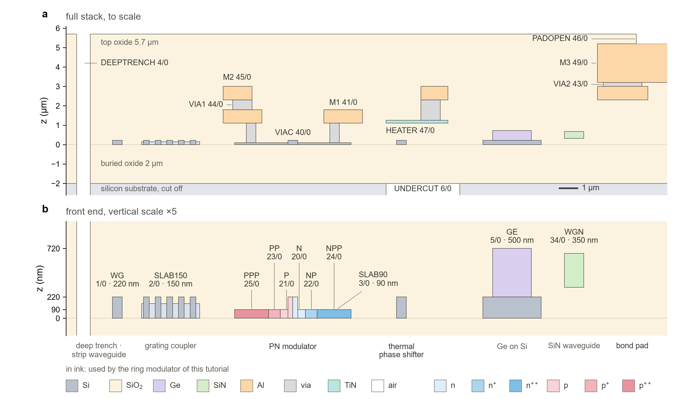

Previous: none. Course map: [README](../README.md). Next: [Chapter 2, the device](device.md).

# Chapter 1. The PDK: a process written as code

A **PDK** (process design kit) is what a foundry hands a designer so that a layout can be made for its
process. It is a set of files: the layer map, the design rules, the layer stack, and the cells and
models. Without it, a layout is only shapes on a screen. With it, a layout can be checked and
fabricated.

This chapter reads one PDK from top to bottom. It is a teaching PDK called `gsip_teaching`, kept in
the file `gsip_technology.py`. No foundry stands behind it. The numbers come from public sources
(see [the sources](#sources)), and the same process is described again for the simulator in
[chapter 3](../gsip_process_file_py/README.md). The aim is that you can read any foundry's PDK after
this chapter, and that you can change one number here and know what else must change.

## 1. What a foundry hands you

A commercial PDK has five kinds of content. Each one answers a different question.

| part of a PDK | question it answers | in `gsip_technology.py` |
|---|---|---|
| layer map | which GDS layer and datatype is which mask? | `LAYER`, `LAYER_INFO`, `LAYER_VIEWS` |
| design rules | how narrow, how close, how far inside may shapes be? | `MIN_WIDTH_SPACE`, `DESIGN_RULES` |
| layer stack | how tall is each layer, and of what material? | `STACK`, `LAYER_STACK` |
| cells and cross-sections | what standard building blocks can I place? | `CROSS_SECTIONS`, `CELLS` |
| models | what does the device do (compact model, simulation data)? | not here: the simulation is chapter 3 and 4 |

The last row is the one this file does not contain. A foundry PDK also has compact models
(SPICE or Verilog-A), and process data for the simulator. Here, the simulator reads the same numbers
from the process tables in `gsip_process_file_py/gsip_csv/`.

Two more things a foundry adds, which this file does not have: a full rule deck (hundreds of rules
instead of a handful) and a set of qualified cells that the foundry has measured.

## 2. The file at a glance

`gsip_technology.py` has eight numbered sections. Learn the numbers; the rest of the course refers to
them.

| section | content | lines |
|---|---|---|
| 1. Process constants | thicknesses, doping, heater film, material names | 47 to 101 |
| 2. Layers | the `LayerMapGSiP` class, descriptions and colours | 104 to 192 |
| 3. Design rules | `MIN_WIDTH_SPACE`, `DESIGN_RULES` | 194 to 238 |
| 4. The stack | the `STACK` table and the gdsfactory `LayerStack` | 241 to 282 |
| 5. Cross-sections | `strip`, `rib`, `rib_pn`, `nitride`, `heater_metal`, the three metals | 285 to 409 |
| 6. Cells | `straight`, two bends, `pad` | 412 to 442 |
| 7. From layout to simulation | `write_gds_for_lumerical` | 445 to 460 |
| 8. The PDK object and KLayout | connectivity, `PDK`, `write_klayout_tech` | 463 to 524 |

Importing the file runs `activate_pdk()` (line 527). Section 8 explains why that matters.

Run it from the repository root:

```
uv run python gsip_technology.py
```

It prints the layer list with GDS numbers, the stack with heights in µm, and the heater sheet
resistance. It also writes `klayout_tech/` (section 9 below). The output looks like this, with
the layers in the order of the file:

```
PDK gsip_teaching: 26 layers, 8 cross-sections, 4 cells
    1/0  WG         silicon core, 220 nm
    ...
stack (um):
  substrate     -12.00 .. -2.00  si    everywhere
  box            -2.00 ..  0.00  sio2  everywhere
  cladding        0.00 ..  5.70  sio2  everywhere
  ...
heater sheet resistance: 10.0 ohm/sq
KLayout technology -> <the klayout_tech folder>
```

The last line of the output names the folder that was written. Do not copy that line into a
document: it contains the path of your own machine.

## 3. Process constants: one number, one place

Every number of the process is written once, in section 1, with its source in a comment. Some
examples from the file:

```python
T_SI = 0.22  # [B][BJ][GF] silicon device layer
ETCH_RIB = 0.13  # [B] "Silicon etch 2": rib waveguide etch
T_SLAB90 = T_SI - ETCH_RIB  # 0.09: slab left by the rib etch [B][GF]
```

The slab is not written as 0.09. It is the silicon thickness minus the etch depth. If you change the
etch, the slab follows. This is the idea of **one number, one place**: a number that is derived is
written as a formula, so that it cannot disagree with the number it comes from.

The comments carry the source tags. A tag says where the number is from:

| tag | meaning |
|---|---|
| `[B]` | Chrostowski and Hochberg, *Silicon Photonics Design* (2015), the textbook |
| `[BJ]` | Baehr-Jones et al., arXiv:1203.0767, the published process the book refers to |
| `[GF]` | the open gdsfactory generic PDK (MIT licence), whose layer numbers this file uses |
| `[T]` | a teaching value chosen for this repository; the reason is written next to it |

A `[T]` value is not a claim about any real process. Examples are the heater film thickness (0.15 µm)
and the sidewall angle (`SIDEWALL_ANGLE`, vertical, 90 degrees). The sidewall angle is not published
for a generic process, so the process file uses the same 90 degrees in every row. The test
`test_sidewall_angle_is_the_technology_value` keeps the two equal. The reader should be able to tell
the two kinds apart at a glance, and the tags make that possible.

Here are the front-end numbers, with their meaning, so that you can find them later:

| name | value | meaning |
|---|---|---|
| `T_BOX` | 2.0 µm | buried oxide under the silicon |
| `T_SI` | 0.22 µm | silicon device layer (the core) |
| `ETCH_RIB` | 0.13 µm | depth of the rib etch |
| `T_SLAB90` | 0.09 µm | slab left by the rib etch (derived) |
| `T_SLAB150` | 0.15 µm | slab left by the shallow grating etch (derived) |
| `T_GE` | 0.50 µm | germanium on the silicon |
| `DOPING["N"]` ... `["PPP"]` | 5e17 ... 1.9e20 cm⁻³ | implant peak concentrations |

The doping values are in `DOPING`. The keys are the layer names, so the same name finds the layer and
the concentration: `DOPING["NP"]` is the concentration of the layer `LAYER.NP`.

## 4. The layer map: names and numbers

A layout file (GDS) does not know what a shape means. It only knows a **layer number** and a
**datatype** for each shape. The layer map gives those numbers a name. In this PDK the layer `M1` is
GDS layer 41, datatype 0. The GDS file stores `41/0`; the code uses `M1`.

Both names and numbers matter. The number is what the mask and the simulator read. The name is what
you type, and what a reader of your code understands. Keep both in one table, so that they cannot
drift apart. Here, `LayerMapGSiP` is that table (section 2 of the file):

```python
class LayerMapGSiP(LayerMap):
    WG: Layer = (1, 0)  # [B] "Si": full-thickness silicon, waveguide cores
    M1: Layer = (41, 0)  # [B] "M1"
    HEATER: Layer = (47, 0)  # [GF] heater film (TiN)
```

The textbook uses its own names (in the comments: "Si", "SiEtch2", "VC", "ML"). The file keeps the
generic gdsfactory names (`WG`, `SLAB90`, `VIAC`, `M2`) and writes the book's name in the comment. The
test `test_layer_numbers_follow_the_book` checks every pair of book name and number.

All 26 layers, by group:

| group | layer (GDS number/datatype) | what it is |
|---|---|---|
| silicon and nitride | `WG` 1/0 | silicon core, 220 nm |
| | `SLAB150` 2/0 | silicon slab, 150 nm (grating couplers) |
| | `SLAB90` 3/0 | silicon slab, 90 nm (rib waveguides, contacts) |
| | `DEEPTRENCH` 4/0 | deep trench through the oxide |
| | `GE` 5/0 | germanium, 500 nm |
| | `UNDERCUT` 6/0 | opening that removes the substrate below |
| | `WGN` 34/0 | silicon nitride, 350 nm |
| implants | `N` 20/0, `P` 21/0 | n and p implants, 5e17 and 7e17 cm⁻³ |
| | `NP` 22/0, `PP` 23/0 | n+ and p+ implants, 3e18 and 2e18 cm⁻³ |
| | `NPP` 24/0, `PPP` 25/0 | n++ and p++ implants, 5e20 and 1.9e20 cm⁻³ |
| | `GEN` 26/0, `GEP` 27/0 | n and p implants in the germanium |
| contacts, heater, metals | `VIAC` 40/0 | contact via, from the slab to metal 1 |
| | `M1` 41/0 | metal 1, aluminium 0.7 µm |
| | `HEATER` 47/0 | heater film, TiN 0.15 µm |
| | `VIA1` 44/0 | via 1, from metal 1 or the heater to metal 2 |
| | `M2` 45/0 | metal 2, aluminium 0.7 µm |
| | `VIA2` 43/0 | via 2, from metal 2 to metal 3 |
| | `M3` 49/0 | metal 3, aluminium 2 µm (pads) |
| | `PADOPEN` 46/0 | opening in the passivation over a pad |
| not fabricated | `FLOORPLAN` 64/0, `TEXT` 66/0, `DEVREC` 68/0 | outline, text, device recognition |

Of the 26 layers, 23 are fabricated. The last three are drawing aids and are never printed on the wafer.

### How code refers to a layer

Use the name. Write `t.M1`, not `(41, 0)`. Both forms describe the same layer, but the name survives a
renumbering and the number does not tell a reader anything. The short handles in section 2 exist for
this reason:

```python
import gsip_technology as t

t.M1          # the layer; print(t.M1) shows M1, and tuple(t.M1) is (41, 0)
t.LAYER.M1    # the same layer, through the class
tuple(t.M1)   # (41, 0), when you need the plain numbers
```

The colours and descriptions in `LAYER_INFO` are the same table again, so that the figures and the
KLayout view show the same colour for the same name. Every layer must be in `LAYER_INFO`. The test
`test_every_layer_is_described_and_has_a_view` checks it.

## 5. The stack: heights and materials

A layer on a mask is a flat shape. The device is three-dimensional, and the simulator needs the
height and the material of every layer. The **layer stack** gives them. Here is the stack in the
order the file defines it, with z in µm. z = 0 is the top of the buried oxide, so the silicon
device layer sits at 0 to 0.22 µm.

| level (`STACK` name) | layer | z from (µm) | z to (µm) | material |
|---|---|---:|---:|---|
| substrate | none | −12.00 | −2.00 | silicon (10 µm kept) |
| box (buried oxide) | none | −2.00 | 0.00 | SiO₂ |
| cladding (top oxide) | none | 0.00 | 5.70 | SiO₂ |
| slab150 | `SLAB150` | 0.00 | 0.15 | silicon |
| slab90 | `SLAB90` | 0.00 | 0.09 | silicon |
| core | `WG` | 0.00 | 0.22 | silicon |
| germanium | `GE` | 0.22 | 0.72 | germanium |
| nitride | `WGN` | 0.32 | 0.67 | Si₃N₄ |
| via_contact | `VIAC` | 0.09 | 1.10 | aluminium |
| metal1 | `M1` | 1.10 | 1.80 | aluminium |
| heater | `HEATER` | 1.10 | 1.25 | TiN |
| via1 | `VIA1` | 1.80 | 2.30 | aluminium |
| metal2 | `M2` | 2.30 | 3.00 | aluminium |
| via2 | `VIA2` | 3.00 | 3.20 | aluminium |
| metal3 | `M3` | 3.20 | 5.20 | aluminium |

The passivation, a 0.5 µm oxide above metal 3 (5.20 to 5.70 µm), is not a level of its own. It is the
cladding, with the pad openings cut into it.

The stack is drawn in the figure below. Read it in two passes. Row a is the whole stack, to scale in
both directions, so that the back end looks thin. Row b is the front end, with the vertical scale
stretched five times, so that the 90 nm slab and the 220 nm core can be seen.

<p align="center"></p>

**Figure 1.** The whole process in one cross-section. (a) The full stack to scale, with the back end of
seven building blocks: deep trench and strip waveguide, grating coupler, PN modulator with its contacts
and metals, thermal phase shifter with its heater, germanium on silicon, silicon nitride, and bond
pad. (b) The front end of the same blocks, z stretched five times. Layer names and GDS numbers are the
ones in the layer map. Drawn by `assets/scripts/pdk_stack.py` from the constants of this file and of
`rm_builder.py`; no simulation data is used. Only the blocks in ink are used by the ring modulator of
chapter 2.

### How the figure reads the PDK

`assets/scripts/pdk_stack.py` does not read the `STACK` table. It reads constants such as `T_SI`,
`T_SLAB90`, `Z_M1`, `T_M1`, `Z_HEATER`, and more, the names of the layers for the labels, the rules for the
via and pad enclosures, and the sizes of the device from `rm_builder.py`. The positions of the
blocks along the horizontal axis are placed by hand, so
that they do not overlap. Because of this, a changed constant changes the figure, but a changed
`STACK` row does not. No test compares the figure with the stack, so a mismatch between the two is
not caught automatically.

### A point to check: the heater via

Look at the heater in Figure 1, row a. Via 1 starts on the heater film, at the film top (1.25 µm),
and not at the metal 1 top (1.80 µm). The table above lists one `via1` row, from 1.80 µm. A stack has
one height for each GDS layer, and via 1 is one GDS layer (44/0), but it has two bottoms: metal 1 and
the heater. The comment on the `via1` row of `STACK` in `gsip_technology.py` (lines 257 and 258) says
so and points to the second case.

The process table in `gsip_process_file_py/gsip_csv/process_layers.csv` has both cases as separate
rows: `Via1_on_metal1` from 1.80 µm and `Via1_on_heater` from 1.25 µm. The test
`test_layers_the_stack_table_cannot_express` in `tests/test_process_tables.py` checks the second row
against the heater top. So the CSV, the figure and the test agree, and the `STACK` table holds the
metal 1 case. When you change the heater or the metal 1 height, change both rows of the CSV.

## 6. Cross-sections: the shape of a waveguide

A **cross-section** is the profile of a waveguide, taken across its path: which layers are present,
how wide, and at what offset. Given a cross-section, gdsfactory draws the straight or the bend for
you. The file defines eight cross-sections. Three are waveguides:

| name | core width | slab | implants | minimum bend radius (default) |
|---|---|---|---|---|
| `strip` | 0.5 µm | none, fully etched | none | 5 µm |
| `rib` | 0.5 µm | 0.09 µm slab, 6 µm wide | none | 10 µm |
| `rib_pn` | 0.5 µm | 0.09 µm slab, 6 µm wide | six nested implants | 10 µm |

The other five are `nitride` (silicon nitride strip), `heater_metal` (TiN filament), `metal1`,
`metal2` and `metal3` (metal wires, with two electrical ports each).

Start with `rib`, because `rib_pn` is `rib` with more layers in it:

```python
@xsection
def rib(width: float = 0.5, width_slab: float = RIB_SLAB_WIDTH, radius: float = 10.0) -> CrossSection:
    """Rib waveguide: 220 nm core on a 90 nm slab."""
    return _waveguide(width, width_slab, radius)
```

`_waveguide` adds the slab section, and the core is the main section of the cross-section. The
decorator `@xsection` registers the function, so that its arguments can be given by name.

### The PN phase shifter: nested implants

A PN phase shifter changes the refractive index by moving carriers in and out of a junction. The
junction is a line between an n-doped side and a p-doped side. The contacts need heavy doping, so
each side has a light implant next to the junction and a heavy one at the outer edge. The implants are
nested: the heavy one covers the outer part of the lighter one. Here is the cross-section as the
docstring of `rib_pn` draws it (distances in µm from the core centre):

```
     N++   |  N+  |   N    |core|    P   |  P+  |  P++
    -------+------+--------+####+--------+------+-------
          -1.25  -0.65              0.65   1.25
```

Read it from left to right. The n side is on the left of the path; the p side is on the right. Each
implant is a band from its inner edge to the slab edge. `N` covers the whole n side from the junction
out to the slab edge. `N+` covers from 0.65 µm out. `N++` covers from 1.25 µm out. The same holds for
the p side. The layers are not drawn one above the other: they are the same slab, with a higher
concentration further out.

The parameters that set this are:

| parameter | default | meaning |
|---|---|---|
| `width` | 0.5 | core width |
| `width_slab` | 6.0 | slab width; the implants end at its edge |
| `junction_offset` | 0.0 | position of the junction from the core centre, positive towards p |
| `gap_medium_doping` | 0.65 | core centre to the N+ and P+ edge |
| `gap_high_doping` | 1.25 | core centre to the N++ and P++ edge |
| `p_inside` | False | swap the sides; on a counter-clockwise ring this puts n inside |
| `radius` | 10.0 | minimum bend radius |

The function refuses the wrong order of the gaps:
`width / 2 < gap_medium_doping < gap_high_doping < width_slab / 2`. The value 0.65 µm is 0.4 µm of
lightly doped slab beside the 0.25 µm half-core, and 1.25 µm leaves 1.0 µm between the core edge
and the N++ edge, then 1.75 µm of slab beyond the heavy edge. Those are the teaching choices (`[T]` in the file).

Use it in your own code like any other cross-section:

```python
import gdsfactory as gf
import gsip_technology as t

wg = gf.components.straight(length=20, cross_section="rib")
ps = gf.components.straight(length=500, cross_section="rib_pn")  # 500 um phase shifter
print(ps.ports)  # o1 and o2 at the two ends
```

Run this from the repository root with the venv Python (`.venv\Scripts\python.exe` on Windows, or
`uv run python` when `uv` is in use). The result is a gdsfactory component. Its polygons are on the
layers of the table in section 4.

You can check the geometry without a viewer. The test
`test_pn_cross_section_is_nested_and_n_is_left_of_the_path` asserts that the n side is at positive y
(left of a path along +x), that `N` runs from 0 to 3 µm (the half slab), and that `NPP` starts at
1.25 µm.

## 7. The design rules

The design rules are the limits a layout must keep. A rule has a value, a reason and a check. The
file keeps them in two tables.

`MIN_WIDTH_SPACE` gives, for each of 19 layers, the minimum width and the minimum space between two
shapes of that layer, in µm:

| layer | min width (µm) | min space (µm) |
|---|---:|---:|
| `WG` | 0.20 | 0.20 |
| `SLAB150`, `SLAB90` | 0.30 | 0.30 |
| `GE` | 1.00 | 1.00 |
| `WGN` | 0.40 | 0.40 |
| `N`, `P`, `NP`, `PP`, `NPP`, `PPP` | 0.30 | 0.30 |
| `VIAC` | 0.40 | 0.40 |
| `M1` | 0.50 | 0.50 |
| `HEATER` | 0.80 | 0.80 |
| `VIA1` | 0.50 | 0.50 |
| `M2`, `VIA2` | 1.00 | 1.00 |
| `M3` | 3.00 | 3.00 |
| `PADOPEN` | 20.0 | 20.0 |

The source of the 0.20 µm silicon rule is the textbook (`[B]`, Listing 10.4). The others are `[T]`:
round numbers of the size a 248 nm process offers, chosen so that the examples make sense.

`DESIGN_RULES` gives the enclosures and spacings between layers, in µm:

| key | value | meaning |
|---|---:|---|
| `viac_enclosure_by_contact_implant` | 0.20 | N++ or P++ must extend this far beyond every contact via |
| `viac_enclosure_by_m1` | 0.10 | metal 1 must extend this far beyond every contact via |
| `via1_enclosure_by_lower` | 0.20 | metal 1 or the heater must extend this far beyond every via 1 |
| `via1_enclosure_by_m2` | 0.20 | metal 2 beyond via 1 |
| `via2_enclosure_by_m2` | 0.30 | metal 2 beyond via 2 |
| `via2_enclosure_by_m3` | 0.30 | metal 3 beyond via 2 |
| `padopen_enclosure_by_m3` | 2.00 | metal 3 beyond the pad opening |
| `m1_to_heater` | 0.60 | metal 1 and the heater film keep this distance (same plane) |
| `contact_implant_to_core` | 0.40 | N++ or P++ edge to the edge of a core |
| `heater_to_waveguide` | 0.50 | lowest point of the heater to the top of the bus core (checked by `ring_modulator`) |
| `rib_bend_radius` | 10.0 | minimum bend radius of a rib; `ring_modulator` refuses a tighter ring |
| `strip_bend_radius` | 5.0 | minimum bend radius of a strip |
| `grid` | 0.001 | the 1 nm grid |

Each entry of `DESIGN_RULES` names where it is enforced: by `gsip_drc.py`, by the builder
(`rm_builder.py`), or by construction. The comment next to each value in the file says which.
The heater clearance of 0.5 µm is a `[T]` value. The simulations do not use it. The 10 µm rib bend radius is a choice with margin too: step 2 shows
that the bend loss falls below the solver floor from 6 µm up.

Not every entry is checked by a tool. `gsip_drc.py` checks nine of the thirteen values. The builder
checks two more: the rib bend radius (a ring below 10 µm is refused) and the heater clearance (a
heater that comes closer than 0.5 µm to the bus core is refused, with the measured clearance in the
error message). `strip_bend_radius` and `grid` are not checked by any tool. A rule that is not
checked is still a rule for the designer, but nothing will tell you when it is broken. Keep that
difference in mind when you read a foundry's rule deck.

### Which rules the DRC enforces

`gsip_drc.py` is a design-rule check in pure Python (it uses the `klayout.db` package, with no GUI). It
enforces these rule families:

| check | rules used | severity |
|---|---|---|
| minimum width and space of each layer | all 19 entries of `MIN_WIDTH_SPACE` | error |
| enclosure of a contact via in N++ / P++ and in metal 1 | `viac_enclosure_by_contact_implant`, `viac_enclosure_by_m1` | error |
| enclosure of via 1 in metal 1 or the heater, and in metal 2 | `via1_enclosure_by_lower`, `via1_enclosure_by_m2` | error |
| enclosure of via 2 in metal 2 and metal 3 | `via2_enclosure_by_m2`, `via2_enclosure_by_m3` | error |
| enclosure of the pad opening in metal 3 | `padopen_enclosure_by_m3` | error |
| metal 1 and the heater film do not touch and keep 0.6 µm | `m1_to_heater` | error |
| N++ does not overlap P++ | none | error |
| N and P meet along the junction; an overlap wider than 2 nm is an error | none (1 nm tolerance on each side) | error |
| implant drawn with no silicon below it | none (5 nm tolerance) | warning |
| N++ or P++ closer than 0.4 µm to a core | `contact_implant_to_core` | warning |

A warning does not fail the check. `run_drc` returns a result whose `passed` is true when there are no
errors. Run the check on a component directly:

```python
from gsip_drc import run_drc
import gdsfactory as gf

ps = gf.components.straight(length=500, cross_section="rib_pn")
result = run_drc(ps)
print(result.summary())  # DRC passed: 0 errors, 0 warnings
```

Or on a file, from the command line:

```
python gsip_drc.py chip.gds          # writes chip_drc.lyrdb for KLayout's marker browser
python gsip_drc.py --demo            # self-test on a layout with planted violations
```

The demo also writes a KLayout marker file, `gsip_drc_demo.lyrdb`, into the repository root. Its console
output lists seven error rules and one warning, and the self-test expects at least seven errors.

## 8. Cells, connectivity and the PDK object

A **cell** is a reusable piece of layout with named ports. The file has four, `straight`,
`bend_euler`, `bend_circular` and `pad`, and the first three are thin wrappers around gdsfactory:

```python
@gf.cell
def straight(length: float = 10.0, cross_section: str = "strip") -> gf.Component:
    return gf.components.straight(length=length, cross_section=cross_section)
```

The `pad` cell is the only one written from scratch. It draws metal 3, opens the passivation over it
with a margin of 2 µm, and puts one electrical port at the centre:

```python
pad = t.pad(size=80)
```

A **port** is a named point where a cell connects to the next one. Its layer and its type tell the
router what it may connect to. An electrical port on metal 3 says that the pad connects to a bond wire.

**Connectivity** is the other half of a PDK. It says which layers touch electrically. The list
`LAYER_CONNECTIVITY` has five pairs, each a rule of the form "these two layers connect through this
via":

```python
LAYER_CONNECTIVITY = [
    ("NPP", "VIAC", "M1"),
    ("PPP", "VIAC", "M1"),
    ("M1", "VIA1", "M2"),
    ("HEATER", "VIA1", "M2"),
    ("M2", "VIA2", "M3"),
]
```

With this list, a netlist tracer can follow a wire from a pad through metal 3, via 2, metal 2 and
via 1 to the heater. The list does not join the heater to metal 1: the two become one net only where
a metal 2 shape touches both vias.

**The PDK object** gathers all of the above in one place:

```python
PDK = gf.Pdk(
    name="gsip_teaching",
    version="0.3 (GSiP layer map; teaching back end)",
    layers=LAYER,
    layer_stack=LAYER_STACK,
    layer_views=LAYER_VIEWS,
    cross_sections=CROSS_SECTIONS,
    cells=CELLS,
    connectivity=LAYER_CONNECTIVITY,
)
```

gdsfactory looks up a name such as `"rib_pn"` in the active PDK. The line `activate_pdk()` at the end
of section 8 makes this PDK the active one. Because it runs at import time, **importing the module is
what activates the PDK**. A script that imports `gsip_technology` and then calls
`gf.components.straight(cross_section="rib_pn")` works. A script that omits the import has no active
`gsip_teaching` PDK, so gdsfactory stops with `ValueError: No active PDK`. This is the reason the
examples in this chapter
import the module first.

## 9. Viewing layouts in KLayout

KLayout is an open-source layout viewer. To see the layers in their colours, it needs a **layer
properties** file (`layers.lyp`) and, optionally, a **technology** file (`tech.lyt`). The function
`write_klayout_tech` writes both:

```python
import gsip_technology as t

t.write_klayout_tech("klayout_tech")  # writes klayout_tech/layers.lyp and tech.lyt
```

Then, in KLayout:

1. File, then Load Layer Properties, and choose `klayout_tech/layers.lyp`. The layers get their names
   and colours.
2. Or Tools, then Manage Technologies, then Import Technology, and choose `klayout_tech/tech.lyt`.
   The technology then opens with its layers and the default settings of the PDK.

If the technology file cannot be written, the function prints a message and writes `layers.lyp`
alone. The colours are kept in either case, because they are the part people look for first.

## 10. Writing a GDS for the simulator

The Lumerical Layer Builder reads a GDS file to build the 3D structure. It loads one cell of one file.
If the file has several cells, or gdsfactory's metadata cell, the user must first choose which cell to
load. A flat, single-cell file leaves nothing to choose. So the function `write_gds_for_lumerical`
writes a **flat**, **single-cell** file with no metadata:

```python
import gdsfactory as gf
import gsip_technology as t

ps = gf.components.straight(length=500, cross_section="rib_pn")
t.write_gds_for_lumerical(ps, "build/phase_shifter_500um.gds", cellname="phase_shifter")
```

Flat means that every sub-cell is merged into the top cell. The file then has no hierarchy to choose
from. The layers are written unchanged, with the same numbers as in the layer map, so the Layer Builder
sees the same masks that the process file describes.

The test `test_write_gds_for_lumerical` checks that the file has one top cell with the requested name,
that it has one cell in total, and that the layers of the `rib_pn` cross-section (1, 3, 20 to 25) are
present.

## 11. Where the numbers come from, and what a real PDK adds

Every number in this file has one of the sources of section 3. Two of them stand out:

- The GDS numbers and names follow the open gdsfactory generic PDK, which itself follows the textbook.
  The test `test_layer_names_and_numbers_equal_the_gdsfactory_generic_pdk` compares every shared layer
  with the installed gdsfactory. The teaching PDK therefore shares its layer map with a public PDK that
  many people use.
- The process thicknesses and doping come from the textbook (`[B]`) and from the published process
  (`[BJ]`). The heater film, the oxide above metal 3 and the design rules that are not in the book are
  teaching values (`[T]`). The metal and via thicknesses come from the gdsfactory generic stack (`[GF]`).

A real foundry PDK adds at least four things this file does not have:

1. A rule deck with hundreds of rules, each with a measured or qualified value. This file has 19 width and space pairs and
   13 values in `DESIGN_RULES`; `gsip_drc.py` checks all 19 pairs and 9 of the 13 values.
2. Qualified cells with measured data, such as a grating coupler whose loss has been characterised on
   the wafer.
3. Compact models for each device, so that circuit simulators can use them.
4. Process variation: corners, and the spread of each number over a wafer.

None of these changes the flow. The layer map, the stack and the cross-sections go into the same
functions. Chapter 5 shows what to replace, one part at a time.

## 12. The tests that guard the PDK

The file is checked by `tests/test_technology.py`. The tests need no Lumerical. Run them from the
repository root:

```
uv run pytest tests/test_technology.py
```

The file has eleven test functions, which run as twelve cases (the cross-section test has two).
The full suite of the repository has 85 tests, and all of them pass.

| test | what it asserts |
|---|---|
| `test_layer_numbers_follow_the_book` | each of the 21 book names of Table 10.2 that the file uses has the GDS number that the layer map gives it |
| `test_layer_names_and_numbers_equal_the_gdsfactory_generic_pdk` | every layer that exists in gdsfactory's generic PDK has the same number there |
| `test_every_layer_is_described_and_has_a_view` | the layer map and `LAYER_INFO` list the same names; every layer has a KLayout view; every name in `MIN_WIDTH_SPACE` is a layer |
| `test_front_end_numbers_follow_the_book` | `T_SI`, `ETCH_RIB`, `T_BOX`, `T_GE`, the derived slab 0.09 µm, and the six doping values match the book |
| `test_stack_is_consistent` | the contact via starts at the slab top and ends at metal 1; the heater starts with metal 1; via 1 and via 2 fill the gaps between metals; the cladding ends at `Z_TOP`; the buried oxide is 2 µm; every layer has a positive height; the heater sheet resistance is 10 Ω/sq |
| `test_passive_cross_sections` (two cases) | `strip` has a 0.5 µm core and no slab; `rib` has a 0.5 µm core and a 6 µm slab |
| `test_pn_cross_section_is_nested_and_n_is_left_of_the_path` | each implant of `rib_pn` lies in the right band, and n is at positive y |
| `test_pn_cross_section_options` | `p_inside` mirrors the sides; `junction_offset` moves the junction; wrong gaps raise `ValueError` |
| `test_pad_has_an_opening_inside_the_metal` | the pad opening has the 2 µm margin in metal 3 |
| `test_write_gds_for_lumerical` | the file is flat, has one cell with the given name, and contains the implant layers |
| `test_klayout_technology_is_written` | `layers.lyp` contains every layer name of `LAYER_INFO`, and the symbols of `tech.lyt` are sorted, so that writing the technology again changes no tracked file |

Note the honest limit of the first table entry: a test that checks the numbers against the textbook
guards against typing errors, not against a mistake in the textbook.

The sister file `tests/test_process_tables.py` checks the process CSV against this file. Each row of
`process_layers.csv` must have the GDS layer numbers and the material of its level, and the sidewall
angle of `SIDEWALL_ANGLE`. A row of a `STACK` level also has the height of that level. That is the link to chapter 3.
It is why a change to the stack is not finished until those tests pass too.

## Sources

- L. Chrostowski and M. Hochberg, *Silicon Photonics Design: From Devices to Systems*, Cambridge
  University Press, 2015, [doi:10.1017/CBO9781316084168](https://doi.org/10.1017/CBO9781316084168)
- T. Baehr-Jones et al., "A 25 Gb/s Silicon Photonics Platform", [arXiv:1203.0767](https://arxiv.org/abs/1203.0767)
- gdsfactory, [repository](https://github.com/gdsfactory/gdsfactory) and
  [documentation](https://gdsfactory.github.io/gdsfactory/)
- [KLayout](https://www.klayout.de/), [uv](https://docs.astral.sh/uv/)

## Check yourself

1. Name the five parts of a PDK, and say which of them `gsip_technology.py` does not contain.
2. Why is `T_SLAB90` written as `T_SI - ETCH_RIB` and not as the number 0.09?
3. In `rib_pn`, which implant covers the region from 0.65 µm to 1.25 µm from the core centre on the n
   side, and what is its peak concentration?
4. Why does the layout go through `write_gds_for_lumerical` before the Layer Builder sees it?
5. Which entries of `DESIGN_RULES` are not checked by any tool (name them), and why does that
   matter for a designer?
6. What happens to the `rib_pn` cross-section if you write a script that does not import
   `gsip_technology`?

## Exercises

1. **Add a layer and see which test fails.** In `gsip_technology.py`, add a line
   `TESTLAYER: Layer = (70, 0)  # for the exercise` to the `LayerMapGSiP` class, and run
   `uv run pytest tests/test_technology.py`. Predict which test fails before you run it. Then add a
   matching entry to `LAYER_INFO` and run the tests again. Remove both lines when you have finished.
2. **Change `T_SLAB90` and find every place that follows.** Change `ETCH_RIB` from 0.13 to 0.12 µm in
   `gsip_technology.py`. Run `uv run pytest tests/test_technology.py` and read which assertions fail.
   Then search the repository for `T_SLAB90` and list the files that use it. Observe three things: the
   hand-written 0.09 µm in `test_technology.py`, the process CSV `process_layers.csv`, and the figures
   that read `t.T_SLAB90`. Explain why the `.npz` results of chapter 4 would now disagree with the
   process, and why the process file would need recompiling with Lumerical (`gsip_process_file_py/`).
   Undo the change afterwards.
3. **Draw a 500 µm phase shifter and open it in KLayout.** From the repository root, run:

   ```python
   import gdsfactory as gf
   import gsip_technology as t

   ps = gf.components.straight(length=500, cross_section="rib_pn")
   print(t.write_gds_for_lumerical(ps, "build/phase_shifter_500um.gds", cellname="phase_shifter"))
   t.write_klayout_tech("klayout_tech")
   ```

   Open `build/phase_shifter_500um.gds` in KLayout and load `klayout_tech/layers.lyp`. Zoom in on one
   end. Find the six implant layers in the layer list, and check that the N++ band starts at 1.25 µm
   from the centre line. Then run `python gsip_drc.py build/phase_shifter_500um.gds` and confirm that
   it reports no errors.

