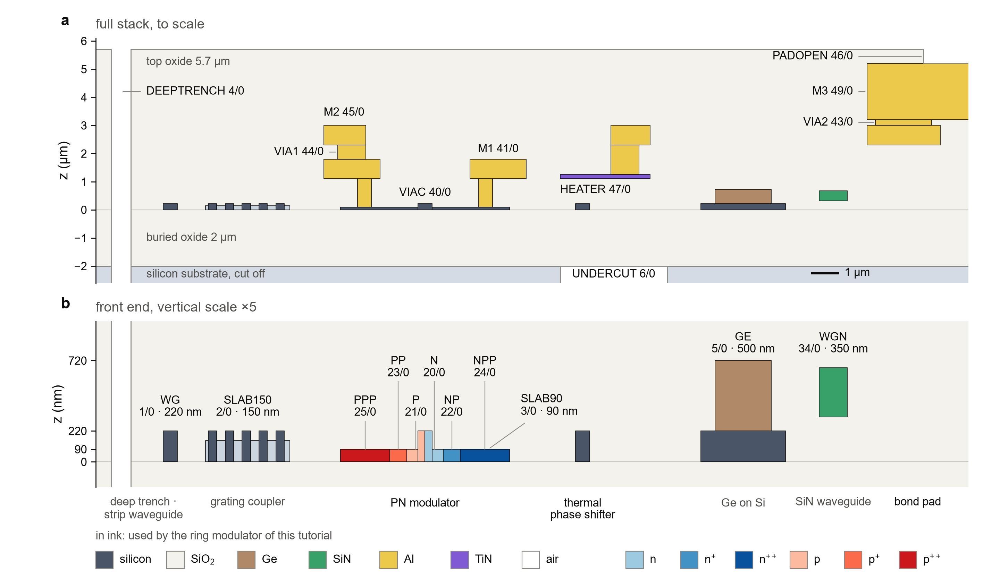

Previous: [4. The simulations](../lumerical_simulations/ring_modulator/README.md) · [Course map](../README.md) · Next: none, this is the last chapter

# 5. Your foundry: porting the flow to a real PDK

The first four chapters built one process twice: once as a gdsfactory technology for the layout,
once as a Lumerical process file for the simulator. Both descriptions were made from the same
numbers. This chapter is about the day you hold the design manual of a real foundry, under a
non-disclosure agreement (NDA), and have to make those two descriptions of its process.

When you finish, you should be able to:

- copy this repository's flow into a private repository for your foundry;
- find each number you need in the manual, and know which file and symbol it goes into;
- build the two descriptions in a sensible order, and check each stage against something
  independent;
- keep the NDA material out of every public place.

The examples use the teaching process of this repository: `gsip_technology.py` and its tables. For
a rehearsal on a real public process, see the last section of this chapter.

## 1. What stays and what changes

The flow, the scripts and the tests are the same for every process. The numbers, the names and the
rules are the part that belongs to the foundry.

| stays the same | changes with the foundry |
|---|---|
| the flow: technology file, device builder, process tables, compiler, Layer Builder, simulations | the layer numbers and names |
| the scripts `rm_builder.py`, `gsip_drc.py` and the step scripts | the stack heights and the materials |
| the tests, which check that the two descriptions agree | the cross-sections: widths, slabs, implant masks |
| the structure of the device: ring, junction, heater, pads | the design rules |
| the checks of chapter 4: the compiler QA, the doping check, the energy balance of the heat step | the doping, the implant profiles, the heater film |

The scripts stay because they read the process through two doors: the process file and the
technology file. They take no thickness, material or doping from their own text. A few places in
the scripts do name process layers. They are listed in section 4, step 6.

## 2. Why two descriptions of one process

The layout and the simulation need different things from the same process.

```
            the foundry's design manual (NDA)
                  |                    |
                  v                    v
    <foundry>_technology.py     <foundry>_csv/*.csv
    layers, rules, stack,        the same stack, doping and materials
    cross-sections, cells        as tables, with the column names of
                  |              the Layer Builder template
                  v                    v
    device layout (.gds)     compiler -> <process>.lbr
                  |                    |
                  +---------+----------+
                            v
          Layer Builder: FDTD, MODE, CHARGE, HEAT, INTERCONNECT
```

The layout needs layer numbers, rules and cross-sections, so that the masks are drawn right. The
simulator needs heights, materials and doping, so that the structure is right. A number that is in
both places must be the same in both. That is why the tests compare the two descriptions:
`tests/test_process_tables.py` fails when the stack in the tables and the stack in the technology
file disagree. Each description checks the other.

Figure 1 shows the whole process in one picture. The cross-section drawing in your foundry's manual
is the same kind of picture, and it is the first thing to compare your stack with.

<p align="center"></p>

**Figure 1.** The teaching process. (a) The full stack to scale, with the back end of seven building
blocks. (b) The front end with the vertical scale multiplied by five. The layers in ink are the ones
the ring modulator uses.

## 3. Mapping the manual to this repository

Read this table with your manual open. The left column is what you need. The middle column is where
it usually sits in a design manual. Section names vary between foundries, so search for the words in
the middle column. The right column is where the number goes in this repository.

| what you need | where it usually is in the manual | file and symbol here |
|---|---|---|
| GDS layer numbers and names | layer table, GDS layer map | `gsip_technology.py`: `LayerMapGSiP`, `LAYER_INFO`; `layer_number` in `process_layers.csv` |
| layer thicknesses and heights | process flow, cross-section drawing | `T_*` constants and `STACK` in `gsip_technology.py`; `start_position` and `thickness` in `process_layers.csv` |
| sidewall angle | etch section, process flow | `sidewall_angle` column of `process_layers.csv`. The constant `SIDEWALL_ANGLE` is read only by the test that compares the column with it |
| implant doses (peak concentrations) | implant table | `DOPING` in `gsip_technology.py`; `concentration` in `doping_process_layers.csv` |
| implant depth profile | implant section: range, straggle | `z surface position`, `range`, `straggle`, `skewness`, `kurtosis`, `function` in `doping_process_layers.csv` |
| implant mask edges from the core | implant mask drawing | `PN_GAP_MEDIUM`, `PN_GAP_HIGH`, `rib_pn` in `gsip_technology.py` |
| waveguide widths, etch depths, slab width | passive waveguide section | `strip`, `rib`, `rib_pn` in `gsip_technology.py`; `ETCH_RIB`, `T_SLAB90` |
| minimum widths and spaces | design rules, DRC deck | `MIN_WIDTH_SPACE` and `DESIGN_RULES`; checked by `gsip_drc.py` |
| bend radius limits | passive component specifications | `DESIGN_RULES["rib_bend_radius"]`, `DESIGN_RULES["strip_bend_radius"]` |
| optical index of each material | material and optical data | `MATERIALS` in `gsip_technology.py`; `dielectric_materials.csv`; `index_perturbation_data.csv` |
| heater film: thickness, resistivity | heater section, sheet resistance | `T_HEATER`, `TIN_RESISTIVITY`, `HEATER_SHEET_RESISTANCE`; the `Heater` row |
| heater thermal and electrical model | thermal properties | `material_property_overrides.csv` (rows `HT` and `CT`) |
| metal and via thicknesses and materials | back-end section | `Metal1` to `Metal3` and `Via*` rows of `process_layers.csv`; `metal1` to `metal3` cross-sections |
| pads and passivation openings | back end, passivation | `pad` cell; `PADOPEN`; the `Pad_opening` row |
| process variations and corners | statistics or corners section | `pattern_variations.csv`, `stack_variations.csv`, `STATISTICAL_PROCESS_FILE` |
| reference numbers for checking | characterisation data, building-block measurements | not code: compare with the `.txt` results of the step folders in `lumerical_simulations/ring_modulator/` |

The last row is the one most often forgotten. The manual's process numbers tell you what to build.
The manual's measured or simulated reference data tell you whether you built it right. Section 5
uses them.

## 4. The order of work

Build the layout description first, then the simulation description. Check each stage before the
next one starts, because every stage uses the stages above it. Work in a private copy of the
repository, and read section 8 before the first commit.

1. **Copy the technology file and the tables under a new name.** Copy `gsip_technology.py` to
   `<foundry>_technology.py`, and the folder `gsip_process_file_py/gsip_csv/` to `<foundry>_csv/`.
   Then change the import line in every file that imports the module. The list is short:
   `grep -rl "gsip_technology" --include=*.py .` shows it. Change the paths that the compiler and the
   tests read: `CSV_DIR` and `OUTPUT_LBR` in the compiler, and `CSV_DIR` in
   `tests/test_process_tables.py`. The process name is set once, by `PROCESS_NAME` in the compiler;
   `PREFIX` is built from it. Rename the process at the end, when everything runs.

2. **Layer map first.** Replace the numbers and names in `LayerMapGSiP`, and the descriptions and
   colours in `LAYER_INFO`. Change the `layer_number` expressions in `process_layers.csv`, and the
   `mask layer number` expressions in `doping_process_layers.csv`, to the same numbers. Run
   `uv run python <foundry>_technology.py`. It lists the layers and writes the KLayout technology.
   Then run `uv run pytest tests/test_process_tables.py::test_layer_expressions_use_fabricated_gds_layers_only`.
   It checks that every expression uses a fabricated layer and that every fabricated layer appears
   in the process. The layers that are not fabricated (the floor plan, text and device recognition
   in this repository) are kept apart from the rest.

3. **Stack.** Set the heights in the `T_*` constants and in `STACK`. Then make the rows of
   `process_layers.csv` agree with them. Both places are needed: the technology file uses the stack
   for the 3D preview, and the process file uses it for the simulation. The test
   `test_stack_heights_equal_the_technology_file` fails until the two agree. Check the result
   against the cross-section drawing in the manual.

4. **Cross-sections.** Write the waveguide cross-sections (strip, rib, the doped rib), the heater
   and the metal cross-sections from the manual's passive and back-end sections. Keep the
   cross-section names that your device builder uses, or change the builder with them. Then run
   `uv run python rm_builder.py`. A wrong name shows up here as an error from the cell.

5. **Design rules.** Fill `MIN_WIDTH_SPACE` and `DESIGN_RULES` from the DRC deck. Run
   `uv run python gsip_drc.py --demo`: the checker finds the violations that the demo plants. Then
   run the checker on your layout. Your foundry's own DRC is the authority. The checker here is a
   fast first pass.

6. **Process tables.** Fill `process_layers.csv`, `doping_process_layers.csv`, the materials and the
   heater film. Keep the source tags of chapter 1: every number gets a source, and every value you
   had to guess gets a flag. Some scripts name process layers, so they change when your names
   differ:
   - `heat_profile.py` names the solids `Si_Substrate` (the heat sink) and `Heater` (the heat
     source);
   - `charge_profile.py` names the contacts `Via_contact_P` and `Via_contact_N`.

   The probes of `layer_builder_check.py` are numbers of this stack as well. Its ten probe points
   sit at z = −5.00 µm (substrate), −1.00 µm (buried oxide), 0.11 µm (core), 0.05 µm (slab), 0.15 µm
   (oxide above the slab), 0.60 µm (contact via), 1.17 µm (heater), 1.45 µm (metal 1), 2.00 µm (oxide
   between the levels) and 2.65 µm (metal 2). Recompute the heights from your stack, and check that
   each probe lands in the layer that the manual puts it in.

7. **Compile.** Run `uv run python gsip_process_file_py/gsip_process_file_compiler.py`, or the copy
   of it that your foundry's folder holds. It needs a Lumerical licence with FDTD and CHARGE. The
   compiler writes the `.lbr` file, reloads it, and compares it with the tables: the process layers,
   the doping layers, the material models and the overridden properties. It does not read back the
   index-perturbation and dielectric materials; steps 0 and 5 exercise those. The exit code is 1 on
   any mismatch, and each printed line names the layer and the property.

8. **Structure check.** Run `layer_builder_check.py` (step 0). It loads the layout and the process
   file, and reads the refractive index at ten points of the finished structure. The silicon, the
   oxide, the aluminium and the TiN must be where the manual says they are. This is the first check
   that uses the whole structure.

9. **One known waveguide.** Run the passive mode step (step 2) on the straight waveguide of your
   foundry's standard width. Compare the effective index and the group index with the values the
   foundry states, if it states them, and with the bend loss in the manual. A wrong width, etch depth
   or silicon model shows up here first.

10. **The junction.** Run the doping check and the capacitance step (step 3), then the active mode
    step (step 5). Compare the doping with the implant table, and the capacitance and the V_π·L with
    a reference modulator from the foundry's building blocks, if the manual has one.

11. **The heater.** Run the heat step (step 4). Compare the kelvin per milliwatt, or the resonance
    shift per milliwatt, with a reference heater. Check the energy balance: the heat that reaches the
    heat sink must equal the power you set. Chapter 4 explains why that check matters.

12. **The device.** Run the circuit step (step 6). Compare the extinction, the quality factor and the
    free spectral range with the foundry's reference ring or measured data, if you have them.

Each step gives a yes or no before the next one starts. Do not move to the junction before the
waveguide is right: a wrong core height changes the optical mode, the doping and the heater.

## 5. The validation ladder

Each stage has a number to compare with that does not come from your own tables. The last column
says what a mismatch usually means, and which check in this repository already looks for it.

| stage | compare with | a mismatch usually means | check in this repository |
|---|---|---|---|
| A. layer map | the foundry's layer table | a number in the wrong place, for example the heater on the metal 1 layer | `test_layer_expressions_use_fabricated_gds_layers_only` |
| B. stack | the cross-section drawing or a TEM image in the manual | a thickness or height typed in one place only | `test_stack_heights_equal_the_technology_file` |
| C. structure | the material you expect at a point of the structure | a layer with the wrong material or height; stale probe heights | step 0, `layer_builder_check.py`: ten probe points |
| D. waveguide | the foundry's stated effective or group index, loss, bend loss | a wrong core width, etch depth or slab; wrong silicon data; a mesh without a line on every interface | step 2, `passive_mode_fde.py` with `common.add_rib_mesh` |
| E. rules and nets | the DRC deck, the foundry's own DRC on your layout, and the connections you intend | a unit slip (µm for nm), a rule taken from the wrong section, a via on one level only, a pad on the wrong net | `gsip_drc.py --demo`, `run_drc` on `rm_ring.gds`; the nets test `tests/test_connectivity.py` |
| F. doping | the implant table, and any reference profile | a net dose taken as a gross dose; nested masks that add up differently from the table | step 3, the doping check (within 0.5 % in this repository) |
| G. junction | a reference modulator: capacitance against bias, V_π·L | the junction at the wrong place, a wrong doping, a missing contact | step 3 (C against V), step 5 (V_π·L) |
| H. heater | a reference heater: kelvin or picometres per milliwatt | the film thickness or resistivity is wrong, the electrodes are missing from the model, or the heat source or sink is set up wrong | step 4, energy balance (`P_sink_mW`) |
| I. device | the reference ring: quality factor, extinction, free spectral range | the gap or radius on the mask, or a loss that is missing | step 6 |

Three cautions about the ladder. First, a number that is close is not proof, and a number that is
off by a little is not always an error. In this repository the abrupt-junction formula gives
0.356 fF/µm at 0 V, and the simulation gives 0.398 fF/µm, 12 % higher. The formula is
one-dimensional and leaves out the field around the 220 nm high junction. That is the likely
reason, and it has not been tested. A factor of two is an error. A few per cent is usually the
physics of the model. Second, a mismatch at stage D is often a wrong layer, and a mismatch at
stage H is often the electrodes. Read the stage above the one that failed before you change a number.

Third, make the mesh right before you compare an effective index. A mode solver meshes the window
into cells. If no mesh line lies on an interface, such as the top of a 90 nm slab or the side of a
core, the solver's index depends on where the window starts. In this repository the same undoped
rib, bent to a 10 µm radius, gave an effective index that differed by 0.007 between two windows.
That is more than a 10 mW heater produces. With a mesh line on every silicon surface
(`common.add_rib_mesh`), the two windows agree to 2 × 10⁻⁵. The absolute index is good to about
5 × 10⁻⁴. Differences, such as the shift with bias or heat, are much less sensitive. So before you
compare an effective index with the foundry's number, put a mesh line on every interface, and run a
second window to see whether the answer moves.

Stage F is worth a worked case. The public rehearsal in section 10 gives a net concentration of
1.1e18 cm⁻³ for the low-dose n region, after compensating a background p implant of 5.7e17 cm⁻³.
The donor density that goes into the process table is the sum of the two, 1.67e18 cm⁻³. A manual
that gives a net value and a table that wants a gross value is the most common doping mistake. Write
a test for every number that the manual gives as net, gross or averaged. The rehearsal's
`test_doping_reproduces_the_published_concentrations` is one such test.

## 6. What a real process has that the teaching one lacks

The teaching process of this repository is deliberately simple: vertical sidewalls, flat implants,
aluminium everywhere, no silicide, a planar top oxide. The [process file README](../gsip_process_file_py/README.md) lists some
of the same simplifications (vertical sidewalls, flat profiles, aluminium as the passage metal).
Each row says how the feature enters the tables.

| feature | what it changes | how it enters the tables |
|---|---|---|
| sidewall angle | the shape of every etched edge, and the height the drawn edge refers to | the `sidewall_angle` column of `process_layers.csv`, in degrees per layer. The compiler setting `SIDEWALL_POSITION_REF` says which height of a slanted wall the GDS edge refers to; it is `"middle"` here. The constant `SIDEWALL_ANGLE` in the technology file feeds one test, which requires every row to equal it: change the constant and the column together |
| implant profiles in depth | the junction depth, and the doping under the core | `range`, `straggle`, `skewness`, `kurtosis` and `function` in `doping_process_layers.csv`. The rehearsal fits a Gaussian to two published averages; see `test_doping_reproduces_the_published_concentrations` |
| silicide | a thin, low-resistance layer on the contacts | a new row of `process_layers.csv` with its GDS expression, thickness and material. A material that the Lumerical CHARGE or HEAT database lacks is set up as the TiN heater is: a model in `active_material_models.csv`, and its missing properties in `material_property_overrides.csv` |
| tungsten plugs, copper | the via resistance and the heat path through the back end | the via rows take the plug material; a metal row takes the metal. Tungsten conducts heat differently from aluminium, so check the heater (stage H) after you change a via |
| liners and several oxides | the optical cladding and the stress | one row per layer in `process_layers.csv`, each with its own height and material. The stack test checks every row |
| fill and exclusion layers | nothing in the simulation, but they must follow the foundry's rules | they stay in the layout and the DRC; they are not process rows. An exclusion layer that keeps metal away from a waveguide becomes a rule in `DESIGN_RULES`, checked by `gsip_drc.py` |
| process corners | the spread of every result | `pattern_variations.csv` and `stack_variations.csv`, switched on by `STATISTICAL_PROCESS_FILE = True`. The sigmas must come from wafer data. The compiler appends the variation block, but its QA does not read that block back, so check it in the Layer Builder |

Some layers in the manual are in the mask set but are not process layers. The teaching process
defines a text layer (66/0), a floor plan layer (64/0) and a device recognition layer (68/0). The
device draws none of them, and none of them is in the process. The rehearsal has a label-etch layer
(100/0) that the foundry merges into the silicon etch. Its technology file adds that layer to the
etched trench region, and the process table has no row for it. Read the process section of
the manual before you decide whether a mask layer is a process layer.

## 7. When the foundry ships its own Layer Builder process file

Some foundries give you a `.lbr` file with the process already built, or compact models for their
devices. Then use theirs. Do not replace it with the file your compiler makes.

- Load their file in the Layer Builder. The simulation scripts do not change, because they read the
  process only through `LBR` in `common.py`. The names they use for solids and contacts (section 4,
  step 6) must exist in that file.
- Keep your technology file consistent with their file: the same layer numbers, the same heights,
  the same materials. Their file is the reference, and your tables become a cross-check.
- Check your tables against their file. The compiler's QA function `qa_process_layers` reads a
  process file and compares every layer with a table. Point it at their file: set `OUTPUT_LBR` to
  their file, and set `PROCESS_NAME` to the process name inside their file. `PREFIX` follows from
  `PROCESS_NAME` when the module is imported, so do not set it by hand. Call `qa_process_layers` from
  a short script that opens FDTD. Do not run the compiler itself on their file, because it writes
  `OUTPUT_LBR`.
- If they ship compact models for the junction or the heater, use them instead of the models
  attached through `active_material_models.csv`, and write down that you did.

## 8. Keeping NDA data safe

The NDA covers more than the design manual. It covers every number, name and rule taken from it,
and every file that contains one. Treat these as NDA material:

- the manual and the foundry's PDK files;
- the layer names, layer numbers and rules of the foundry;
- the `.lbr` file, the `.gds` files, and the `.lyrdb` DRC reports made with the foundry's layers;
- your tables, your technology file, and the notes that quote the manual.

The rules below follow from that.

**Use a private repository.** Create a new repository, set to private, for your foundry's work. A
private repository on a hosting service is still visible to the service and to its collaborators.
Check that the NDA allows that service.

**Never fork a public repository for NDA work.** A fork of a public repository stays public, and it
keeps the public history. Start the private repository from a copy of the code: run `git init` in a
new folder, then copy the files you need. Before the first push, run `git remote -v` and check that
the remote is the private one.

**Keep the data outside the code.** The safest layout keeps the manual and the foundry's files in a
folder that is not under version control at all, and the scripts read them from there. If the data
must sit inside the repository, put it in one folder that is ignored as a whole.

**Write the `.gitignore` for the private repository, not copied from the public one.** The public
`.gitignore` keeps the `.npz` files of the tutorial device through a negation line. Remove that
negation in the private repository. A starting point:

```
# NDA material: never in git
foundry/
*.lbr
*.gds
*.lyrdb
*.fsp
*.ldev
*.npz
*.mat
```

A `.gitignore` stops new files from being added. It does not remove a file that is already tracked,
and it does not clean the history. Check after every change:

```
git check-ignore -v path/to/file    # which rule ignores the file, if any
git ls-files                        # every tracked file: look for data you did not mean to add
git status --ignored                # ignored files: are the right ones ignored?
```

If a data file was committed once, treat it as published. Removing it from the history does not undo
a clone that someone made in the meantime. Report the leak as the NDA requires, and follow the
foundry's instructions.

**Scan before every commit.** Keep a list of your foundry's own words (its layer names, its names
for its processes, its rule names) in a file outside the repository. Then check the staged changes
against it:

```
git diff --cached -U0 | grep -F -f ../foundry_terms.txt
```

No output means no match. A match means you stop, and you do not push.

**No foundry numbers in issues, screenshots, commit messages or AI chats.** Issues, commit messages
and screenshots are seen by everyone who can read the repository, and they stay in the history.
Write "the heater film is too thin", not the film's thickness. A screenshot of KLayout with the layer
table is foundry data. Before you paste a manual page or a number into an AI assistant, read the NDA:
many NDAs forbid sending the manual to a third-party service. The `CONTRIBUTING.md` of this
repository states the same rule for public work: never commit numbers received under an NDA, not
even "anonymised".

**Cite by identifier, not by number.** A comment such as "heater thickness: see the manual, process
section" tells a colleague where to look, and it leaks nothing. A comment that carries the number
turns the code into a copy of the manual.

## 9. The private twin and the public repository

This repository is public, and its teaching PDK is built from public sources. Your private
repository is a twin of it: the same structure, the same functions, the same tests, and different
numbers.

- The two repositories share their structure. The file names, the folders, the tests and the scripts
  match, so that a reader of this repository can find everything in the twin.
- The numbers, the names and the rules differ. Everything the foundry gave you lives only in the
  private repository.
- Information flows one way. Improvements to the code can go from the public repository to the
  private one. Data never goes back. A change from the private repository to the public one must
  contain no NDA material, and you should review it as a public contribution, because it becomes one.
- The tests are the bridge. The same test suite runs in both repositories. When the private twin
  passes the tests, its two descriptions agree with each other. That does not show that they agree
  with the foundry. The validation ladder of section 5 does that.

## 10. Rehearsal on public data: CORNERSTONE SOI220A

Before you open the manual of a real foundry, run the whole port once on a process whose data are
public. The folder `more_processes/cornerstone_soi220a/` is a second, self-contained example of the
flow on the open CORNERSTONE SOI220A process. It has its own technology file, process tables,
compiler, tests and simulation steps. Nothing in it is NDA material, so you can practise there
without risk.

The header of `cornerstone_technology.py` tags every number with its source: `[YAML]` for the
official PDK repository, `[XS]` for its cross-section file, `[DG]` for the design guidelines of the public call, `[MZM]` and `[HTR]` for
measured building blocks, and `[assumed]` for values that are not published. Read the tags first.
An `[assumed]` tag says what to replace first.

Follow the order of section 4 on this folder:

1. Run the tests:

   ```
   cd more_processes/cornerstone_soi220a
   uv run pytest
   ```

   The result is 24 passed and 1 skipped. The skipped test compares the layer table with a checkout
   of the official repository. It runs only when the environment variable `CORNERSTONE_PDK` points to
   that checkout.

2. Find the public inconsistencies. The public sources disagree on three points, and the README of
   the process tables lists them:

   | quantity | design guidelines | process overview | used here | where in the code |
   |---|---|---|---|---|
   | buried oxide | 2 µm | 3.0 µm | 2 µm | `T_BOX` in `cornerstone_technology.py`; the `BOX` row of `process_layers.csv` |
   | top cladding | 1 µm ± 100 nm | 2.0 µm ± 0.2 µm | 1 µm | `T_TOX`; the `TOX` row |
   | electrode minimum gap | 2 µm | 4.0 µm, and the official DRC deck | 4 µm | `MIN_WIDTH_SPACE["ELECTRODE_LF"]` |

   This is the situation of a real port: two documents from the same foundry, and one of them is
   out of date or wrong. Write down which one you chose and why, and find the check that would show
   a wrong choice. For the buried oxide, the stack test is that check.

3. Make the disagreement visible. In `cornerstone_technology.py`, change `T_BOX` from 2.0 to 3.0, and
   run `uv run pytest` again. The stack test fails, because the process table still says 2 µm. Change
   the `BOX` and `Si_Substrate` rows to match, and the test passes again. This is the loop you will
   run with your foundry's numbers.

4. Look at what the rehearsal does that the teaching process does not. The low-dose n region is given
   as a net concentration, and the process table takes the gross donor density (stage F of section 5).
   The n-side junction does not sit at the drawn mask edge. The foundry implants through the sidewall
   at 45°, and the Layer Builder cannot derive that strip, so `write_gds_for_lumerical()` computes it
   and writes it to the simulation-only layer 208/0. That is a process step that the masks do not
   show. The way to add it is a derived layer in the technology file.

5. Check the passive waveguide against the step-2 summary. The file
   [rib_w450_passive.txt](../more_processes/cornerstone_soi220a/lumerical_simulations/ring_modulator/2_passive_mode_properties/rib_w450_passive.txt)
   gives, for the 0.45 µm rib on a 100 nm slab at 1.55 µm, n_eff = 2.55145, n_g = 3.9117 and a TE
   fraction of 0.986. The repository does not claim that the foundry states these values. In your own
   port, the comparison with the foundry's stated index is the step that counts.

The rehearsal shows the whole loop on public data. Your port will be harder, in the manual and under
the NDA, but the loop is the same.

The rehearsal is the second example as it was released in v0.2. Its scripts do not have the
corrections of the teaching process. Its passive index is computed on a uniform 20 nm mesh, so its
absolute effective index can be off by several 10⁻³ (the mesh caution of section 5). Its heat source
is a thermal power boundary condition, which is the pitfall of chapter 4. Until you have fixed both,
compare its differences, such as the shift with bias or heat, and not its absolute indices.

## Check yourself

1. Which part of the flow changes when you port it to a foundry, and which parts stay? Name two of
   each.
2. In what order do you build the layer map, the stack, the cross-sections, the rules and the process
   tables, and why does the order matter?
3. Which scripts name process layers, and what breaks if your foundry calls its heater film `HTR_FILM`
   and you change only the process table? Where else must the name change?
4. A foundry gives a net dose of 1.1e18 cm⁻³ after compensating a background implant of 5.7e17 cm⁻³.
   What donor density goes into the process table, and which check catches a mistake?
5. Why must a fork of a public repository not hold NDA data, and what does a `.gitignore` not do?
6. What is the difference between a mismatch at stage D and a mismatch at stage H of the validation
   ladder, and which stage do you read first?

## Exercises

1. **One number, two places.** In `gsip_technology.py`, change `SIDEWALL_ANGLE` from `90.0` to `85.0`
   and run `uv run pytest tests/test_process_tables.py::test_sidewall_angle_is_the_technology_value`.
   The test fails and names the first row that differs, because the table still says 90. Then change
   the `sidewall_angle` column of `gsip_process_file_py/gsip_csv/process_layers.csv` to 85 in every
   row, and the test passes. Read the compiler: it takes its sidewall angle from the column, not from
   the constant. Reset the constant to `90.0` and the column to 90.

2. **The heater tests.** In `gsip_technology.py`, change `T_HEATER` from `0.15` to `0.20`, and run
   `uv run pytest tests/test_process_tables.py`.
   Three tests fail: the stack test for the `Heater` row, `test_layers_the_stack_table_cannot_express`
   (via 1 on the heater starts at the top of the film), and `test_heater_film_properties`. Read the
   lines that compare the heater of the table with the constant. Reset the constant.

3. **Rehearse the stack on CORNERSTONE.** In
   `more_processes/cornerstone_soi220a/cornerstone_technology.py`, change `T_BOX` from `2.0` to `3.0`,
   and run `uv run pytest` in that folder. Find the failing test and the line that checks the buried
   oxide. Then change the `BOX` and `Si_Substrate` rows of
   `more_processes/cornerstone_soi220a/cornerstone_process_file_py/cornerstone_csv/process_layers.csv`
   to the 3 µm stack, and check that the test passes.

4. **Write your own stage F check.** Pick one implant of `gsip_process_file_py/gsip_csv/doping_process_layers.csv`,
   for example `N_plus`. Write a test in the style of `test_doping_tables_follow_the_technology_file`
   in `tests/test_process_tables.py` that checks its concentration against `DOPING`. Add a second
   check that its mask layer number is the layer of `LAYER`. Run it with `uv run pytest`, and observe
   that it passes.
