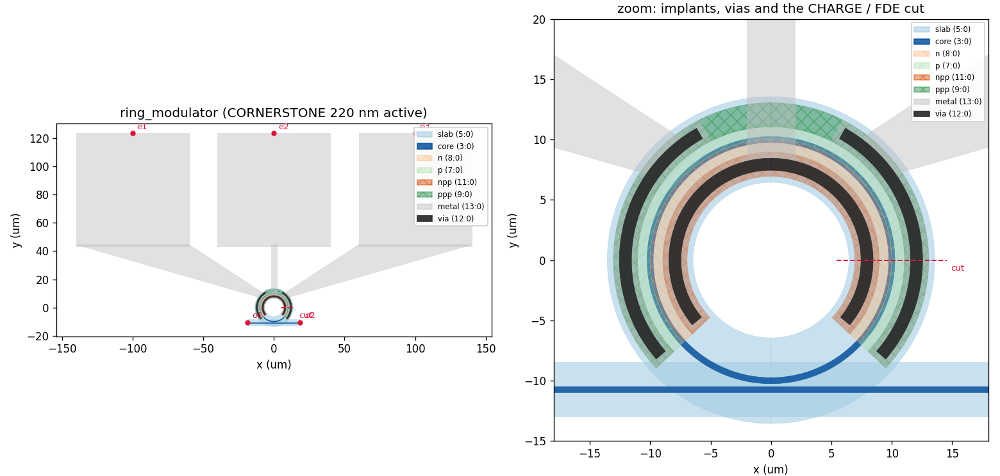
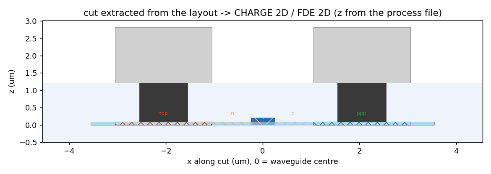

# Recipe 01: doped microring modulator (lateral PN junction)

An all-pass silicon ring with a lateral PN depletion junction along most of its circumference, contacted by P++ / N++ implants and vias, and wired to a GSG pad row. In-plane defaults follow the Ansys Lumerical [Ring Modulator](https://optics.ansys.com/hc/en-us/articles/360042322794-Ring-Modulator) example; the vertical stack and implant doses come from the CORNERSTONE 220 nm SOI active process file.

```bash
uv run python examples/01_devices/01_ring_modulator/01_layout.py              # GDS + preview
uv run python examples/01_devices/01_ring_modulator/02_export_to_lumerical.py # .lsf scripts
uv run python examples/01_devices/01_ring_modulator/03_run_lumerical.py       # CHARGE -> MODE (needs Lumerical)
```



## How the layout is built

The ring centre is at the origin and the bus runs along the bottom. Working outwards from the waveguide centre line at radius R: the rib `core` (width w), the low-dose `n` implant inside the junction radius and `p` outside it, then the `npp` / `ppp` contact implants at `contact_spacing` from the core edge, the vias inset by `via_enclosure`, and metal on top. A `slab` ring covers everything, so the doped regions keep 100 nm of silicon.

Two windows are deliberately left open. Around the coupling point (bottom) there is no doping and no metal, because free carriers and metal would add loss and perturb the coupler; its half-angle is computed from `coupler_clearance` so that nothing doped comes closer than 1.5 µm to the bus. At the top, the outer (ground) contact is interrupted where the signal bridge crosses from the inner contact to the S pad, otherwise S and G would be shorted. A unit test checks both.

Signal on the inner N side and grounds on the outer P side means that a positive signal voltage reverse-biases the junction (use `inner_dopant="p"` to swap).

## Parameters

| parameter | default | Ansys example | what it trades off |
|---|---|---|---|
| `radius` | 10 µm | 10 µm | FSR and footprint vs. bend loss |
| `width` | 0.5 µm | 0.5 µm rib | single-mode operation, overlap with the junction |
| `gap` | 0.2 µm | swept in FDTD | coupling: sweep it to reach critical coupling at your loss |
| `junction_offset` | 0 µm | centred | moving the junction outwards overlaps the mode better in a bend |
| `contact_spacing` | 0.8 µm | | series resistance (RC bandwidth) vs. optical loss from P++/N++ |
| `contact_width` | 2.0 µm | | contact resistance vs. footprint |

The slab thickness (100 nm), rib height (220 nm) and doses (P 5.7e17, N 1.1e18, P++/N++ 1e20 cm⁻³) are properties of the process, not of the device, and therefore live in the process YAML.

## What the export gives you

`02_export_to_lumerical.py` writes into `build/01_ring_modulator/lumerical/`: a 3D geometry and FDTD script, a Layer Builder script, a CHARGE 2D script and an FDE 2D script that share one radial cut through the contacted, doped arc, plus `ring_modulator_xsec.png` showing that cut. The CHARGE normalisation length is the doped arc length stored by the cell (about 46.5 µm for the defaults), and the FDE script uses the stored bend radius with the ring centre on the −x side of the cut.



## Exercises

1. Open the GDS in KLayout and find each layer of the process table. Which layers are only implants and never appear as 3D geometry in Lumerical?
2. Sweep `gap` from 0.15 to 0.35 µm, export each variant and run the 3D FDTD script on the coupler only. Where is critical coupling for the loss you get from FDE?
3. Move the junction with `junction_offset = +0.05` and `-0.05` µm. How do Δn_eff per volt and the loss at 0 V change, and why is the bent mode not centred?
4. Halve `contact_spacing`. Estimate the change in series resistance from CHARGE and in loss from FDE: what does this do to the electro-optic bandwidth?
5. Write a process YAML for another foundry and re-run the three scripts without touching the recipe.
