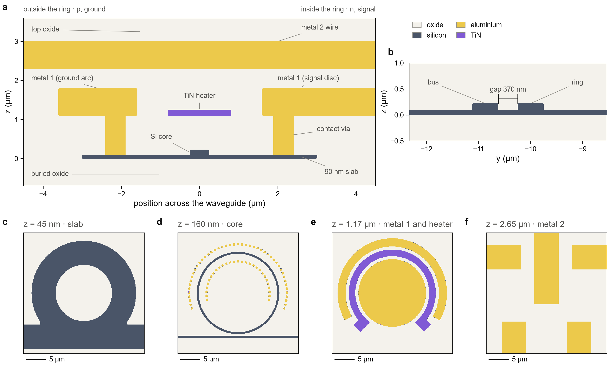

Previous: [Chapter 2, the device](../docs/device.md) · [Course map](../README.md) · Next: [Chapter 4, the simulations](../lumerical_simulations/ring_modulator/README.md)

# 3. The process file: the same process for the simulator

Chapter 1 wrote the process as code. Chapter 2 drew a ring modulator with it. This chapter
describes the same process a second time, for the simulator. The second description is a
Lumerical **process file** (`.lbr`). The program that makes it is
[`gsip_process_file_compiler.py`](gsip_process_file_compiler.py).

Two terms first:

- A **process file** is a text file that tells a simulator how a wafer is built: which layer
  sits at which height, how thick it is, what it is made of, and how it is doped. A foundry
  ships one with its PDK, so that simulations use the stack the fab really builds.
- The **Layer Builder** is a Lumerical simulation object. It takes a flat 2D layout (a GDS
  file) and a process file, and produces a 3D structure. The layout says where each shape is.
  The process file says how high it stands, out of what, and with which doping.

Neither file alone gives a device. The GDS file has no heights, and the process file has no
shapes. Together they give the structure that all seven simulation steps use.

After this chapter you can:

1. say what a process file contains, and why a foundry ships one;
2. read each table of the process and find the number it holds;
3. compile the process file, and trust it because a read-back check compares it with the tables;
4. load a GDS file and the process file into a Layer Builder, by script and in the GUI;
5. check with one MODE run that the 3D structure is the one you meant to build.

Everything below uses the GSiP teaching process of this repository. Its numbers are teaching
values, not a foundry's. Chapter 1 explains the sources, and
[`gsip_csv/README.md`](gsip_csv/README.md) gives the source of each number.

---

## 1. Two descriptions of one process

**The idea.** The layout half of the flow is Python. `gsip_technology.py` describes the stack,
and `rm_builder.py` draws shapes with it. The simulation half is Lumerical, which needs the same
stack in its own format. Two descriptions of one process can drift apart. A layout drawn on a
2.0 µm buried oxide, simulated with a 2.5 µm one, would give numbers for a device that does not
exist. So each number is written in one place, and a test or a check ties each copy to it.

The table lists a few quantities, where each one lives, and which check keeps the copies equal.

| quantity | in `gsip_technology.py` | in the process tables | which check keeps them equal |
|---|---|---|---|
| silicon core, 220 nm thick | `T_SI` (line 52) | `process_layers.csv`, `Si_core`: start 0, thickness 220 | `test_stack_heights_equal_the_technology_file` |
| heater film, 150 nm, at 1.10 µm | `Z_HEATER`, `T_HEATER` (lines 63 and 64) | `Heater`: start 1100, thickness 150 | the same test, and `test_heater_film_properties` |
| metal 1, 0.70 µm at 1.10 µm | `Z_M1`, `T_M1` (line 62) | `Metal1`: start 1100, thickness 700 | the same test |
| buried oxide, 2.0 µm | `T_BOX` (line 51) | `BOX`: start −2000, thickness 2000 | the same test |
| n implant, 5e17 cm⁻³ | `DOPING["N"]` (line 73) | `doping_process_layers.csv`, `N` | `test_doping_tables_follow_the_technology_file` |
| TiN resistivity, 1.5 µΩ·m | `TIN_RESISTIVITY` (line 85) | `material_property_overrides.csv`: conductivity 666667 S/m | `test_heater_film_properties` |
| material names | `MATERIALS` (line 89) | `active_material_models.csv` | `test_materials_exist_and_have_electrical_and_thermal_models` |

The tests are in [`tests/test_process_tables.py`](../tests/test_process_tables.py). They need
Python only, not Lumerical. Two more tests go beyond the table. One ties every row of
`process_layers.csv` to the PDK: its GDS layer number (plus the layer under a via), its material
and its sidewall angle must equal those of the technology file. The other ties the heights of the
rows that the stack table does not list, such as the undercut, which must end at the bottom
of the buried oxide. The compiler adds a second link: it reads the tables back from the
process file it wrote, and compares them with the tables (section 6). Step 0 of the simulations adds a third: it looks at
the 3D structure that the file produces (section 9).

```text
gsip_technology.py --(pytest, no licence)--> gsip_csv/*.csv --(compiler QA)--> gsip_process.lbr
                                                                                      |
rm_builder.py --> rm_ring.gds ----------------------(step 0, Layer Builder)-----------+
```

Why two descriptions of one process? The layout must be drawn with the numbers the simulator
uses. The Python file is the form the layout reads, and the tables are the form Lumerical reads.
Keeping both costs little, and a mismatch shows up at once in a test.

---

## 2. What a process file contains

**The idea.** A process file is a list of layers. Each layer has a height, a material and a GDS
expression. Doping and material models are added on top. The repository keeps each part in a
CSV table, so that the numbers can be read, compared and changed without touching code.

The tables live in [`gsip_csv/`](gsip_csv/). Their sources and the reason for each number are in
[`gsip_csv/README.md`](gsip_csv/README.md), which this chapter does not repeat.

| table | rows | what one row says |
|---|---|---|
| `process_layers.csv` | 20 | one layer: where it is in z, what it is made of, which GDS layer defines it |
| `doping_process_layers.csv` | 9 | one implant: which GDS layer masks it, dopant, concentration, depth profile |
| `active_material_models.csv` | 8 | for one optical material, the CHARGE (electrical) and HEAT (thermal) model |
| `material_property_overrides.csv` | 4 | one number changed in a model (the TiN film) |
| `index_perturbation_data.csv` | 1 | a silicon material whose index responds to carriers and temperature |
| `dielectric_materials.csv` | 1 | a constant-index material the database lacks (air) |
| `pattern_variations.csv` | 1 | a statistical variation of a layer pattern (optional) |
| `stack_variations.csv` | 2 | a statistical variation of a layer height (optional) |

**Reading `process_layers.csv`.** Each row has ten columns. Heights are in nm.

| column | meaning |
|---|---|
| `enabled` | 1 to use the layer, 0 to skip it |
| `name` | the layer name in the simulator |
| `layer_number` | the GDS layer, or an expression of GDS layers (section 3) |
| `start_position` | height of the bottom of the layer, in nm above z = 0 |
| `thickness` | height of the layer, in nm |
| `pattern_material` | the material of the shapes drawn on `layer_number` |
| `background_material` | the material everywhere else, for background layers |
| `process` | `Grow`: a solid made from the drawn shapes; `Background`: a layer that fills space |
| `sidewall_angle` | 90 is vertical |
| `pattern_growth_delta` | a growth offset of the sidewall in nm; 0 here |

A worked row, the heater:

```text
1,Heater,47:0,1100,150,TiN - Palik,None,Grow,90,0
```

It is enabled. Its shapes are GDS layer 47 (`HEATER`). The shapes become a solid of TiN from
1100 nm to 1250 nm above z = 0, with vertical walls. The `None` in the background column means
that no background material is set for this layer.

The background rows work differently. `Si_Substrate`, `BOX` and `TOX` have no GDS layer
(`None`), and `process` is `Background`. They fill the whole space below and above the stack:
silicon, then oxide, then oxide. Every `Grow` row is a solid placed on top of them.

---

## 3. One GDS layer, two solids

**The question.** Why is the heater not drawn on metal 1? Both sit at 1.10 µm, and both are
drawn as shapes. The answer shows how the process file works.

Metal 1 is aluminium, 0.70 µm thick, with a low resistance. The heater must be a resistive TiN
film, 0.15 µm thick, with about 10 Ω per square. The material belongs to the layer, and the
layer belongs to a GDS number. So the heater gets its own GDS number, 47, and its own row in the
table. A shape drawn on layer 41 becomes metal 1, whatever it is called in the layout.

The expression column can combine layers. Look at the contact vias:

```text
1,Via_contact_P,40:0 and 25:0,90,1010,Al (Aluminium) - Palik,None,Grow,90,0
1,Via_contact_N,40:0 and 24:0,90,1010,Al (Aluminium) - Palik,None,Grow,90,0
```

Layer 40 is the contact via, drawn as one set of squares. Layer 25 is the P++ implant, and layer
24 is the N++ implant. `and` means that the solid is the overlap of the two. The P-side row keeps
only the parts of the vias that sit on P++, and the N-side row keeps only the parts on N++. One
drawn via becomes two solids.

Why does that matter? CHARGE puts one electrical contact on each solid. A single solid would
give one contact for both the p side and the n side of the junction.

The same trick gives the via 1 that lands on the heater:

```text
1,Via1_on_metal1,44:0 and 41:0,1800,500,Al (Aluminium) - Palik,None,Grow,90,0
1,Via1_on_heater,44:0 and 47:0,1250,1050,Al (Aluminium) - Palik,None,Grow,90,0
```

Via 1 is drawn once, on layer 44. Where it overlaps metal 1 it starts at 1800 nm. Where it
overlaps the heater it starts at 1250 nm, the top of the thin film. Two solids, two heights.
`gsip_technology.py` states the same rule in `STACK` (lines 257 and 258): on the heater, via 1
"starts at the top of the heater film". The `STACK` table has one height per GDS layer, so the
second height is listed in the process table only, and a test checks it there.

The compiler passes the expression to Lumerical as text (its comment reads "a GDS layer or a
not()/and/or/xor expression", line 142). This repository uses only `and` and single layers.

---

## 4. Doping: flat profiles

**The idea.** A doped region is an implant: a dopant, a concentration, and a depth profile. The
implant is masked by a GDS layer, so the doping follows the layout, as the metal does.

Each row of `doping_process_layers.csv` gives a mask, a dopant and a concentration in cm⁻³. The
silicon implants have a straggle of 1 µm, which is much longer than the 220 nm of silicon. So
the concentration is flat over the silicon, from top to bottom. The profile is a rectangle in
depth. That is the abrupt-junction picture of the textbook. A real implant has a curved profile
with a peak, and a real process file has measured profiles.

| implant | mask | dopant | concentration (cm⁻³) |
|---|---|---|---|
| N | 20:0 | n | 5e17 |
| P | 21:0 | p | 7e17 |
| N+ | 22:0 | n | 3e18 |
| P+ | 23:0 | p | 2e18 |
| N++ | 24:0 | n | 5e20 |
| P++ | 25:0 | p | 1.9e20 |

The masks nest. In the cross-section `rib_pn` of `gsip_technology.py`, the N mask covers the whole
n side. N+ covers everything beyond 0.65 µm from the core centre, and N++ everything beyond
1.25 µm. The concentrations add. So the n side next to the core holds 5e17 + 3e18 = 3.5e18 cm⁻³,
and the contact region holds 5e17 + 3e18 + 5e20 = 5.035e20 cm⁻³. Step 3 of the simulations
compares the net doping that CHARGE sees with these values. It averages the solver's doping over
each region of its mesh, and all six regions agree with the table within 0.5 %
(see the [simulations chapter](../lumerical_simulations/ring_modulator/README.md)). The
comparison tests the concentration and the lateral position of each region. It does not test
the depth, because the profiles are flat in depth by construction.

The Ge rows and the wafer background are in the table too. The Ge implants are not used by the
ring modulator. The wafer is lightly p-type, at 1e15 cm⁻³.

---

## 5. Materials and models

**The idea.** A material in a process file has two faces. Light sees its refractive index (n and
k). The electrical and thermal solvers see a model of the same material: an electrical
conductivity, a thermal conductivity, a heat capacity. The process file names one optical
material for each layer, and attaches to it one electrical (CT) model and one thermal (HT) model
from the Lumerical database.

`active_material_models.csv` lists the attachment for each material. A few rows:

| optical material (light) | CHARGE model (electrical) | HEAT model (thermal) |
|---|---|---|
| `Si (Silicon) - Palik` | `Si (Silicon)` | `Si (Silicon)` |
| `SiO2 (Glass) - Palik` | `SiO2 (Glass) - Sze` | `SiO2 (Glass) - Sze` |
| `Al (Aluminium) - Palik` | `Al (Aluminium) - CRC` | `Al (Aluminium) - CRC` |
| `TiN - Palik` | `Al (Aluminium) - CRC` | `Al (Aluminium) - CRC` |

The `TiN - Palik` row needs attention. Lumerical's CHARGE and HEAT database has no titanium
nitride. The film still needs an electrical and a thermal model, so it borrows the aluminium
models. Four numbers of that borrowed model are then changed, as listed in
`material_property_overrides.csv`:

| property | value | where the number comes from |
|---|---|---|
| thermal conductivity | 28 W m⁻¹ K⁻¹ | bulk TiN is about 29; [`gsip_csv/README.md`](gsip_csv/README.md) |
| mass density | 5400 kg m⁻³ | bulk TiN |
| specific heat | 600 J kg⁻¹ K⁻¹ | bulk TiN |
| electrical conductivity | 666667 S m⁻¹ | 1 / 1.5 µΩ·m; 10 Ω per square at 150 nm |

The electrical value is not an independent guess. It is 1 / `TIN_RESISTIVITY` of
`gsip_technology.py`, and `test_heater_film_properties` checks the table against that number.

The compiler applies an override with `apply_property_overrides`. A property whose name ends in
`.constant` (for example `thermal conductivity.constant`) is first switched to the constant model,
so that the single number takes effect. The override is honest about what it is: the film has
bulk values, not the values of a sputtered film. Chapter 5 lists this among the assumptions of the
flow ([Chapter 5](../docs/your_foundry.md)).

**The optics of the film** come from `TiN - Palik`. At 1550 nm its index is 3.54 + 6.52i. The
imaginary part is what makes the heater absorb. Section 9 shows that value in the structure.

**Index perturbation.** The silicon `Si_np` is not plain silicon in the process file. It is an
index-perturbation material. Its index responds to free carriers (the Soref and Bennett
coefficients of Nedeljkovic, Soref and Mashanovich, 2011) and to temperature (dn/dT = 1.87e-4 K⁻¹
at 300 K, a teaching value [T]). Without carriers and at the reference temperature it is plain silicon. Step 2 uses it
without carriers. Step 5 loads the carriers of step 3 and the temperature of step 4, so that its
index responds to them.

---

## 6. The compiler, step by step

The compiler has four parts. Each part opens a Lumerical session, does one job, and saves the
file. The optical part and the electrical part use separate sessions, because they need different
licences. All sessions run hidden (`hide=True`), so no GUI opens.

**Step 1, FDTD session: the optical part.** The functions are called in this order:

1. `add_dielectric_materials` adds air, with a constant index of 1.0, from `dielectric_materials.csv`.
2. `add_index_perturbation_materials` adds `Si_np`, with its carrier and temperature settings.
   The compiler accepts only the built-in Soref and Bennett coefficients and the linear
   temperature model. Any other setting stops the run with an error.
3. `addlayerbuilder` creates a Layer Builder object. The process name is set to `gsip`, and the
   sidewall reference to `middle`. The sidewall reference says which height of a slanted wall the
   GDS edge refers to. With 90° walls it makes no difference.
4. `add_process_layers` adds each of the 20 rows. Before it adds a row, it checks that the
   materials of the row exist in the FDTD material database or among the custom materials, and
   stops if they do not. Heights are converted from nm to m. The start position `Auto` is kept as it is.
5. `save_process_file` writes `gsip_process.lbr` with the material data inside
   (`export materials` is true). Loading the file then does not depend on the local database.

**Step 2, CHARGE session: the electrical and thermal part.**

1. `loadprocessfile` loads the file from step 1.
2. `add_doping_layers` adds the 9 implants: mask, dopant, concentration, and the Gaussian depth
   profile (range, straggle and so on).
3. `add_ct_ht_models` attaches the electrical (CT) and thermal (HT) model to each of the 8 optical
   materials.
4. `apply_property_overrides` sets the four numbers of the TiN film.
5. `save_process_file` saves the file again, now with doping and models.

**Step 3, optional: process variations.** Off by default (`STATISTICAL_PROCESS_FILE = False`).
When it is on, `append_process_variation` writes the rows of `pattern_variations.csv` and
`stack_variations.csv` into the file as a `<process_variation>` block, in the format of the Ansys
template. A pattern row has one 0 or 1 per layer, and a 1 says that the layer moves. A stack row
has two blocks of 20 flags: one for the thickness, one for the start position. In the core width
row the 1 is at position 6 of the 20 layers, which is `Si_core`. None of the seven simulation steps
uses these variations. The σ values are teaching values (see
[`gsip_csv/README.md`](gsip_csv/README.md)).

**Step 4, QA: the read-back check.** This step is what makes the file trustworthy. The compiler
does not take its own word for what it wrote. It loads the saved file again, in new sessions, and
reads every property back from Lumerical:

- `qa_process_layers` compares, for each of the 20 layers, the enabled flag, process, layer number,
  thickness, both materials, sidewall angle and growth delta, and the start position unless it is
  `Auto`. Numbers must agree with the CSV to a relative tolerance of 1e-6.
- `qa_doping_and_materials` checks that each of the 9 implants reads back with the same
  properties, and that each material has the CT and HT models it should have.
- `qa_property_overrides` reads back the four overridden numbers, and the model switch of each
  of them. The switch must read "constant". Mass density has no switch, so it is not checked for one.

Every difference prints one line, and the total ends the run. The format strings of the code are:

```text
  mismatch  <layer> / <property>: CSV=<value>  LBR=<value>
  missing   process layer <name>
[QA]     <n> mismatches        (then the run exits with code 1)
```

The QA step is the one you rely on. The tests of section 1 show that the CSV matches the Python
technology. The QA step shows that the file Lumerical will load holds the CSV. Step 0 (section 9)
shows that the 3D structure is the one the layout describes.

The QA step does not cover everything. It does not read back `index_perturbation_data.csv` or
`dielectric_materials.csv`: the materials `Si_np` and `Air` are exercised by steps 0 and 5 (see the compiler docstring).
It also cannot tell whether a number in the tables is physically right. It shows that the file
says what the tables say, and nothing more.

---

## 7. Running the compiler

The compiler needs an installed Lumerical with FDTD and CHARGE licences. It finds Lumerical
through `LUMERICAL_ROOT`, or in the usual install locations (see
[`lumerical_env.py`](../lumerical_env.py)). It takes no arguments, and it always writes
`gsip_process.lbr` next to itself. Its tables are found relative to its own file, so it runs from
any folder. From the repository root:

```bash
uv run python gsip_process_file_py/gsip_process_file_compiler.py
```

The docstring of the script shows `python gsip_process_file_compiler.py`, run from the folder
that contains it. Both forms do the same work.

What it prints. These are the print statements of the code, in the order they run. This is the
output of a run with the current tables and no mismatch:

```text
[FDTD]   20 process layers, 2 custom materials -> gsip_process.lbr
[CHARGE] 9 doping layers, CT/HT models of 8 materials, 4 adjusted properties -> gsip_process.lbr
[QA]     reloading and comparing with the CSV tables ...
[QA]     everything matches
done: <full path of gsip_process.lbr>
```

The counts are 20 process layers and 2 custom materials in the first line, and 9 doping layers,
8 materials and 4 adjusted properties in the second. The line `[XML]    appended <process_variation>
(statistical_1)` appears only when the statistical variations are on. A mismatch prints the lines
of section 6 and a `[QA]` line with the number of mismatches, and the run exits with code 1.

A rerun overwrites `gsip_process.lbr`, which is kept in the repository. Rerun the compiler only
after you change a table. If the compiler writes a file that differs from the kept one, version
control will show the difference.

---

## 8. Loading the result

**By script.** `common.py` holds the function that every simulation step calls. It is shown here
as it is written:

```python
def add_layer_builder(app, gds: Path, x_span: float, y_span: float, name: str = "device") -> None:
    """Add a Layer Builder centred on the origin and load the layout and the process file (spans in um)."""
    app.addlayerbuilder()
    app.set("name", name)
    app.set("x", 0)
    app.set("y", 0)
    app.set("z", 0)
    app.set("x span", x_span * um)
    app.set("y span", y_span * um)
    app.set("gds position reference", "Centered at origin")  # GDS coordinates = simulation coordinates
    app.loadgdsfile(gds.as_posix())
    app.loadprocessfile(LBR.as_posix())
```

The spans are given in µm, and `um = 1e-6`. Three Lumerical commands do the work:
`addlayerbuilder` creates the object, `loadgdsfile` loads the layout, and `loadprocessfile` loads
the process. The reference "Centered at origin" puts the GDS coordinates on the simulation
coordinates, so a shape at x = 5 µm in the layout is at x = 5 µm in the solver.

To use it, run from the
[`scripts/`](../lumerical_simulations/ring_modulator/scripts/) folder, so that `common.py` can be
imported:

```python
from common import REPO, add_layer_builder, import_lumapi

lumapi = import_lumapi()
with lumapi.MODE(hide=True) as m:
    add_layer_builder(m, REPO / "rm_ring.gds", 36.0, 36.0)
```

`rm_ring.gds` must exist. `rm_builder.py` writes it at the repository root. The spans are in µm,
as the function expects.

**In the GUI.** Add a Layer Builder object from the object library, under the simulation objects.
In its properties, set the x, y and z centre to 0, and the x and y span to the size of the layout
(36 µm by 36 µm for the step 0 check). Set the GDS position reference to "Centered at origin".
Then load the GDS file `rm_ring.gds`, and load the process file `gsip_process.lbr`. The property
names are the ones of the script above. The button labels of your Lumerical version may differ
slightly from the names the script uses.

After loading, the names carry the process prefix. Silicon is `gsip Si_np`, which is the constant
`SI_MATERIAL` in `common.py`. Use the prefixed name in scripts, or the simulator will not find the
material.

---

## 9. Step 0: the structure check

**The idea.** Before any physics, look at what the Layer Builder built. A mode solver meshes a
plane, and for each mesh cell it knows the refractive index. The check uses that index as a
probe. It reads the material at a few points of the finished 3D device and compares each reading
with the material that should be there.

The script is
[`layer_builder_check.py`](../lumerical_simulations/ring_modulator/scripts/layer_builder_check.py).
It loads the whole ring modulator, takes two vertical cuts and four horizontal cuts, and saves
the results in [`0_layer_builder_check/`](../lumerical_simulations/ring_modulator/0_layer_builder_check/).
The vertical cut through the PN section runs from z = −5.5 µm to 3.6 µm, so that it reaches the
substrate and the buried oxide below the device. Its docstring states the purpose:

> A layer expression that is wrong in the process file shows up here at once, as a missing or
> misplaced shape. No solver licence is used beyond MODE.

Run it from the scripts folder, after `rm_builder.py` has written `rm_ring.gds`:

```bash
cd lumerical_simulations/ring_modulator/scripts
python layer_builder_check.py
```

It needs MODE only. It takes no options: `python layer_builder_check.py --help` prints the
docstring and exits. The script prints the ten lines of the probe table below, and saves them to
[`0_layer_builder_check/structure.txt`](../lumerical_simulations/ring_modulator/0_layer_builder_check/structure.txt).
The cut arrays go to `structure.npz`, which the figure reads.

The ten probe points lie on the cut through the PN section, on the north side of the ring. The
ring radius R is 10 µm.

| probe point | at (y, z) in µm | index seen | expected |
|---|---|---|---|
| substrate | y = R, z = −5.00 | 3.476 + 0.000i | silicon, about 3.48 |
| buried oxide | y = R, z = −1.00 | 1.444 + 0.000i | oxide, about 1.44 |
| core centre | y = R, z = 0.11 | 3.476 + 0.000i | silicon, about 3.48 |
| slab | y = R − 1.0, z = 0.05 | 3.476 + 0.000i | silicon |
| above the slab | y = R − 1.0, z = 0.15 | 1.444 + 0.000i | oxide, about 1.44 |
| inner contact via | y = R − 2.15, z = 0.60 | 1.440 + 16.000i | aluminium (large imaginary part) |
| heater film | y = R, z = 1.17 | 3.538 + 6.517i | TiN |
| metal 1, outer arc | y = R + 2.6, z = 1.45 | 1.440 + 16.000i | aluminium |
| metal 2 wire | y = R, z = 2.65 | 1.440 + 16.000i | aluminium |
| between the levels | y = R, z = 2.00 | 1.444 + 0.000i | oxide |

How to read it. Silicon and oxide have real indices with no loss, so their imaginary part is 0.
The two metals and the TiN film have an imaginary part, which is their absorption. Aluminium reads
1.44 + 16i in the solver. The heater film reads 3.54 + 6.52i, which is the TiN optics of section 5.
If a probe reads oxide where the film should be, a layer is missing. If it reads silicon where the
contact should be, a layer is in the wrong place. The first two probes check the bottom of the
stack: if the substrate reads oxide, the `Si_Substrate` row is missing or wrong.

The figure below shows the same check as pictures. It was drawn from the saved `structure.npz`,
and it can be redrawn without Lumerical:

<p align="center"></p>

**Figure 1.** What the Layer Builder built. (a) A vertical cut through the PN section on the north
side of the ring, from the buried oxide to metal 2: the p ground arc of metal 1 outside, the n
signal disc inside, the contact vias down to the slab, the TiN heater above the core, and metal 2
above. The panel starts at z = −0.7 µm, so the substrate probe lies below the picture; the table
above reads it. (b) A vertical cut through the coupler: the ring core and the bus core on one slab,
with the 370 nm gap. (c) to (f) Horizontal cuts at the slab (45 nm), the core (160 nm), metal 1
with the heater (1.17 µm) and metal 2 (2.65 µm). Redraw it with `python fig0_layer_builder.py` in
the figures folder. That script reads only the saved data and needs no Lumerical.

Check the figure against the table. In (a), the heater sits above the core, between the two metal 1
electrodes. In (e), the TiN is a ring with two landings, and the metal 1 disc sits in its centre.

---

## 10. What goes wrong

These are the failures that the code and its comments describe. Each one has a message or a
comment that points to it.

- **A material is not in the database.** `add_process_layers` stops with
  `material '...' is not in the FDTD material database`. Add the material as a custom material in
  `dielectric_materials.csv` or `index_perturbation_data.csv`, or correct the name.
- **A model name does not match.** `add_ct_ht_models` stops with `cannot attach the CT model`.
  The name in `active_material_models.csv` must be the database name, spelled exactly, with the
  same capital letters and brackets.
- **An unsupported index setting.** The compiler accepts only the Soref and Bennett coefficients
  and the linear temperature model. Any other setting stops with `only the built-in Soref and
  Bennett coefficients are implemented` or `only the linear temperature model is implemented`.
- **The database does not have a material.** TiN is the case in this repository. The override
  table gives a borrowed model with changed numbers. Use it with the values written down, and
  state them in any report.
- **A property has the wrong name.** `cannot set '...' of '...'` means that the property does not
  exist in that model. The `.constant` suffix switches the property to its constant model first.
  A model that has only a constant (such as the mass density) skips the switch.
- **An override does not take effect without its switch.** The compiler sets the model switch to
  "constant" before it writes the number. If that switch is missing, the QA step reports it as a
  mismatch on the `.active model` property, so the error is not silent.
- **The read-back check fails.** The mismatch lines name the layer and the property. Compare the
  CSV value with the LBR value.
- **The file was edited by hand.** The compiler removes the `<revisions>` line when it appends the
  statistical variations, because its checksum no longer matches after a manual edit. Edit the
  tables, not the file, and rerun the compiler.
- **A layer is drawn on the wrong GDS number.** It is still a solid, and the compiler does not
  fail. Step 0 finds it, because the probe reads the wrong material at that point.
- **A simulation region leaves the stack.** The heat simulation's docstring says that the region
  "has to stay inside the layers of the process file, otherwise the solver stops". Give the region
  the heights of the stack, not a guess.
- **A script deletes the materials.** `charge_profile.py` has the comment "no deleteall here: it
  would remove the materials group the process file fills". Keep the materials group when you
  edit the Layer Builder object.
- **Names carry a prefix after loading.** Silicon is `gsip Si_np` in the simulator. The compiler
  strips the prefix only when it compares the file with the tables.
- **The model is not the whole truth.** Vias and metals are aluminium, not tungsten or copper.
  The silicon profiles are flat, not measured. The sidewalls are vertical. These are teaching
  assumptions, and they are the first things a foundry file replaces.

---

## Check yourself

1. Why does the heater have its own GDS layer (47) and its own row in `process_layers.csv`,
   instead of being drawn on metal 1 (layer 41)?
2. The P-side contact is `40:0 and 25:0`. What does `and` do to the drawn vias, and why does CHARGE
   need two solids here rather than one?
3. Which check compares the Python technology with the CSV tables without Lumerical? Which check
   compares the saved `.lbr` file with the CSV tables? Which check compares the 3D structure with
   the layout?
4. The compiler prints `[QA]     everything matches`. What does that prove, and what does it not
   prove?
5. At (y = R − 2.15, z = 0.60) the probe reads 1.440 + 16.000i. Which material is it? If the contact
   layer were missing, which value would you expect instead?

## Exercises

1. **Sidewall angle of the core.** Edit `process_layers.csv`: in the row `Si_core`, change
   `sidewall_angle` from 90 to 85. Run the compiler from the repository root, and check that
   `[QA]     everything matches` is printed. Then run `uv run pytest` in the repository root.
   `test_sidewall_angle_is_the_technology_value` fails. That is the check working: the table and
   `SIDEWALL_ANGLE` in `gsip_technology.py` must agree, so decide which one is the truth and change
   the other. Then, in the scripts folder, run `python passive_mode_fde.py --help` and rerun step 2
   with the options you need. Observe the change in n_eff and n_g of the straight waveguide, and in
   the bend loss. Before you run it, predict the size of the change: at 85° over the 220 nm height,
   the core width changes by about 20 nm between its base and its top (0.22 µm × cot 85°). Work on
   a copy of the repository, because the step scripts overwrite the results in the step folders.

2. **A thicker buried oxide.** Edit `process_layers.csv`: in `BOX`, change the start to −3000 and
   the thickness to 3000. In `Si_Substrate`, change the start to −3000 and keep the thickness at
   −10000. Run the compiler, then run `uv run pytest` in the repository root. The pytest run should
   fail in the stack tests for `box` and `substrate`. Explain why. Then change `T_BOX` in
   `gsip_technology.py` to 3.0, and change the `Undercut` row to a thickness of 4000, so that it
   still ends at the bottom of the buried oxide. Rerun the tests: they pass again. Predict which
   results of the simulations move. A prediction to test: the heater and core temperatures in step 4
   rise, because heat leaves through a thicker oxide. The mode of step 2 hardly moves, because the
   guided mode is already confined well inside the 2 µm oxide. Test both predictions, and say where
   the prediction was wrong.

3. **Two checks, one error.** Change the N implant concentration in `doping_process_layers.csv`
   from 5e+17 to 6e+17, and do not change `gsip_technology.py`. Run `uv run pytest` and see which
   test fails. Then run the compiler and see whether its QA step fails. The QA step passes: it
   compares the file with the CSV, and the file was written from the new CSV. Explain why the two
   checks disagree. Then ask which check would catch a wrong number that was typed in both places,
   the CSV and `gsip_technology.py`. Neither does. The pytest test passes because the two copies
   agree, and the QA step passes because the file holds the CSV. Only a comparison with the source
   of the number ([`gsip_csv/README.md`](gsip_csv/README.md)) catches it.
