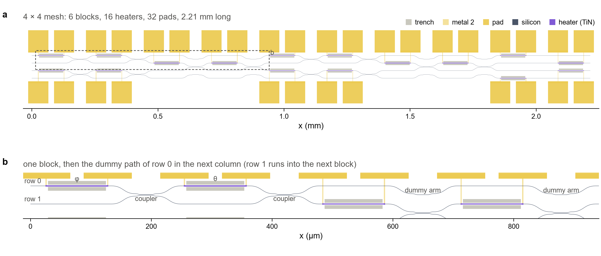
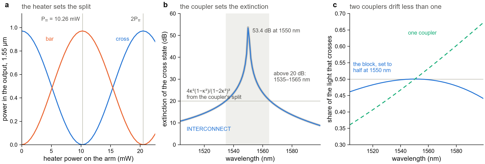
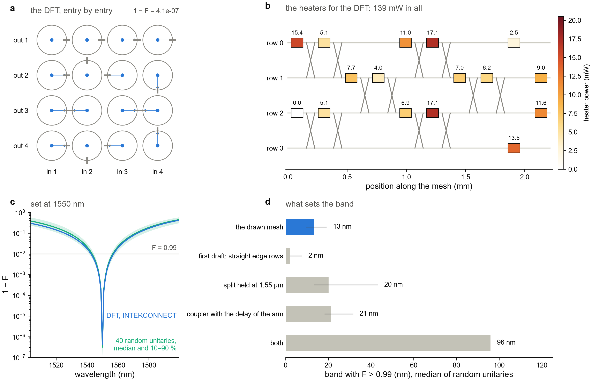
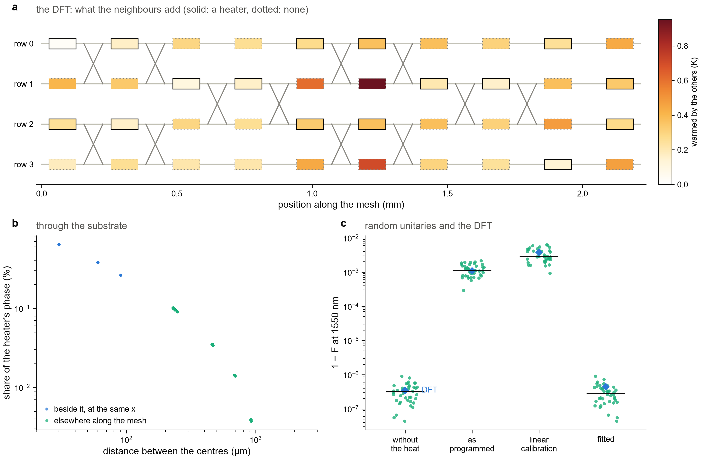
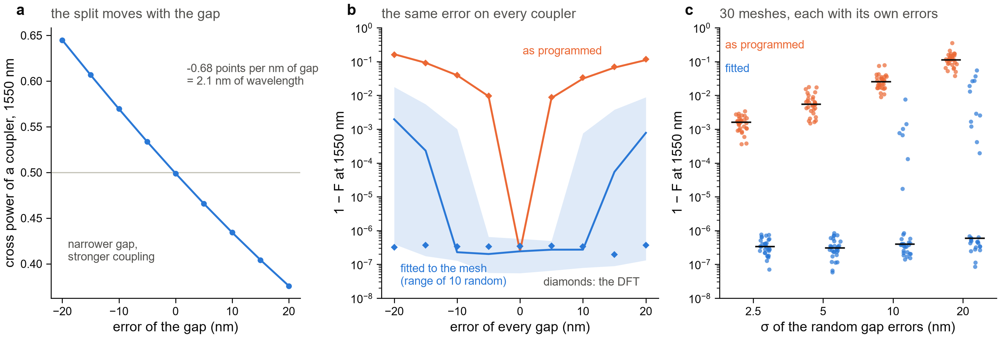

# Clements mesh of Mach-Zehnder interferometers

<div align="center">

[Previous: thermo-optic phase shifter](../thermo_optic_phase_shifter/README.md) · [Circuits](../../README.md#circuits) · [Device library](../../README.md#device-library)

</div>

A mesh of Mach-Zehnder interferometers is a programmable linear circuit. Light enters on N
waveguides and leaves on N waveguides. In between, every interferometer mixes two neighbouring
waveguides, by an amount that its heaters set. With enough interferometers in the right
arrangement, the mesh can be set to any unitary matrix: a Fourier transform, a permutation, the
weights of a layer of a neural network. That makes it the core of optical computing, of
programmable photonics and of many quantum-optics experiments.

This chapter builds a 4 × 4 mesh in the arrangement of Clements et al. (2016) from two devices of
the library: the [directional coupler](../directional_coupler/README.md) and the
[thermo-optic phase shifter](../thermo_optic_phase_shifter/README.md). Nothing is simulated
again at the device level. The circuit takes the kept results of those chapters, and INTERCONNECT
runs it. The chapter answers four questions: what one interferometer does, how well the mesh holds
a matrix it is programmed to, what the heat of the neighbours does to it, and how much a
fabrication error of the couplers costs.

---

## The circuit

<p align="center"></p>

**Figure 0.** The layout, drawn from its GDS file. Panel a is the whole mesh, b one interferometer
and, after it, the dummy path of an edge row (see below).

[devices/clements_mesh_builder.py](../../devices/clements_mesh_builder.py) draws the mesh with the
PDK. From the repository root:

```bash
uv run python devices/clements_mesh_builder.py
```

```text
4 x 4 Clements mesh: 6 blocks, 16 heaters, 32 pads; 2.21 mm long, rows 30 um apart, fan bends down to a radius of 27.521 um
GDS -> devices/gds/clements_mesh.gds   ports: ['o1', 'o2', 'o3', 'o4', 'P0_w', 'P0_e', 'T0_w', ... 'D3_e', 'o5', 'o6', 'o7', 'o8']
DRC passed: 0 errors, 0 warnings
```

**The arrangement.** The mesh has four waveguides, the rows, and four columns of interferometers
(the blocks). Column c pairs the rows (p, p + 1) for p = c mod 2, c mod 2 + 2, ...: two blocks in
columns 0 and 2, one in columns 1 and 3, six in all. The blocks of one column sit between those of
the next, like bricks. That is what Clements et al. showed: N(N − 1)/2 blocks in N columns reach
every unitary matrix, with every path through the mesh crossing the same number of columns. The
older triangle of Reck et al. (1994) needs as many blocks but makes some paths much longer than
others.

**One block.** Each block is a Mach-Zehnder interferometer:

| part | what it is | from |
|---|---|---|
| coupler | two of them, 0.2 µm gap over 15 µm, ports 4 µm apart | the [directional coupler](../directional_coupler/README.md), unchanged |
| fan | an S-bend, 40 µm long, from a row to a port of the coupler and back | this builder: it opens the 4 µm of the coupler to the 30 µm between rows |
| φ | a phase shifter on the upper input: the phase between the two inputs | the heated section of the [thermo-optic phase shifter](../thermo_optic_phase_shifter/README.md) |
| θ | the same on the upper arm, between the couplers: the split of the block | the same |

After the last column every row has a phase shifter of its own (the column D of the paper). That
makes 6 × 2 + 4 = 16 heaters. Each heater is the film of the phase shifter chapter, 100 µm long, with
its two trenches and its two pads. The coupler is placed exactly as its chapter simulated it, with
ports 4 µm apart, so that its S-parameters from FDTD stay valid; the fans do the rest.

**The pads.** The heaters of rows 0 and 1 have their pads above the mesh, those of rows 2 and 3
below. Each pad stands straight above or below the landing of its wire, so no wire crosses
another. That needs at least 100 µm between two landings along x, which sets the length of a block
(458 µm) and of the mesh (2.21 mm). The output heaters of rows 1 and 2 are moved one step along x
so that their wires pass rows 0 and 3 where those have no heater.

**The dummy path.** In columns 1 and 3, rows 0 and 3 have no block. A first draft of this layout
ran them straight through. Every other row there goes through two couplers and four fans, which
are longer than the straight line, so the paths of the mesh differed in length. Step 2 shows what
that costs: the matrix held over 2 nm of wavelength instead of 13. The drawn mesh gives those rows
the same four fans and one arm of the coupler alone (`coupler_arm`), dipped towards the inside of
the mesh. `match_delay=False` draws the first draft.

| parameter | default | where it comes from |
|---|---|---|
| `n` | 4 | the size of this chapter; the builder draws any N ≥ 2 (tested up to 6 with the DRC) |
| `pitch` | 30 µm | rows centre to centre. The trenches of a heater reach 8 µm from its row, and the next row keeps 1.75 µm from them (rule `trench_to_waveguide`, 1.5 µm). Smaller than 10.25 µm is refused |
| `match_delay` | True | the dummy paths of the edge rows |

The ports: light enters at `o1` to `o4` (rows 0 to 3, west) and leaves at `o5` to `o8` (east). The
pads are named after their heater and side: `P<k>_w`, `P<k>_e` (φ of block k), `T<k>_w`, `T<k>_e`
(θ), `D<m>_w`, `D<m>_e` (the output of row m). Blocks are counted column by column, from the top.

The mesh has no grating or edge couplers: those devices are still on the
[roadmap](../../ROADMAP.md). Its optical ports are plain waveguide ends.

## How the mesh sets a matrix

The heaters do not set the entries of the matrix one by one. Each heater sets one phase, each
block mixes two rows, and the matrix is the product of all of them. This section goes from a
matrix to the sixteen voltages: what one block does, how six blocks and four output phases make a
matrix, how the recipe of Clements et al. finds the phases, and how a phase becomes a voltage.
Step 2 runs all of it on the drawn mesh.

**One block.** A block is a coupler, a heater on the upper arm, a second coupler, and a heater on
the upper input before them. Written in the order in which the light meets them, from right to
left:

```math
T(\theta,\varphi) = B\,P(\theta)\,B\,P(\varphi), \qquad B = \frac{1}{\sqrt{2}}\begin{pmatrix} 1 & i \\ i & 1 \end{pmatrix}, \qquad P(a) = \begin{pmatrix} e^{ia} & 0 \\ 0 & 1 \end{pmatrix}
```

B is a coupler of exactly 50:50 (the light that crosses gains a quarter turn, i), and P(a) a phase
a on the upper waveguide. The rows and columns are the upper and the lower waveguide of the
block. Multiplied out:

```math
T(\theta,\varphi) = i\,e^{i\theta/2} \begin{pmatrix} e^{i\varphi}\sin\frac{\theta}{2} & \cos\frac{\theta}{2} \\ e^{i\varphi}\cos\frac{\theta}{2} & -\sin\frac{\theta}{2} \end{pmatrix}
```

The two phases do different things. θ sets the split: of the light that enters the upper
waveguide, sin²(θ/2) stays on it and cos²(θ/2) crosses. At θ = 0 everything crosses, which is the
mesh with all heaters off; at θ = π everything goes straight (step 1 measures both). φ moves no
light by itself. It sets the phase of the upper input against the lower one before they meet, and
so decides how the light of two inputs adds up in the block.

**The mesh.** Block k is the 4 × 4 matrix T<sub>k</sub> that is T(θ<sub>k</sub>, φ<sub>k</sub>)
on its two rows and leaves the other two alone. Blocks 0 and 1 stand in column 0 (rows 0–1 and
2–3), block 2 in column 1 (rows 1–2), blocks 3 and 4 in column 2, block 5 in column 3. The heaters
carry the same numbers: P<sub>k</sub> is the φ of block k, T<sub>k</sub> its θ, and D<sub>m</sub>
the output phase δ<sub>m</sub> of row m. The light meets the columns in turn, so the mesh is

```math
U = D\,T_5\,T_4\,T_3\,T_2\,T_1\,T_0, \qquad D = \operatorname{diag}\left(e^{i\delta_0},\, e^{i\delta_1},\, e^{i\delta_2},\, e^{i\delta_3}\right)
```

That is 6 × 2 + 4 = 16 phases, and a 4 × 4 unitary matrix has exactly 16 real parameters. A mesh
with fewer phases would miss some matrices; the recipe below shows that these 16 reach every one.
Every block is lossless, so the mesh keeps the power of the light: U is always unitary, U†U = 1.
A matrix that is not unitary needs more than one mesh. It is the subject of the next chapter,
optical computing: two meshes and a column of attenuators set M = U Σ V†, once M is scaled so
that no entry of Σ exceeds 1.

**The recipe.** The recipe takes a target U apart, one block at a time. Multiplying U from the
right by T<sup>−1</sup> on columns m and m + 1 mixes those two columns. Its θ and φ can be chosen
so that one entry of a row becomes zero. Multiplying from the left by T on rows m and m + 1 mixes
two rows and can zero one entry of a column. For the two entries a and b that are mixed:

```math
\text{from the right:}\quad (a,\ b)\,T^{-1} = (0,\ \ast) \quad\text{when}\quad \theta = 2\arctan\frac{|b|}{|a|},\quad \varphi = \pi + \operatorname{arg} a - \operatorname{arg} b
```

```math
\text{from the left:}\quad T\begin{pmatrix} a \\ b \end{pmatrix} = \begin{pmatrix} \ast \\ 0 \end{pmatrix} \quad\text{when}\quad \theta = 2\arctan\frac{|a|}{|b|},\quad \varphi = \operatorname{arg} b - \operatorname{arg} a
```

Both follow from the matrix of T above. From the right, (a, b) T<sup>−1</sup> starts with a zero
when (a, b) is parallel to the second row of T, that is when a/b = −e<sup>iφ</sup> cot(θ/2). From
the left, the second entry T<sub>21</sub> a + T<sub>22</sub> b has to vanish, that is
a/b = e<sup>−iφ</sup> tan(θ/2).

For a 4 × 4 matrix the recipe zeroes the six entries below the diagonal, diagonal by diagonal from
the corner, alternately from the right and from the left. In that order a zero, once made, stays
zero:

| null | side | mixes | the entry it zeroes (row, column) | the block it becomes |
|---|---|---|---|---|
| 1 | right | columns 0 and 1 | (3, 0) | block 0: P0, T0 |
| 2 | left | rows 1 and 2 | (2, 0) | block 5: P5, T5, after the move below |
| 3 | left | rows 2 and 3 | (3, 1) | block 4: P4, T4, after the move below |
| 4 | right | columns 2 and 3 | (3, 2) | block 1: P1, T1 |
| 5 | right | columns 1 and 2 | (2, 1) | block 2: P2, T2 |
| 6 | right | columns 0 and 1 | (1, 0) | block 3: P3, T3 |

After the six nulls, with T<sub>(n)</sub> the block of null n:

```math
T_{(3)}\,T_{(2)}\;U\;T_{(1)}^{-1}\,T_{(4)}^{-1}\,T_{(5)}^{-1}\,T_{(6)}^{-1} = D
```

D is diagonal, because a unitary matrix with nothing below its diagonal has nothing above it
either. Solved for U:

```math
U = T_{(2)}^{-1}\,T_{(3)}^{-1}\;D\;T_{(6)}\,T_{(5)}\,T_{(4)}\,T_{(1)}
```

The light meets the factors from the right. The two blocks made from the left stand on the wrong
side of D: the light would meet them after the output phases, where the mesh has no blocks. The last
step of the recipe moves them through D. For every block and every diagonal there are a new
diagonal and a new block with

```math
T^{-1}(\theta,\varphi)\,\operatorname{diag}(d_1,\,d_2) = \operatorname{diag}(d_1',\,d_2')\,T(\theta',\varphi')
```

because a diagonal times T(θ′, φ′) covers every 2 × 2 unitary matrix (`split` in the model solves
it). Done twice:

```math
U = D''\;T'_{(2)}\,T'_{(3)}\,T_{(6)}\,T_{(5)}\,T_{(4)}\,T_{(1)}
```

Six blocks in the order of the light, then a diagonal: the form of the mesh. Each block goes into
the first column after the blocks it follows on its two rows, which gives the brick pattern and the
last column of the table. The phases of D″ are the output phases δ<sub>m</sub>. For the DFT the
recipe gives θ/π = 0.500, 0.500, 0.392, 0.333, 0.333, 0.608 and φ/π = 1.500, 0.000, 0.750, 0.946,
0.804, 0.804 for blocks 0 to 5, and δ/π = 1.887, 0.529, 0.779, 0.833 for rows 0 to 3
(`program.txt`). For all 41 targets of step 2, the ideal mesh with the phases of the recipe is its
target to 3.6 × 10⁻¹⁵.

**From a phase to a voltage.** A heater of power P raises the effective index of the 100 µm of
waveguide under it by dn<sub>eff</sub>/dP = 7.557 × 10⁻⁴ per mW (the
[phase shifter chapter](../thermo_optic_phase_shifter/README.md), step 2). The phase it adds is

```math
\Delta\phi = \frac{2\pi L}{\lambda}\,\frac{\mathrm{d}n_\mathrm{eff}}{\mathrm{d}P}\,P = \pi\,\frac{P}{P_\pi}, \qquad P_\pi = \frac{\lambda}{2L\,\mathrm{d}n_\mathrm{eff}/\mathrm{d}P} = 10.26\ \mathrm{mW}
```

The film of the heater is a resistor of R = 500 Ω (10 Ω/sq over 100 µm by 2 µm). A voltage V
across it gives P = V²/R, so

```math
\Delta\phi = \pi\left(\frac{V}{V_\pi}\right)^{2}, \qquad V_\pi = \sqrt{P_\pi R} = 2.26\ \mathrm{V}
```

The phase grows with the square of the voltage: a heater is driven by its power. Half of π takes
1.60 V, not half of 2.26 V. A heater can only add phase, so every phase is set as its value modulo
2π, between 0 and 2π: a power between 0 and 2P<sub>π</sub> = 20.5 mW, a voltage between 0 and 3.20 V.

**The DFT, heater by heater.** The recipe is for the ideal block. The drawn mesh adds what the
recipe does not know: every piece of waveguide adds its own phase, β L over 2 mm of strip on every
row, and the couplers split 49.86 : 50.07 with a phase of their own. With the powers of the recipe
alone, the drawn mesh is the DFT with F = 0.27 only. Step 2 starts from those powers and fits all
sixteen to the drawn circuit, by least squares on the entries:

```math
\min_{P_0,\,\dots,\,P_{15},\;a}\ \sum_{i,j}\bigl|U_{ij}(P_0,\dots,P_{15}) - a\,M_{ij}\bigr|^2
```

where a is a common phase and loss that the fidelity ignores too. For the DFT it ends at
1 − F = 3.5 × 10⁻⁷, with these settings:

| heater | what it sets | recipe, phase / π | recipe, mW | fitted, mW | fitted, V |
|---|---|---|---|---|---|
| P0 | φ of block 0, row 0 | 1.500 | 15.38 | 15.39 | 2.77 |
| T0 | θ of block 0, row 0 | 0.500 | 5.13 | 5.13 | 1.60 |
| P1 | φ of block 1, row 2 | 0.000 | 0.00 | 0.01 | 0.06 |
| T1 | θ of block 1, row 2 | 0.500 | 5.13 | 5.13 | 1.60 |
| P2 | φ of block 2, row 1 | 0.750 | 7.69 | 7.69 | 1.96 |
| T2 | θ of block 2, row 1 | 0.392 | 4.02 | 4.02 | 1.42 |
| P3 | φ of block 3, row 0 | 0.946 | 9.70 | 11.01 | 2.35 |
| T3 | θ of block 3, row 0 | 0.333 | 3.42 | 17.09 | 2.92 |
| P4 | φ of block 4, row 2 | 0.804 | 8.25 | 6.91 | 1.86 |
| T4 | θ of block 4, row 2 | 0.333 | 3.42 | 17.09 | 2.92 |
| P5 | φ of block 5, row 1 | 0.804 | 8.25 | 6.95 | 1.86 |
| T5 | θ of block 5, row 1 | 0.608 | 6.24 | 6.24 | 1.77 |
| D0 | output phase of row 0 | 1.887 | 19.36 | 2.45 | 1.11 |
| D1 | output phase of row 1 | 0.529 | 5.43 | 9.03 | 2.12 |
| D2 | output phase of row 2 | 0.779 | 7.99 | 11.59 | 2.41 |
| D3 | output phase of row 3 | 0.833 | 8.55 | 13.48 | 2.60 |

The θ heaters keep the split of the recipe. T0, T1, T2 and T5 agree to a hundredth of a milliwatt:
the two arms of a block are equally long, so the split does not depend on the rows around it. T3
and T4 sit on the mirror value, (2 − 0.333)π instead of 0.333π. It gives the same split with other
signs, which the phases after it take up. The φ of the first two columns keep their values too; up
to there the rows are alike. From column 2 on, the φ and the output phases move: they take up the
signs of the mirrored blocks and the phases that the drawn rows add. The total is 139 mW.

## The steps

| step | folder | tool | script | the question it answers |
|---|---|---|---|---|
| 1 | `1_mzi` | INTERCONNECT | `mzi_interconnect.py` | What does one block do, and what limits its extinction and its band? |
| 2 | `2_program` | INTERCONNECT, Python | `program_mesh.py` | How well does the drawn mesh hold a matrix, and over which band? |
| 3 | `3_crosstalk` | INTERCONNECT, Python | `thermal_crosstalk.py` | What does the heat of the neighbours do to the matrix, and can a calibration undo it? |
| 4 | `4_coupler_errors` | INTERCONNECT, Python | `coupler_errors.py` | How much does a fabrication error of the coupler gaps cost, and can the phases make up for it? |

**What the circuit is made of.** The scripts read the layout's own description of where every
piece lies (the `info` of the builder) and turn it into a chain of pieces along every row:

| piece | model | numbers |
|---|---|---|
| coupler | INTERCONNECT's "Optical N Port S-Parameter" element, with the complex S-parameters of the FDTD run, 1.5 to 1.6 µm | [directional coupler](../directional_coupler/README.md), step 3: cross 0.4986, through 0.5007 at 1.55 µm |
| waveguide, fan, dummy arm | "Straight Waveguide" over the length of the path | [strip waveguide](../strip_waveguide/README.md): n_eff = 2.44448, n_g = 4.2387 |
| heated section | the same, 100 µm long, its index raised by 7.557 × 10⁻⁴ per mW | [phase shifter](../thermo_optic_phase_shifter/README.md), step 2: P<sub>π</sub> = 10.26 mW |
| loss | 2.2 dB/cm | an assumption: no chapter measures the loss of the strip; chapter 4 takes this value for the rib of the same process |

A heated section lies on every row under every heater position, 40 in all: a heater warms the
waveguides beside it too (step 3). The FDTD ports of the coupler stood 1 µm beyond each end of the
cell, so the scripts move its S-parameters inwards by 1 µm of strip. The coupler was simulated
exciting port 1 only; its two mirror symmetries give the rest of the 4 × 4 matrix.

The same chain is also a short Python model,
[scripts/mesh_model.py](scripts/mesh_model.py). INTERCONNECT runs every case that the chapter
reports; the model does what INTERCONNECT cannot do quickly, such as fitting the heater powers or
running hundreds of meshes with random errors. Every step compares the two.

## Run it

You need Lumerical with INTERCONNECT. See the
[prerequisites of chapter 4](../ring_modulator/README.md#prerequisites). The run times are from the
author's machine, with Lumerical 2025 R1.

```bash
cd lumerical_simulations/clements_mesh/scripts
uv run python mzi_interconnect.py     # step 1, about 1.5 minutes
uv run python program_mesh.py         # step 2, about 8 minutes
uv run python thermal_crosstalk.py    # step 3, about 2 minutes
uv run python coupler_errors.py       # step 4, about 30 minutes
```

Run them in this order: steps 3 and 4 start from the heater powers that step 2 keeps, and step 4
reads the split of step 1. No step needs a result that is not kept in the repository. The figures
are redrawn from the kept results, without Lumerical:

```bash
uv run python lumerical_simulations/clements_mesh/figures/fig0_layout.py
uv run python lumerical_simulations/clements_mesh/figures/fig1_mzi.py
uv run python lumerical_simulations/clements_mesh/figures/fig2_program.py
uv run python lumerical_simulations/clements_mesh/figures/fig3_crosstalk.py
uv run python lumerical_simulations/clements_mesh/figures/fig4_errors.py
```

---

## Step 1. One block

**The question.** What does one interferometer of the mesh do when its heater is turned up, and
what limits it?

**The idea.** Write the coupler as passing τ straight and κ across, with κ = i|κ|. Light that
enters the upper input of a block leaves it

```
across:    κτ (1 + e^(iθ))
straight:  τ² e^(iθ) − |κ|²
```

where θ is the phase of the heated arm. With no power, θ = 0, all the light crosses (for a 50:50
coupler). At θ = π the two paths across cancel exactly, whatever the split: the block passes
everything straight. The other null, nothing straight at θ = 0, needs τ² = |κ|², a perfect 50:50
coupler. With the coupler of its chapter, 0.4986 : 0.5007, the leak is

```
((|τ|² − |κ|²) / (|τ|² + |κ|²))² = 4.3 × 10⁻⁶ = −53.7 dB
```

**The model.** The 2 × 2 mesh of the builder: one block and two output heaters, 612 µm long. The
script sweeps the heater on the arm from 0 to 2.2 P<sub>π</sub> in 45 steps and runs the network analyser
from 1.503 to 1.600 µm at each step, 101 points centred on 1.55 µm.

**The results** (`mzi.txt`):

| quantity | value |
|---|---|
| power for θ = π, the straight state | 10.26 mW, the P<sub>π</sub> of the phase shifter chapter |
| leak into the cross port at θ = π | none: no light reaches the analyser there |
| leak into the straight port at θ = 0, over all that passes | −53.4 dB (the formula gives −53.7 dB) |
| through the block | 0.971, or 0.13 dB, over 553 µm of strip and two couplers |
| extinction of the cross state above 20 dB | from 1535 to 1565 nm |

<p align="center"></p>

**Figure 1.** One block. Panel a is the power in the two outputs against the heater power at 1550
nm. Panel b is the extinction of the cross state against the wavelength, from INTERCONNECT and from
the formula with the split of the FDTD coupler at each wavelength. Panel c is the block set to a
half split at 1550 nm, and the split of one coupler, against the wavelength.

**Reading the figure.**

- *a, the heater.* The two outputs trade light as cos² and sin² of θ/2. The straight output is full
  at P<sub>π</sub> and the cross output at 0 and 2P<sub>π</sub>.
- *b, the extinction.* The peak of 53 dB holds only where the coupler splits 50:50. A few
  nanometres away the coupler has moved, and the leak with it. INTERCONNECT and the formula lie on
  one curve.
- *c, the half state.* One coupler goes from 0.36 to 0.67 across the band. The block set to half
  stays between 0.44 and 0.50: its two couplers drift together, and the second undoes part of
  what the first does.

**What it tells you.** The block is as good as its coupler. The heater sets the split exactly,
and one of the two nulls, the straight state, is perfect at every wavelength. The other is limited
by how close the coupler is to 50:50, and that changes by 0.32 percentage points per nanometre
(the coupler chapter). For a mesh this means that a block can always send all its light straight,
but never quite all of it across.

**Checks.**

- *INTERCONNECT against the model.* Over all 45 powers and 101 wavelengths the largest difference
  of an entry of the matrix is 2.1 × 10⁻⁴. The rest is the reflection of the couplers (−43 dB),
  which only INTERCONNECT has.
- *Against the formula.* The extinction at every wavelength agrees with
  4κ²(1 − κ²)/(1 − 2κ²)², κ² the split of the FDTD coupler.

**Pitfalls.**

- *Write the phase of an S-parameter file unwrapped.* INTERCONNECT interpolates the phase
  linearly between the samples of the file. A phase wrapped to ±π jumps by 2π somewhere, and every
  frequency of the analyser between those two samples gets a wrong phase. A first run of this step
  showed it as an extinction of 0.5 dB at 1560 nm, where the formula gives 24 dB.
- *A perfect null has no result.* When no light at all reaches an input of the analyser, as at the
  cross port at θ = π, INTERCONNECT writes no result for that input, and asking for it raises an
  error. The scripts read it as zero.
- *Save the project after the runs.* The script saves the circuit at the end, switched back to
  design mode with the heaters off, so that the project carries no results.

## Step 2. A matrix

**The question.** The mesh is set to a matrix. How close does it come, and over which band of
wavelengths does it stay close?

**The idea.** Clements et al. give a recipe ([How the mesh sets a matrix](#how-the-mesh-sets-a-matrix)).
It removes the entries of the target below its diagonal one at a time, each with one block,
alternately from the right and from the left, and then moves the blocks of the left through the
diagonal that remains. The result is θ and φ of
every block and the four output phases, for an ideal mesh: couplers of exactly 50:50 and nothing
else. [scripts/mesh_model.py](scripts/mesh_model.py) writes the recipe for the block of this mesh,
B P(θ) B P(φ), with B the ideal coupler.

The drawn mesh is not ideal. Its couplers split 49.86 : 50.07, the rows carry fixed phases from
their own lengths, and the paths lose different amounts of light. So the script corrects the
heater powers for the drawn circuit with a least-squares fit, starting from the recipe. A heater
gives a phase between 0 and 2π, for a power between 0 and 2P<sub>π</sub> = 20.5 mW.

How close the mesh comes is the fidelity

```
F = |Tr(U_target† U)|² / (N Tr(U† U))
```

which is 1 when the mesh is the target up to a phase common to all entries and a loss common to
all paths. The targets are the 4-point discrete Fourier transform (DFT) and 40 random unitary
matrices, drawn uniformly over all unitary matrices with a fixed seed.

**The model.** The 4 × 4 mesh with all 16 heaters, set at 1.55 µm. INTERCONNECT runs the DFT and
three random targets, one input at a time, from 1.503 to 1.600 µm; the model runs all of them.

**The results** (`program.txt`):

| quantity | value |
|---|---|
| the recipe, ideal mesh: largest difference from its target, 41 targets | 3.6 × 10⁻¹⁵ |
| drawn mesh at 1.55 µm, DFT | 1 − F = 3.5 × 10⁻⁷ |
| drawn mesh at 1.55 µm, 40 random targets | 1 − F from 5 × 10⁻⁸ to 9 × 10⁻⁷, median 3 × 10⁻⁷ |
| the same, INTERCONNECT, DFT and three random | F = 0.9999996 and up, within 1 × 10⁻⁷ of the model |
| heater power, DFT | 139 mW |
| heater power, random targets | 116 to 219 mW, mean 163 mW |
| band with F > 0.99, 41 targets | median 13 nm, from 8 to 21 nm |

What is left at 1.55 µm, the worst of six targets:

| what the model leaves out | 1 − F |
|---|---|
| nothing | 9 × 10⁻⁷ for the worst random target |
| the propagation loss | 2.8 × 10⁻⁷ |
| all loss, also that of the couplers | 7.9 × 10⁻⁸ |
| all loss, and the couplers exactly 50:50 | below 10⁻¹⁵ |

What sets the band, the width with F > 0.99 for the DFT and ten random targets:

| case | DFT | random, median (range) |
|---|---|---|
| the drawn mesh | 13 nm | 13 nm (10 to 19) |
| the first draft, edge rows straight | 2 nm | 2 nm (2 to 8) |
| the drawn mesh, the split of every coupler held at its value at 1.55 µm | 19 nm | 20 nm (13 to 43) |
| the drawn mesh, the coupler given the delay of its dummy arm | 20 nm | 21 nm (18 to 32) |
| both | 96 nm | 96 nm: the whole range of the analyser |

<p align="center"></p>

**Figure 2.** A matrix. Panel a is the DFT entry by entry: the ring and its tick are the target,
the dot and its arrow the mesh in INTERCONNECT at 1550 nm. Panel b is the heater powers of the DFT
at the places of the heaters. Panel c is 1 − F against the wavelength: the DFT in INTERCONNECT and
the random targets in the model. Panel d is the width of the band with F > 0.99 for the five cases
of the table above.

**Reading the figure.**

- *a, the DFT.* Every entry has a quarter of the power, and the phases step by multiples of
  90° along a row. The arrows end on the rings and on their ticks.
- *b, the heaters.* One heater is almost off: φ of block 1, at 0.01 mW. The largest, θ of blocks 3
  and 4, take 17.1 mW each. The total, 139 mW, is spread over all sixteen.
- *c, the band.* All targets lose fidelity at the same rate away from 1550 nm: 1 − F reaches 1 %
  about 6 nm to each side.
- *d, the band.* The first draft held the matrix over 2 nm. Matching the lengths of the rows gives
  13 nm. Holding the split, or the delay, of the couplers fixed gives about 20 nm each; holding both
  gives the whole band.

**What it tells you.** The recipe of the paper is exact for the ideal mesh, and a short fit makes
the drawn mesh hold any of these matrices to 1 − F below 10⁻⁶. What is left is mostly loss that
differs between paths: they cross different numbers of couplers, each losing 0.003 dB, and
different numbers of fans, each 2.8 µm longer than its run along x. The split of the couplers
leaves a smaller rest, 8 × 10⁻⁸, that no phase can take up.

The band is another matter. A mesh is a large interferometer: light that meets again in a later
block must arrive with the phase it had at the design wavelength. That needs every path to be
equally long, which the first draft broke by more than 100 µm of strip, and every coupler to keep
its split. With the delays matched, the coupler is what remains, in two ways at once. Its split
changes with the wavelength (step 1). And its own delay, 34.47 µm of strip, is shorter than that
of the arm that stands in for it on the edge rows, 35.38 µm: in the coupled section the light has
a lower group index. A path that spans the coupler's 35 µm cannot be shorter than 35 µm, so the
dummy cannot match it. A broader mesh needs a broader coupler, such as an adiabatic coupler or
a pair of couplers that compensate each other.

**Checks.**

- *The recipe.* For 41 targets the ideal mesh with the phases of the recipe differs from its target
  by at most 3.6 × 10⁻¹⁵. The tests repeat it for N = 2 to 8, and for targets where blocks cross
  fully or not at all.
- *INTERCONNECT against the model.* The largest difference of an entry over the band is
  6.5 × 10⁻⁴, from the reflections of the couplers.
- *All heaters off.* The mesh then sends input m to output 5 − m: every block passes its light
  across.

**Pitfalls.**

- *Match the delays, not only the arms.* The arms of each block are equal, and still the first
  draft held a matrix over 2 nm only. In a mesh, light from different rows meets in later blocks;
  every path from any input to any output has to be equally long.
- *The paper's recipe is for an ideal mesh.* With the fixed phases of the drawn rows, its phases
  are a starting point and not the answer. Here the fit from that start converged for all 41
  targets.
- *Fidelity hides a common loss.* F is 1 for a mesh that loses 1 dB on every path alike. The
  insertion loss is a separate number: 0.47 dB for every input of this mesh, mostly the 2.2 dB/cm
  that was assumed.

## Step 3. The heat of the neighbours

**The question.** Every heater warms the waveguides around it a little. What does that do to the
matrix, and can a calibration undo it?

**The idea.** The trenches stop the heat that would flow sideways through the oxide. They cannot
stop the heat that goes down into the silicon substrate, spreads there and comes up under another
waveguide. Step 4 of the [phase shifter chapter](../thermo_optic_phase_shifter/README.md) estimated
that path for a wafer 725 µm thick, with a formula for a point source on a thick plate. The script
applies the same formula to every pair of heater and waveguide in the drawn mesh, with the true
positions of both. It reproduces the four values of that chapter to six digits.

The result is a matrix of shares: how much a waveguide warms per milliwatt of a heater, over how
much the heater's own waveguide warms. A heater's own waveguide gains 3.79 K per mW.

**The model.** The heater powers of step 2, with the heat of the neighbours added on every one of
the 40 heated sections. Then two calibrations:

- *linear.* Solve a linear system so that each of the 16 heated waveguides gets the phase it was
  meant to have.
- *fitted.* The fit of step 2, with all 40 sections and their heat in the model.

**The results** (`crosstalk.txt`):

| quantity | value |
|---|---|
| the largest share | 0.64 %: a heater on the waveguide 30 µm beside it |
| the most that one waveguide collects from all heaters | 1.70 % of the phase of one heater |
| warming of a waveguide by the others, at the powers of the DFT | up to 0.95 K |

| 1 − F at 1.55 µm | DFT | random: median (largest) |
|---|---|---|
| without the heat | 3.5 × 10⁻⁷ | 3.3 × 10⁻⁷ (9.1 × 10⁻⁷) |
| with the heat, as programmed | 1.1 × 10⁻³ | 1.1 × 10⁻³ (2.2 × 10⁻³) |
| linear calibration | 3.8 × 10⁻³ | 2.9 × 10⁻³ (6.4 × 10⁻³) |
| fitted | 4.4 × 10⁻⁷ | 3.0 × 10⁻⁷ (9.0 × 10⁻⁷) |

<p align="center"></p>

**Figure 3.** The heat of the neighbours. Panel a is the mesh at the powers of the DFT: how much
the other heaters warm every waveguide under a heater position (solid outline: a heater is there;
dotted: none). Panel b is the share of a heater's phase that a waveguide takes, against the
distance between their centres, for every pair. Panel c is 1 − F for the 41 targets in the four
cases; the diamond is the DFT and the bar the median.

**Reading the figure.**

- *a, where the heat lands.* A waveguide collects most where heaters stand on both sides of it and
  along it; row 0, with heaters on one side only, collects least. Nowhere is it more than 1 K.
- *b, the distance.* The share falls slowly near the heater, about as 1 / d: 0.64 % at 30 µm, 0.26 %
  at 90 µm, 0.1 % at 240 µm. Further out it falls faster, to 0.004 % at 900 µm: there the heat sink
  under the wafer, 725 µm below, takes it away. A waveguide collects from all sixteen heaters at once.
- *c, the calibrations.* The heat costs about 10⁻³. The linear calibration makes it worse, by a
  factor of about three. The fit brings it back to where it was without the heat.

**What it tells you.** The heat is small, 0.64 % at most, and it still costs a thousand times
more than everything in step 2. A linear calibration is the obvious cure, and here it is the wrong
one. A heater warms both arms of the block beside it by about as much, and what both arms gain
cancels in the block: the heat as programmed does less harm than its size suggests. The linear
calibration takes the heat out of the heated arm only and so leaves the difference. It also asks
some heaters for less than no power, and those have to go round by a full turn of phase, 20.5 mW
more, which heats everything else: the DFT takes 159 mW instead of 139.

The fit has every heated section in the model and moves every heater a little. It brings every
target back to the level without heat, the DFT to 4.4 × 10⁻⁷ with 143 mW. One heater of the DFT, φ
of block 1, was set to 0.01 mW; with the heat of its neighbours it would need slightly less than
nothing, and the fit leaves it at zero and finds a setting of the others around it.

**Checks.**

- *The formula.* It gives the four values of step 4c of the phase shifter chapter, 25 to 250 µm,
  to six digits.
- *INTERCONNECT against the model.* The DFT in the three cases agrees with the model to the sixth
  digit of F: 0.99892, 0.99617 and 0.9999995 in INTERCONNECT.

**Pitfalls.**

- *A heater cannot cool.* A fit over heater powers must never let a power go below zero. Without
  crosstalk a power of −0.1 mW is the same phase as 2P<sub>π</sub> − 0.1 mW and nothing is lost. With
  crosstalk it is not: the heater at 20.4 mW warms its neighbours. A first version of this step let
  the fit go below zero and wrapped the powers afterwards; the DFT then ended at 1 − F = 2.7 × 10⁻⁴
  instead of 4.4 × 10⁻⁷. The fit now evaluates the circuit at the powers a heater can have.
- *Calibrate the circuit, not the heaters.* The heated sections without a heater have phases too,
  and those are what the linear calibration forgets.

## Step 4. Couplers that came out wrong

**The question.** The gap of a coupler comes out a few nanometres wider or narrower than drawn,
and the coupler no longer splits 50:50. How much does that cost, and can the phases make up for it?

**The idea.** The coupling length grows exponentially with the gap: L_π = 6.72 µm × exp(gap /
115.7 nm), from the supermodes of the [coupler chapter](../directional_coupler/README.md). A coupler
passes across sin²ψ of the light, with ψ = π/2 (L + L_bends)/L_π. A gap wider by Δg scales ψ by
exp(−Δg / 115.7 nm). The script keeps the FDTD coupler and changes only its split, at every
wavelength.

Miller (2015) asked whether a mesh of imperfect parts can still be perfect. For a Clements mesh
the limit is the block: with couplers of cross power f, a block passes at most 4f(1 − f) of its
light across. A matrix that needs a block near full crossing is then out of reach.

**The model.** Two cases, each with the powers of the error-free mesh (as programmed) and with
powers fitted to the mesh as it came out (fitted). The fit assumes the errors are known, for
example from a measurement of each block.

- *every gap off by the same Δg*, from −20 to +20 nm: a wafer whose gaps all came out wider or
  narrower. The DFT and ten random targets of step 2.
- *every gap off by its own Δg*, drawn from a normal distribution of width σ = 2.5, 5, 10 and 20 nm:
  30 meshes for each σ, each with a random target of its own.

**The results** (`errors.txt`):

| quantity | value |
|---|---|
| change of the split per nm of gap | −0.68 percentage points |
| the same as a change of wavelength | 2.1 nm of wavelength per nm of gap |

| every gap off by | split | 1 − F as programmed, random median | fitted: DFT | fitted: random median (worst) |
|---|---|---|---|---|
| −20 nm | 0.645 | 0.17 | 3 × 10⁻⁷ | 2.0 × 10⁻³ (1.8 × 10⁻²) |
| −10 nm | 0.570 | 0.039 | 3 × 10⁻⁷ | 2 × 10⁻⁷ (1.0 × 10⁻³) |
| −5 nm | 0.534 | 0.0094 | 3 × 10⁻⁷ | 2 × 10⁻⁷ (7 × 10⁻⁷) |
| +5 nm | 0.466 | 0.0084 | 4 × 10⁻⁷ | 3 × 10⁻⁷ (5 × 10⁻⁷) |
| +10 nm | 0.434 | 0.031 | 3 × 10⁻⁷ | 3 × 10⁻⁷ (7.6 × 10⁻⁴) |
| +20 nm | 0.376 | 0.11 | 4 × 10⁻⁷ | 7.8 × 10⁻⁴ (8.8 × 10⁻³) |

| random errors, σ | 1 − F as programmed, median | fitted, median | fitted, worst | fitted with F > 0.999 |
|---|---|---|---|---|
| 2.5 nm | 1.6 × 10⁻³ | 3 × 10⁻⁷ | 8 × 10⁻⁷ | 30 of 30 |
| 5 nm | 5.5 × 10⁻³ | 3 × 10⁻⁷ | 8 × 10⁻⁷ | 30 of 30 |
| 10 nm | 2.5 × 10⁻² | 4 × 10⁻⁷ | 7.6 × 10⁻³ | 27 of 30 |
| 20 nm | 0.11 | 6 × 10⁻⁷ | 5.5 × 10⁻² | 20 of 30 |

<p align="center"></p>

**Figure 4.** Couplers that came out wrong. Panel a is the split of one coupler at 1550 nm against
the error of its gap. Panel b is 1 − F with every gap off by the same amount, as programmed and
fitted; the line is the median of ten random targets, the shading their range, the diamonds the
DFT. Panel c is 1 − F for random errors, 30 meshes for each width, as programmed (orange) and
fitted (blue); the bars are the medians.

**Reading the figure.**

- *a, the gap.* The split moves almost linearly, by 0.68 points per nanometre. A narrower gap
  couples more.
- *b, a common error.* As programmed, 5 nm already cost 1 %. Fitted, nothing is lost up to ±5 nm,
  and the median holds to ±10 nm. Beyond it some targets fail, and they fail more for a narrower
  gap, where the couplers pass more than half. The DFT never fails: it needs no block near full
  crossing.
- *c, random errors.* As programmed, the loss grows as σ². Fitted, the median stays at the level of
  step 2 for every σ, and the spread grows from 10 nm on.

**What it tells you.** The phases make up for a great deal, but only once the errors are known. As
programmed, a mesh needs gaps within a few nanometres to hold a matrix to 10⁻³; fitted, it holds
most matrices with errors of 10 nm. What the fit cannot reach is a block near full crossing: the
couplers of a block with an error of 20 nm pass at most 94 % across. A random matrix needs such a
block often enough that a third of the meshes with σ = 20 nm fail. The knowledge of the errors is
the hard part in practice. Every block has to be measured, for example by sweeping its heater and
reading the extinction, which is what step 1 shows depends on the split.

**Checks.**

- *INTERCONNECT against the model.* One mesh with σ = 10 nm, with a coupler file of its own for
  each of the twelve couplers: F = 0.983448 as programmed (model 0.983432) and 0.999999 fitted
  (model 0.999999).
- *No error.* The row Δg = 0 gives the results of step 2.

**Pitfalls.**

- *A fit needs the circuit as it is.* The fitted results assume that the split of every coupler is
  known. A mesh programmed with the powers of the ideal one loses a hundred times more at σ = 5 nm.
- *Gap errors and wavelength are the same thing to a coupler.* One nanometre of gap moves the split
  as far as 2.1 nm of wavelength. A mesh that tolerates 10 nm of gap error in this way does not
  thereby gain 20 nm of band: the fit is made at one wavelength.

---

## In numbers

| | |
|---|---|
| mesh | 4 × 4, Clements arrangement: 6 interferometers in 4 columns, 16 heaters, 32 pads |
| size | 2.21 mm long, rows 30 µm apart, pads 100 µm apart in two rows |
| one interferometer | P<sub>π</sub> = 10.26 mW; straight state without leak; cross state −53.4 dB at 1550 nm, above 20 dB from 1535 to 1565 nm |
| programmed to the DFT | 1 − F = 3.5 × 10⁻⁷ at 1550 nm, 139 mW in all |
| programmed to random unitaries | 1 − F below 10⁻⁶, 116 to 219 mW |
| band with F > 0.99 | 13 nm (2 nm in the first draft, without matched delays) |
| heat of the neighbours | 1 − F = 1 × 10⁻³ as programmed; back below 10⁻⁶ with a fit, worse with a linear calibration |
| coupler gap error | −0.68 points of split per nm; fitted, F > 0.999 for all meshes with σ = 5 nm and two thirds with σ = 20 nm |

## Limits

- The circuit takes the devices as their chapters simulated them. The fans and the dummy arms are
  straight strip in the model, without the small change of index in a bend.
- The propagation loss, 2.2 dB/cm, is an assumption. It lowers all paths alike to first order; its
  differences between paths set the floor of step 2.
- The heat of the neighbours through the substrate is an estimate by formula, for one wafer on a
  perfect heat sink, not a three-dimensional simulation. The carrier below the chip, the wires and
  the pads are not in it.
- The coupler errors change the split only, not the phase of the coupled section, and not the
  width of the waveguide.
- The phases are set at 1550 nm and for TE light. Time is not in the model: the heaters take some
  50 µs to settle (the phase shifter chapter, step 3), so the mesh can be reset a few thousand times
  a second.
- The mesh has no grating or edge couplers, and no measured device stands behind any of these
  numbers.

## Check yourself

1. A block passes κτ(1 + e^(iθ)) across. Why is its straight state perfect at any split, and its
   cross state not?
2. The arms of every block are equal, yet the first draft held a matrix over 2 nm only. Which
   lengths have to be equal in a mesh?
3. Why can the dummy arm not have the delay of the coupler it stands in for?
4. The linear calibration gives each heated waveguide exactly its intended phase, and the fidelity
   gets worse. Why?
5. With every gap 20 nm too wide, the DFT can still be set exactly and some random matrices cannot.
   What does the DFT not need?

<details>
<summary>Answers</summary>

1. At θ = π the two paths across are κτ and κτe^(iπ) = −κτ: equal and opposite whatever the split,
   so they cancel. Straight, the two paths are τ²e^(iθ) and −|κ|², which cancel only when
   τ² = |κ|², a 50:50 coupler.
2. Every path from any input to any output, because light from different rows meets again in later
   blocks. In the first draft the edge rows ran straight through two columns without a block and
   were shorter than the rows through blocks.
3. A path that spans the 35 µm of the coupler is at least 35 µm long, and the light in it travels
   with the group index of the strip. In the coupled section the light has a lower group index, so
   the coupler's delay is that of 34.47 µm of strip.
4. A heater warms both arms of the block beside it by about as much, and that cancels in the block.
   The linear calibration removes the heat from the heated arm only and so creates the difference
   it meant to remove. It also sends some heaters round a full turn of phase, which heats the rest.
5. A block near full crossing. Its blocks are all set to about half, θ between 0.3π and 0.6π, which
   couplers of 0.38 can still reach.

</details>

## Exercises

1. **A wider pitch.** Draw the mesh with `pitch=60` and run step 3 with that layout (change
   `LAYOUT` in `scripts/common.py` to `cm.clements_mesh(pitch=60).info`). How much does the largest
   share fall? Copy the folders of steps 2 and 3 first, because the runs overwrite their results,
   and restore them afterwards.
2. **The first draft in INTERCONNECT.** Build the circuit of `cm.clements_mesh(match_delay=False)`
   with `interconnect.Mesh`, program the DFT and look at its band. Does INTERCONNECT agree with the
   2 nm of the table?
3. **A larger mesh.** Run the decomposition and the fit of `mesh_model.py` for the 6 × 6 mesh of the
   builder. How does the band with F > 0.99 change? Which of the effects of step 2 grows with N?
4. **Set the mesh by hand.** With the heaters of the DFT from `2_program/program.npz`, turn one
   heater up by 1 % and compute 1 − F with the model. Which heater matters most, and why?

## References

- W. R. Clements, P. C. Humphreys, B. J. Metcalf, W. S. Kolthammer and I. A. Walmsley, "Optimal
  design for universal multiport interferometers", Optica 3, 1460 (2016),
  [doi:10.1364/OPTICA.3.001460](https://doi.org/10.1364/OPTICA.3.001460)
- M. Reck, A. Zeilinger, H. J. Bernstein and P. Bertani, "Experimental realization of any discrete
  unitary operator", Physical Review Letters 73, 58 (1994),
  [doi:10.1103/PhysRevLett.73.58](https://doi.org/10.1103/PhysRevLett.73.58)
- D. A. B. Miller, "Perfect optics with imperfect components", Optica 2, 747 (2015)
- R. Burgwal, W. R. Clements, D. H. Smith, J. C. Gates, W. S. Kolthammer, J. J. Renema and
  I. A. Walmsley, "Using an imperfect photonic network to implement random unitaries", Optics
  Express 25, 28236 (2017)
- S. Pai, B. Bartlett, O. Solgaard and D. A. B. Miller, "Matrix optimization on universal unitary
  photonic devices", Physical Review Applied 11, 064044 (2019)
- S. Bandyopadhyay, R. Hamerly and D. Englund, "Hardware error correction for programmable
  photonics", Optica 8, 1247 (2021)
- A. Ribeiro, A. Ruocco, L. Vanacker and W. Bogaerts, "Demonstration of a 4×4-port universal linear
  circuit", Optica 3, 1348 (2016)
- Y. Shen, N. C. Harris, S. Skirlo et al., "Deep learning with coherent nanophotonic circuits",
  Nature Photonics 11, 441 (2017)

---

*The figures are drawn from the result files kept in this repository. Ansys and Lumerical are
trademarks of ANSYS, Inc. This chapter has no affiliation with or endorsement by Ansys.*
