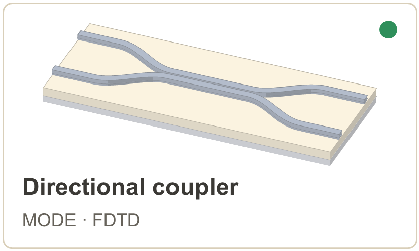
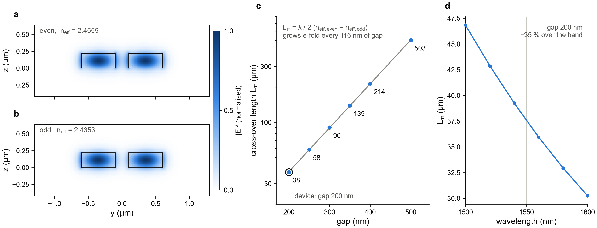
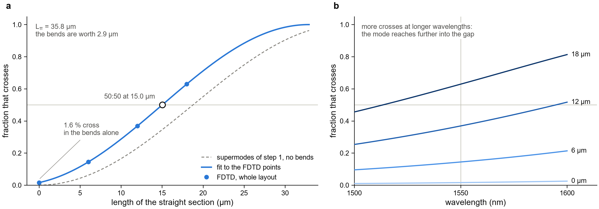
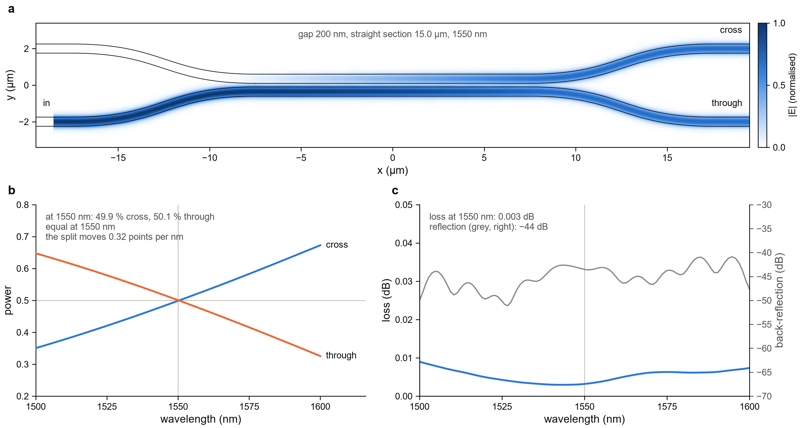

# Directional coupler

<div align="center">

[Previous: rib waveguide](../rib_waveguide/README.md) · [Device library](../../README.md#device-library) · [Next: 1×2 MMI splitter](../mmi1x2/README.md)

</div>

Two waveguides brought close together exchange their light. A short stretch taps off a few per cent
into the neighbour, and a longer one splits the light in half. This chapter draws a directional coupler
with the PDK and finds the length that gives a 50:50 split at 1.55 µm. It also shows how far the split
moves when the wavelength changes.

The work takes three steps: the cross-section first, then the length, then the finished device. Each
step checks the one before it.

---

## The device

<p align="center"></p>

[devices/directional_coupler_builder.py](../../devices/directional_coupler_builder.py) draws two
strip waveguides, 0.5 µm wide, that run side by side over a straight section. An S-bend at each of
the four ends takes them apart again. From the repository root:

```bash
uv run python devices/directional_coupler_builder.py
```

```text
coupler: gap 0.2 um over 15 um, S-bends 10 um long (tightest radius 11.744 um), ports 4 um apart
GDS -> devices/gds/directional_coupler.gds   ports: ['o1', 'o2', 'o3', 'o4']
DRC passed: 0 errors, 0 warnings
```

| parameter | default | where it comes from |
|---|---|---|
| `gap` | 0.20 µm | the minimum space of the waveguide layer: the strongest coupling the process allows |
| `length` | 15 µm | step 2: the 50:50 length at 1.55 µm is 15.03 µm |
| `port_spacing` | 4 µm | centre to centre, at both ends |
| `bend_length` | 10 µm | each S-bend; its tightest radius, 11.7 µm, is above the 5 µm rule |

Light enters at `o1`. The waveguide it stays in ends at `o4`, the through port. The other waveguide
ends at `o3`, the cross port. The builder refuses a gap below the minimum space, and S-bends that
curve tighter than the bend radius of the design rules.

## The steps

| step | folder | solver | script | the question it answers |
|---|---|---|---|---|
| 1 | `1_supermodes` | MODE (FDE) | `supermodes_fde.py` | How fast do two parallel waveguides exchange light, for a given gap? |
| 2 | `2_coupling_length` | FDTD | `coupling_length_fdtd.py` | How long must the straight section be, with the bends counted in? |
| 3 | `3_coupler_fdtd` | FDTD | `coupler_fdtd.py` | What does the device as drawn do across the band? |

## Run it

You need Lumerical with MODE and FDTD. See the
[prerequisites of chapter 4](../ring_modulator/README.md#prerequisites). The run times are from the
author's machine, with 16 threads.

```bash
cd lumerical_simulations/directional_coupler/scripts
uv run python supermodes_fde.py                 # step 1, about 2 minutes
uv run python coupling_length_fdtd.py --preview # draws the layout, the simulation region and the ports
uv run python coupling_length_fdtd.py           # step 2, about 35 minutes for four lengths
uv run python coupler_fdtd.py                   # step 3, about 13 minutes
uv run python coupler_fdtd.py --mesh 0.01 --name coupler_fdtd_fine   # the mesh check of step 3, about 40 minutes
```

The figures are redrawn from the kept results, without Lumerical:

```bash
uv run python lumerical_simulations/directional_coupler/figures/fig1_supermodes.py
uv run python lumerical_simulations/directional_coupler/figures/fig2_coupling_length.py
uv run python lumerical_simulations/directional_coupler/figures/fig3_coupler.py
```

---

## Step 1. The supermodes, by MODE

**The question.** How long does it take two parallel strips, 0.2 µm apart, to pass their light across?

**The idea.** Two waveguides side by side do not have a mode each. Together they have two: the even
supermode, with the same field in both cores, and the odd one, with opposite fields. Light that
starts in one waveguide is the sum of the two. They travel at slightly different speeds, so along
the coupler the sum moves across to the other waveguide, and back again. All of it has crossed after

```
L_π = λ / (2 (n_even − n_odd))
```

and half of it after L_π / 2. One mode calculation on the cross-section therefore gives the scale of
the device.

**The model.** A straight piece of the two strips, written to GDS and loaded into a Layer Builder with
the process file. The mode solver uses a window of 6 µm by 2.4 µm with a 20 nm mesh, and 10 nm over
both cores and across the gap, with a mesh line on every silicon surface.

**The results** (`supermodes.txt`):

| quantity | value |
|---|---|
| even supermode, 1.55 µm | n_eff = 2.45591 |
| odd supermode | n_eff = 2.43528 |
| difference | 0.02064 |
| cross-over length L_π | 37.55 µm |
| half of it | 18.78 µm |

| gap | 200 nm | 250 nm | 300 nm | 350 nm | 400 nm | 500 nm |
|---|---|---|---|---|---|---|
| L_π | 37.6 µm | 58.4 µm | 90.3 µm | 139 µm | 214 µm | 503 µm |

<p align="center"></p>

**Figure 1.** The supermodes. Panels a and b are the even and the odd supermode; c is the cross-over
length against the gap, on a logarithmic axis; d the same length against wavelength at a gap of
200 nm.

**Reading the figure.**

- *a and b, the two supermodes.* The even one has light in the gap; the odd one has a zero in the
  middle of it. More of the even mode is in silicon and oxide between the cores, so its index is
  higher. The single strip of the [strip chapter](../strip_waveguide/README.md) has 2.4445, between
  the two.
- *c, the gap.* L_π grows by a factor e for every 116 nm of gap. The field of one waveguide falls off
  exponentially outside its core, and the coupling is the part of that tail that reaches the other
  core.
- *d, the wavelength.* L_π falls from 46.8 µm at 1500 nm to 30.3 µm at 1600 nm, by 35 %. At a longer
  wavelength the mode is wider and reaches further into the gap.

**What it tells you.** At the smallest gap the process allows, a 50:50 coupler is about 19 µm long.
The gap is the sensitive dimension. By the fit of panel c, 10 nm more gap makes L_π 9 % longer. The
length is not sensitive in that way: a micrometre more or less is 3 % of L_π.

**Pitfall.** The two supermodes differ by 0.02 in index, and L_π is the inverse of that difference. An
error of 0.001 in one index moves L_π by 5 %. Step 1 therefore meshes the gap finely and puts mesh
lines on the surfaces. Both modes are found in the same run, on the same mesh, so their common errors
cancel in the difference.

## Step 2. The length, by FDTD

**The question.** How long must the straight section be for a 50:50 split, when the S-bends are part of
the device?

**The idea.** The S-bends couple too. Where they approach the straight section, the two cores are
already close. Step 1 knows nothing of that. FDTD on the whole layout includes it. The fraction of the
light that crosses follows

```
cross / (cross + through) = sin²( π/2 · (L + L_bends) / L_π )
```

where L is the length of the straight section and L_bends is the length of straight coupler that the
four bends are worth. Two unknowns need at least two lengths; four lengths check that the formula
holds.

**The model.** The builder's coupler with a 3 µm lead at each port, for straight sections of 0, 6, 12
and 18 µm, each loaded into a Layer Builder. The FDTD region ends 1 µm before the ends of the leads, so
the waveguides run on into the absorbing boundary. A mode port sits on each of the four waveguides;
light enters at port 1. The mesh is the solver's automatic one (accuracy 2) with a 20 nm override over
the gap, the straight section and 4 µm of the bends at each end.

Run `--preview` first. It draws the layout with the region and the ports, which is the quickest way to
catch a port in the wrong place.

**The results** (`coupling_length.txt`):

| straight section | cross | through | sum | fraction that crosses | the fit |
|---|---|---|---|---|---|
| 0 µm | 0.0158 | 0.9835 | 0.9994 | 0.0158 | 0.0159 |
| 6 µm | 0.1440 | 0.8546 | 0.9987 | 0.1442 | 0.1442 |
| 12 µm | 0.3685 | 0.6309 | 0.9994 | 0.3687 | 0.3688 |
| 18 µm | 0.6282 | 0.3706 | 0.9988 | 0.6290 | 0.6289 |

| quantity | value |
|---|---|
| L_π from the fit | 35.81 µm |
| L_bends, what the four bends are worth | 2.88 µm |
| 50:50 length, L_π / 2 − L_bends | 15.03 µm |
| L_π from the supermodes of step 1 | 37.55 µm, 4.6 % longer |

<p align="center"></p>

**Figure 2.** The length. Panel a is the fraction that crosses against the length of the straight
section: the four FDTD runs, the fit through them, and the curve that step 1 alone would predict.
Panel b is the same fraction against wavelength, one line for each length.

**Reading the figure.**

- *a, the fit.* The four points lie on the sin² curve within 0.0001. With no straight section at all,
  1.6 % already crosses, in the bends. The dashed curve is step 1 without the bends, and it lies
  to the right: it needs more length for the same split.
- *b, the wavelength.* Every length crosses more light at longer wavelengths. A coupler is 50:50 at
  one wavelength.

**What it tells you.** The straight section must be 15.0 µm. A design from the cross-section alone
would have taken L_π / 2 = 18.8 µm from step 1, and by the fit of this step that coupler crosses 66 %
of the light, not 50 %. The bends account for most of that difference and the 4.6 % in L_π for the
rest.

**Checks.**

- *Energy.* Cross and through add up to 0.9987 or more in every run: the coupler loses under 0.006 dB.
  At most 6 × 10⁻⁵ of the power comes back at the input, and as little leaves at port 2.
- *The model.* Two parameters fitted to four points leave no residual above 0.0001. The sin² law
  describes this device.
- *Against step 1.* The two values of L_π come from different solvers and differ by 4.6 %. Step 3
  simulates the device at the fitted length, which is the test that matters.

**Pitfalls.**

- *The bends are not a detail.* At a 200 nm gap they are worth 2.9 µm of straight coupler, a fifth of
  the device.
- *Do not extrapolate the fit far.* It is fitted between 0 and 18 µm. It predicts full crossing at
  32.9 µm; no run checks that.
- *The fields are not kept.* A project with fields is hundreds of megabytes. The script reads the
  port results and saves the project again without them.

## Step 3. The device, by FDTD

**The question.** Does the coupler, as the builder draws it, split 50:50 at 1.55 µm, and what does it
do across the band?

**The model.** The layout that `devices/directional_coupler_builder.py` writes, with its 15 µm straight
section, in the set-up of step 2. One run gives the whole band from 1.50 to 1.60 µm.

**The results** (`coupler_fdtd.txt`):

| quantity | value |
|---|---|
| cross, 1.55 µm | 0.4986 |
| through, 1.55 µm | 0.5007 |
| loss, 1.55 µm | 0.003 dB |
| equal split at | 1550.3 nm |
| back-reflection, 1.55 µm | −43.5 dB |
| light into port 2, 1.55 µm | −43.6 dB |
| the split moves by | 0.32 percentage points per nm |
| between 45:55 and 55:45 | from 1536 to 1565 nm |
| cross fraction at 1500 nm and 1600 nm | 35 % and 67 % |
| loss, 1.50 to 1.60 µm | 0.003 to 0.009 dB |

<p align="center"></p>

**Figure 3.** The device. Panel a is the field at 1550 nm, seen from above, with the outline of the
layout; b the power in the two outputs against wavelength; c the loss and the back-reflection.

**Reading the figure.**

- *a, the field.* The light enters at the lower left. Along the straight section it moves into the
  upper waveguide, and at the right both waveguides carry the same.
- *b, the split.* The two lines cross at 1550 nm. Away from it the split changes almost linearly, by a
  third of a percentage point per nanometre.
- *c, loss and reflection.* The loss stays under 0.01 dB. The reflection, on the right axis, stays
  under −40 dB.

**What it tells you.** The device does what steps 1 and 2 designed it for: 49.9 % crosses at 1.55 µm,
against the 49.9 % the fit predicts for 15.0 µm. It is a narrow-band splitter: the split stays inside
45:55 from 1536 to 1565 nm only. Where a split must hold over a wide band, the
[MMI splitter](../mmi1x2/README.md) is the better device.

**The mesh, and how well the length is known.** The run was repeated with 10 nm over the gap instead
of 20 nm (`coupler_fdtd_fine.txt`; 37 minutes instead of 13):

| mesh over the gap | cross at 1.55 µm | through | equal split at | loss |
|---|---|---|---|---|
| 20 nm, the default | 0.4986 | 0.5007 | 1550.3 nm | 0.003 dB |
| 10 nm | 0.4855 | 0.5137 | 1554.3 nm | 0.004 dB |

The finer mesh couples 2.6 % less. The equal split moves by 4 nm, and at 1.55 µm the device then
splits 48.6:51.4. By the sin² law of step 2, the straight section would have to be about 0.3 µm
longer, 15.3 µm, to bring the equal split back to 1550 nm. That figure is an estimate, not a run.

So the 50:50 length is known to about 0.3 µm, and the 15.0 µm of the builder is the answer of the
default mesh. The finer mesh moves the FDTD towards step 1, whose L_π was the longer one. Running
step 2 again with `--mesh 0.01` takes about two hours and settles it; it is exercise 4.

---

## In numbers

| | |
|---|---|
| waveguides | two strips, 0.5 µm × 220 nm, 0.2 µm apart |
| supermodes at 1.55 µm | n_even = 2.4559, n_odd = 2.4353 |
| L_π | 37.6 µm from the cross-section, 35.8 µm from FDTD |
| the four S-bends are worth | 2.9 µm of straight coupler |
| 50:50 length | 15.0 µm with the default mesh; about 15.3 µm by the mesh check |
| the device at 1.55 µm | 49.9 % cross, 50.1 % through, 0.003 dB loss (48.6 % cross with the finer mesh) |
| bandwidth of the split | ±15 nm for 45:55 |

## Limits

- Smooth, vertical sidewalls, and the gap exactly as drawn. In fabrication the gap is the dimension
  that varies; step 1 gives its effect on L_π.
- TE light only.
- The coupler is simulated alone. In a circuit, the waveguides that lead to it add their own loss and
  phase.
- The numbers are for a teaching process and have not been compared with a fabricated device.

## Exercises

1. **A tap.** Use the fit of step 2 to choose the length for a 10 % tap. Build it, simulate it with
   `coupler_fdtd.py` after changing `LENGTH` in the builder, and compare.
2. **A wider gap.** Step 1 gives L_π = 90 µm at a 300 nm gap. Run step 2 with the builder's `GAP` at
   0.30 and lengths of 0, 15, 30 and 45 µm. Are the bends worth more or less than at 200 nm, and why?
3. **The wavelength of equal split.** By how much must the length change to move the equal split from
   1550 to 1530 nm? Estimate it from panel b of figure 2, then run it.
4. **The finer mesh.** Run `coupling_length_fdtd.py --mesh 0.01`. What are L_π, L_bends and the 50:50
   length now, and how close is L_π to the 37.55 µm of step 1? Set the builder's `LENGTH` to the new
   value and run `coupler_fdtd.py --mesh 0.01 --name coupler_fdtd_fine` again.
