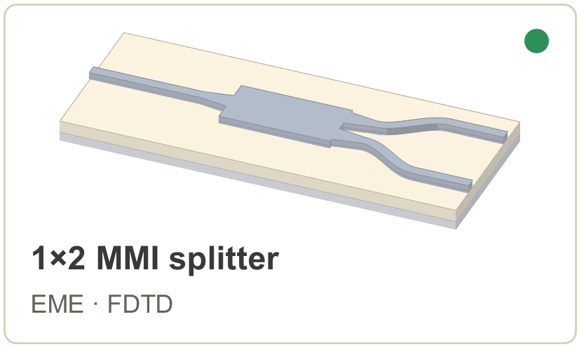
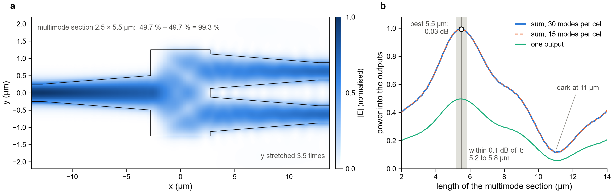
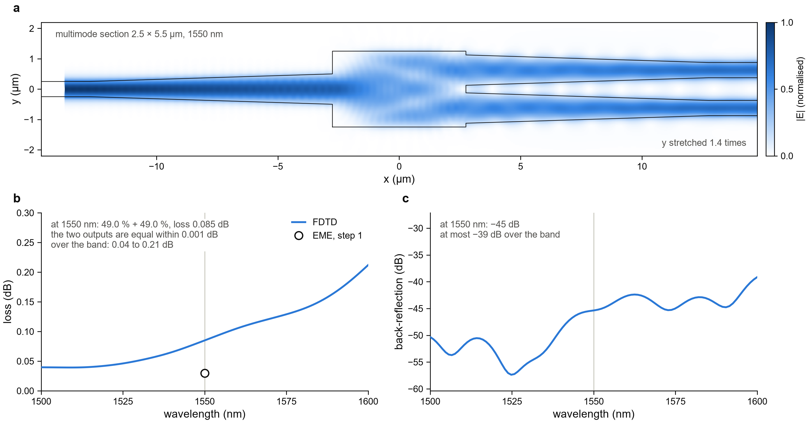

# 1×2 MMI splitter

<div align="center">

[Previous: directional coupler](../directional_coupler/README.md) · [Device library](../../README.md#device-library)

</div>

A multimode interference splitter divides light between two waveguides. The input waveguide opens
into a short, wide section that guides several modes at once. They travel at different speeds, and
at one particular length they add up to two copies of the input, side by side. Two output waveguides
sit there. The device is mirror-symmetric, so the split is 50:50 by construction; what the designer
has to find is the length, and with it the loss.

This chapter finds that length with one solver, EME, and checks the finished device with another,
FDTD.

---

## The device

<p align="center"></p>

[devices/mmi1x2_builder.py](../../devices/mmi1x2_builder.py) draws the input taper, the multimode
section and the two output tapers on the strip waveguide layer. From the repository root:

```bash
uv run python devices/mmi1x2_builder.py
```

```text
MMI: multimode section 2.5 x 5.5 um, tapers 1 um wide and 10 um long, outputs 1.25 um apart
GDS -> devices/gds/mmi1x2.gds   ports: ['o1', 'o2', 'o3']
DRC passed: 0 errors, 0 warnings
```

| parameter | default | where it comes from |
|---|---|---|
| `width_mmi` | 2.5 µm | width of the multimode section |
| `length_mmi` | 5.5 µm | step 1: the length of lowest loss |
| `width_taper` | 1.0 µm | each access waveguide where it meets the multimode section |
| `length_taper` | 10 µm | from 0.5 µm to 1.0 µm |
| `gap_mmi` | 0.25 µm | between the two output tapers; the rule is 0.2 µm |

The widths and the taper dimensions are the defaults of the `mmi1x2` cell of gdsfactory. The builder
adds the checks against the design rules: it refuses a gap below the minimum space, and output tapers
that do not fit on the multimode section.

## The steps

| step | folder | solver | script | the question it answers |
|---|---|---|---|---|
| 1 | `1_mmi_length` | MODE (EME) | `mmi_length_eme.py` | At what length of the multimode section do the two images form? |
| 2 | `2_mmi_fdtd` | FDTD | `mmi_fdtd.py` | What does the device as drawn do across the band? |

## Run it

You need Lumerical with MODE and FDTD. See the
[prerequisites of chapter 4](../ring_modulator/README.md#prerequisites). The run times are from the
author's machine, with 16 threads.

```bash
cd lumerical_simulations/mmi1x2/scripts
uv run python mmi_length_eme.py --check     # step 1, about 7 minutes
uv run python mmi_fdtd.py --preview         # draws the layout, the simulation region and the ports
uv run python mmi_fdtd.py                   # step 2, about 5 minutes
uv run python mmi_fdtd.py --mesh 0.01 --name mmi_fdtd_fine   # the mesh check of step 2, about 20 minutes
```

The figures are redrawn from the kept results, without Lumerical:

```bash
uv run python lumerical_simulations/mmi1x2/figures/fig1_mmi_length.py
uv run python lumerical_simulations/mmi1x2/figures/fig2_mmi_fdtd.py
```

---

## Step 1. The length, by EME

**The question.** How long must a multimode section of 2.5 µm width be, so that the light arrives at
the two outputs?

**The model.** The splitter with a 3 µm lead at each port, loaded into a Layer Builder with the process
file. The solver is EME: it cuts the device into cells along its length and finds the modes of each
cell once. The [strip chapter](../strip_waveguide/README.md#step-2-the-taper-by-eme) introduces the
method. Here the device has five groups of cells: the input lead, the input taper (12 cells), the
multimode section (one cell, since its cross-section does not change), the output tapers (12 cells)
and the output leads. Each cell keeps 30 modes.

The whole cross-section is solved. There are three ports: one on the input, and one on each output,
each covering its own waveguide only.

A longer multimode section has the same modes; only their phases at the output change. So the sweep
over 121 lengths costs one mode calculation.

**The results** (`mmi_length.txt`):

| length of the multimode section | power into the two outputs | loss |
|---|---|---|
| 4.5 µm | 83.8 % | 0.77 dB |
| 5.0 µm | 95.5 % | 0.20 dB |
| 5.2 µm | 98.0 % | 0.09 dB |
| 5.5 µm, the device | 99.3 % | 0.03 dB |
| 5.8 µm | 97.5 % | 0.11 dB |
| 6.0 µm | 94.8 % | 0.23 dB |
| 6.5 µm | 84.9 % | 0.71 dB |
| 11.0 µm | 11.6 % | 9.4 dB |

<p align="center"></p>

**Figure 1.** The length. Panel a is the field in the device as drawn, seen from above, with the
outline of the layout; b the power into the outputs against the length of the multimode section.

**Reading the figure.**

- *a, the field.* The input mode enters the wide section and spreads. At the far face it has
  gathered into two spots, in front of the two output tapers.
- *b, the sweep.* The power into the outputs peaks at 5.5 µm, where 99.3 % arrives. The shaded band,
  5.2 to 5.8 µm, is where the loss stays within 0.1 dB of the best. At 11 µm, twice the length, the
  outputs are almost dark. The theory of self-imaging expects that: at twice the length the modes
  add up to one image of the input, on the axis, between the two outputs.

**What it tells you.** 5.5 µm is the length, with a tolerance of ±0.3 µm for a tenth of a decibel.
That is a comfortable tolerance for a drawn length. What moves the best length in fabrication is the
width of the multimode section, which this step does not vary.

**Checks.**

- *The sweep against a direct simulation.* The sweep stretches the multimode section in the solver.
  The device as drawn, simulated directly, gives the same 0.9932.
- *The number of modes.* With 15 modes per cell instead of 30, the power changes by at most 0.005 over
  the sweep and by under 0.001 between 5 and 6 µm. The best length stays at 5.5 µm.
- *Symmetry.* The two outputs receive 0.4966 each.

**Pitfalls.**

- *Read the device before the sweep.* A length sweep leaves the swept group at the last length it
  tried. An early version of this script read the "device" after a sweep that ended at 14 µm, and
  reported 42 % for it. The script now propagates the device first and compares it with the sweep.
- *A port per output.* A port that spans the whole cross-section on the output side would look for
  one mode of two waveguides together. Each output port covers its own waveguide, from the axis
  outwards.
- *No symmetry wall here.* The taper of the strip chapter was solved in half. This device could be
  too, but then the two outputs become one port. The whole cross-section is solved, which costs twice
  the modes and shows the balance between the outputs.

## Step 2. The device, by FDTD

**The question.** Does a second solver agree, and what does the splitter do from 1.50 to 1.60 µm?

**The model.** The same layout, in a 3D FDTD region that ends 1 µm before the ends of the leads. A
mode port sits on the input and one on each output. The mesh is the solver's automatic one (accuracy
2) with a 20 nm override over the multimode section and the tapers. One run gives the whole band.

FDTD does not choose modes. It solves Maxwell's equations on the layout as it is, so it is an
independent check of step 1. It also gives the reflection, and the spectrum in one run.

**The results** (`mmi_fdtd.txt`):

| quantity | value |
|---|---|
| power into each output, 1.55 µm | 0.4903 and 0.4903 |
| loss, 1.55 µm | 0.085 dB |
| difference between the outputs, 1.55 µm | below 0.001 dB |
| back-reflection, 1.55 µm | −45 dB |
| loss, 1.50 to 1.60 µm | 0.04 to 0.21 dB |
| back-reflection, 1.50 to 1.60 µm | at most −39 dB |

<p align="center"></p>

**Figure 2.** The device. Panel a is the field at 1550 nm; b the loss against wavelength, with the EME
value of step 1 as a circle; c the back-reflection.

**Reading the figure.**

- *a, the field.* The same picture as in step 1, from the other solver.
- *b, the loss.* It rises from 0.04 dB at 1500 nm to 0.21 dB at 1600 nm. The length was chosen at
  1550 nm; the length at which the images form changes with wavelength, and at 1600 nm the device is
  a little off it.
- *c, the reflection.* It stays below −39 dB, although the multimode section begins and ends with
  an abrupt face.

**What it tells you.** The splitter divides the light evenly over the whole band with a loss of at
most 0.2 dB. Compare the [directional coupler](../directional_coupler/README.md): its loss is more
than ten times lower, but its split moves from 35:65 to 67:33 across the same band. A coupler suits one
wavelength and a tunable ratio; an MMI suits a fixed, even split over a band.

**The mesh.** The run was repeated with 10 nm over the multimode section instead of 20 nm
(`mmi_fdtd_fine.txt`; 20 minutes instead of 5):

| mesh over the multimode section | power into each output, 1.55 µm | loss | back-reflection | loss over the band |
|---|---|---|---|---|
| 20 nm, the default | 0.4903 | 0.085 dB | −45.4 dB | 0.039 to 0.212 dB |
| 10 nm | 0.4903 | 0.085 dB | −44.9 dB | 0.040 to 0.210 dB |

Nothing moves. The FDTD result does not depend on this mesh.

**The two solvers.** EME gives a loss of 0.030 dB at 1.55 µm and FDTD 0.085 dB. They agree that the
loss is under a tenth of a decibel, and they differ by 0.055 dB, about 1.3 % of the power. Each is
stable against its own refinement: the EME against the number of modes, the FDTD against the mesh. So
the difference is not explained by either, and this chapter cannot say which number is closer. For a
loss budget, take the larger one.

The reflections differ more: the EME reports 2 × 10⁻⁸ and the FDTD 3 × 10⁻⁵, which is −45 dB. The
numbers of this chapter take the reflection from the FDTD. Why the EME value is so much lower was not
investigated here.

---

## In numbers

| | |
|---|---|
| multimode section | 2.5 µm × 5.5 µm, 220 nm silicon in oxide |
| best length | 5.5 µm; within 0.1 dB from 5.2 to 5.8 µm |
| loss at 1.55 µm | 0.03 dB by EME, 0.085 dB by FDTD |
| split | equal within 0.001 dB |
| loss over 1.50 to 1.60 µm | 0.04 to 0.21 dB |
| back-reflection | −45 dB at 1.55 µm, at most −39 dB over the band |

## Limits

- Smooth, vertical sidewalls, and the widths exactly as drawn.
- The width of the multimode section is not varied. It is the dimension the best length is most
  sensitive to.
- TE light only.
- The numbers are for a teaching process and have not been compared with a fabricated device.

## Exercises

1. **The width.** In the builder, set `WIDTH_MMI` to 2.4 and to 2.6 and run step 1 each time. By how
   much does the best length move for 0.1 µm of width? Compare with the ±0.3 µm tolerance of the
   length.
2. **A longer device.** The sweep is dark at 11 µm. Extend it with `--lengths 2 30 --points 281`.
   Where is the next length at which the two outputs are bright again?
3. **Fewer modes.** Run step 1 with `--modes 8`. Which part of the curve changes first?
