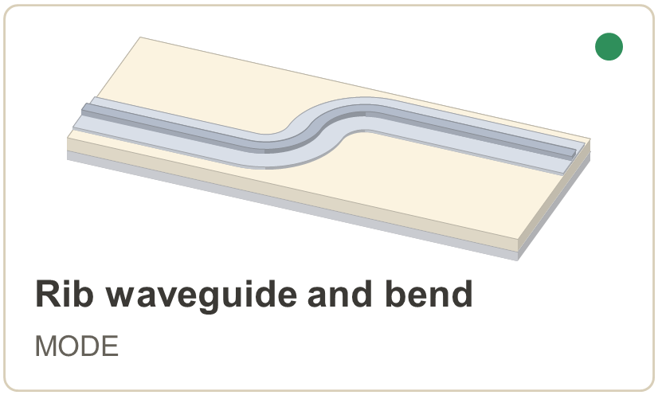
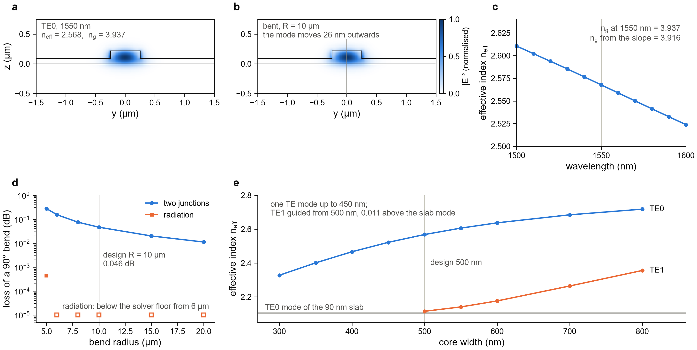

# Rib waveguide and bend

<div align="center">

[Previous: strip waveguide](../strip_waveguide/README.md) · [Device library](../../README.md#device-library) · [Next: directional coupler](../directional_coupler/README.md)

</div>

A rib waveguide keeps a thin slab of silicon on both sides of its core. The etch stops 90 nm above the
buried oxide instead of going through. The slab is what an active device needs: it carries the implants
and the contacts of a modulator to the core. This chapter draws a rib waveguide with the PDK and finds
what the slab costs: a weaker hold on the light, and so a larger bend.

The ring modulator of [chapter 4](../ring_modulator/README.md) is built on this waveguide. Its step 2
computes the same cross-section, and the numbers here agree with it.

---

## The device

<p align="center"></p>

[devices/rib_waveguide_builder.py](../../devices/rib_waveguide_builder.py) draws a straight, an S-bend
and a straight in a row, and has a cell for each part: `straight` and `bend`. From the repository root:

```bash
uv run python devices/rib_waveguide_builder.py
```

```text
rib 0.5 um wide on a 6 um slab, S-bend of R = 10 um, route 45.708 um
GDS -> devices/gds/rib_waveguide.gds   ports: ['o1', 'o2']
DRC passed: 0 errors, 0 warnings
```

| parameter | default | where it comes from |
|---|---|---|
| `width` | 0.5 µm | core width, the same as the strip |
| `slab_width` | 6 µm | wide enough for a contact on each side of the core |
| `radius` | 10 µm | the rib bend radius of the design rules; step 1 shows why it is twice that of the strip |

The core is drawn on the layer `WG` and the slab on `SLAB90`. In the process file the two are grown
from the same level, 220 nm and 90 nm high, so the core stands 130 nm above the slab.

## The step

| step | folder | solver | script | the question it answers |
|---|---|---|---|---|
| 1 | `1_waveguide_modes` | MODE (FDE) | `waveguide_modes_fde.py` | Which modes does the rib guide, how does the index change with wavelength and width, and what does a bend cost? |

## Run it

You need Lumerical with MODE. See the [prerequisites of chapter 4](../ring_modulator/README.md#prerequisites).

```bash
cd lumerical_simulations/rib_waveguide/scripts
uv run python waveguide_modes_fde.py      # about 4 minutes
```

The figure is redrawn from the kept results, without Lumerical:

```bash
uv run python lumerical_simulations/rib_waveguide/figures/fig1_modes.py
```

---

## Step 1. The modes, by MODE

**The question.** What does the rib guide at 1.55 µm, and how does it compare with the strip of the same
width?

**The model.** A straight 6 µm piece of the waveguide, written to GDS and loaded into a Layer Builder
with the process file. The mode solver uses a window of 8 µm by 2.4 µm, so that the whole 6 µm slab lies
inside it, with perfectly matched layers on every side. The mesh is 20 nm, and 10 nm over the rib, with a
mesh line on every silicon surface: the top of the core, the top of the slab, the bottom, and the two
sidewalls.

**What "guided" means in a rib.** In a strip, a mode is guided when its index is above that of the
oxide. In a rib there is silicon beside the core, and light can also leave sideways through the slab. The
slab alone guides a mode of its own, with an index of 2.1035 for a 90 nm slab between oxide. A mode of
the rib stays at the core only while its index is above that. The script computes the slab index from
the three-layer slab equation, with the indices it reads from the structure, and uses it as the
threshold.

**The results** (`rib_modes.txt`):

| quantity | rib | strip, for comparison |
|---|---|---|
| TE0, 1.55 µm: n_eff | 2.5677 | 2.4445 |
| TE0, 1.55 µm: n_g | 3.937 | 4.239 |
| reference index a guided mode must exceed | 2.1035, the slab mode | 1.444, the oxide |
| second TE mode at 0.5 µm | n_eff = 2.1145, 0.011 above the slab mode | n_eff = 1.4934, 0.049 above the oxide |
| second TE mode | absent up to 0.45 µm, guided from 0.50 µm | the same |
| 90° bend at the design radius | 0.046 dB at 10 µm | 0.012 dB at 5 µm |
| 90° bend at 5 µm | 0.28 dB | 0.012 dB |
| mode shift in the bend | 26 nm at 10 µm, 69 nm at 5 µm | 15 nm at 5 µm |
| radiation of the bend | 0.0004 dB per 90° at 5 µm, below the solver floor from 6 µm | below the floor from 3 µm |

<p align="center"></p>

**Figure 1.** The rib waveguide. Panel a is the TE0 mode; b the same mode in a bend of 10 µm; c n_eff
against wavelength; d the loss of a 90° bend against its radius; e the effective index of TE0 and TE1
against the core width.

**Reading the figure.**

- *a, the mode.* The light sits over the core and spreads into the slab on both sides. The index is
  higher than in the strip, 2.568 against 2.444, because there is more silicon under the mode.
- *b, the bend.* The mode moves outwards, away from the centre of the bend, by 26 nm at 10 µm. The grey
  line marks the middle of the core.
- *c, dispersion.* The group index is 3.94, lower than the 4.24 of the strip: a weaker confinement gives
  a weaker dispersion.
- *d, the bend.* As in the strip, the loss of a bend is at its two ends, where the shifted mode meets
  the mode of the straight. The shift is larger here, so the loss is larger: 0.046 dB at 10 µm, and
  0.28 dB at 5 µm, where radiation also begins.
- *e, the width.* The line is the slab mode. TE1 crosses it between 0.45 and 0.50 µm.

**What it tells you.** The slab loosens the hold of the waveguide on the light sideways. The same 0.5 µm
core that bends at 5 µm as a strip needs 10 µm as a rib for a comparable loss, and that is where the
design rule puts it. This is the trade of an active process: use ribs where the device needs the slab,
and strips for the routing between devices.

**Checks.**

- *Against the ring modulator.* Step 2 of chapter 4 simulated this cross-section as part of the ring and
  found n_eff = 2.56770 and n_g = 3.9370 for the straight waveguide, and 2.57016 at R = 10 µm. This
  chapter, with its own layout and its own script, finds the same numbers.
- *The group index.* From the slope of n_eff(λ) it is 3.916; the solver gives 3.937, 0.5 % apart.

**Pitfalls.**

- *The threshold must be the slab mode.* With the oxide index as the threshold, the solver's list
  contains modes of the slab that happen to have some power near the core. An early run of this script
  reported a "TE1" at 0.30 µm with an index of 1.74, far below the slab mode. It was a slab mode.
- *The mesh.* Without a mesh line on the slab surface the index of this waveguide changes by 0.007 with
  the size of the window. Chapter 4 has the full story:
  [the mesh, and why it decides the answer](../ring_modulator/README.md#the-mesh-and-why-it-decides-the-answer).

---

## In numbers

| | |
|---|---|
| waveguide | 0.5 µm core, 220 nm high, on a 90 nm slab 6 µm wide |
| TE0 at 1.55 µm | n_eff = 2.5677, n_g = 3.937 |
| slab mode | n_eff = 2.1035 |
| single TE mode | up to 0.45 µm |
| 90° bend at R = 10 µm | 0.046 dB |

## Limits

- Smooth, vertical sidewalls and a flat slab. Scattering loss is not modelled.
- The slab is undoped here. In a modulator the implants add loss; chapter 4 computes it.
- The bend is a uniform arc between two straights, at 1.55 µm.
- The numbers are for a teaching process and have not been compared with a fabricated device.

## Exercises

1. **A thinner slab.** A shallower rib etch leaves a thicker slab. In
   `gsip_process_file_py/gsip_csv/process_layers.csv` the slab is 90 nm; note what you would have to
   change in `gsip_technology.py` as well, and why the tests would catch a change in only one of them.
2. **The slab width.** Run the builder with `slab_width=3.0` and simulate it. Does n_eff change? At what
   slab width does the mode start to feel the edge of the slab?
3. **A wider core.** Run `waveguide_modes_fde.py --widths 0.6 0.7 0.8 --radii 10`. How far above the
   slab mode is TE1 at 0.8 µm, and what does that mean for a bend?
