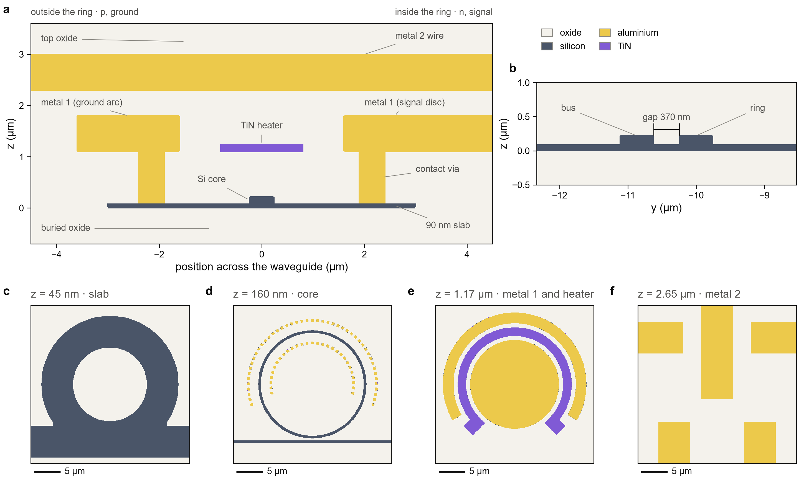
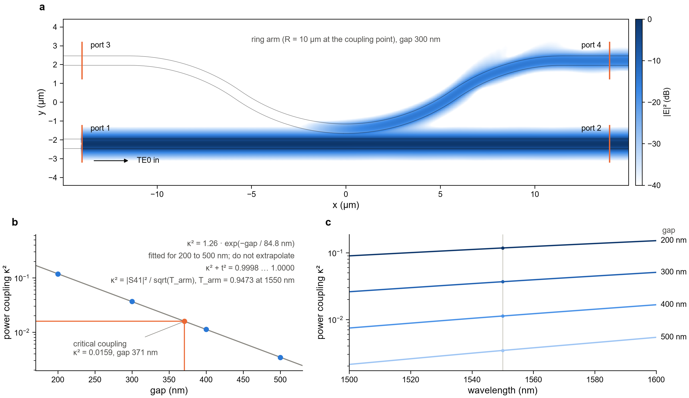
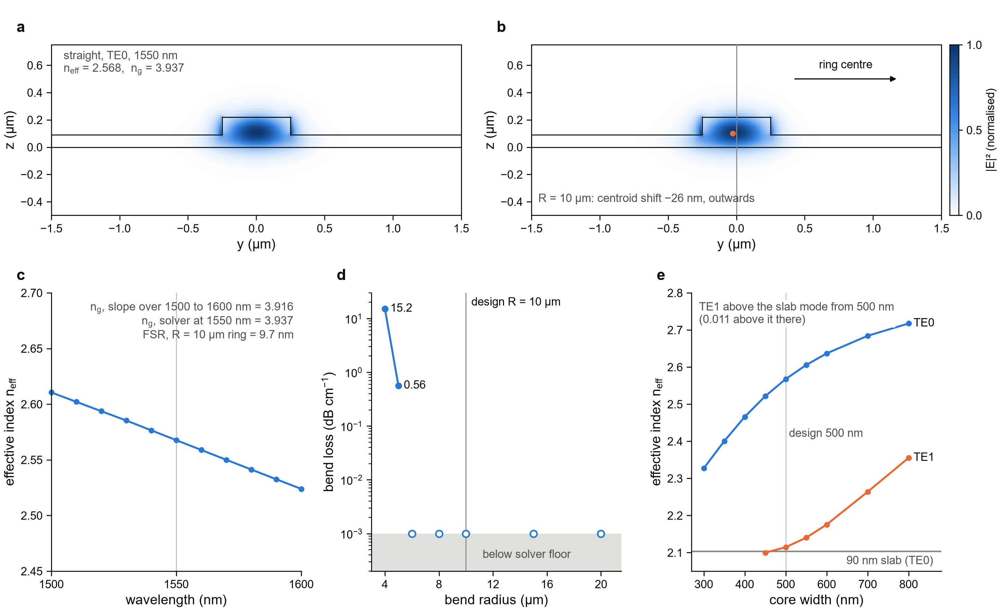
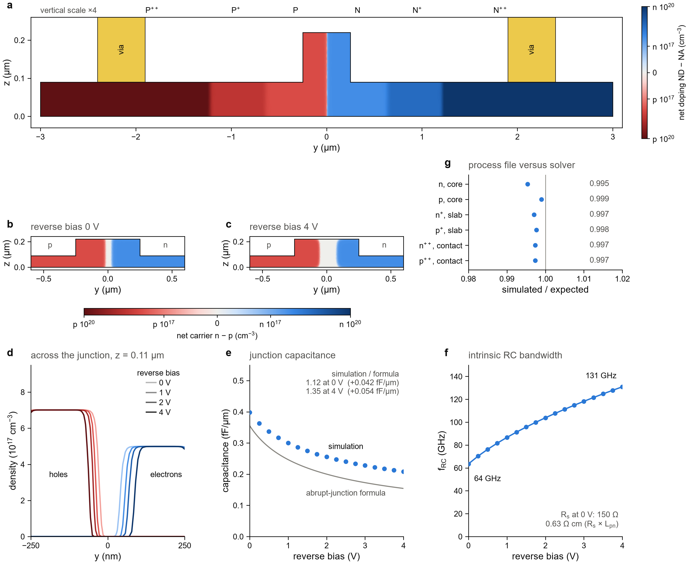
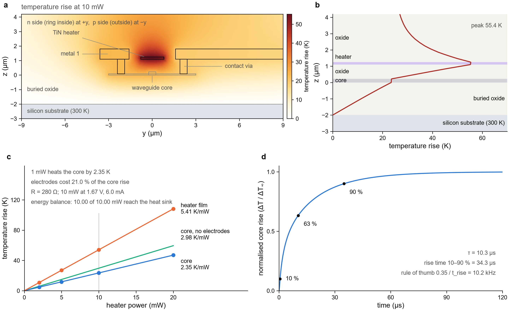
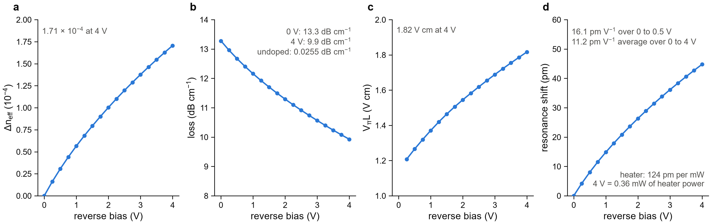
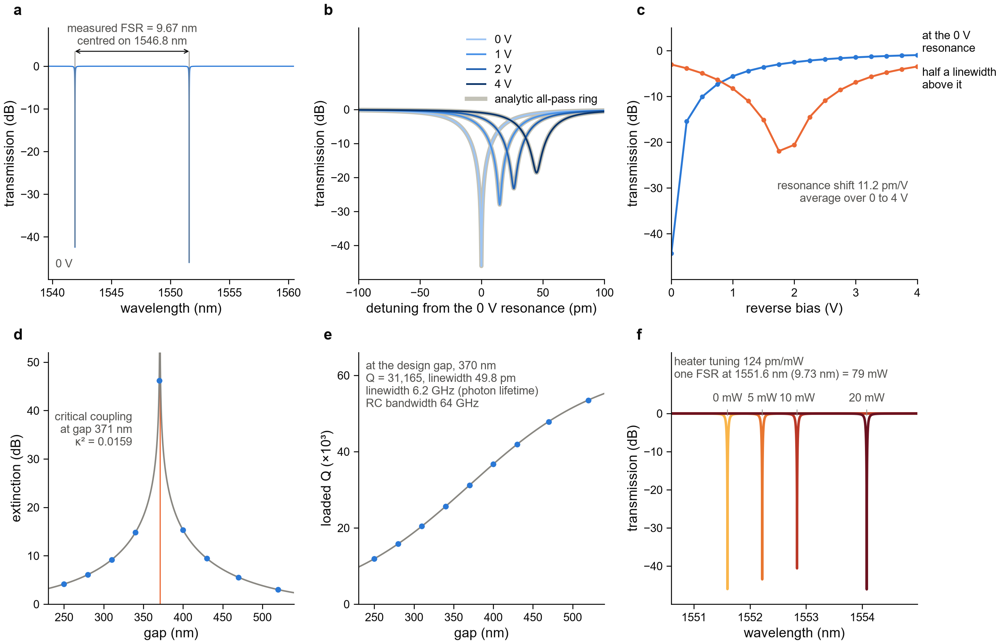

# Chapter 4. The simulations: seven steps from the layout to the circuit

<p align="center">
[Previous: Chapter 3, the process file](../../gsip_process_file_py/README.md) · [Course map](../../README.md) · [Next: Chapter 5, your foundry](../../docs/your_foundry.md)
</p>

Chapter 2 drew the ring modulator. This chapter simulates it. The simulation is split into seven
steps, and each step answers one question about the device with one solver. A step passes its result
on to the next one, so that at the end the seven answers combine into the spectrum of a working
modulator. The whole chain runs from one layout and one process file. No script contains a thickness,
a material or a doping level.

Read the chapter in order. Each step needs the results of the steps before it, and the numbers in later
steps are only meaningful once the earlier ones have been checked.

---

## 4.1 One pattern for every step

Every step builds its structure in the same way:

```
small GDS drawn with the PDK   +   gsip_process.lbr   ->   Layer Builder object
```

The small GDS is a piece of the device, drawn with the layers of the PDK (chapter 1,
[`docs/pdk.md`](../../docs/pdk.md)). The file `gsip_process.lbr` is the process file (chapter 3). The
Layer Builder reads both and makes the 3D structure that the solver meshes. The helper that does this is
`add_layer_builder` in `lumerical_simulations/ring_modulator/scripts/common.py`. Its last two steps are:

```python
    app.loadgdsfile(gds.as_posix())
    app.loadprocessfile(LBR.as_posix())
```

The consequence matters more than the code. A thickness, a material or a doping level is written once,
in the process tables. If the process changes, the seven steps change with it, and the layout and the
simulation cannot drift apart.

The flow is arranged after the flow chart of the Ansys and Tower Semiconductor workshop (see
[`assets/design_flow.png`](../../assets/design_flow.png)). Its circuit-simulation stage is step 6 here. The compact-model stage is drawn but not built yet:
steps 5 and 6 supply its numbers, and the circuit reads them from the result files.

### The seven steps

| step | folder | solver | script | the question it answers | what it passes on |
|---|---|---|---|---|---|
| 0 | `0_layer_builder_check` | MODE (as an index probe) | `layer_builder_check.py` | Did the Layer Builder build the structure the layout describes? | index maps of the finished device (figure 0 only) |
| 1 | `1_coupling_coefficient` | FDTD | `coupling_coefficient_fdtd.py` | How much light crosses from the bus into the ring, for a given gap? | κ²(gap) and its fit, to step 6 |
| 2 | `2_passive_mode_properties` | MODE (FDE) | `passive_mode_fde.py` | What does the bare ring waveguide guide: n_eff, n_g, bend loss? | n_eff, n_g, bend loss, FSR, to steps 5 and 6 |
| 3 | `3_charge_profile` | CHARGE | `charge_profile.py` | How do carriers, capacitance and resistance change with reverse bias? | carrier map to step 5; C, R_s, f_RC to step 6 |
| 4 | `4_heat_profile` | HEAT | `heat_profile.py` | How many kelvin does one milliwatt of heater power add to the core? | temperature map to step 5; K/mW, time constant |
| 5 | `5_active_mode_properties` | MODE (FDE) | `active_mode_fde.py` | How do n_eff and loss change with bias and with heat? | table of Δn_eff, loss and shift versus bias, to step 6 |
| 6 | `6_interconnect_ring_modulator` | INTERCONNECT | `ring_modulator_interconnect.py` | How does the ring behave as a circuit element: spectra, extinction, Q, bandwidth? | the result of the chain: spectra and figures of merit |

### Data flow

```
                 rm_ring.gds + gsip_process.lbr
                               |
                        step 0 (check only)

step 1 FDTD ---- kappa^2(gap) ----------------------------------------------+
                                                                             |
step 2 MODE ---- n_eff, n_g, bend loss, FSR -------------------------------+ |
     |                                                                     | |
     +-- bend orientation ----------------+                                | |
                                          |                                | |
step 3 CHARGE -- carriers (.mat) ---+     |                                | |
            |                       |     |                                | |
            +-- C, R_s, f_RC -------------------------------------------+   | |
                                    |     |                            |   | |
step 4 HEAT --- temperature (.mat) -+     |                            |   | |
            |                             |                            |   | |
            +-- K/mW, tau                 v                            v   v v
                               step 5 MODE: dn_eff(V), loss(V), per mW of heat
                                          |
                                          v
                               step 6 INTERCONNECT: ring element, spectra,
                               extinction, Q, bandwidth, heater tuning
```

In words: step 5 needs the carriers of step 3, the temperature of step 4, and the bend orientation and
group index of step 2. Step 6 needs the coupling of step 1, the waveguide of step 2, the loss and index
change of step 5, and the bandwidth of step 3.

---

## 4.2 Run it

### Prerequisites

1. Python 3.12 or 3.13, and [uv](https://docs.astral.sh/uv/). The environment is set up once from the
   repository root, as described in the root README.
2. Ansys Lumerical 2025 R1 with the FDTD, MODE, CHARGE, HEAT and INTERCONNECT licences. The scripts reach
   it through `lumapi`, the Python API that ships with Lumerical.
3. `LUMERICAL_ROOT`, the folder of the installation that contains `api/python/lumapi.py`. If it is not
   set, `lumerical_env.py` searches the usual install locations and uses the newest one. Set it explicitly
   if you have more than one version:

   ```powershell
   $env:LUMERICAL_ROOT = "C:/Program Files/ANSYS Inc/v251/Lumerical"
   ```

   ```bash
   export LUMERICAL_ROOT=/opt/lumerical/v251
   ```

   Check it with `uv run python lumerical_env.py`. The command prints the installation and the path of
   `lumapi`.
4. The layout `rm_ring.gds` and the process file `gsip_process_file_py/gsip_process.lbr`. Both are kept
   in the repository, so the compiler of chapter 3 need not run again. If you change the device, run
   `uv run python rm_builder.py` first.

Before any licence is used, run the tests. They need no Lumerical:

```bash
uv run pytest
```

The 85 tests check the PDK, the layout, the design rules, the process tables, the device's nets and the
figures redrawn from the kept data.

### The commands, in order

Run the scripts from the `scripts` folder. Each script writes into the folder of its step, using paths
relative to its own location.

```bash
cd lumerical_simulations/ring_modulator/scripts

uv run python layer_builder_check.py                 # step 0, about half a minute, MODE only
uv run python coupling_coefficient_fdtd.py --preview # optional: draw the FDTD window, no solver
uv run python coupling_coefficient_fdtd.py --dry     # optional: one gap, coarse mesh, a few minutes
uv run python coupling_coefficient_fdtd.py           # step 1, about 6 minutes per gap
uv run python coupling_coefficient_fdtd.py --summary-only  # optional: rebuild the table, no Lumerical
uv run python passive_mode_fde.py                    # step 2, about 7 minutes
uv run python charge_profile.py                      # step 3, about 9 minutes
uv run python heat_profile.py                        # step 4, about 3 minutes
uv run python active_mode_fde.py                     # step 5, about 1 minute
uv run python ring_modulator_interconnect.py         # step 6, under 1 minute
```

The order matters. Step 5 reads the files of steps 2, 3 and 4, and step 6 reads the files of steps 1, 2,
3 and 5. Steps 2, 3 and 4 do not depend on each other, and step 0 is only a check.

The run times are the ones measured on the author's machine, and they are rough guides. Step 1 takes
about 6 minutes for each gap. The reference arm of step 1 is a fifth run and is not in the table, so
budget about 30 minutes for the default run of step 1.

The `--dry` option of step 1 writes files named `dry_*` into the same folder. Delete them after the
check. A dry run does not write the summary table.

### The options of each script

The defaults shown are those of the `argparse` definitions in each script. `-h` or `--help` prints them.

| script | option | default | what it does |
|---|---|---|---|
| `layer_builder_check.py` | none | | |
| `coupling_coefficient_fdtd.py` | `--gaps` | `0.20 0.30 0.40 0.50` (µm) | gaps to simulate |
| | `--radius` | 10 µm | ring radius of the coupling region |
| | `--dry` | off | coarse mesh, first gap only, no reference, no summary |
| | `--no-reference` | off | skip the arm-alone run; κ² is then not de-embedded |
| | `--summary-only` | off | rebuild `coupling_vs_gap.csv` and `.txt` from the kept `.npz` files; no Lumerical |
| | `--preview` | off | draw the layout and the window into `figures/check_coupler_setup.png`, no solver |
| | `--accuracy` | 2 | FDTD mesh accuracy |
| | `--gap-mesh` | 0.02 µm | mesh step over the coupler; `0.01` is the mesh check of this step |
| | `--time` | 2.5e-12 s | simulation time |
| | `--threads` | up to 16 | threads of the CPU engine |
| | `--job-manager` | off | run through Lumerical's job manager instead of the CPU engine |
| | `--keep-results` | off | keep the fields in the `.fsp` files (large) |
| `passive_mode_fde.py` | `--radii` | `4 5 6 8 10 15 20` (µm) | bend radii |
| | `--widths` | nine values, `0.30` to `0.80` µm | core widths of the sweep |
| | `--no-widths` | off | skip the width sweep |
| | `--mesh` | 0.02 µm | uniform mesh step of the mode solver |
| | `--rib-mesh` | 0.01 µm | mesh step on the silicon surfaces of the rib (see 4.8) |
| | `--points` | 11 | wavelengths of the sweep, 1.50 to 1.60 µm |
| `charge_profile.py` | `--vmin` | −4.0 V | most negative anode voltage |
| | `--points` | 17 | bias points; keep the step at 0.25 V or below |
| | `--freqs` | `1e8 1e9 1e10 3e10` (Hz) | small-signal frequencies, strictly ascending |
| | `--no-ssac` | off | skip the small-signal capacitance and resistance |
| `heat_profile.py` | `--powers` | `2 5 10 20` (mW) | steady-state heater powers |
| | `--no-transient` | off | skip the time-dependent run |
| | `--no-bare` | off | skip the run without metal 1 and the vias |
| `active_mode_fde.py` | `--mesh` | 0.02 µm | uniform mesh step of the mode solver |
| | `--rib-mesh` | 0.01 µm | mesh step on the silicon surfaces of the rib |
| `ring_modulator_interconnect.py` | `--gaps` | nine values, `0.25` to `0.52` µm | gaps of the sweep at 0 V |
| | `--gap` | the swept gap with the highest extinction | design gap |
| | `--volts` | `0 -1 -2 -4` (V) | biases listed in the summary |
| | `--heater` | `0 5 10 20` (mW) | heater powers of the thermal sweep |

Running a step rewrites the result files of that step, and every figure that reads them changes. Only
`--dry`, `--preview`, `--summary-only` and the read-only commands leave the kept results alone (`--dry`
writes its own `dry_*` files). Copy a step folder before you experiment with its options, and restore it
afterwards.

---

## 4.3 Redraw the figures without Lumerical

The seven figures are drawn by the scripts in `lumerical_simulations/ring_modulator/figures/`. They read
the `.npz` files of the steps, not the solver. Each figure can therefore be drawn again on any machine,
from the kept data:

```bash
uv run python lumerical_simulations/ring_modulator/figures/fig0_layer_builder.py   # -> fig0_layer_builder.png
uv run python lumerical_simulations/ring_modulator/figures/fig1_coupling.py       # -> fig1_coupling.png
uv run python lumerical_simulations/ring_modulator/figures/fig2_passive.py        # -> fig2_passive.png
uv run python lumerical_simulations/ring_modulator/figures/fig3_charge.py         # -> fig3_charge.png
uv run python lumerical_simulations/ring_modulator/figures/fig4_heat.py           # -> fig4_heat.png
uv run python lumerical_simulations/ring_modulator/figures/fig5_active.py         # -> fig5_active.png
uv run python lumerical_simulations/ring_modulator/figures/fig6_circuit.py        # -> fig6_circuit.png
```

The figures need matplotlib, numpy and klayout. The arrays they read are kept in the repository for this
purpose. The arrays are about 7 MB in total, which is the price of being able to read every number in
every panel without a licence.

---

## 4.4 What is kept and what is rebuilt

| kept in the repository | rebuilt by the scripts and ignored by git |
|---|---|
| the small GDS of each step | Lumerical project files (`.fsp`, `.lms`, `.ldev`, `.icp`) |
| the `.txt` summary of each step | field and temperature maps as `.mat` files |
| `coupling_vs_gap.csv`, the table that step 6 reads | log files (`*_p0.log`, `*_engine.out`) |
| the result arrays `.npz`, which the figures read | the `dry_*` files of step 1 |

The `.txt` files are the human-readable record of each run. The numbers in this chapter are taken from
them, and the result tables below repeat them.

---

## 4.5 The device

The device is the one of chapter 2 ([`docs/device.md`](../../docs/device.md)). Its defaults are the
defaults of `rm_builder.ring_modulator`, and the scripts read them from its signature, so the simulations
always match the layout.

| quantity | value |
|---|---|
| ring radius | 10 µm (circumference 62.83 µm) |
| waveguide | rib, 0.5 µm wide, 220 nm silicon core on a 90 nm slab 6 µm wide |
| bus | same cross-section as the ring |
| coupling gap | 0.37 µm (layout default) |
| wavelength, polarisation | 1550 nm, TE |
| PN junction | upper 240° of the ring, 41.89 µm long, 67 % of the ring |
| junction position | at the core centre; n inside the ring (signal), p outside (ground) |
| contact vias | 0.5 µm wide, 1.9 µm from the core centre |
| metal 1 | a disc inside the ring (signal) and an arc outside (ground), both from 1.6 µm |
| heater | TiN arc, 1.6 µm wide, 0.15 µm thick, 0.88 µm above the core; 270° with a free filament of 44.72 µm (71 % of the ring) between two landings |
| heater resistance | 280 Ω |
| metal 2 and pads | metal 2 to five metal 3 pads, 80 µm wide on a 100 µm pitch: G S G in the north for the junction, H H in the south for the heater |
| ports | o1, o2, G1, S, G2, H1, H2 |
| design rules | 0 errors, 0 warnings, 16 layers used (`rm_builder.py` output) |

---

## 4.6 Step 0. The Layer Builder check

**The question.** Does the Layer Builder make the structure that the layout describes?

**The model.** The whole device, `rm_ring.gds`, is loaded with the process file into a Layer Builder object
36 µm wide. The mode solver is used only as a probe. It meshes a plane, and it reports the refractive index
that it sees on every mesh point. Two vertical cuts and four horizontal cuts are taken:

- a vertical cut through the PN section on the north side of the ring (x = 0, mesh 20 nm), from
  z = −5.5 µm to 3.6 µm. It reaches the substrate and the buried oxide below the slab, and it shows the
  contacts, metal 1, the heater and the metal 2 wire above;
- a vertical cut through the coupler on the south side (mesh 10 nm), which shows the ring core and the bus
  core on the common slab, and the gap between them;
- horizontal cuts at z = 45 nm (slab), 160 nm (core), 1.17 µm (metal 1 and heater) and 2.65 µm (metal 2),
  with a 50 nm mesh over a 32 µm window.

A wrong layer expression in the process file shows up here at once, as a missing or misplaced shape. No
solver licence is used beyond MODE.

**What the probe sees.** At ten points of the finished structure the solver should see the material that the
process table assigns to the layer there. The expected values are the ones of a known material at 1550 nm,
and the result is written to `structure.txt`:

| probe point | expected | seen by the solver, n + ik |
|---|---|---|
| substrate (y = R, z = −5.00 µm) | silicon, about 3.48 | 3.476 + 0.000i |
| buried oxide (y = R, z = −1.00 µm) | oxide, about 1.44 | 1.444 + 0.000i |
| core centre (y = R, z = 0.11 µm) | silicon, about 3.48 | 3.476 + 0.000i |
| slab (y = R − 1.0, z = 0.05 µm) | silicon | 3.476 + 0.000i |
| above the slab (y = R − 1.0, z = 0.15 µm) | oxide, about 1.44 | 1.444 + 0.000i |
| inner contact via (y = R − 2.15, z = 0.60 µm) | aluminium, large imaginary part | 1.440 + 16.000i |
| heater film (y = R, z = 1.17 µm) | TiN | 3.538 + 6.517i |
| metal 1, outer arc (y = R + 2.6, z = 1.45 µm) | aluminium | 1.440 + 16.000i |
| metal 2 wire (y = R, z = 2.65 µm) | aluminium | 1.440 + 16.000i |
| between the levels (y = R, z = 2.00 µm) | oxide | 1.444 + 0.000i |

**Figure 0.**

<p align="center"></p>

**Figure 0.** The finished device as the mode solver sees it, at 1550 nm. Panel a is the cut through the PN
section; panel b the cut through the coupler; panels c to f the horizontal cuts at 45 nm, 160 nm, 1.17 µm
and 2.65 µm.

**Reading the figure.**

- *a, the PN section.* The horizontal axis is the position across the waveguide, with the ring centre to
  the right. The left side is outside the ring: p and ground. The right side is inside the ring: n and
  signal. Metal 1 is a disc on the inside and an arc on the outside, both standing on a contact via. The
  TiN heater floats above the core at 1.10 µm. Metal 2 is a wire at 2.3 to 3.0 µm, and the buried oxide
  lies below the 90 nm slab.
- *b, the coupler.* The bus and the ring sit side by side on one slab, with a gap of 370 nm between their
  core edges. The slab is the same piece of silicon under both, which is why the two waveguides are coupled
  at all.
- *c, slab level.* The slab of the ring and the slab of the bus are one merged shape.
- *d, core level.* The ring core is the circle, the bus the straight line below. The dotted rings are the
  contact vias, drawn as strips.
- *e, metal 1 and heater.* The inner disc and the outer arc of metal 1, and the TiN arc with its two landings
  at the bottom. The heater lies inside the metal 1 arc, not on it.
- *f, metal 2.* The five wires: three in the north (G, S and G), with the signal in the middle, and two in the
  south (H and H) for the heater.

**What it tells you.** The structure is what the layout and the process file together describe. The geometry
of chapter 2 has become a 3D structure with the right materials at the right heights. Every later step uses
this structure or a cut of it.

**Check.** The table above is the check. Its expected values come from the materials, not from the process
file, so a mistake in the process file cannot hide in both columns.

**Things that go wrong.**

- *A shape is missing from a panel.* The layer expression in `gsip_process.lbr` does not match the layer in the
  GDS. Check the process tables (chapter 3). Then rerun step 0, which takes about half a minute.
- *The script stops with "rm_ring.gds is missing".* Run `uv run python rm_builder.py` from the repository root,
  then step 0 again.
- *The probe shows silicon where the heater should be.* The Layer Builder is not centred on the origin of the
  GDS. The script sets "Centered at origin" for this reason: GDS coordinates equal simulation coordinates.

**Try it.** Open `rm_ring.gds` in KLayout with `klayout_tech/tech.lyt`, and compare the layout of metal 1 with
panel e of figure 0. Both show the same disc, arc and heater landings.

---

## 4.7 Step 1. The coupling coefficient, by FDTD

**The question.** For a given gap, what fraction of the power in the bus crosses into the ring?

**The model.** Only the coupling region is simulated. The ring arc is kept for 35° on either side of the
coupling point. Beyond that the arc bends back, so that it leaves the window parallel to the bus and all four
ports are normal to x:

```
port 3 ______                               ______ port 4      ring arm (radius R near the bus)
             `--..                       ..--'
                   `--..__     __..--'
port 1 ====================`==='==================== port 2      bus
```

Light enters at port 1. The transmission t² = |S21|² stays in the bus. The coupling κ² = |S41|² is the power
that crosses into the ring. Two settings matter.

- **The reference arm.** The arm itself loses light, through bend radiation and through the two curvature
  reversals. Without a correction the coupling would be too low. The script therefore runs a second simulation
  without the bus, sends light from port 3 to port 4, and measures the transmission of the whole arm,
  T = 0.9473. Light coupled from the bus passes only half of the arm, so the correction is κ² = |S41|² / √T.
  Half an arm transmits √0.9473 = 0.9733.
- **The mesh over the coupler.** The gap sets the coupling, so the mesh is refined in the gap region to 20 nm.
  The slab covers the whole window, as it does in the device, where the slabs of ring and bus merge.

The simulation uses the process file through the Layer Builder, a mesh accuracy of 2, a simulation time of
2.5 ps with auto shutoff, and 101 frequency points from 1500 to 1600 nm.

**The results** (`coupling_vs_gap.txt`):

| gap (µm) | κ² | t² = \|S21\|² | κ² + t² | raw \|S41\|² | minutes |
|---|---|---|---|---|---|
| 0.200 | 0.11817 | 0.88166 | 0.9998 | 0.11501 | 5.7 |
| 0.300 | 0.03687 | 0.96308 | 1.0000 | 0.03589 | 5.9 |
| 0.400 | 0.01129 | 0.98870 | 1.0000 | 0.01099 | 5.6 |
| 0.500 | 0.00344 | 0.99656 | 1.0000 | 0.00335 | 5.6 |

The fit is κ² = 1.26 · exp(−gap / 84.8 nm), for gaps of 200 to 500 nm. It is an interpolation formula. Do not
extrapolate it: its amplitude 1.26 is above 1, which no physical coupler reaches. The result file also lists
the reflections |S11|² and the crosstalk |S31|², both below 10⁻⁶, which are negligible.

**The mesh check.** The table is only as good as the mesh. One gap, 400 nm, was run three ways, and the raw
|S41|² at 1550 nm was compared:

| mesh over the coupler | raw \|S41\|² | change | run time |
|---|---|---|---|
| 20 nm (the default) | 0.010989 | reference | 5.6 min |
| 20 nm, mesh boxes cut at the silicon surfaces | 0.010949 | −0.4 % | not timed |
| 10 nm (`--gap-mesh 0.01`) | 0.010774 | −2.0 % | 18.6 min |

The change is small, but it is not zero. A 2 % change in κ² moves the gap of critical coupling by about 2 nm,
and near critical coupling it changes the extinction by many decibels (step 6). So κ² is known to about 2 %.
The tables of this folder are from the default mesh. Running all gaps with the fine mesh is the exercise of this
step.

**Figure 1.**

<p align="center"></p>

**Figure 1.** Coupling between the bus and the ring. Panel a is the field in the coupler at a gap of 300 nm;
panel b the power coupling against gap, with the fit and the critical-coupling point; panel c the coupling
against wavelength for each gap.

**Reading the figure.**

- *a, the field.* Light comes in from the left on port 1, in the bus at the bottom. The bright band at the
  bottom is the bus mode. A part of it leaves the bus near x = 0 and runs up the ring arm to port 4 at the top
  right. The logarithmic colour scale runs from 0 dB to −40 dB. The arm at the top left, between port 3 and the
  coupling point, is empty: light enters at port 1 only.
- *b, the coupling against gap.* The points are the simulation and the line is the fit. Coupling falls by a
  factor of about 3.3 for every 100 nm of gap. The orange point is the gap at which κ² equals the critical value
  0.0159, which is 371 nm. Critical coupling is discussed in step 6.
- *c, the coupling against wavelength.* Each line is one gap, the largest gap the lightest. The coupling rises
  slightly with wavelength. For the 200 nm gap it goes from about 0.09 at 1500 nm to about 0.15 at 1600 nm, read
  from the plot.

**What it tells you.** The coupling is set by the gap, exponentially. Changing the gap by 30 nm changes κ² by
roughly 30 %. This is the most sensitive knob on the mask, and step 6 shows what it does to the extinction.

**Check.** The energy balance κ² + t² = 1 holds to four digits at every gap (0.9998 to 1.0000). The coupler has
no loss of its own in the model, so the 0.0002 deficit at 200 nm is a numerical residual.

**Things that go wrong.**

- *The coupling is about 2.7 % too low.* The reference run was skipped (`--no-reference`), so the arm loss was not
  divided out. Without the correction κ² is low by the factor √T = 0.9733, that is by 2.7 %. Run the default,
  which includes the reference.
- *The script stops with "the engine finished but the file holds no results".* The solver ran but did not write
  the field data. Read the `*_p0.log` file of the failing run in the step folder.
- *The run through the job manager picks a GPU resource or fails without a message.* This is why the default runs
  the CPU engine directly. Use `--job-manager` only if the job manager is configured for your machine.
- *The `--dry` numbers differ from the table.* The dry run uses a coarse mesh and one gap. Its numbers are for
  checking the set-up, not for the table.

**Try it.** Open the window before running anything. In `scripts/coupling_coefficient_fdtd.py`, change
`ARM_ANGLE` from 35 to 45, then run `uv run python coupling_coefficient_fdtd.py --preview`. The picture
`figures/check_coupler_setup.png` shows the wider arm and where the ports moved. This writes only the preview
picture, not the step results.

---

## 4.8 Step 2. The passive waveguide, by MODE

**The question.** What does the bare rib waveguide of the ring guide: effective index n_eff, group index n_g,
the loss of a bend, and how many modes does it carry?

**The model.** A straight 6 µm piece of the rib cross-section is loaded into a Layer Builder. It has no implants
and no contacts, so the silicon is plain silicon. The mode solver uses a window of 8 µm by 2.4 µm with perfectly
matched layers on every side, and a uniform mesh of 20 nm. On top of that, every silicon surface of the rib
carries a mesh line, with a 10 nm mesh over the rib. The section "The mesh, and why it decides the answer" below
explains why this matters. The steps of the script are:

1. the straight waveguide at 1.55 µm: n_eff, n_g, mode profile;
2. the same cross-section bent to the ring radius, 10 µm: n_eff, n_g, radiation loss;
3. the bend radius swept from 4 to 20 µm: radiation loss, and overlap with the straight mode;
4. the wavelength swept from 1.50 to 1.60 µm: n_eff(λ), and n_g from its slope;
5. the core width swept from 0.30 to 0.80 µm: n_eff of TE0 and TE1.

The solver searches for the modes near the highest index, which also returns slab and boundary modes. The script
keeps only the modes that are mostly TE (TE fraction above 0.5) and mostly inside the core (more than 30 % of the
power in the core).

**The results** (`rib_passive.txt`):

| quantity | value |
|---|---|
| straight TE0, 1.55 µm | n_eff = 2.56770, n_g = 3.9370, TE fraction 0.987 |
| ring, R = 10 µm | n_eff = 2.57016, n_g = 3.9361 |
| mode shift of the bend, R = 10 µm | 26 nm further out, away from the ring centre |
| overlap with the straight mode, R = 10 µm | 0.9950 |
| bend loss, R = 4 µm | 15.2 dB/cm |
| bend loss, R = 5 µm | 0.56 dB/cm |
| bend loss, R = 6 µm and above | below the solver floor |
| n_g from the slope of n_eff(λ), 1500 to 1600 nm | 3.916 (0.5 % below the solver's value) |
| free spectral range, R = 10 µm | λ² / (n_g L) = 9.71 nm |

**Width sweep.** At 0.40 µm and below the rib carries one TE mode. At 0.45 µm a second TE mode appears, but it lies
below the fundamental mode of the 90 nm slab alone (n_eff 2.104), so it is not guided. At 0.50 µm the second mode,
TE1, has n_eff = 2.115, about 0.01 above the slab mode, and it is guided. The design width of 0.5 µm is therefore
close to the cut-off of the second mode.

**Figure 2.**

<p align="center"></p>

**Figure 2.** The passive rib waveguide. Panel a is the straight TE0 mode; b the same mode bent to the ring radius;
c n_eff against wavelength; d the bend loss against radius; e the effective index of TE0 and TE1 against core width.

**Reading the figure.**

- *a, the straight mode.* The mode sits over the core and leaks into the slab, as a rib mode does. The outline is
  the rib. The effective index 2.568 is the index the mode feels, between the 3.476 of silicon and the 1.444 of oxide.
- *b, the bent mode.* The bend pushes the mode outwards, away from the ring centre. The orange dot is the centroid.
  The shift is 26 nm, and it is why the bend orientation matters in step 5.
- *c, dispersion.* n_eff falls with wavelength. The slope gives the group index, n_g = n − λ dn/dλ. The slope fit
  gives 3.916, the mode solver 3.937 for the straight waveguide at 1550 nm. The free spectral range of the ring,
  9.7 nm, is λ² / (n_g L) with the solver's value of n_g for the bent waveguide, 3.936.
- *d, bend loss.* Below 5 µm the bend radiates strongly: 15.2 dB/cm at 4 µm. The design radius of 10 µm is far in
  the region where the loss is below the solver's noise floor, shown as open circles on the grey band at 10⁻³ dB/cm.
- *e, width.* TE0 rises steadily with width. TE1 appears at 450 nm, below the line of the slab mode, and is guided
  from 500 nm, where it lies 0.01 above that line. The grey line is the fundamental mode of the 90 nm slab, computed
  in the figure script from the slab equation. The design width of 500 nm lies above the threshold.

**What it tells you.** The ring waveguide is a good guide at 10 µm, with almost no bend loss and a free spectral
range of 9.7 nm. The 0.5 µm rib carries a second TE mode, weakly confined. The modulator couples to TE0 only, so the
second mode does not matter for the ring as drawn. A designer who widens the waveguide should expect the second mode
from 0.5 µm upwards.

**Check.** The group index from the wavelength slope, 3.916, agrees with the solver's value, 3.936, to 0.5 %. This is
the independent check of n_g. The analytic slab line in panel e checks the solver at the cut-off of TE1.

### The mesh, and why it decides the answer

This is the most instructive pitfall of the course. The effective index depends on the mesh of the mode solver,
not only on the geometry, and the dependence is larger than the effect that the heater or the bias produce.

The solver does not place a mesh line on every interface. A uniform mesh of 20 nm has lines wherever the cell
boundaries happen to fall. On the 90 nm slab surface and on the core sidewalls they fall at different places in
different windows. So which interfaces carry a line depends on where the window starts.

The same undoped rib, bent to R = 10 µm, gives:

| mesh | window of step 2 (8 × 2.4 µm) | window of step 5 (3.4 × 1.9 µm) | difference |
|---|---|---|---|
| uniform 20 nm, no mesh lines on the interfaces | 2.5765 | 2.5693 | 0.0072 |
| uniform 10 nm | 2.5710 | 2.5710 | 0 |
| uniform 5 nm | 2.5705 | 2.5705 | 0 |
| 20 nm, with a 10 nm override over the rib (used) | 2.5702 | 2.5701 | −2 × 10⁻⁵ |

A difference of 0.007 in n_eff is larger than the effect of 10 mW of heater power on the index (step 5). A
simulation whose window had been placed differently would have given a different waveguide. The rule that follows
is this: force a mesh line on every interface that matters, and check that two windows give the same answer.

The script does that in the function `add_rib_mesh` of `scripts/common.py`. It adds two mesh overrides whose faces
lie on the silicon surfaces: a core box of width W, from the top of the slab to the top of the core, and a slab box
0.3 µm wider on each side, from the bottom of the slab to its top. Inside the boxes the mesh is 10 nm. Every face of
an override becomes a mesh line.

Two practical details matter:

- The override is added last, after every property of the FDE object is set. A new object takes the selection in
  Lumerical. Adding the override right after `addfde()` makes the next `set` fail with "the requested property
  'solver type' was not found".
- The mesh is no longer uniform, so every sum over a field map is weighted by the area of its cells (`np.gradient`
  gives the cell widths). The overlap of the bent mode with the straight one is computed the same way.

The result is an absolute index good to about 5 × 10⁻⁴. Two windows with the same mesh give the same answer, which is
the check. Steps 2 and 5 are compared directly in section 4.11.

The window and the mesh are not the only source of error. Lumerical interpolates the tabulated silicon index linearly
between its sample wavelengths. The material dispersion is therefore piecewise constant, and the solver's n_g changes
in steps: it is 3.869 at 1530 nm and 3.941 at 1540 nm. The slope fit over 1500 to 1600 nm averages over these steps,
which is why it differs by 0.5 % from the local value at 1550 nm. The steps are a feature of the material table, not a
mode jump.

**Things that go wrong.**

- *The bend loss is enormous, and the mode centroid moves towards the ring centre.* The bend orientation is wrong. The
  script detects this from the sign of the centroid and turns the bend through 180°. If you change the layout so that
  the ring centre lies on the other side, check the line "bend orientation" in `rib_passive.txt`.
- *The "fundamental" mode is a slab or boundary mode.* The solver returns every mode near the highest index. The filter
  keeps only TE modes with more than 30 % of their power in the core. The script also stops if the mode of the default
  waveguide is not TE or not in the core.
- *The wavelength sweep jumps between modes.* The built-in sweep of the solver can jump to boundary modes. The script
  solves once per wavelength instead.
- *The waveguide looks single-mode, but it is not quite.* The 0.5 µm rib is at the edge of the second mode. Read panel e
  before you quote single-mode operation.
- *Two windows give different absolute indices.* The mesh has no line on an interface. Use the rib override of
  `add_rib_mesh`, and compare two windows before you compare absolute indices.

**Try it.** In `figures/fig2_passive.py`, change `FLOOR` from `1e-3` to `1e-2` and redraw panel d. The grey band grows,
and the bends of 6 µm and above remain open circles under it. The floor is a choice of the plot. What the solver
establishes is only that these bends lie below its noise.

---

## 4.9 Step 3. The PN junction, by CHARGE

**The question.** When the junction is reverse biased, how do the carriers, the capacitance and the series resistance
change, and how fast could the junction switch on its own?

**The model.** A straight piece of the rib cross-section with implants and contacts, `rib_pn`, is loaded into the Layer
Builder. The doping comes entirely from the process file. The process file splits each contact via by the implant under
it, so there are two separate solids: `Via_contact_P` (the anode, outside the ring) and `Via_contact_N` (the cathode,
inside the ring). The bias is the anode voltage minus the cathode voltage, so reverse bias is negative. The simulation is
a 2D cross-section, normalised to the length of the doped arc, 41.89 µm, so that currents, capacitance and resistance are
those of the whole PN section.

The script does two things.

1. A steady-state sweep from 0 V to −4 V in 17 points. It records the electron and hole densities for step 5, and it
   checks the doping against the process tables.
2. A small-signal run at each bias, at four frequencies. The junction is a series RC: its impedance is
   Z = 1/Y = R_s − j/(ωC). The series resistance is R_s = Re Z, and the capacitance is C = −1/(ω Im Z). The capacitance
   is read at the lowest frequency (100 MHz) and the resistance at the highest (30 GHz). The intrinsic bandwidth is
   f_RC = 1/(2π R_s C).

Settings that matter:

- A fine mesh of 8 nm over the rib. The capacitance comes from how far the depletion edge moves per volt. With the
  automatic mesh alone, C(V) scatters by several per cent from run to run.
- The simulation region must not be `deleteall`-ed. That would remove the materials group that the process file fills,
  so the script switches to the layout instead.
- The small-signal analysis needs the Newton solver.
- The formula C = Im(Y)/ω is right only when ωR_sC is much less than 1. At 100 MHz and a few hundred ohms the error is
  small, but at the highest frequencies it is not. The series form is exact at every frequency, so the script uses it.

**The results** (`pn_rib_charge.txt`, a selection of the seventeen biases):

| V (V) | C (fF) | C (fF/µm) | R_s (Ω) | f_RC (GHz) |
|---|---|---|---|---|
| 0.00 | 16.68 | 0.398 | 150.2 | 63.5 |
| −1.00 | 12.58 | 0.300 | 146.0 | 86.7 |
| −2.00 | 10.70 | 0.255 | 143.2 | 103.9 |
| −4.00 | 8.73 | 0.208 | 139.3 | 130.9 |

The reverse current stays below 10⁻¹³ A at every bias. The largest value of the sweep is 3 × 10⁻¹⁴ A. This is the
numerical floor of the steady-state solver, and it is a bound, not a measurement. The sweep says nothing about leakage
at the level of a real junction.

**The doping check.** The solver averages the net doping over each region of its mesh and compares it with the process
tables:

| region | simulated (cm⁻³) | process tables (cm⁻³) |
|---|---|---|
| n, core | +4.977e17 | +5.000e17 |
| p, core | −6.993e17 | −7.000e17 |
| n+, slab | +3.490e18 | +3.500e18 |
| p+, slab | −2.694e18 | −2.700e18 |
| n++, contact | +5.022e20 | +5.035e20 |
| p++, contact | −1.922e20 | −1.927e20 |

The expected values are read from `gsip_csv/doping_process_layers.csv`, and nested masks are added. The n+ slab is
3.5 × 10¹⁸ because the masks add up: the N implant covers the slab too, and the N+ implant lies on top of it. The solver
sees each region within 0.5 %.

The check tests concentration and lateral position. It does not test depth. The implants are flat in depth by
construction: the straggle is much larger than the 0.22 µm core, so the concentration changes by well under 1 % over the
depth. An error in the depth profile would pass this check. The junction sits 5 nm from the drawn position.

**Figure 3.**

<p align="center"></p>

**Figure 3.** The PN junction. Panel a is the net doping over the slab, with the vertical scale stretched ×4; b and c the
net carriers at 0 V and 4 V; d the electron and hole densities across the junction at mid height of the rib; e the
capacitance against bias, with the textbook formula; f the intrinsic RC bandwidth; g the process check.

**Reading the figure.**

- *a, the doping.* The colour is the signed logarithm of the net doping: red for p, blue for n, and each decade is a
  step in the colour. The core is doped at 5 × 10¹⁷ n and 7 × 10¹⁷ p. The slab is more heavily doped the further it is
  from the core: N and P, then N+ and P+, then N++ and P++ under the contacts. The two aluminium vias come up from the
  slab on either side.
- *b and c, the carriers.* At 0 V the depletion region is narrow. At 4 V the neutral region has widened, and the band of
  carrier-free silicon is wider.
- *d, the junction profile.* The densities at z = 0.11 µm for 0, 1, 2 and 4 V. Holes fall from 7 × 10¹⁷ to zero on the
  p side, and electrons rise from zero to 5 × 10¹⁷ on the n side. The depletion edges move outwards as the bias rises.
- *e, the capacitance.* The points are the simulation, and the grey line is the abrupt-junction formula of the textbook,
  Chrostowski and Hochberg, equation 6.14. At 0 V the simulation is 1.12 times the formula, which is 0.042 fF/µm more.
  At 4 V it is 1.35 times the formula, 0.054 fF/µm more. The difference is roughly a constant extra capacitance. The
  one-dimensional formula leaves out the field around the 220 nm high junction. That is the likely source of the
  difference, but it was not tested.
- *f, the bandwidth.* f_RC rises with reverse bias, from 64 GHz at 0 V to 131 GHz at 4 V. The series resistance at 0 V
  is 150 Ω, which is 0.63 Ω·cm normalised to the doped length.
- *g, the process check.* The six ratios of simulated to expected net doping lie between 0.995 and 0.999.

**What it tells you.** The junction is not the bottleneck. Its intrinsic bandwidth is 64 GHz at 0 V and 131 GHz at 4 V.
Step 6 shows that the optical bandwidth, about 6 GHz, is far lower. The capacitance is 17 fF at 0 V for the whole section,
and it falls with reverse bias as the depletion region widens.

**Check.** The doping check of the solver against the process tables is the check for this step. It confirms that the
carriers come from the process and not from a number typed into the script. The abrupt-junction formula is the textbook
comparison of the capacitance. The 12 % to 35 % gap to the formula is real, and its origin is the open question noted in
panel e.

**Things that go wrong.**

- *The capacitance points scatter from run to run.* The automatic mesh is too coarse at the junction. The fine mesh of
  8 nm in the script cures it. Do not remove that mesh to save time.
- *The model loses its materials.* Do not call `deleteall` in this step. The script uses `switchtolayout` for that reason.
- *The small-signal run fails.* It needs the Newton solver, not the Gummel solver of the steady state. The script sets
  this.
- *C(V) has a kink.* The bias step is too coarse. Keep the step at 0.25 V or below. The default of 17 points from 0 to
  −4 V gives 0.25 V.
- *The script stops because the contacts are not found.* The names `Via_contact_P` and `Via_contact_N` come from the
  process file. If you change the process file, change the names here.
- *The script stops with "--freqs must be strictly ascending".* The capacitance is read at the lowest frequency and the
  resistance at the highest, so the list must rise.

**Try it.** In `figures/fig3_charge.py`, change `CUT_FRACTIONS` from `(0.0, 0.25, 0.5, 1.0)` to `(0.0, 1.0)` and redraw.
Panel d then shows the cuts at 0 V and 4 V only. Compare the widths of the depletion regions by eye.

---

## 4.10 Step 4. The heater, by HEAT

**The question.** How many kelvin does one milliwatt of heater power add to the waveguide core, and how fast does the
core warm up?

**The model.** A straight piece of the ring cross-section, drawn exactly as `rm_builder` draws it: the rib, the contact
vias, metal 1 on both sides, and the TiN film above the core. The stack and the thermal material models come from the
process file. Metal 1 and the vias are in the model on purpose. Aluminium next to the heater spreads its heat, and the
vias lead it down into the slab. The inner disc of metal 1 is drawn from 1.6 µm to the ring centre. The simulation is a
2D cross-section normalised to the length of the heater filament, 44.72 µm, so the power you set is the total heater
power.

The heat sink is a temperature boundary condition of 300 K on the solid `Si_Substrate`, and the simulation region
includes that solid. The region must stay inside the layers of the process file. If it does not, the solver stops with
the message "No thermal material properties defined for domain".

The script makes three runs.

1. Steady state at several powers (2, 5, 10 and 20 mW by default). It records the temperature map at 10 mW for step 5,
   and the rise of the core and of the film against power. The energy balance is computed from the map of the 10 mW run
   (see below).
2. The same without metal 1 and the vias. The difference is the cost of the electrodes.
3. A transient run at the reference power of 10 mW. The power is switched on at 0.1 µs, and the core rise is recorded for
   200 µs. The time constant and the rise time follow from the rise.

### The heat source, and why it matters

This is the pitfall of step 4, and it is worth telling in full, because the same mistake looks harmless. The Joule heat
has to be generated in the film. The correct model is a uniform heat source assigned to the *solid* `Heater`. The heat is
generated in the volume of the film, and the film conducts it to the core.

There are two wrong ways to write the same source, and each looks equivalent.

- A *thermal power boundary condition* on the solid `Heater`. The core temperature comes out the same within 0.4 %. But
  the boundary condition cuts the film out of the thermal domain, so the film no longer conducts the heat. In that model
  the film is 23 K hotter in its middle than at its edges.
- A *heat source drawn as a box* over the film. It also heats the mesh cells that it touches, so 12 % more power than
  requested arrives at the heat sink.

The check that finds the second error is an energy balance. The script integrates the heat flux that leaves through the
buried oxide into the substrate, and compares the integral with the power that was set. A correct model sends out exactly
the power that was put in. The reference run prints "energy balance: 10.00 mW reach the heat sink, 10.00 mW were set". A
model with a wrong source fails this line before any number is used.

**The results** (`heater_heat.txt`):

| heater power (mW) | core rise (K) | film rise (K) |
|---|---|---|
| 2 | 4.70 | 10.82 |
| 5 | 11.75 | 27.05 |
| 10 | 23.50 | 54.09 |
| 20 | 47.01 | 108.19 |

The rise is linear in power. The least-squares slopes through the origin are these.

| quantity | value |
|---|---|
| core temperature in the heated section | 2.35 K/mW |
| core, averaged over the whole ring (71 % heated) | 1.67 K/mW |
| heater film | 5.41 K/mW |
| core without metal 1 and the vias | 2.98 K/mW |
| cost of the electrodes | 21 % |
| peak temperature at 10 mW (in the film) | 55 K |
| filament resistance | 10 Ω/sq × 44.7 µm / 1.6 µm = 280 Ω |
| voltage and current for 10 mW | 1.67 V and 6.0 mA |
| time constant (63 % of the final rise) | 10.3 µs |
| 10 to 90 % rise time | 34.3 µs |
| thermal bandwidth, 0.35 / t_rise | about 10 kHz (rule of thumb) |
| energy balance at 10 mW | 10.00 mW reach the sink, 10.00 mW set |

The filament resistance follows from the sheet resistance of TiN, 10 Ω/sq, which is the bulk resistivity of 1.5 µΩ·m
divided by the 150 nm film. The voltage for 10 mW is √(PR).

The resistance and the voltage are those of the free filament, between the two landings. The landings and the current
spreading into them add a few per cent. A two-terminal solve of the drawn film gives about 298 Ω, which is 6 % more.

**Figure 4.**

<p align="center"></p>

**Figure 4.** The heater. Panel a is the temperature rise at 10 mW over the device; b the rise along the centre line
against depth, with the layers; c the rise of the core and of the film against power; d the transient of the core rise,
normalised to its final value.

**Reading the figure.**

- *a, the map.* The hot spot lies directly under the heater, with a peak of 55 K in the film. The rise spreads through
  the buried oxide and falls to almost nothing at the edges of the window. The substrate, at the bottom, is held at
  300 K. Metal 1 blocks the heat on the sides, and the contact vias are the paths of heat into the slab.
- *b, the profile.* Along the centre line the rise climbs from the substrate, which is at zero, to the core at about
  24 K, and on to the film at 55 K. The layers are shaded behind the curve. The kink at the core marks the silicon, which
  conducts better than the oxide around it.
- *c, the power.* The three lines are the core with electrodes (blue), the core without electrodes (green) and the film
  (orange). The electrodes take 21 % of the core rise. The label gives the operating point: 280 Ω, and 10 mW at 1.67 V
  and 5.98 mA.
- *d, the transient.* The core rise is normalised to its final value. The 10 %, 63 % and 90 % levels are marked: the core
  reaches 63 % after 10.3 µs, and the 10 to 90 % rise takes 34.3 µs. The curve is steeper at the start and flatter at the
  end than a single exponential would be. Heat diffuses through the oxide, so the response is not one time constant. The
  rule of thumb 0.35 / t_rise gives about 10 kHz. It is not a measured −3 dB point.

**What it tells you.** One milliwatt heats the core by 2.35 K in the heated section, and the electrodes waste 21 % of
that. The heater is slow, with a rise time of about 34 µs. This is why the heater is used to set the wavelength once, and
the junction to modulate it at speed.

**Check.** The energy balance described above is the check for this step: the heat that reaches the substrate must equal
the power set. A second check is the textbook. Section 6.5.2 of Chrostowski and Hochberg gives 36 mW per free spectral
range for a metal heater above a strip waveguide. Step 6 gives 79 mW, which is larger for two reasons: only 71 % of the
ring is heated, and the electrodes take 21 % of the heat. Corrected for both, the value would be about 44 mW.

**Things that go wrong.**

- *The film is hotter in the middle than at the edges, by about 23 K.* The heat is a thermal power boundary condition on
  the solid. Use the uniform heat source on the solid, as the script does.
- *The energy balance is well above or below the power set.* The heat source is a box over the film, or the heat sink is
  not where it should be. Use the volume source on the solid `Heater`, and check that the substrate is a temperature
  boundary condition on the solid `Si_Substrate`.
- *The script stops with "No thermal material properties defined for domain".* The simulation region has left the layers
  of the process file. Keep it inside the layers of the stack, between the bottom of the substrate and the top of the
  oxide.
- *The substrate is not at 300 K, or the temperature is wrong everywhere.* The heat sink must be a temperature boundary
  condition on the solid `Si_Substrate`, and the region must include that solid.
- *The electrodes seem to add nothing.* They were left out. Metal 1 and the vias are part of the model on purpose. Without
  them the core rises 27 % more for the same power (2.98 against 2.35 K/mW).
- *The project file is about 15 times larger than it should be.* The transient time steps are stored in the project. The
  script drops them after the run.

**Try it.** Read the saved arrays and check the slope yourself. This command only reads:

```bash
uv run python -c "import numpy as np; d = np.load('lumerical_simulations/ring_modulator/4_heat_profile/heater_heat.npz'); print(d['core_dT'] / d['powers_mW'])"
```

The core rise divided by the power is 2.35 K/mW at every power, to within 0.1 %. The least-squares slope the script
prints is the same number, 2.350 K/mW.

---

## 4.11 Step 5. The active waveguide, by MODE

**The question.** When the junction is biased, and when the heater is on, how do the effective index and the loss of the
bent waveguide change?

**The model.** The silicon in the process file is an index-perturbation material. Its index responds to two things, once
the simulation is given the map of each:

- carriers, through the Soref-Bennett coefficients of Nedeljkovic, Soref and Mashanovich (2011);
- temperature, through the linear coefficient dn/dT.

Both maps come from earlier steps, and each is attached to the Layer Builder as a grid attribute.

- *Electrical.* The PN section of step 3 is loaded, and the grid attribute `np Density` is filled with the carriers that
  CHARGE exported. The mode solver then gives n_eff and loss for each bias.
- *Thermal.* The heater section of step 4 is loaded, and the grid attribute `temperature` is filled with the temperature
  that HEAT exported. The solver gives n_eff at 10 mW of heater power.

The waveguide is solved bent to the ring radius, with the bend orientation that step 2 found. The mode moves outwards,
towards the p side, so it sees each half of the junction in a different way. The mode window is 3.4 µm wide and 1.9 µm
high, which keeps it inside the contact vias and below metal 1. The mesh is the one of step 2: 20 nm, with the 10 nm rib
override of section 4.8.

Two baselines are used, and they are not the same.

- The Δn_eff and the resonance shift are measured from 0 V, not from the undoped waveguide. The zero-bias state already
  carries the carriers of the doping. Read Δn_eff as the change that the reverse bias makes to a doped device.
- The loss of the undoped waveguide, 0.0255 dB/cm, is the run with no carriers at all. At 0 V the loss is 13.3 dB/cm,
  almost all of it free-carrier absorption of the doping.

**The check against step 2.** The undoped rib, solved in this step's window, gives n_eff = 2.570135. The same rib bent to
R = 10 µm in step 2's window gives 2.570159. Their difference, −2.3 × 10⁻⁵, is well inside the tolerance of 10⁻³ that the
script enforces. The script stores this difference as `base_minus_passive`, and it prints a warning if the two windows
disagree by more than 10⁻³.

**The results** (`active.txt`, a selection of the sixteen biases):

| V (V) | n_eff | Δn_eff | loss (dB/cm) | ring shift (pm) | V_π·L (V·cm) |
|---|---|---|---|---|---|
| 0 | 2.569346 | 0 | 13.278 | 0 | |
| −0.25 | 2.569362 | +1.60 × 10⁻⁵ | 12.961 | 4.2 | 1.21 |
| −1.00 | 2.569402 | +5.65 × 10⁻⁵ | 12.159 | 14.8 | 1.37 |
| −2.00 | 2.569446 | +1.00 × 10⁻⁴ | 11.293 | 26.3 | 1.55 |
| −4.00 | 2.569517 | +1.71 × 10⁻⁴ | 9.927 | 44.8 | 1.82 |

Further results:

- the free-carrier loss of the PN section per round trip is 0.056 dB at 0 V and 0.042 dB at −4 V;
- the index at 0 V with carriers is 7.9 × 10⁻⁴ below the index of the same waveguide without carriers. This difference is
  `neff0V_minus_base`, and step 6 uses it;
- the thermal coefficient is Δn_eff = 4.41 × 10⁻⁴ per mW in the heated section, which is **123.6 pm/mW** for the ring;
- the junction at −4 V moves the resonance as much as 0.36 mW of heater power.

The relation between the index change and the resonance shift is the one used for every ring:

```
ring shift = dn_eff × (fraction of the ring that is modulated) × lambda / n_g
```

For the junction the fraction is 41.89 / 62.83 = 0.667. For the heater it is 44.72 / 62.83 = 0.712.

The modulation efficiency is V_π·L = |V| λ / (2 Δn_eff). It is the product of the voltage that shifts the phase by π and
the length over which the shift acts. Here the length is the doped arc, so read it as V·cm per unit length of the doped
section.

**Figure 5.**

<p align="center"></p>

**Figure 5.** The active waveguide against reverse bias. Panel a is Δn_eff in units of 10⁻⁴; b the loss; c V_π·L; d the
resonance shift of the ring, with the heater equivalent.

**Reading the figure.**

- *a, the index change.* Δn_eff rises steadily with reverse bias, to 1.71 × 10⁻⁴ at 4 V. The curve is slightly concave.
- *b, the loss.* The loss falls from 13.3 dB/cm at 0 V to 9.9 dB/cm at 4 V as the bias sweeps the carriers out. The
  undoped value, 0.0255 dB/cm, lies far below the scale of the panel. The loss is therefore almost all free carriers.
- *c, V_π·L.* The modulation efficiency is about 1.2 V·cm at 0.25 V and 1.82 V·cm at 4 V. It gets worse with bias, because
  the index change per volt falls.
- *d, the resonance shift.* The shift in picometres. It is 16.1 pm per volt over the first 0.5 V, and 11.2 pm per volt
  averaged over the 4 V. The heater label gives 124 pm per mW, and 4 V shifts the ring as much as 0.36 mW of heater power.

**What it tells you.** The junction is an efficient modulator near 0 V and a weaker one at high bias, and the loss pays
for it. The heater shifts the ring as much as the junction does at its full swing, with about a third of a milliwatt. So
the heater sets where the resonance sits, and the junction moves it about that point.

**Check.** The textbook check is V_π·L. Figure 6.6 of Chrostowski and Hochberg gives 1.6 V·cm for its PN phase shifter.
The simulation gives 1.37 to 1.82 V·cm between −1 V and −4 V. The second check is the arithmetic of the resonance shift:
14.8 pm at −1 V follows from Δn_eff = 5.65 × 10⁻⁵, a fraction of 0.667, λ = 1550 nm and n_g = 3.9361.

**Things that go wrong.**

- *The loss at 0 V is 13 dB/cm, not 0.03.* This is the doping, and it is right. The undoped number is the baseline with no
  carriers. Do not compare the 0 V loss with the undoped waveguide.
- *The step-5 and step-2 windows disagree.* The script prints a warning if the undoped rib gives an n_eff in this window
  that differs by more than 10⁻³ from the step-2 ring. The cause is the mesh: check the rib override of section 4.8 and the
  window before you use these numbers.
- *The bend has the wrong sign.* The bend orientation is read from step 2. Run step 2 first.
- *The solver fails at the first bias.* The contact vias or the grid attribute are not found. Check that steps 3 and 4
  have been run and that their `.npz` and `.mat` files exist.
- *The shift is about 1.5 times too large.* The fraction of the ring that carries the junction has been left out. The
  shift applies to 67 % of the ring, not to all of it.

**Try it.** In `figures/fig5_active.py`, change `SLOPE_WINDOW_V` from 0.5 to 1.0, redraw, and read the new slope in panel
d. The slope over the first volt is smaller than over the first half volt, which shows how the index change depends on the
bias near zero.

---

## 4.12 Step 6. The ring as a circuit element, by INTERCONNECT

**The question.** Put together, what does the ring do to light? What are the extinction, the quality factor, the
bandwidth, and the tuning of the resonance with bias and heat?

**The model.** INTERCONNECT is a circuit simulator. The element `Optical Ring Modulator` describes the ring as an all-pass
ring, with its coupling, length, group index, loss, and a table of its index change against voltage. The element is
connected to an optical network analyser at the bus, and a DC source drives the junction through the `modulation` port.
The inputs come from the steps before:

| element setting | value | from |
|---|---|---|
| length | 62.83 µm | the layout |
| effective index at 0 V | 2.56963 = 2.57016 + 0.667 × (−7.89 × 10⁻⁴) | steps 2 and 5 |
| group index | 3.9361 | step 2 |
| coupling | κ² = 1.259 · exp(−gap / 84.8 nm) | step 1 |
| loss | scattering 2.2 dB/cm and the bend loss (0 here); the free carriers are in the table | step 2 and a published value |
| measurement table | index change and loss against voltage, scaled to the 67 % that is doped | step 5 |
| heater | index change per mW, scaled to the 71 % that is heated | step 5 |

The effective index of the element at 0 V is the index of the undoped bent ring, plus the carrier change of the doped
fraction only. The absolute resonance wavelength is only as good as the absolute index, and the index of step 2 is good
to about 5 × 10⁻⁴. The results of this step are therefore differences: shifts, tuning rates, and Q and extinction at a
given gap.

The scattering loss, 2.2 dB/cm, is not a simulation. The mode solver has no sidewall roughness, so the value comes from
Baehr-Jones et al. (2012), who measured 2.2 ± 0.8 dB/cm for the 0.5 µm rib waveguide of the published process. It is the
only number of the chain that comes from the literature rather than from a simulation.

**The round-trip loss at 0 V** adds up to 0.069 dB:

| source | per round trip |
|---|---|
| scattering, 2.2 dB/cm over 62.83 µm | 0.0138 dB |
| bend radiation | 0 |
| free carriers, from step 5 | 0.0556 dB |
| total | 0.0694 dB |

The free-carrier figure is the whole 13.3 dB/cm of the mode solver over the doped arc. Without carriers the solver gives
0.0255 dB/cm, which is 0.0002 dB per round trip, so the figure is almost entirely carrier loss.

**Critical coupling.** A ring is critically coupled when the power that leaves the bus equals the power lost in one round
trip. That condition is κ² = 1 − 10^(−loss/10). With the loss above it gives κ² = 0.0159, and the fit of step 1 gives the
gap that produces it: **371 nm**. At critical coupling the transmission on resonance falls to zero, and the extinction is
infinite.

**The sweeps** (`ring_modulator.txt`):

| gap (nm) | κ² | extinction (dB) | loaded Q | linewidth (pm) | c/(λQ) (GHz) |
|---|---|---|---|---|---|
| 250 | 0.0660 | 4.1 | 11 894 | 130.5 | 16.2 |
| 280 | 0.0463 | 6.1 | 15 799 | 98.2 | 12.2 |
| 310 | 0.0325 | 9.2 | 20 426 | 76.0 | 9.5 |
| 340 | 0.0228 | 14.8 | 25 634 | 60.5 | 7.5 |
| 370 | 0.0160 | **46.2** | 31 165 | 49.8 | 6.2 |
| 400 | 0.0112 | 15.3 | 36 689 | 42.3 | 5.3 |
| 430 | 0.0079 | 9.4 | 41 879 | 37.0 | 4.6 |
| 470 | 0.0049 | 5.5 | 47 857 | 32.4 | 4.0 |
| 520 | 0.0027 | 3.0 | 53 488 | 29.0 | 3.6 |

The design gap is the swept gap with the highest extinction, 370 nm. At it, the loaded Q is 31 165, the linewidth is
49.8 pm, and the extinction is 46.2 dB. The free spectral range is 9.67 nm (see below).

**The voltage sweep at the design gap:**

| V (V) | resonance shift (pm) | extinction (dB) | transmission at the 0 V resonance (dB) |
|---|---|---|---|
| 0 | 0.0 | 46.2 | −46.04 |
| −1 | 14.9 | 28.0 | −5.57 |
| −2 | 26.4 | 23.3 | −2.51 |
| −4 | 44.9 | 18.6 | −0.95 |

The resonance positions, depths and widths are refined from the samples of the simulation. The spectrum is sampled on a
0.4 pm grid, which is coarse against a 50 pm linewidth. The position and the depth come from a parabola through the
lowest sample and its two neighbours, and the linewidth from linear interpolation of the two half-depth crossings.

The extinction near critical coupling is very sensitive to κ². The analytic all-pass ring with this loss gives 76.5, 46.2
and 40.1 dB when κ² is changed by −1 %, 0 and +1 %. The 2 % uncertainty of κ² from step 1 therefore means that the
extinction is known to several decibels at the design gap. The design gap should be read as the gap of the best
extinction in this sweep, not as a precise prediction of the best gap.

**The free spectral range.** Two values are given, and they agree. The two resonances around 1547 nm lie 9.67 nm apart,
centred on 1546.8 nm. At the design resonance, 1551.6 nm, λ²/(n_g L) = 9.73 nm. The second is the one used for "one FSR
needs ... mW". The absolute wavelength of the design resonance is only as good as the absolute index, so the spacing is
the more robust of the two.

**The bandwidth.** Two bandwidths limit the modulator, and they are combined here.

- The optical bandwidth, c/(λQ) = 6.2 GHz. This is the linewidth in frequency, 1/(2π τ_photon), and the usual
  photon-lifetime estimate of the optical bandwidth. The exact small-signal response depends on the laser detuning. On
  resonance its pole lies at half this value.
- The electrical bandwidth of the junction, f_RC = 64 GHz at 0 V (step 3).

The −3 dB point of two cascaded first-order responses, (1 + (f/f₁)²)(1 + (f/f₂)²) = 2, is found from the quadratic in f²
and is 6.1 GHz. It is not the simple root-sum-square of the two bandwidths, which would give 6.2 GHz. The optical bandwidth
limits the speed. The junction is not the bottleneck.

**The voltage tuning.** The shift per volt, averaged from 0 V to the end of the sweep at −4 V, is 11.2 pm/V. Step 5 gives
the same value over the same range. The shifts of the two steps agree within 0.1 pm at each bias.

**Heater tuning.** 5, 10 and 20 mW shift the resonance by 620, 1240 and 2482 pm, which is **124 pm/mW**. One free spectral
range of 9.73 nm needs 79 mW. Step 5 gives 123.6 pm/mW from n_eff. The circuit reads the resonance of a 52 001-point
spectrum over 21 nm, and it places each heater resonance next to its predicted position. If no resonance lies within a
quarter of the FSR of the prediction, the script stops with a message rather than reporting a wrong shift.

**Figure 6.**

<p align="center"></p>

**Figure 6.** The ring as a circuit element. Panel a is the transmission at 0 V over two free spectral ranges; b the
resonance at four biases, with the analytic all-pass ring underneath; c the transmission at the 0 V resonance and half a
linewidth above it, against bias; d the extinction against gap; e the loaded Q against gap; f the resonance at four heater
powers.

**Reading the figure.**

- *a, the spectrum.* Two resonances, 9.67 nm apart, in a window of about 21 nm. Between them the transmission is 0 dB. The
  depth of each notch is the extinction at that resonance.
- *b, the resonance at four biases.* The coloured lines are the simulation at 0, 1, 2 and 4 V. The grey halo under each is
  the analytic all-pass ring, which the figure computes from the same constants. They lie on one another. The resonance
  moves to longer wavelength as the reverse bias rises, and the notch becomes shallower because the loss falls.
- *c, the transfer.* The blue curve is the transmission at the 0 V resonance. It rises from −46 dB at 0 V to about −1 dB at
  4 V, which is the modulation. The orange curve is the transmission at a fixed wavelength half a linewidth above that
  resonance. It dips to about −22 dB near 1.75 V, when the moving resonance passes that wavelength, and then recovers. A
  receiver at that fixed wavelength therefore sees a signal that does not change monotonically with bias. The panel label
  gives 11.2 pm per volt, the end-point average over 0 to 4 V, the same value as step 5.
- *d, the extinction against gap.* The points are the simulation and the grey curve is the analytic ring. The orange line
  marks the critical gap of 371 nm, where the analytic extinction peaks. The extinction is 46 dB at 370 nm and falls to
  about 15 dB at 340 nm and at 400 nm. The peak is sharp, which is why the gap is the most sensitive dimension on the mask.
- *e, the Q against gap.* The loaded Q rises with the gap, because a wider gap couples less light out of the ring, so the
  light stays in it longer. The panel carries the bandwidth budget at the design gap: Q 31 165, linewidth 49.8 pm, optical
  bandwidth 6.2 GHz, and RC bandwidth 64 GHz (the value of step 3, 63.5 GHz, rounded).
- *f, the heater.* At 0, 5, 10 and 20 mW the notch moves to longer wavelength in steps of about 0.62 nm. The label gives the
  tuning, 124 pm/mW, and the power for one free spectral range at 1551.6 nm, 79 mW.

**What it tells you.** The ring modulator as designed has a 46 dB extinction at 0 V, a Q of 31 000 and an optical bandwidth
of 6 GHz. It is limited by its photon lifetime, not by the junction. The extinction depends on the gap so steeply that the
design has to be fixed on the mask. A modulator twice as fast needs about twice the linewidth, which means a smaller Q and a
shallower notch.

**Check.** Three checks support this step. The analytic all-pass ring of panel b reproduces the simulated spectra. The
analytic extinction and Q curves of panels d and e pass through the simulated points. And the bandwidths combine in the way
the cascade formula says: the combined bandwidth is 6.1 GHz, and the optical one dominates. The interface of the element was
itself checked against the analytic ring. `coupling coefficient 1` is the power coupling κ², `loss` is in dB per metre, and
the third column of the measurement table is the imaginary part of the index.

**Things that go wrong.**

- *The spectrum is wrong at the right gap.* The coupling coefficient was entered as an amplitude, not as the power κ².
  Check that the gap of the critical coupling is 371 nm, as the script prints it.
- *The loss is 100 times too large or too small.* The `loss` of the element is in dB per metre, not dB per centimetre. The
  script converts it.
- *The third column of the table is read as the loss.* It is the imaginary part of the index, which the element converts.
  Passing the loss in that column gives a wrong result without a warning.
- *A property change has no effect.* Properties can be changed only after `switchtodesign()`. The script calls it before
  each change.
- *The design gap seems arbitrary.* It is the swept gap with the highest extinction. A different gap grid gives a different
  design gap. Use `--gap` to set it explicitly.
- *The script stops with "no resonance within a quarter FSR".* The heater shift does not match the prediction of step 5.
  Read the message: it prints the predicted and the nearest resonance. Check the heater power and the span of the spectrum.
- *The resonance shift is about 1.5 times too large.* The index change of the junction has not been scaled by the fraction
  of the ring that carries it. The script scales the table by 67 %.

**Try it.** In `figures/fig6_circuit.py`, change `ZOOM_BIASES` from `(0.0, 1.0, 2.0, 4.0)` to `(0.0, 4.0)`, redraw, and count
the curves in panel b.

---

## 4.13 The device in numbers

The values below are the ones of the result files. Every row names its source step.

| quantity | value | step |
|---|---|---|
| ring radius, circumference | 10 µm, 62.83 µm | layout |
| n_eff, n_g of the bent ring at 1550 nm | 2.57016, 3.9361 | 2 |
| n_eff at 0 V with carriers | 2.56963 | 5, 6 |
| free spectral range | 9.67 nm (measured), 9.73 nm (λ²/n_gL at 1551.6 nm) | 2, 6 |
| κ² at a 370 nm gap | 0.0160 | 1 |
| critical gap | 371 nm (κ² = 0.0159) | 6 |
| round-trip loss at 0 V | 0.069 dB (0.014 scattering, 0.056 free carriers) | 5, 6 |
| loaded Q, design gap 370 nm | 31 165 | 6 |
| linewidth | 49.8 pm | 6 |
| extinction at 0 V | 46.2 dB | 6 |
| optical bandwidth | 6.2 GHz (photon lifetime) | 6 |
| junction capacitance at 0 V | 16.7 fF (0.398 fF/µm) | 3 |
| series resistance at 0 V | 150 Ω | 3 |
| junction RC bandwidth, 0 V and −4 V | 64 GHz and 131 GHz | 3 |
| combined bandwidth (cascade) | 6.1 GHz | 6 |
| loss of the PN section, 0 V and −4 V | 13.3 and 9.9 dB/cm | 5 |
| Δn_eff at −4 V | 1.71 × 10⁻⁴ | 5 |
| V_π·L, −1 V and −4 V | 1.37 and 1.82 V·cm | 5 |
| resonance shift per volt, first 0.5 V and average over 4 V | 16.1 and 11.2 pm/V | 5, 6 |
| heater efficiency, core, with and without electrodes | 2.35 and 2.98 K/mW | 4 |
| heater tuning | 124 pm/mW | 5, 6 |
| heater power for one free spectral range | 79 mW | 6 |
| heater resistance, voltage and current at 10 mW | 280 Ω, 1.67 V, 6.0 mA | 4 |
| thermal time constant and rise time | 10.3 µs and 34.3 µs | 4 |

---

## 4.14 What the numbers say

- **The photon lifetime limits the speed, at about 6 GHz.** The junction could in principle reach 64 GHz, and the heater is
  slower still. A faster modulator needs a lower Q, which means a smaller gap, at the cost of extinction.
- **Free carriers set the loss.** Of the 0.069 dB lost per round trip, 0.056 dB is the free carriers of the doped arc. Less
  doping, or a shorter doped arc, would lower the loss and raise the Q, at the cost of the modulation.
- **The heater sets the operating point, and the junction modulates around it.** Four volts of reverse bias is worth about a
  third of a milliwatt of heater power. This is the usual division of labour in a thermally tuned ring: the heater aligns the
  resonance with the laser once, and the junction moves it at speed.
- **The extinction is very sensitive to the gap.** It is 46 dB at 370 nm and about 15 dB at 340 and at 400 nm. A real design
  sweeps the gap on the mask, and checks the extinction against the tolerance of the lithography.
- **Metal 1 and the vias cost 21 % of the heater efficiency.** They are part of the electrical connection, and they take heat
  away from the core. A designer who removes them to save area should expect a more efficient heater and a harder electrical
  layout.
- **The mesh matters more than the window.** A mesh line that misses a 90 nm slab surface moves the effective index by 0.007,
  which is more than 10 mW of heater power (4.4 × 10⁻³ in the heated section) or 4 V of bias (1.7 × 10⁻⁴).

### Cross-checks against the textbook

Chrostowski and Hochberg (2015), chapters 6 and 13:

- *Figure 6.6, V_π·L.* The textbook PN phase shifter has 1.6 V·cm. This ring has 1.37 to 1.82 V·cm between −1 V and −4 V.
- *Section 6.5.2, heater per free spectral range.* A metal heater above a strip waveguide needs 36 mW per free spectral range.
  This ring needs 79 mW. Corrected for the 71 % of the ring that is heated and for the 21 % that the electrodes take, it would
  need about 44 mW.
- *Section 13.1.2, a ring modulator in the same rib.* The textbook device has a 500 nm rib on a 90 nm slab, a radius of 7.5 µm,
  and about 75 % of the ring doped. It gives 28 pm/V near 0 V, about 25 fF, and a Q lowered to 5000 for a 35 GHz bandwidth.
  This ring has 16.1 pm/V near 0 V with 67 % doped, 16.7 fF of capacitance, and a Q of 31 165 at critical coupling. The two
  designs make different trades, and the comparison shows which one is which.

---

## 4.15 Limits of the model

These are simulation results. Nothing here has been compared with a fabricated device.

- The process is a teaching process. Before a tape-out, every number comes from the foundry.
- The assumptions are: vertical sidewalls; flat doping profiles, so an abrupt junction; a planar top oxide; aluminium for all
  vias and metals; and TiN thermal and electrical data taken from bulk values. Lumerical's CHARGE and HEAT database has no TiN,
  so the aluminium model is attached and four properties are overridden. The top surface is insulating in HEAT, so there is no
  convection and no radiation.
- CHARGE and HEAT use straight 2D cross-sections. Only the mode solver bends the waveguide.
- Optical absorption by the heater and the metals is not included. The mode-solver window ends below them, with 0.88 µm of
  oxide between the core and the heater.
- The circuit model has no self-heating, no two-photon absorption, and no RF model of the pads and the wires. f_RC is the
  intrinsic junction limit.
- The waveguide loss of 2.2 dB/cm is a published value for a comparable process, not a simulation.
- The absolute effective index is good to about 5 × 10⁻⁴, and κ² of the FDTD step to about 2 %. Near critical coupling this
  makes the extinction uncertain by several decibels; the gap of critical coupling moves by about 2 nm.
- The 0.5 µm rib is close to cut-off for the second TE mode. The bend loss of TE1 has not been simulated.

---

## Check yourself

1. Step 1 gives κ² = |S41|² / √T, where T = 0.9473. Why is the square root there, and what happens to κ² if you skip the
   reference run?
2. Step 4 gives the same core temperature for a thermal power boundary condition and for a volume source on the solid. What is
   wrong with the first, and which check shows it?
3. Step 2 gives the same effective index for the same rib in two different windows, once the mesh has lines on the silicon
   surfaces. Why did the uniform 20 nm mesh give a different answer in each window?
4. The optical bandwidth is 6.2 GHz and the junction bandwidth is 64 GHz. Which one limits the speed, and what would you change
   to make the modulator faster?
5. Step 5 gives 16.1 pm/V over the first 0.5 V and 11.2 pm/V over 0 to 4 V. Why are the two slopes different, and which one
   should a designer quote?

<details>
<summary>Answers</summary>

1. The arm loses light, and only half of the arm lies between the bus and port 4, so the coupled light has crossed half an arm.
   Dividing by √T removes that loss. Without the reference, κ² is low by the factor 0.9733, that is by 2.7 %.
2. The thermal boundary condition cuts the film out of the thermal domain. The film then does not conduct the heat, and its
   middle runs about 23 K hotter than its edges. The check is the energy balance: the heat that reaches the substrate must equal
   the power set.
3. A uniform mesh has no line on the slab surface or on the core sidewalls, and which interfaces get a line depends on where the
   window starts. The mesh error (0.007) is larger than the physical effect of the bias. With a mesh line on every interface, the
   two windows agree to 2 × 10⁻⁵.
4. The optical bandwidth limits the speed. A faster modulator needs a lower Q, which means a smaller gap, at the cost of
   extinction.
5. The index change per volt falls with bias, so a slope over a short window near 0 V is steeper than one over the whole range.
   Quote both, each with its voltage range, because they answer different questions.

</details>

---

## Exercises

1. **Read the critical gap from the file.** Without running any solver, read `k2_critical` and `gap_critical` from
   `lumerical_simulations/ring_modulator/6_interconnect_ring_modulator/ring_modulator.npz`, and compare them with
   `ring_modulator.txt`. Edit nothing.
2. **Run every gap of step 1 with the fine mesh.** Copy the folder `1_coupling_coefficient` somewhere safe, because the run
   overwrites its results. Then run `uv run python coupling_coefficient_fdtd.py --gap-mesh 0.01` from the `scripts` folder, and
   read the new `coupling_vs_gap.txt`. Compare κ² at each gap with the table of 4.7, and the change of the critical gap that
   results. Expect a run time several times that of the default: 18.6 minutes for one gap. Restore the copy afterwards.
3. **Change the slope window.** In `figures/fig5_active.py`, change `SLOPE_WINDOW_V` to 1.0. Observe how the label in panel d
   changes, and explain why the slope over one volt is smaller than over half a volt.
4. **Find where the rib becomes two-moded.** Copy the folder `2_passive_mode_properties` somewhere safe, because the script
   overwrites its results. Then run `uv run python passive_mode_fde.py --radii 10 --widths 0.40 0.42 0.44 --points 3` from the
   `scripts` folder, and read the TE1 column of the width line in `rib_passive.txt`. Observe at which width TE1 appears. Restore
   the copy afterwards.
5. **Watch the design gap move.** Copy the folder `6_interconnect_ring_modulator`, then run
   `uv run python ring_modulator_interconnect.py --gaps 0.31 0.37 0.43 --heater 0 10` from the `scripts` folder. Observe how the
   design gap and the extinction change, and explain why the largest extinction is at the gap nearest 371 nm. Restore the copy
   afterwards.

---

*The figures are drawn from the result files kept in this repository. The chain of numbers runs from the layout gap, through κ²,
the mode, the carriers, the heat and the bias, to the spectrum of the ring.*

*Ansys and Lumerical are trademarks of ANSYS, Inc. This chapter has no affiliation with or endorsement by Ansys or Tower
Semiconductor.*
