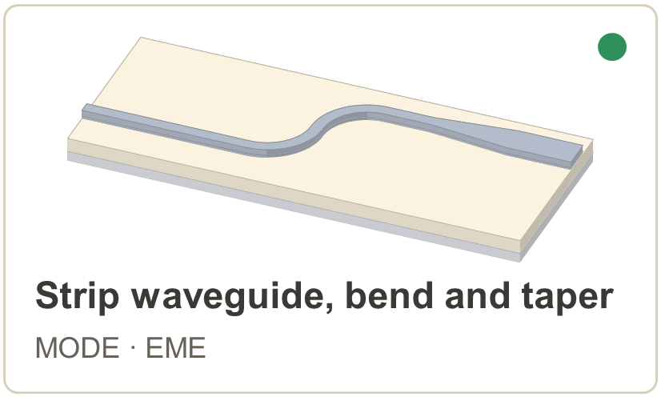
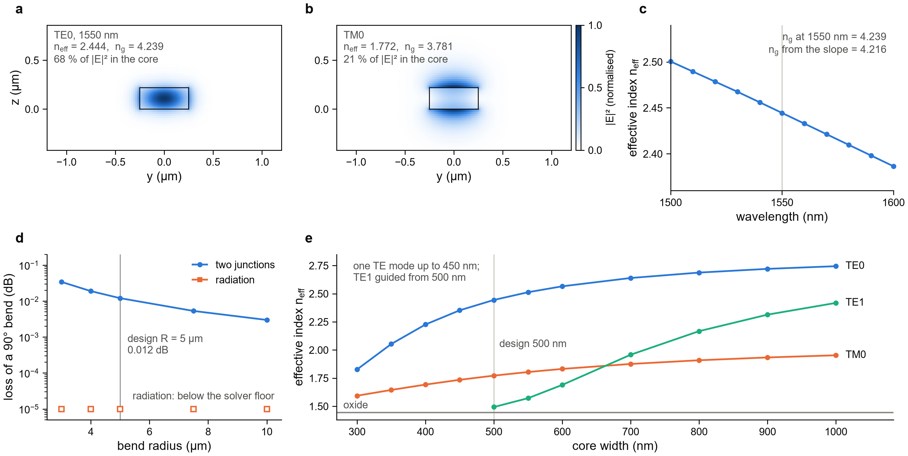
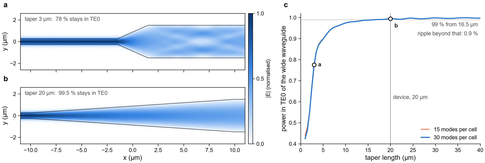

# Strip waveguide, bend and taper

<div align="center">

[Device library](../../README.md#device-library) · [Next: rib waveguide](../rib_waveguide/README.md)

</div>

The strip waveguide is the wire of a silicon photonic circuit. The 220 nm silicon layer is etched
through on both sides of the core, and oxide surrounds what is left. This chapter draws one with the
PDK and answers the questions a designer asks before routing with it. What does it guide? How tight
can it bend? How long must a taper be when the width changes?

It follows the same pattern as the ring modulator in [chapter 4](../ring_modulator/README.md). The
layout comes from a builder, the structure comes from the layout and the process file, and no script
contains a thickness or a material.

---

## The device

<p align="center"></p>

[devices/strip_waveguide_builder.py](../../devices/strip_waveguide_builder.py) draws a straight
waveguide, an S-bend, a taper and a wide waveguide in a row. It also has a cell for each part:
`straight`, `bend` and `taper`. From the repository root:

```bash
uv run python devices/strip_waveguide_builder.py
```

```text
strip 0.5 um wide, S-bend of R = 5 um, route 37.853 um, taper 20 um to 3 um
GDS -> devices/gds/strip_waveguide.gds   ports: ['o1', 'o2']
DRC passed: 0 errors, 0 warnings
```

| parameter | default | where it comes from |
|---|---|---|
| `width` | 0.5 µm | routing width; step 1 shows what it guides |
| `radius` | 5 µm | the strip bend radius of the design rules; step 1 shows the margin |
| `taper_length` | 20 µm | step 2: from 16.5 µm on the taper passes 99 % |
| `wide_width` | 3 µm | a wide waveguide for long straight runs |

The builder refuses a radius below the design rule and a width below the minimum of the waveguide
layer, and names the rule:

```python
from devices import strip_waveguide_builder as sw

sw.bend(radius=3.0)
# ValueError: radius 3.0 um is below the strip bend radius, 5.0 um (gsip_technology.DESIGN_RULES['strip_bend_radius'])
```

## The steps

| step | folder | solver | script | the question it answers |
|---|---|---|---|---|
| 1 | `1_waveguide_modes` | MODE (FDE) | `waveguide_modes_fde.py` | Which modes does the waveguide guide, how does the index change with wavelength and width, and what does a bend cost? |
| 2 | `2_taper` | MODE (EME) | `taper_eme.py` | How long must the taper to the wide waveguide be? |

Each step folder keeps the layout it simulated (`.gds`), a summary (`.txt`) and the result arrays
(`.npz`). The Lumerical project (`.lms`) is written next to them and is not kept in the repository;
the script rebuilds it.

## Run it

You need Lumerical with MODE. See the [prerequisites of chapter 4](../ring_modulator/README.md#prerequisites)
for the installation and the process file.

```bash
cd lumerical_simulations/strip_waveguide/scripts
uv run python waveguide_modes_fde.py      # step 1, about 4 minutes
uv run python taper_eme.py --check        # step 2, about 7 minutes
```

The figures are redrawn from the kept results, without Lumerical:

```bash
uv run python lumerical_simulations/strip_waveguide/figures/fig1_modes.py
uv run python lumerical_simulations/strip_waveguide/figures/fig2_taper.py
```

---

## Step 1. The modes, by MODE

**The question.** What does a 0.5 µm strip guide at 1.55 µm, and what do a bend and a change of width
do to it?

**The model.** A straight 6 µm piece of the waveguide is written to GDS and loaded into a Layer Builder
with the process file. The mode solver works on the cross-section, in a window of 5 µm by 2.4 µm with
perfectly matched layers on every side. The mesh is 20 nm, and 10 nm over the core, with a mesh line on
each of the four surfaces of the core. Chapter 4 explains why those lines matter:
[the mesh, and why it decides the answer](../ring_modulator/README.md#the-mesh-and-why-it-decides-the-answer).

Before any mode is computed, the script reads the refractive index the solver sees: 3.4764 in the core
and 1.4440 beside, below and above it. That is silicon in oxide, as the process file says. A wrong
layer number in the process file would show up here.

The solver returns more modes than the waveguide guides. Some live in the cladding and some in the
absorbing boundary. The script keeps a mode when its index is above that of the oxide and its power
sits around the core.

**The results** (`strip_modes.txt`):

| quantity | value |
|---|---|
| TE0, 1.55 µm | n_eff = 2.4445, n_g = 4.239, TE fraction 0.983 |
| TM0, 1.55 µm | n_eff = 1.7723, n_g = 3.781 |
| TE1, 1.55 µm | n_eff = 1.4934, only 0.049 above the oxide |
| share of the field intensity inside the core (figure 1) | TE0 68 %, TM0 21 % |
| n_eff of TE0, 1500 to 1600 nm | 2.5005 to 2.3865 |
| n_g from the slope of n_eff(λ) | 4.216 (0.5 % below the solver's value) |
| 90° bend, R = 5 µm | 0.012 dB, all of it at the two junctions with the straights |
| 90° bend, R = 3 µm | 0.034 dB |
| radiation of the bend, R = 3 to 10 µm | below 10⁻⁶ dB per 90°, the noise of the solver |
| second TE mode | absent up to 0.45 µm, guided from 0.50 µm |

<p align="center"></p>

**Figure 1.** The strip waveguide. Panels a and b are the TE0 and the TM0 mode on the same colour
scale; c is n_eff of TE0 against wavelength; d the loss of a 90° bend against its radius; e the
effective index of three modes against the core width.

**Reading the figure.**

- *a and b, the modes.* TE0 has its field across the core, between the two sidewalls, and 68 % of its
  intensity lies inside the silicon. TM0 has its field above and below the core, and only 21 % of it
  lies inside. That is why TE0 has the higher index, and why it is the mode circuits use.
- *c, dispersion.* n_eff falls by 0.114 across the band. The group index, n_g = n − λ dn/dλ, is the
  index a pulse or a resonance sees; at 4.24 it is far above n_eff. A ring or an interferometer made of
  this waveguide needs n_g, not n_eff, for its free spectral range.
- *d, the bend.* The solver finds no radiation down to 3 µm. What a bend loses is at its two ends.
  The mode of a bend sits further out than the mode of a straight, 15 nm at R = 5 µm, so a little
  light is lost where the two meet. At 5 µm that is 0.006 dB per junction.
- *e, the width.* Below 0.45 µm the strip carries one TE mode. At 0.5 µm a second one, TE1, is just
  above the oxide line. TM0 is guided at every width.

**What it tells you.** At 0.5 µm and R = 5 µm the strip is a good wire. A bend costs about a hundredth
of a decibel, and the design rule of 5 µm has margin down to 3 µm. The strip is not strictly
single-mode at 0.5 µm. TE1 is guided, though so weakly that a bend or a taper strips it off. A circuit
that must not carry TE1 at all uses 0.45 µm.

**Check.** The group index from the slope of n_eff(λ), 4.216, agrees with the solver's value, 4.239,
to 0.5 %. The two come from different calculations.

**Pitfalls.**

- *A bend sweep needs a window that excludes the centre of the bend.* The solver maps the bend onto a
  straight guide, and the map breaks down at the centre. With the 5 µm window, radii of 1, 1.5 and
  2 µm returned no mode. The script now leaves out any radius below half the window plus 0.2 µm, and
  says so in its summary.
- *"Loss" in the mode list can be negative.* Values around 10⁻⁹ dB/cm, of either sign, are the noise of
  the solver. The figure draws them on a floor, as open squares.
- *The loss here is not the loss of a fabricated waveguide.* In a real strip the roughness of the
  sidewalls dominates, at a few decibels per centimetre in published work. The model has smooth walls.

## Step 2. The taper, by EME

**The question.** How long must a linear taper from 0.5 µm to 3 µm be, so that the light stays in the
fundamental mode?

**The model.** The taper with a straight at each end, loaded into a Layer Builder. The solver is EME,
the eigenmode expansion method. It cuts the device into cells along its length, finds the modes of each
cell once, and joins them at the cell boundaries. The taper is cut into 20 cells, with a correction for
the staircase between them (CVCS). Each cell keeps 30 modes.

The reason to use EME here is the length sweep. A longer taper has the same cells with the same modes;
only the phase each mode collects changes. So the sweep over 79 lengths costs one mode calculation and
a few seconds more. FDTD would need 79 runs.

The device is mirror-symmetric and fed with TE0, so only half of it is solved, with an anti-symmetric
wall on the axis. The official Ansys example of a linear taper does the same.

**The results** (`taper.txt`):

| taper length | power in TE0 of the wide waveguide | loss |
|---|---|---|
| 1 µm | 42 % | 3.7 dB |
| 3 µm | 78 % | 1.1 dB |
| 5 µm | 90 % | 0.47 dB |
| 10 µm | 97.4 % | 0.11 dB |
| 16.5 µm | 99.0 % | 0.04 dB |
| 20 µm, the device | 99.5 % | 0.02 dB |
| 30 µm | 99.9 % | 0.006 dB |

<p align="center"></p>

**Figure 2.** The taper. Panel a is the field in a taper of 3 µm; b in the taper of the device, 20 µm;
c the power that arrives in TE0 of the wide waveguide against the taper length.

**Reading the figure.**

- *a, too short.* The waveguide widens faster than the mode can follow. A fifth of the light goes
  into higher modes of the wide waveguide. They travel at other speeds, and the pattern in the wide
  waveguide is their beating with TE0.
- *b, long enough.* The mode widens with the waveguide and arrives as TE0.
- *c, the sweep.* The curve rises steeply to 10 µm and then flattens. It does not rise evenly: beyond
  16.5 µm it ripples between 99.0 % and 99.9 %, because the little light in higher modes arrives in or
  out of phase. So the length is read where the curve stays above the target, not at its first
  crossing.

**What it tells you.** 20 µm is a safe length for this pair of widths. A longer taper buys almost
nothing; a taper under 10 µm costs more than a tenth of a decibel.

**Checks.**

- *The sweep against a direct simulation.* The sweep stretches the taper in the solver without redrawing
  it. The device was also simulated as drawn, and so was a second layout with a 3 µm taper. Both agree
  with the sweep to four digits: 0.9951 and 0.7753.
- *The number of modes.* With 15 modes per cell instead of 30, the transmission changes by 0.0002 at
  16.5 µm and beyond. Below 2 µm it changes by up to 0.016: a short taper scatters into many modes, and
  the answer there needs them.
- *Against step 1.* The EME finds n_eff = 2.4443 for TE0 of the input waveguide; the mode solver of
  step 1 found 2.4445.

**Pitfalls.**

- *The Layer Builder builds only what lies inside its box.* The box is centred on the origin. A layout
  drawn from x = 0 to the right, in a box sized for its length, loses its far end without a warning,
  and the solver then finds no silicon there. An early version of this step lost the wide waveguide
  this way and reported a transmission of 1.5 %. The sign was in the mode list: the highest index in
  the last cell was 0.97, below that of oxide. `add_layer_builder` now sizes the box from the layout.
- *Propagate the device before the sweep.* A length sweep leaves the swept group at the last length it
  tried. The script therefore reads the field and the transmission of the device first.
- *Symmetry halves the work only if the feed is symmetric too.* The anti-symmetric wall keeps the modes
  that TE0 can excite. For a device without that symmetry, solve the whole cross-section, as the
  [MMI chapter](../mmi1x2/README.md) does.
- *A run can come back empty.* In two runs of this script, the last `run`, the one of the convergence
  check, returned without an error and without having run: no new engine log, and the project still
  in layout mode. The next command then failed with "emesweep cannot be used while in layout mode". A
  second attempt ten seconds later ran normally. The cause was not found; an FDTD run was busy on the
  same machine both times. The scripts now run through `run_eme` in `lumerical_simulations/solvers.py`,
  which checks for results, tries once more, and says so on the console.
- *The project file grows with the modes.* Saved after a run, the project of this step is several
  hundred megabytes, because it holds the fields of every mode of every cell. The script saves the
  project once more at its end, in layout mode, at under 1 MB.

---

## In numbers

| | |
|---|---|
| waveguide | 0.5 µm × 220 nm silicon in oxide |
| TE0 at 1.55 µm | n_eff = 2.4445, n_g = 4.239 |
| modes guided at 0.5 µm | TE0, TM0, and a weak TE1 |
| single TE mode | up to 0.45 µm |
| 90° bend at R = 5 µm | 0.012 dB |
| taper 0.5 to 3 µm, 20 µm long | 0.02 dB |

## Limits

- Smooth, vertical sidewalls. Scattering loss, the main loss of a real strip, is not modelled.
- One wavelength for the bend and the taper, 1.55 µm.
- The bend loss is the radiation of a uniform bend plus the mismatch at its two ends. An Euler bend,
  which the builder also draws, removes the jump in curvature; its gain is not computed here.
- The numbers are for a teaching process and have not been compared with a fabricated device.

## Exercises

1. **The cut-off of TE1.** Run `waveguide_modes_fde.py --widths 0.42 0.44 0.46 0.48` and find the width
   at which the second TE mode first appears.
2. **A tighter bend.** The window limits the radius. Change `Y_SPAN` in the script to 3 µm and run
   `--radii 2 2.5 3 --no-widths`. Does the radiation rise above the floor?
3. **Another taper.** In `devices/strip_waveguide_builder.py` set `WIDE_WIDTH` to 2.0 and run step 2
   again. Does a narrower end need a shorter taper?
