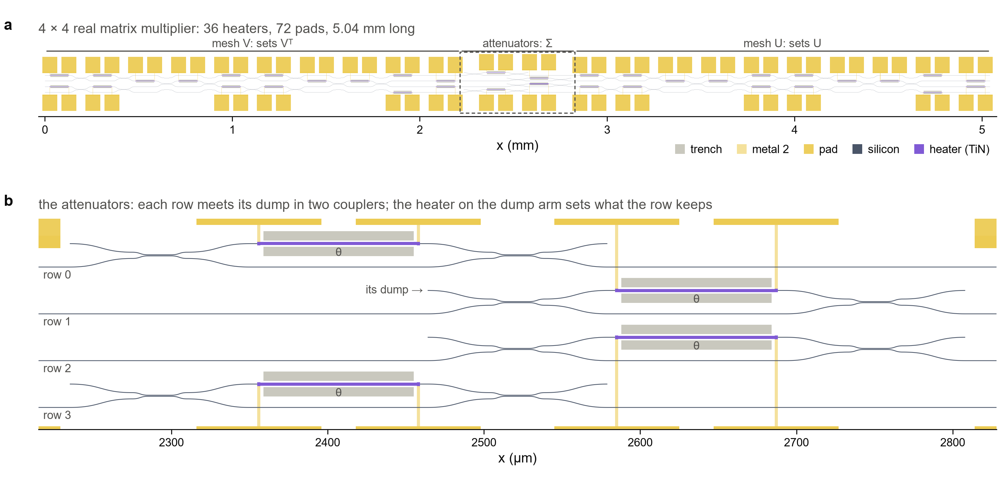
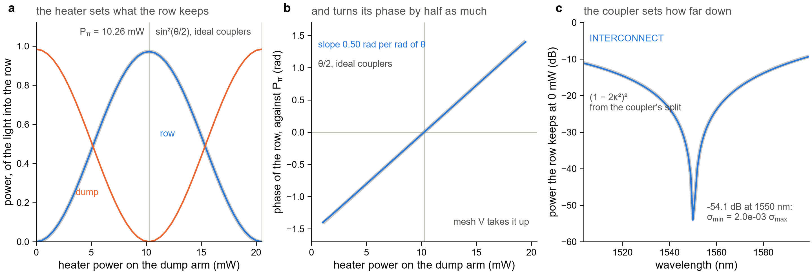
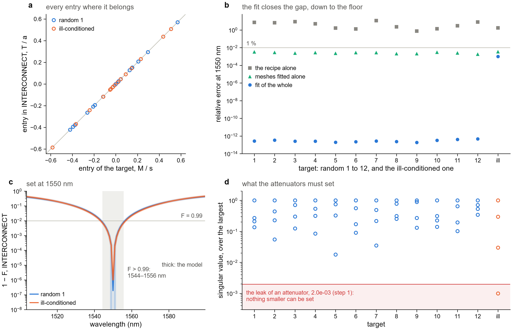
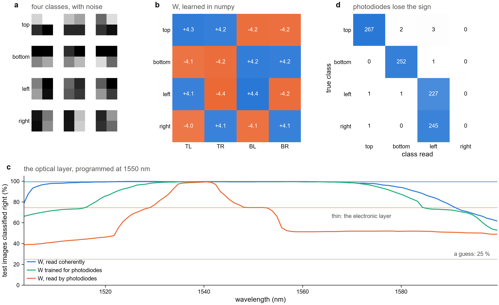
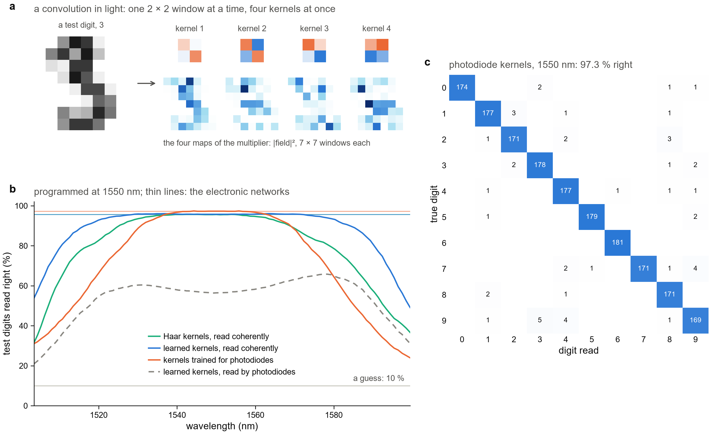

# Real matrix multiplier

<div align="center">

[Previous: Clements mesh](../clements_mesh/README.md) · [Circuits](../../README.md#circuits) · [Device library](../../README.md#device-library)

</div>

A mesh of interferometers sets a unitary matrix: it moves light between waveguides but never
takes any away. The layers of a neural network, and most matrices that a computation needs, are
not unitary. A real matrix M can still be built from unitary parts. Its singular value
decomposition writes it as M = U Σ V<sup>T</sup>: two rotations and, between them, a diagonal of numbers
that stretch or shrink each direction. Two meshes set the rotations. A column of attenuators,
one on every waveguide, sets the diagonal by sending part of the light out of the circuit.

This chapter builds that multiplier, 4 × 4, from the parts of the
[previous chapter](../clements_mesh/README.md): two Clements meshes and four Mach-Zehnder
attenuators, all made of the [directional coupler](../directional_coupler/README.md) and the
[thermo-optic phase shifter](../thermo_optic_phase_shifter/README.md). As there, nothing is
simulated again at the device level. The chapter answers four questions: what one attenuator can
set, how well the drawn multiplier holds a real matrix, what it does as the layer of a small
neural network, and whether it can be the convolution layer of a network that reads handwritten
digits.

---

## The circuit

<p align="center"></p>

**Figure 0.** The layout, drawn from its GDS file. Panel a is the whole multiplier, b the column
of attenuators.

[devices/svd_multiplier_builder.py](../../devices/svd_multiplier_builder.py) draws it with the
PDK. From the repository root:

```bash
uv run python devices/svd_multiplier_builder.py
```

```text
4 x 4 real matrix multiplier: two meshes and 4 attenuators, 36 heaters, 72 pads; 5.04 mm long
GDS -> devices/gds/svd_multiplier.gds   ports: ['o1', 'o2', 'o3', 'o4', 'V_P0_w', 'V_P0_e', ... 'A0_w', 'A0_e', 'd0_in', 'd0_out', ... 'U_D3_e', 'o5', 'o6', 'o7', 'o8']
DRC passed: 0 errors, 0 warnings
```

| part | what it is | sets |
|---|---|---|
| mesh V | the 4 × 4 Clements mesh of the [previous chapter](../clements_mesh/README.md), unchanged: 6 blocks, 16 heaters | V<sup>T</sup> |
| attenuators | on every row a Mach-Zehnder interferometer whose second waveguide, the dump, runs half a pitch above the row and ends open on both sides. The heater sits on the dump arm | the diagonal Σ |
| mesh U | a second copy of the same mesh | U |

**One attenuator.** The row and its dump meet in a coupler, run apart through two arms of the
same length, and meet again in a second coupler. The parts are those of a block of the mesh: the
coupler of its chapter, placed exactly as simulated, the same fans that open its 4 µm to the
15 µm between row and dump, and the same heated section on one arm. What differs is where the
light goes. In a block of the mesh, both outputs stay in the circuit. Here one output is the row
and the other is the dump, which leaves the circuit. The heater decides how much of the light the
row keeps.

**Equal paths.** All four rows pass through the same pieces in the column, an attenuator each, so
the paths of the light stay as long as each other, as in the mesh. The attenuators of the inner
rows stand one heater step (229 µm) further along x than those of the outer rows, so that their
wires pass beside the dumps of the outer rows. The heaters of rows 0 and 1 have their pads above,
those of rows 2 and 3 below.

**The pads above.** The dump of row 0 lies 15 µm above the row, and the trenches of its heater
reach 8 µm higher still. A first draft kept the pads of the column where the mesh keeps them, and
the DRC found the trench under the metal of a pad (rule `trench_to_metal`). The pads above the
column now stand half a pitch further out than those of the meshes.

The ports: light enters at `o1` to `o4` (mesh V, west) and leaves at `o5` to `o8` (mesh U, east).
The open ends of the dumps are ports too, `d0_in` to `d3_out`. The pads carry the name of their
heater with the part in front: `V_P0_w`, ... for mesh V, `A0_w`, ... for the attenuators,
`U_P0_w`, ... for mesh U. As in the mesh, there are no grating or edge couplers.

## How the multiplier sets a real matrix

The mesh chapter went from a unitary matrix to sixteen voltages
([How the mesh sets a matrix](../clements_mesh/README.md#how-the-mesh-sets-a-matrix)). This
section adds what a real matrix needs on top of that: the decomposition, the scale, one attenuator,
and the phase that the attenuator adds.

**The decomposition.** Every real N × N matrix M has a singular value decomposition

```math
M = U\,\operatorname{diag}(s_0,\,s_1,\,\dots,\,s_{N-1})\,V^{\mathsf T}, \qquad s_0 \ge s_1 \ge \dots \ge s_{N-1} \ge 0
```

with U and V real and orthogonal, a special case of unitary. Read from the right, as the light
meets it: V<sup>T</sup> turns the input into the directions in which M acts simply, the diagonal stretches
each direction by its singular value, and U turns the result to the output. Light in a passive
circuit can only lose power, so no factor can be larger than 1. The multiplier sets M scaled by
its largest singular value,

```math
\frac{M}{s_0} = U\,\Sigma\,V^{\mathsf T}, \qquad \Sigma = \operatorname{diag}(\sigma_0,\,\dots,\,\sigma_{N-1}), \quad \sigma_k = \frac{s_k}{s_0} \le 1
```

and the scale s<sub>0</sub> goes into the reading of the outputs (one number for the whole
matrix). Mesh V is set to V<sup>T</sup> and mesh U to U, each by the recipe of Clements et al., exactly as in
the mesh chapter.

**One attenuator.** With the ideal coupler B and the phase θ on the dump arm, the attenuator is
the block of the mesh without its φ, written on (dump, row):

```math
A(\theta) = B\,P(\theta)\,B = i\,e^{i\theta/2}\begin{pmatrix} \sin\frac{\theta}{2} & \cos\frac{\theta}{2} \\ \cos\frac{\theta}{2} & -\sin\frac{\theta}{2} \end{pmatrix}
```

Light that enters on the row leaves on the row with the entry at the lower right,

```math
a(\theta) = -i\,e^{i\theta/2}\,\sin\frac{\theta}{2}
```

and the rest, cos(θ/2) of its field, leaves on the dump. So the attenuator of row k is set to

```math
\theta_k = 2\arcsin\sigma_k
```

From θ = 0 (all of the light to the dump) to θ = π (all of it on the row), the row keeps any field
from 0 to 1. This is the same Mach-Zehnder as a block of the mesh, used as a variable splitter
with one output thrown away.

**The phase of the attenuator.** a(θ) has a phase too, −i e<sup>iθ/2</sup>, and it differs from
row to row because θ does. Left alone, it would multiply row k of V<sup>T</sup> by a phase and spoil the
product. The output phase shifters of mesh V stand just before the column, one on every row. The
recipe adds to each the phase that undoes its attenuator:

```math
\delta_k^{V} \;\to\; \delta_k^{V} + \frac{\pi}{2} - \frac{\theta_k}{2}
```

so one heater per attenuator is enough. Put together, with mesh V written as its six blocks
W<sub>V</sub> followed by its output phases D<sub>V</sub>, so corrected:

```math
T = U\;\operatorname{diag}\bigl(a(\theta_0),\,\dots,\,a(\theta_{N-1})\bigr)\;D_V\,W_V = U\,\Sigma\,V^{\mathsf T}
```

For random targets, the ideal multiplier with the phases of the recipe is its target to
2 × 10⁻¹⁴ (the tests check five). Without the change to the output phases of mesh V it misses by
half the size of the matrix.

**From a phase to a voltage.** As in the mesh: a heater of power P adds the phase πP/P<sub>π</sub>,
P<sub>π</sub> = 10.26 mW, and the film is a resistor of R = 500 Ω, so V = √(PR) and
V<sub>π</sub> = 2.26 V. For the attenuator that makes

```math
P_k = \frac{2\arcsin\sigma_k}{\pi}\,P_\pi, \qquad V_k = V_\pi\sqrt{\frac{2\arcsin\sigma_k}{\pi}}
```

For the first random matrix of step 2 the four attenuators come out as:

| heater | row | σ<sub>k</sub> | θ<sub>k</sub> / π | recipe, mW | fitted, mW | fitted, V |
|---|---|---|---|---|---|---|
| A0 | 0 | 1.000 | 1.000 | 10.26 | 10.27 | 2.27 |
| A1 | 1 | 0.272 | 0.175 | 1.80 | 1.80 | 0.95 |
| A2 | 2 | 0.213 | 0.136 | 1.40 | 1.40 | 0.84 |
| A3 | 3 | 0.136 | 0.087 | 0.89 | 0.89 | 0.67 |

The fit hardly moves them: the two arms of an attenuator are equally long, so its split does not
depend on anything else in the circuit. The largest singular value always needs P<sub>π</sub>,
everything on the row. The other 32 heaters, in the two meshes, take most of the power and most
of the correction (step 2).

**What the fidelity means here.** The fidelity of the mesh chapter assumes a unitary target. For
a target that is not unitary the chapter uses

```math
F = \frac{\lvert\operatorname{Tr}(M^{\dagger}T)\rvert^2}{\operatorname{Tr}(M^{\dagger}M)\,\operatorname{Tr}(T^{\dagger}T)}, \qquad \operatorname{Tr}(A^{\dagger}B) = \sum_{i,j} A_{ij}^{\ast} B_{ij}
```

the square of the cosine between the two matrices taken as vectors of 16 entries. F = 1 when the
measured matrix T is the target up to one common complex factor a (a loss and a phase that every
path shares). Next to it stands the relative error

```math
\varepsilon = \frac{\lVert T - a M\rVert}{\lVert a M\rVert}, \qquad a = \frac{\operatorname{Tr}(M^{\dagger}T)}{\operatorname{Tr}(M^{\dagger}M)}
```

which says the same in a form that is easier to read: ε = 0.01 means the entries are off by about
one percent of their size. For small errors 1 − F ≈ ε².

## The steps

| step | folder | tool | script | the question it answers |
|---|---|---|---|---|
| 1 | `1_attenuator` | INTERCONNECT | `attenuator_interconnect.py` | What does one attenuator set, and how far down can it dim its row? |
| 2 | `2_program` | INTERCONNECT, Python | `program_svd.py` | How well does the drawn multiplier hold a real matrix, and over which band? |
| 3 | `3_classifier` | INTERCONNECT, Python | `classifier.py` | Can it serve as the layer of a neural network, and what does the way the outputs are read change? |
| 4 | `4_convolution` | INTERCONNECT, Python | `conv_digits.py` | Can it be the convolution layer of a network that reads handwritten digits? |

**What the circuit is made of.** Exactly the pieces of the mesh chapter
([What the circuit is made of](../clements_mesh/README.md#the-steps)): the coupler from its FDTD
S-parameters, the strip with n<sub>eff</sub> = 2.44448 and n<sub>g</sub> = 4.2387, the heated
section with 7.557 × 10⁻⁴ per mW, and an assumed loss of 2.2 dB/cm. The scripts read the layout's
own description (the `info` of the builder) and build every row piece by piece; the circuit has
eight rows, the four of the light and the four dumps.
[scripts/svd_model.py](scripts/svd_model.py) is the same chain as a short Python model. It reuses
the model of the mesh, [mesh_model.py](../clements_mesh/scripts/mesh_model.py), for the two meshes,
and adds the attenuators and the programming of a real matrix.
[scripts/svd_interconnect.py](scripts/svd_interconnect.py) builds the circuit in INTERCONNECT with
the builder of the mesh chapter, which joins any two rows with a coupler.

## Run it

You need Lumerical with INTERCONNECT (the
[prerequisites of chapter 4](../ring_modulator/README.md#prerequisites)). The run times are from
the author's machine, with Lumerical 2025 R1.

```bash
cd lumerical_simulations/svd_multiplier/scripts
uv run python attenuator_interconnect.py   # step 1, about 1 minute
uv run python program_svd.py               # step 2, about 6 minutes
uv run python classifier.py                # step 3, about 3 minutes
uv run python conv_digits.py               # step 4, about 4 minutes
```

The steps do not depend on each other's results; each reads only the kept results of the device
chapters. The figures are redrawn from the kept results, without Lumerical:

```bash
uv run python lumerical_simulations/svd_multiplier/figures/fig0_layout.py
uv run python lumerical_simulations/svd_multiplier/figures/fig1_attenuator.py
uv run python lumerical_simulations/svd_multiplier/figures/fig2_program.py
uv run python lumerical_simulations/svd_multiplier/figures/fig3_classifier.py
uv run python lumerical_simulations/svd_multiplier/figures/fig4_convolution.py
```

---

## Step 1. One attenuator

**The question.** What does one attenuator of the column set, and what limits it?

**The idea.** With the real coupler, passing τ straight and κ across, the row keeps at θ = 0

```
((|τ|² − |κ|²) / (|τ|² + |κ|²))² = 4.3 × 10⁻⁶ = −53.7 dB
```

of what passes, the same leak as the cross state of a block of the mesh (its step 1). That leak is
the smallest power the row can keep, and its square root, 2 × 10⁻³, the smallest field: the
smallest singular value, over the largest, that the column can set.

**The model.** The attenuator of row 0 alone, with its lead and the rest of the column, 344 µm
from coupler to coupler. The script sweeps its heater from 0 to 2P<sub>π</sub> in 41 steps and
runs the network analyser from 1.503 to 1.600 µm at each, light into the row.

**The results** (`attenuator.txt`):

| quantity | value |
|---|---|
| field the row keeps, against the heater | sin(θ/2) to within 3 × 10⁻³ at every power |
| phase of the row, against the heater | 0.50 rad per rad of θ, as a(θ) says |
| leak at 0 mW, of all that passes | −54.1 dB (the formula gives −53.7 dB): a field of 2.0 × 10⁻³ |
| through the attenuator, row and dump together | 0.984, or 0.072 dB, at every power |
| leak below −20 dB | from 1535 to 1565 nm |

<p align="center"></p>

**Figure 1.** One attenuator. Panel a is the power on the row and on the dump against the heater
power at 1550 nm, with sin²(θ/2) as the grey line. Panel b is the phase of the row, referred to
its value at P<sub>π</sub>, with θ/2 as the grey line. Panel c is the power the row keeps at 0 mW
against the wavelength, from INTERCONNECT and from the formula with the split of the FDTD coupler.

**Reading the figure.**

- *a, the split.* The row is full at P<sub>π</sub> and empty at 0 and 2P<sub>π</sub>; the dump
  takes the rest. Any value in between is one heater power away.
- *b, the phase.* The phase of the row moves by half the phase of the heater, a straight line
  through the whole range. It is the phase that mesh V takes up. Near 0 and 2P<sub>π</sub> the row
  keeps nothing and its phase means nothing, so the curve stops there.
- *c, the floor.* The leak is deep only where the coupler splits 50:50, as for the cross state of a
  block. Away from 1550 nm the coupler drifts, and the smallest field the row can keep rises: to
  −24 dB at 1540 and 1560 nm, to −11 dB at the edges of the band.

**What it tells you.** The attenuator is a block of the mesh with one output thrown away, and it
inherits the block's strengths and limits. It sets any field between its floor and 1 exactly, and
its phase is known in advance. Its floor is set by how close the coupler is to 50:50: at 1550 nm a
singular value can be 500 times smaller than the largest, but not smaller.

**Checks.**

- *INTERCONNECT against the model.* Over all 41 powers and 101 wavelengths the largest difference
  of an entry is 2.2 × 10⁻⁴, the reflection of the couplers that only INTERCONNECT includes.
- *Against the formula.* The leak at every wavelength agrees with (1 − 2κ²)², κ² the split of the
  FDTD coupler.

**Pitfalls.**

- *Refer the phase to where it means something.* At 0 mW the row keeps 2 × 10⁻³ of its field, and
  the phase of so little light is noise. A first version of the script referred all phases to
  0 mW and found a slope that did not match θ/2. The script refers them to P<sub>π</sub>, where the
  row keeps everything.

## Step 2. A real matrix

**The question.** The multiplier is set to a real matrix. How close does the drawn circuit come,
and over which band of wavelengths does it stay close?

**The idea.** The recipe above is exact for the ideal multiplier. The drawn one adds what the
mesh chapter found: every piece of waveguide adds its own phase, and the couplers are not quite
50:50. As there, a least-squares fit corrects all 36 heater powers for the drawn circuit, so that
its 4 × 4 block between the rows of the light is a M/s<sub>0</sub> with a common factor a.

The start of the fit matters more here than in the mesh. From the powers of the recipe, the fit
ended in a minimum that was not the target for two of the first three matrices tried (1 − F = 0.4).
The script therefore starts from a better place: it fits each mesh alone, as drawn, to V<sup>T</sup> and to U
(the fit of the mesh chapter, which reaches every unitary it was given), takes the attenuators
from the recipe, adds the phase of each attenuator to the output phase of mesh V, and only then
fits the whole.

The targets are twelve random matrices, every entry drawn from a normal distribution with a fixed
seed, and one ill-conditioned matrix with singular values 1, 0.3, 0.03 and 0.001: its smallest is
below the floor of step 1.

**The model.** The whole multiplier, all 36 heaters, set at 1.55 µm. The model runs all 13
targets; INTERCONNECT runs the first random matrix and the ill-conditioned one, one input at a
time, from 1.503 to 1.600 µm.

**The results** (`program.txt`):

| quantity | value |
|---|---|
| the recipe, ideal multiplier: largest difference from its target | 2 × 10⁻¹⁴ |
| drawn multiplier, the recipe alone | relative error 0.7 to 12, median 4: no use |
| drawn multiplier, the two meshes fitted alone | relative error 1.8 × 10⁻³ to 3.3 × 10⁻³ |
| drawn multiplier, the fit of the whole, 12 random targets | relative error below 5 × 10⁻¹³ |
| the same, ill-conditioned target | relative error 1.0 × 10⁻³: the floor of the attenuator |
| INTERCONNECT at 1.55 µm, random 1 | relative error 4.3 × 10⁻⁴, 1 − F = 1.9 × 10⁻⁷ |
| INTERCONNECT at 1.55 µm, ill-conditioned | relative error 1.0 × 10⁻³, 1 − F = 1.0 × 10⁻⁶ |
| band with F > 0.99 | 12 nm (1544 to 1556 nm), random 1; 13 nm, ill-conditioned |
| heater power, random targets | 281 to 388 mW, mean 335 mW |
| light that leaves through the dumps, random 1 | 37 to 83 % of each input |

<p align="center"></p>

**Figure 2.** A real matrix. Panel a is every entry of the first random matrix and of the
ill-conditioned one, from INTERCONNECT at 1550 nm with the common factor taken out, against its
target. Panel b is the relative error of all 13 targets in the model: the recipe alone, the two
meshes fitted alone, and the fit of the whole. Panel c is 1 − F against the wavelength, from
INTERCONNECT (thin) and the model (thick). Panel d is the singular values of every target over the
largest, with the floor of an attenuator from step 1.

**Reading the figure.**

- *a, the entries.* All 32 entries lie on the diagonal, positive and negative alike: the
  multiplier sets signs as well as sizes, because it works on the field.
- *b, three stages.* The recipe alone misses by more than the size of the matrix. The meshes fitted
  alone come to a few 10⁻³. The fit of the whole closes the rest, to the rounding of the
  arithmetic, for every random target, and to 10⁻³ for the ill-conditioned one.
- *c, the band.* The two targets lose fidelity alike, 1 % about 6 nm to each side of 1550 nm,
  as the mesh did (13 nm there). The band is set by the meshes; the attenuators add little to it.
- *d, the floor.* All singular values of the random targets lie above 0.018, well above the floor.
  The ill-conditioned target has one at 0.001, which no attenuator can set.

**What it tells you.** The multiplier holds any real matrix it was given, to within what its
attenuators can set. The meshes fitted alone stop at a few 10⁻³ mostly because the attenuators
between them are not ideal: with the real coupler, the field a row keeps differs from sin(θ/2) by
up to 2.5 × 10⁻³ (step 1). With exactly 50:50 couplers in the attenuators, the same start would
come to 7 × 10⁻⁴ to 1 × 10⁻³ for the first three targets. The fit of the whole takes that up, and more. It reaches 10⁻¹³
because the attenuators stand between the meshes: they also take up the small loss differences
that the meshes leave between the rows, which a mesh alone cannot, since it has no way to remove
light. In the mesh chapter that rest, a few 10⁻⁷ in 1 − F, was the floor; here the
floor is gone. What remains is the leak of the attenuator: a singular value below 2 × 10⁻³ of the
largest is set as 2 × 10⁻³, and the ill-conditioned matrix keeps an error of that size.

The price is light. The multiplier sets M/s<sub>0</sub>, so it passes on average
Σσ<sub>k</sub>²/N of the power of an input: 28 % for the first random matrix. The rest leaves
through the dumps. A matrix with one large singular value and three small ones wastes most of the
light; a matrix with all singular values alike is nearly a mesh. On top of this comes the loss of
5 mm of strip, 1.1 dB at the assumed 2.2 dB/cm.

**Checks.**

- *The recipe.* The ideal multiplier with the phases of the recipe is its target to 2 × 10⁻¹⁴, the
  phase of the attenuators included. Without the change to the output phases of mesh V the relative
  error is 0.5.
- *INTERCONNECT against the model.* Over the band, the largest difference of an entry is
  8.7 × 10⁻⁴ for the random target and 1.1 × 10⁻³ for the ill-conditioned one, the reflection of
  32 couplers.
- *The fitted attenuators.* Their powers stay within 0.02 mW of the recipe (the table above).

**Pitfalls.**

- *Start the fit where it can finish.* 36 heater powers make a landscape with more than one
  minimum. From the recipe the fit can stop at 1 − F = 0.4 and stay there. Fitting the two meshes
  alone first, which each converge, puts the start close enough for the fit of the whole.
- *Do not forget the phase of the attenuator.* a(θ) carries e<sup>iθ/2</sup>, different on every
  row. A recipe without it sets every row of V<sup>T</sup> with the wrong phase.
- *A non-unitary fidelity.* The formula of the mesh chapter divides by N, the norm of a unitary
  matrix. For M/s<sub>0</sub> it gives numbers that look wrong but are not; use F above.

## Step 3. A layer of a neural network

**The question.** Can the multiplier act as the layer of a neural network, and what does it
change that a camera or a photodiode, not a computer, reads its outputs?

**The idea.** The smallest images there are: 2 × 2 pixels, the four powers on the four inputs.
Four classes: the top row lit, the bottom row, the left column, the right column. Every image
has its own brightness, from 0.6 to 1, and noise of 0.2 on every pixel; no pixel is below zero,
because light has no negative power. A softmax regression without bias, logits = W x, learns the
4 × 4 weights W in numpy on 2000 images and is tested on 1000 others. The multiplier is programmed
to W (step 2), and its matrix, measured in INTERCONNECT, takes the place of W.

The outputs are fields, and the logits are their real parts. Two ways of reading them:

| reading | what it measures | what it needs |
|---|---|---|
| coherent | the real part of each output field, against a reference that travels as far as the signal | a local oscillator split from the same laser, and a receiver per output |
| power | \|field\|² on a plain photodiode | nothing more |

The power reading loses the sign. The weights of the top class are about (+4, +4, −4, −4) and those
of the bottom class the opposite (−4, −4, +4, +4), so their logits are of the same size for every
image. So the script also trains a second W for the photodiode, logits = (W x)², and programs and
measures it the same way.

**The model.** The multiplier set to each W at 1.55 µm, its 4 × 4 matrix from INTERCONNECT over
the band, and the test images through it at every wavelength.

**The results** (`classifier.txt`):

| reading | the electronic layer | the optical layer, 1.55 µm | within 1 point of electronic |
|---|---|---|---|
| W for the logits, read coherently | 99.3 % | 99.3 % | 1513 to 1570 nm (58 nm) |
| the same W, read by photodiodes | 74.6 % | 74.6 % | — |
| W trained for photodiodes | 99.6 % | 99.6 % | 1531 to 1569 nm (38 nm) |

| quantity | value |
|---|---|
| W for the logits, singular values over the largest | 1, 0.979, 0.008, 0.003 |
| its relative error, model / INTERCONNECT | 7 × 10⁻⁵ / 3.8 × 10⁻⁴ |
| W for photodiodes, singular values over the largest | 1, 0.908, 0.847, 0.010 |
| its relative error, model / INTERCONNECT | 6 × 10⁻¹³ / 2.9 × 10⁻⁴ |
| test images classified as the electronic layer does, both W | 100 % |
| heater power | 351 and 387 mW |

<p align="center"></p>

**Figure 3.** A layer of a neural network. Panel a is three test images of each class, as the
inputs carry them. Panel b is W as learned, the rows the classes and the columns the pixels (top
left, top right, bottom left, bottom right). Panel c is the share of test images classified right,
against the wavelength, for the three readings; the thin lines are the electronic layer. Panel d
is W read by photodiodes at 1550 nm: the true class against the class read.

**Reading the figure.**

- *b, the weights.* Each class looks for its two pixels and against the two others. The rows of
  top and bottom are opposite, as are those of left and right: W has two large singular values and
  two near zero, close to the floor of step 1.
- *c, the band.* The coherent reading classifies as well as the computer over 58 nm, much more
  than the 12 nm of step 2. A classifier needs only the largest logit to stay the largest, not
  every entry to stay right. The photodiode reading of the same W is at 75 % at 1550 nm and moves
  by chance away from it: the phases of the entries change with the wavelength, and with them
  which of two opposite classes wins.
- *d, the sign.* Top, bottom and left are read right. Almost every image of the right column is
  read as left: with the sign lost, left and right give logits of the same size, and small
  differences between the weights, not the image, decide between them.

**What it tells you.** The multiplier is a layer of a network as long as its outputs are read as
fields. Where the weights are close to the target, the network classifies as the computer does,
image by image. The step from field to power is a nonlinearity in itself, (W x)², and a network can
be trained for it: the second W uses it and does as well. Which reading a system uses is a
decision about the receiver, and it changes the training, not the chip.

**Checks.**

- *INTERCONNECT against the model.* The largest difference of an entry, both W, all wavelengths,
  is 1.2 × 10⁻³.
- *Image by image.* At 1550 nm both optical layers classify all 1000 test images as their
  electronic layers do.

**Pitfalls.**

- *A coherent reading needs a reference.* The chapter takes the real part of each output after
  removing the common phase of the matrix, as a receiver with a local oscillator from the same
  laser does. That oscillator, the receivers and their noise are not in the model.
- *Small singular values sit at the floor.* W for the logits has two singular values near
  0.003 and 0.008, close to the floor of 0.002. The fit leaves 7 × 10⁻⁵ there instead of 10⁻¹³. It
  does not matter for this task, but a layer that needs its small singular values exactly would
  feel it.

## Step 4. A convolution layer that reads handwritten digits

**The question.** Step 3 used four pixels. Can the same 4 × 4 multiplier take part in reading a
real image, and how well does a network with an optical layer read handwritten digits?

**The idea.** A convolution slides a small window over an image and multiplies every patch under
it by the same few kernels. With a window of 2 × 2 pixels a patch is four numbers, the fields on
the four inputs, and four kernels are the four rows of a 4 × 4 matrix K. The multiplier computes
all four kernels on one patch at once, and the 49 patches of an 8 × 8 image one after another,
with the window moving by one pixel. Its 196 outputs go to an electronic layer of 196 × 10
weights and ten biases, one score per digit. Photonic convolution layers are built this way
(Feldmann et al. 2021, Xu et al. 2021): the light does the many multiplications of the
convolution, the electronics the few of the last layer.

The digits are those of Alpaydin and Kaynak (1998) in the UCI Machine Learning Repository, under
CC BY 4.0: 3823 written by 30 people to train on, and 1797 written by 13 others to test on. Each was
scanned to 32 × 32 pixels and cut into blocks of 4 × 4, so that every value of the 8 × 8 image
counts the dark pixels of its block, 0 to 16; here they become fields from 0 to 1.
[data/README.md](data/README.md) says where the kept copy comes from, and
[scripts/digits.py](scripts/digits.py) downloads it again and checks it.

Three sets of kernels, each trained with its electronic layer in numpy:

| kernels | what they are | read-out |
|---|---|---|
| Haar | fixed: the average, the edge across, the edge along and the diagonal of the window. An orthogonal matrix: every singular value is 1, so the attenuators pass everything | coherent, then ReLU in the electronics |
| learned | trained with the layer | coherent, then ReLU |
| photodiode | trained with the layer for a plain photodiode, which reads \|K x\|² | power: the square law of the detector is the nonlinearity of the network |

The coherent reading takes the real part of every output field with the phase of the matrix
removed, as in step 3, and its gain is set once, at 1550 nm. The photodiode reading takes the
power, with the same fixed gain.

**The model.** Each K programmed into the drawn multiplier (step 2) and measured in INTERCONNECT
over the band; the 1797 test digits through the measured matrix at every wavelength.

**The results** (`convolution.txt`):

| kernels | electronic network | optical layer at 1550 nm | within 1 point of electronic | singular values of K/s<sub>0</sub> | heaters |
|---|---|---|---|---|---|
| Haar | 95.6 % | 95.6 % | 1534 to 1560 nm (26 nm) | 1, 1, 1, 1 | 391 mW |
| learned | 95.7 % | 95.7 % | 1525 to 1575 nm (51 nm) | 1, 0.474, 0.219, 0.036 | 334 mW |
| photodiode | 97.3 % | 97.3 % | 1540 to 1561 nm (21 nm) | 1, 0.806, 0.434, 0.188 | 378 mW |
| learned, read by photodiodes | 56.4 % | 56.4 % | — | | |

| quantity | value |
|---|---|
| relative error of K in INTERCONNECT, 1550 nm | 6.1 × 10⁻⁴ (Haar), 3.9 × 10⁻⁴ (learned), 4.6 × 10⁻⁴ (photodiode) |
| the model against INTERCONNECT, all three, all wavelengths | 1.0 × 10⁻³, largest difference of an entry |
| test digits read differently by the optical and the electronic network, 1550 nm | none, for all three |

<p align="center"></p>

**Figure 4.** A convolution layer. Panel a is a test digit, the four kernels trained for
photodiodes (orange negative, blue positive) and the four maps the multiplier makes of the digit
in INTERCONNECT at 1550 nm, one value for each of the 49 windows. Panel b is the share of the test
digits read right against the wavelength, for the three sets and for the learned kernels read by
photodiodes; the thin lines are the electronic networks. Panel c is the true digit against the
digit read, for the kernels trained for photodiodes at 1550 nm.

**Reading the figure.**

- *a, the maps.* Each kernel lights up where the window sees its pattern: an edge running one
  way, a corner, a stroke. The network reads the digit from where the four maps are bright.
- *b, the band.* At 1550 nm every optical network reads exactly what its electronic twin reads.
  Away from it the matrix drifts, as in step 2, and the accuracy falls. The learned kernels hold
  longest, over 51 nm, and the kernels trained for photodiodes fall first: squaring the output
  doubles the effect of an error in its field.
- *b, the sign.* The learned kernels, read by photodiodes, reach only 56 %: the network was trained
  on signed outputs and gets their size alone.
- *c, the mistakes.* The 49 digits read wrong are mostly 9s taken for 3s or 4s and 7s taken for
  9s, as for an electronic network of this size.

**What it tells you.** A 4 × 4 multiplier is small, but a convolution uses it again and again: 49
times for every 8 × 8 digit, 196 multiplications and additions done by the light for every 196 of
the electronic layer. The square law of a photodiode, a nuisance in step 3, is a nonlinearity the
network can use: trained for it, the network reads more digits right than with a ReLU after a
coherent receiver, and needs no reference light. And it is the training that has to know which
receiver is used: the same kernels read the other way lose 39 points.

**Checks.**

- *INTERCONNECT against the model.* The largest difference of an entry, all three matrices, all
  wavelengths, is 1.0 × 10⁻³.
- *Digit by digit.* At 1550 nm the optical and the electronic network read every test digit alike,
  for all three sets.
- *The data.* [scripts/digits.py](scripts/digits.py) checks both files of the archive against
  their SHA-256 before it keeps them.

**Pitfalls.**

- *Calibrate the gain once.* The coherent receiver takes the phase of the matrix at every
  wavelength from its reference, but the gain is set at 1550 nm and then left alone, as a
  real system would. A gain set anew at every wavelength would hide part of the drift of the band.
- *Train for the hardware.* The kernels and the layer have to be trained with the read-out that the
  chip will have. Retraining for photodiodes took the same time as training for a coherent
  receiver.

---

## In numbers

| | |
|---|---|
| multiplier | 4 × 4 real matrices: two Clements meshes and four Mach-Zehnder attenuators, 32 couplers, 36 heaters, 72 pads |
| size | 5.04 mm long; the column of attenuators 0.61 mm |
| one attenuator | sets sin(θ/2) of the field from 2 × 10⁻³ to 1; floor −54.1 dB at 1550 nm, below −20 dB from 1535 to 1565 nm |
| programmed to random real matrices | relative error below 5 × 10⁻¹³ at 1550 nm, 281 to 388 mW |
| ill-conditioned, smallest σ 0.001 | relative error 1.0 × 10⁻³, the floor of the attenuator |
| band with F > 0.99 | 12 nm |
| 2 × 2 image classifier | 99.3 % read coherently, as the computer; 74.6 % with the same weights read by photodiodes; 99.6 % with weights trained for photodiodes |
| handwritten digits, the multiplier as convolution layer | 97.3 % of 1797 test digits with kernels trained for photodiodes, 95.6 to 95.7 % read coherently, each digit as the electronic network reads it |

## Limits

- Everything that limits the mesh chapter limits this one: devices as their chapters simulated
  them, an assumed loss, phases set at 1550 nm for TE light, no grating or edge couplers, no
  measured device behind the numbers.
- The heat of the neighbours is left out. The mesh chapter found that it costs 10⁻³ and that a fit
  takes it back; with 36 heaters the same fit applies.
- The dumps end open. On a chip their light must go somewhere harmless, into a termination or a
  monitor photodiode, or it scatters back.
- The coherent reading assumes an ideal receiver with a reference from the same laser. Its noise,
  the shot noise of the outputs and the precision of an electronic readout, which together set the
  number of bits of the multiplier, are not modelled.
- The input is set exactly. A real system encodes the input vector in the light with modulators,
  which have their own precision, speed and power.
- The classifier of step 3 is a single linear layer on four pixels, and the network of step 4 has
  one convolution and one electronic layer. They show what the hardware does to a network, not
  what an optical network can learn.
- Step 4 runs the 49 windows of a digit one after another through one multiplier. How fast that
  is depends on the modulators that set the inputs and on the receivers, which are not modelled.

## Check yourself

1. A mesh alone sets every unitary matrix. Why can it not set M = diag(1, 0.5, 0.5, 0.5)?
2. The multiplier sets M/s<sub>0</sub>. Where does s<sub>0</sub> go?
3. The attenuator of a row passes −i e<sup>iθ/2</sup> sin(θ/2) of its field. Why is one heater per
   attenuator enough, when the phase depends on θ?
4. Each mesh fitted alone comes to 10⁻³, the whole multiplier to 10⁻¹³. What can the fit of the
   whole do that a mesh cannot?
5. Why does the same W classify 99.3 % when read coherently and 74.6 % when read by photodiodes?
6. The Haar kernels are an orthogonal matrix. What do the attenuators do for them, and how much of
   the light reaches the outputs?

<details>
<summary>Answers</summary>

1. A mesh keeps the power of the light, U†U = 1, and diag(1, 0.5, 0.5, 0.5) does not: it would
   send a quarter of the power of three inputs to the outputs and lose the rest. Losing light needs
   a way out of the circuit, which the attenuators give.
2. Into the reading of the outputs: the measured vector is multiplied by s<sub>0</sub> (and by
   the common factor a of the loss) after detection. One number for the whole matrix.
3. Its phase is known from θ, so it can be undone in advance. The output phase shifter of mesh V
   on the same row stands just before the attenuator, and the recipe adds π/2 − θ/2 to it.
4. Remove light from one row more than from another. The meshes are lossless apart from the small
   loss of their paths, which differs between rows and leaves a floor; the attenuators set the
   amplitude of every row, so they take up those differences along with Σ.
5. Opposite classes have opposite rows of W. Read coherently, their logits have opposite signs and
   the right one is positive. Read as power, they are of the same size, and small differences
   between the weights decide which wins, whatever the image.
6. Nothing: every singular value is 1, so every attenuator is set to P<sub>π</sub> and passes its
   row whole. The multiplier is then two meshes in a row, and all the light reaches the outputs,
   apart from the loss of the waveguides.

</details>

## Exercises

1. **The floor.** Program the ill-conditioned target with its smallest singular value at 0.003,
   0.01 and 0.03 instead of 0.001 (change `ILL_SIGMA` in `scripts/program_svd.py`; copy
   `2_program` first). Where does the error of the fit start to fall to 10⁻¹³?
2. **A better attenuator.** Replace the couplers of the attenuators by exact 50:50 couplers with the
   `couplers` argument of `svd_model.matrix`. How deep is the floor then, and what sets it?
3. **The light budget.** For the twelve random targets of step 2, compute Σσ<sub>k</sub>²/4 from
   `2_program/program.npz`. Which target passes the most light, and why?
4. **Trained for the hardware.** Train W for the logits with a penalty on its small singular values,
   so that W/s<sub>0</sub> has none below 0.01. Does the accuracy change? Does the fit reach 10⁻¹³?
5. **More pixels.** A 3 × 3 image needs a 9 × 9 multiplier. Draw it with
   `svd_multiplier(n=9)`, count its heaters and estimate its length. What does the stagger of the
   attenuators become?

## References

- D. A. B. Miller, "Self-configuring universal linear optical component", Photonics Research 1, 1
  (2013), [doi:10.1364/PRJ.1.000001](https://doi.org/10.1364/PRJ.1.000001)
- Y. Shen, N. C. Harris, S. Skirlo et al., "Deep learning with coherent nanophotonic circuits",
  Nature Photonics 11, 441 (2017),
  [doi:10.1038/nphoton.2017.93](https://doi.org/10.1038/nphoton.2017.93)
- W. R. Clements, P. C. Humphreys, B. J. Metcalf, W. S. Kolthammer and I. A. Walmsley, "Optimal
  design for universal multiport interferometers", Optica 3, 1460 (2016),
  [doi:10.1364/OPTICA.3.001460](https://doi.org/10.1364/OPTICA.3.001460)
- G. H. Golub and C. F. Van Loan, *Matrix Computations*, 4th edition, Johns Hopkins University Press
  (2013): the singular value decomposition
- B. J. Shastri, A. N. Tait, T. Ferreira de Lima et al., "Photonics for artificial intelligence and
  neuromorphic computing", Nature Photonics 15, 102 (2021)
- W. Bogaerts, D. Pérez, J. Capmany et al., "Programmable photonic circuits", Nature 586, 207 (2020)
- J. Feldmann, N. Youngblood, M. Karpov et al., "Parallel convolutional processing using an
  integrated photonic tensor core", Nature 589, 52 (2021)
- X. Xu, M. Tan, B. Corcoran et al., "11 TOPS photonic convolutional accelerator for optical neural
  networks", Nature 589, 44 (2021)
- E. Alpaydin and C. Kaynak, "Optical Recognition of Handwritten Digits", UCI Machine Learning
  Repository (1998), [doi:10.24432/C50P49](https://doi.org/10.24432/C50P49), CC BY 4.0: the
  digits of step 4

---

*The figures are drawn from the result files kept in this repository. Ansys and Lumerical are
trademarks of ANSYS, Inc. This chapter has no affiliation with or endorsement by Ansys.*
