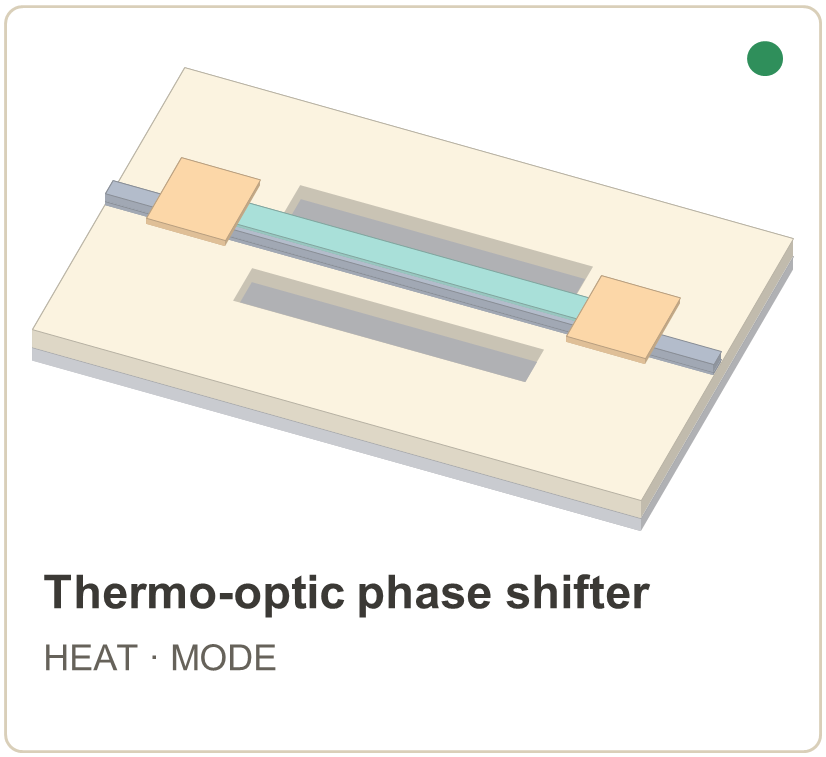
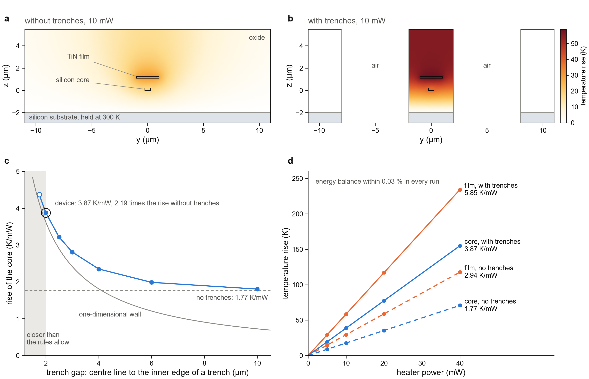
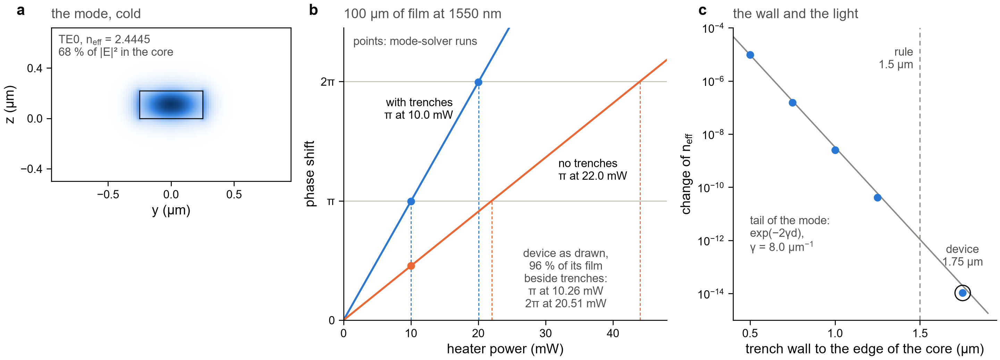
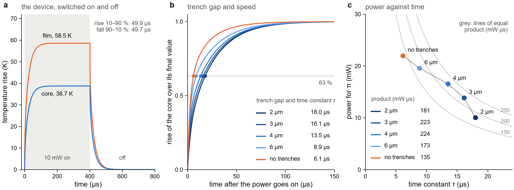
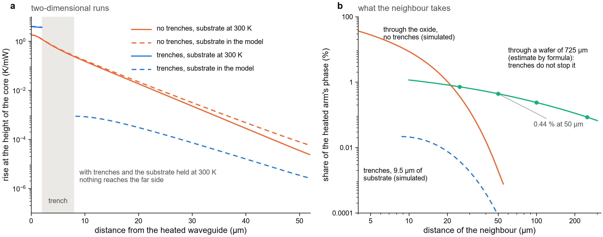

# Thermo-optic phase shifter

<div align="center">

[Previous: 1×2 MMI splitter](../mmi1x2/README.md) · [Device library](../../README.md#device-library)

</div>

A thermo-optic phase shifter is a waveguide with a heater above it. A current through the heater
warms the silicon core, warm silicon has a higher refractive index, and the light that passes gains
phase. It is the tuning element of interferometers, switches and filters. A mesh of Mach-Zehnder
interferometers for optical computing has two of them in every interferometer.

A heater has two numbers that matter: the power it needs for a phase shift of π, and the time it
takes to get there. This chapter draws a phase shifter with the PDK and finds both. Its design
choice is a pair of deep trenches beside the heater. They stop the heat from spreading sideways, so
the same phase needs less than half the power. The chapter also shows what the trenches cost in
speed, and what a waveguide next to the heater still feels.

The work takes four steps: the heat first, then the phase, then the speed, then the neighbour.

---

## The device

<p align="center"></p>

[devices/thermo_optic_phase_shifter_builder.py](../../devices/thermo_optic_phase_shifter_builder.py)
draws a strip waveguide, 0.5 µm wide, with a film of titanium nitride (TiN) above it. The film is
150 nm thick and lies 0.88 µm above the core. At each end it widens into a landing, where a via
takes the current up to metal 2, and a wire leads north to a pad. A deep trench runs along each
side of the film. From the repository root:

```bash
uv run python devices/thermo_optic_phase_shifter_builder.py
```

```text
heater 100 um long, trenches along 96 um (96% of the filament), filament resistance 500 ohm
GDS -> devices/gds/thermo_optic_phase_shifter.gds   ports: ['o1', 'o2', 'H1', 'H2']
DRC passed: 0 errors, 0 warnings
```

| parameter | default | where it comes from |
|---|---|---|
| `length` | 100 µm | the heated length: the film between its two landings. It sets the temperature and the voltage, not the power (step 2) |
| `heater_width` | 2.0 µm | the widest film that the closest trench allows (step 1) |
| `trench_gap` | 2.0 µm | centre line of the core to the inner edge of each trench: the closest the rules allow. `None` draws no trenches |
| `trench_width` | 6.0 µm | the width does not enter the result (step 1); the minimum of the layer is 5 µm |
| `width` | 0.5 µm | the strip of the [strip waveguide chapter](../strip_waveguide/README.md) |

Light enters at `o1` and leaves at `o2`. The current flows from pad `H1` to pad `H2`. The film
between the landings has a resistance of 10 Ω/sq × 100 µm / 2 µm = 500 Ω.

**The trenches.** The layer `DEEPTRENCH` removes everything from the top of the cladding down to
5 µm inside the substrate, and leaves air. The two trenches leave a wall of oxide, 4 µm wide, with
the core and the film in it. Three rules of the PDK meet at a gap of 2.0 µm:

| rule | value | what the device has |
|---|---|---|
| minimum space of `DEEPTRENCH`: the wall between two trenches | 4.00 µm | 4.00 µm |
| `trench_to_heater`: trench to the edge of the film | 1.00 µm | 1.00 µm |
| `trench_to_waveguide`: trench to the edge of the core (a warning) | 1.50 µm | 1.75 µm |
| `trench_to_metal`: trench to a metal | 2.00 µm | 2.00 µm to each wire |

The last rule is why the trenches are 96 µm long and the film 100 µm: they stop 2 µm before the
wires. All four are teaching values of this PDK, not foundry rules
([docs/pdk.md](../../docs/pdk.md)). The builder refuses a set of arguments that breaks one of them,
and its message names the rule.

**The reference.** `trench_gap=None` draws the same device without trenches. The pads, the wires and
the film stay where they are. Every step simulates both, so each result of the trenches has a
number to stand against.

**No undercut.** The process also has a layer `UNDERCUT`, which removes the substrate under a
heater. This device does not use it, for two reasons. With a trench on each side and no substrate
below, the wall hangs free, and its heat can leave only through its two ends. A cross-section does
not contain the ends, so the model of this chapter cannot describe it (see the pitfalls of step 1).
And an undercut is a different trade: the published devices need a milliwatt or so, and take from a
hundred microseconds to two milliseconds (see [Against published devices](#against-published-devices)).

## The steps

| step | folder | solver | script | the question it answers |
|---|---|---|---|---|
| 1 | `1_heat_cross_section` | HEAT, steady state | `heat_cross_section.py` | How many kelvin does the core gain per milliwatt, with and without trenches? |
| 2 | `2_phase_shift` | MODE (FDE) | `phase_shift_fde.py` | How much heater power gives a phase shift of π? |
| 3 | `3_switching_time` | HEAT, transient | `heat_transient.py` | How fast does the core follow the power, and what do the trenches cost in speed? |
| 4 | `4_neighbour` | HEAT, steady state | `neighbour_heat.py` | How much of the heat reaches a waveguide next to the heater? |

The method of steps 1 and 2 is that of the Ansys application example "Thermally tuned waveguide":
a HEAT run gives the temperature, the temperature map is laid over the optical model, and a mode
solver gives the phase. Here both models are built from the layout and the process file.

## Run it

You need Lumerical with HEAT and MODE. See the
[prerequisites of chapter 4](../ring_modulator/README.md#prerequisites). The run times are from the
author's machine, with Lumerical 2025 R1.

```bash
cd lumerical_simulations/thermo_optic_phase_shifter/scripts
uv run python heat_cross_section.py     # step 1, about 12 minutes for 22 cases
uv run python phase_shift_fde.py        # step 2, about 2 minutes
uv run python heat_transient.py         # step 3, about 10 minutes
uv run python neighbour_heat.py         # step 4, about 3 minutes
```

Run them in this order. Step 2 reads the temperature maps that step 1 writes
(`device_T_10mW.mat` and two more). Like the Lumerical projects, the maps are not kept in the
repository, so step 2 needs a run of step 1 first. Steps 3 and 4 read the result arrays of steps 1
and 2, which are kept.

The figures are redrawn from the kept results, without Lumerical:

```bash
uv run python lumerical_simulations/thermo_optic_phase_shifter/figures/fig1_heat.py
uv run python lumerical_simulations/thermo_optic_phase_shifter/figures/fig2_phase.py
uv run python lumerical_simulations/thermo_optic_phase_shifter/figures/fig3_switching.py
uv run python lumerical_simulations/thermo_optic_phase_shifter/figures/fig4_neighbour.py
```

---

## Step 1. The heat, by HEAT

**The question.** How many kelvin does one milliwatt of heater power add to the core, and what do
the trenches change?

**The idea.** In the steady state all the heat that the film makes leaves through the silicon
substrate, which is the heat sink. Silicon conducts heat about a hundred times better than oxide:
148 against 1.38 W/m/K in the thermal models that the process file names for the two materials
(step 4 reads both values back from the heat flux). So what decides the temperature is the
oxide between the film and the substrate: 0.88 µm of cladding down to the core, then 2 µm of buried
oxide. The rise of the core is the power times the thermal resistance of the path below it.

Without trenches the heat spreads sideways on its way down. The path gets wider, its resistance
falls, and the core stays cooler. A trench on each side stops the spreading: all the heat has to go
down through the wall. If it flowed evenly through a wall of width W and length L, the buried oxide
of thickness t under the core would give

```
rise of the core per unit power = t / (k W L) = 2 µm / (1.38 W/m/K × 4 µm × 100 µm) = 3.62 K/mW
```

One consequence is worth stating before any run. The rise per milliwatt goes as 1 / L: a film
twice as long warms half as much for the same power. The rise times the length, in K µm/mW, is a
property of the cross-section alone. It is the number to compare two heaters by.

**The model.** A straight piece of the device's cross-section: the core, the film and, for the
device, the two trenches. It is written to GDS and loaded into a Layer Builder with the process
file, so the stack, the depth of the trench and the materials come from there. The run is a
two-dimensional steady state normalised to the heated length of 100 µm, so the power that is set is
the total heater power. The region is 40 µm wide and ends 0.2 µm below the top of the cladding.
The mesh has edges of 0.02 to 0.5 µm.

The heat source is a uniform source on the solid `Heater`, and the heat sink a temperature of 300 K
on the solid `Si_Substrate`. [Chapter 4](../ring_modulator/README.md#the-heat-source-and-why-it-matters)
explains why the source has to be written this way. The recipe is `add_heat_cross_section` in
[solvers.py](../solvers.py).

The script solves 22 cases: the device and the reference, each at 5, 10, 20 and 40 mW; six more
trench gaps; three more heater widths, each with and without trenches; and the checks.

**The results** (`heat.txt`):

| quantity | with trenches | without trenches |
|---|---|---|
| rise of the core | 3.874 K/mW | 1.768 K/mW |
| rise of the film | 5.855 K/mW | 2.942 K/mW |
| film over core | 1.51 | 1.66 |
| rise of the core times the length | 387.4 K µm/mW | 176.8 K µm/mW |
| hottest point at 10 mW | 59 K above the substrate | 30 K |

The trenches multiply the rise of the core by 2.19. In the device as drawn they run beside 96 µm of
the 100 µm of film. Averaged along the film, the core gains
(0.96 × 387.4 + 0.04 × 176.8) / 100 = 3.790 K/mW, which is 2.14 times the rise without trenches.

| trench gap | 1.75 µm | 2 µm | 2.5 µm | 3 µm | 4 µm | 6 µm | 10 µm | none |
|---|---|---|---|---|---|---|---|---|
| rise of the core (K/mW) | 4.37 | 3.87 | 3.22 | 2.81 | 2.35 | 1.99 | 1.80 | 1.77 |
| the even wall, t / (k W L) | 4.14 | 3.62 | 2.90 | 2.42 | 1.81 | 1.21 | 0.72 | |

The gap of 1.75 µm is closer than the rules allow. It is in the table for the trend only.

| heater width | closest gap the rules allow | core, with trenches | core, without | film over core, with trenches |
|---|---|---|---|---|
| 1.0 µm | 2.0 µm | 3.95 K/mW | 1.89 K/mW | 1.62 |
| 1.5 µm | 2.0 µm | 3.91 K/mW | 1.83 K/mW | 1.55 |
| 2.0 µm | 2.0 µm | 3.87 K/mW | 1.77 K/mW | 1.51 |
| 3.0 µm | 2.5 µm | 3.13 K/mW | 1.64 K/mW | 1.49 |

<p align="center"></p>

**Figure 1.** The heat. Panels a and b are the temperature rise at 10 mW without and with the
trenches, on the same colour scale. Panel c is the rise of the core per milliwatt against the trench
gap, with the even wall of the formula above; d the rise of the core and of the film against the
power.

**Reading the figure.**

- *a, without trenches.* The heat spreads over some 10 µm to each side on its way down. The film
  reaches 30 K.
- *b, with trenches.* The wall is the only way down. Above the film the oxide is as hot as the film,
  because no heat flows upwards: the top of the oxide is insulating in this model. Below the film
  the temperature falls evenly to the substrate.
- *c, the gap.* At the closest gap the simulated rise lies 7 % above the even wall. With a wider
  gap the two part: the even wall keeps falling as 1 / W, and the simulated rise levels off at the
  value without trenches. A trench 10 µm away adds 2 %.
- *d, the power.* The four lines are straight. The largest deviation from the slope is 0.001 %.

**What it tells you.** A trench has to be close to work. At 2 µm it multiplies the rise by 2.19, at
4 µm by 1.33 and at 6 µm by 1.12. Step 4 gives the scale: without trenches the rise falls off
sideways by a factor e every 4.8 µm, so a trench further out than that finds little heat to stop.
The width of the trench does not matter: 4, 6 and 10 µm give the same rise.

The film width is the smaller lever. A narrower film heats the core 2 % more, but it runs hotter
itself and has twice the resistance. A 3 µm film pushes the trench out to 2.5 µm, by the rule
`trench_to_heater`, and that costs 19 %. So the device takes the widest film that the closest trench
allows.

The film is always hotter than the core, here by a factor 1.5. It is the film that limits how far
the phase can be driven. Step 2 gives its temperature at π and at 2π.

**Checks.**

- *Energy.* The heat that arrives at the sink equals the power that was set within 0.03 % in all 22
  cases.
- *Width of the region.* With trenches the result is the same for 20, 40 and 80 µm. Without them a
  20 µm region is 2 % high, and 40 µm agrees with 80 µm within 0.03 %.
- *Mesh.* With the edges halved the rise changes by +0.23 % (device) and +0.25 % (reference).
- *By hand.* The even wall gives 362 K µm/mW, the simulation 387, which is 7 % more. The film is
  2 µm wide and the wall 4 µm, so under the film the heat is denser than at the edges of the wall,
  and the core lies under the film.

**Pitfalls.**

- *The air is not in the model.* HEAT solves the solids. The trench is a hole with insulating walls:
  nothing conducts or convects across it. For a deep trench that is a fair model, since air
  conducts some fifty times less than oxide (0.026 W/m/K, a textbook value that is not in the
  process file).
- *A trench together with an undercut does not converge, and the script is not told.* A trial for
  this chapter put the `UNDERCUT` layer under the wall (Lumerical 2025 R1; the run is not kept). The
  wall then has no solid path to the heat sink. The solver log says "Heat Flow Newton solver failed
  to converge after 40 iterations … a partial result will be saved", the call from Python raises
  nothing, and the temperature that is read back is −4000 K everywhere. The scripts therefore run
  the solver through `run_checked` in [solvers.py](../solvers.py), which reads the log
  `<project>_p0.log` after every run and stops when the solver did not converge. An undercut alone,
  without trenches, converges: the oxide then still holds on at its sides.
- *Compare heaters by K µm/mW.* The rise per milliwatt of a 50 µm heater is twice that of a 100 µm
  heater of the same cross-section. Neither is the better heater.

## Step 2. The phase, by MODE

**The question.** How much heater power gives a phase shift of π?

**The idea.** After a length L, light with the effective index n_eff has the phase 2π n_eff L / λ.
A change of the index by Δn_eff changes the phase by 2π L Δn_eff / λ. That is π when
Δn_eff = λ / (2 L), here 1.55 µm / 200 µm = 0.00775. The index follows the power linearly, so

```
P_π = λ / (2 L · dn_eff/dP)
```

where P is the total heater power. Step 1 showed that the rise per milliwatt goes as 1 / L. So does
dn_eff/dP, and the length cancels: **P_π does not depend on the length of the heater.** A film twice
as long needs half the rise for the same phase, and reaches it with the same power. What the length
sets is the temperature at π, and with the resistance the voltage.

**The model.** The cross-section of step 1 in the mode solver. The silicon of the process file has
a thermo-optic coefficient of 1.87 × 10⁻⁴ /K, so its index follows the temperature once the
simulation has a temperature map. The script lays the maps of step 1 over the structure one at a
time, as a `temperature` grid attribute, and finds the TE0 mode at 1.55 µm: cold, at 10 mW and at
20 mW for the device, cold and at 10 mW for the reference.

The window is 3.4 µm by 1.8 µm with PML on four sides. It holds silicon and oxide only: it ends
inside the wall, before the trench, and below the film. The mesh is 20 nm, with 10 nm and a mesh
line on every surface of the core.

**The results** (`phase.txt`):

| case | heater power | n_eff | change | per milliwatt |
|---|---|---|---|---|
| cold | 0 | 2.444493 | | |
| with trenches | 10 mW | 2.452215 | 0.007722 | 7.722 × 10⁻⁴ |
| with trenches | 20 mW | 2.459945 | 0.015452 | 7.726 × 10⁻⁴ |
| without trenches | 10 mW | 2.448016 | 0.003523 | 3.523 × 10⁻⁴ |

| | power for π | power for 2π | at π: core, film | at π: voltage, current |
|---|---|---|---|---|
| cross-section with trenches | 10.03 mW | 20.06 mW | +38.9 K, +58.7 K | 2.24 V, 4.48 mA |
| **the device as drawn** | **10.26 mW** | **20.51 mW** | +38.9 K, +58.8 K | 2.26 V, 4.53 mA |
| without trenches | 22.00 mW | 44.00 mW | +38.9 K, +64.7 K | 3.32 V, 6.63 mA |

The device as drawn is the average along its film: 96 % of it has trenches beside it and 4 % has
not. At 2π the film of the device is 117.7 K above the substrate, at 3.20 V and 6.40 mA. Without
trenches it would be 129.4 K, at 4.69 V and 9.38 mA.

| trench wall to the edge of the core | 1.75 µm (the device) | 1.25 µm | 1.00 µm | 0.75 µm | 0.50 µm |
|---|---|---|---|---|---|
| change of n_eff | −1.1 × 10⁻¹⁴ | −4.2 × 10⁻¹¹ | −2.5 × 10⁻⁹ | −1.5 × 10⁻⁷ | −9.6 × 10⁻⁶ |

<p align="center"></p>

**Figure 2.** The phase. Panel a is the TE0 mode whose index the temperature moves. Panel b is the
phase shift against the heater power with and without trenches: the points are the mode-solver
runs, the lines go through them and the origin. Panel c is the change of the effective index when
the wall of a trench comes close to the core, with the tail of the mode drawn through the closest
point.

**Reading the figure.**

- *a, the mode.* 68 % of |E|² lies in the core. Weighted with the permittivity that is 92 % of the
  electric energy, and the energy is what counts for the change of the index.
- *b, the power.* The two points with trenches lie on one line within 0.05 %. The line reaches π at
  10.0 mW and the line without trenches at 22.0 mW.
- *c, the wall.* The change falls about sixty times for every 0.25 µm. That is close to the square
  of the tail of the mode in the oxide, exp(−2γd) with γ = 8.0 µm⁻¹, which gives 55 times. At the
  1.75 µm of the device nothing is left of it.

**What it tells you.** The device needs 10.26 mW for π, and without trenches it would need 22.0 mW.
A circuit that must reach every phase needs 2π: 20.5 mW at 3.2 V, with the film 118 K above the
substrate.

The core has to warm by 38.9 K for π, whatever the trenches do. That number follows from the
length alone: λ / (2 L) divided by the change of n_eff per kelvin.

The effective index changes by 1.994 × 10⁻⁴ per kelvin, 7 % more than the index of silicon itself.
Only 92 % of the energy is in the silicon, which would make it less. But the light is slow: its
group index is 4.24 against 3.48 for silicon, so it spends more time in the heated silicon than a
plane wave would. The product, (4.24 / 3.48) × 0.92 × 1.87 × 10⁻⁴ = 2.10 × 10⁻⁴ /K, is 5 % above
the simulated value; it leaves out the dispersion of silicon.

A trench wall 1.75 µm from the core does not touch the light. The rule of 1.5 µm leaves room for a
real wall, which is rough, where this one is perfectly flat.

The film is 0.88 µm above the core. In a window that holds it, it adds 0.0085 dB/cm, which is
0.0001 dB over the device.

**Checks.**

- *Mesh.* With the mesh halved the cold index moves by 9 × 10⁻⁴, and the change per milliwatt by
  0.10 %. The error of the mesh is the same in the cold and in the warm run and cancels in the
  difference.
- *Window.* A window 5.0 µm wide gives the same change per milliwatt for the reference.
- *Against the strip chapter.* The cold mode has n_eff = 2.44449 and n_g = 4.2387. The
  [strip waveguide chapter](../strip_waveguide/README.md) has 2.44448 and 4.2387 for the same guide
  in another window.
- *Linearity.* The runs at 10 and 20 mW give the same change per milliwatt within 0.05 %.

**Pitfalls.**

- *The path of the temperature file.* The script command `importdataset` reads a backslash followed
  by a t as a tab. On Windows a path through `\thermo_optic_phase_shifter` therefore fails with
  "cannot open file". The script passes the path with forward slashes.
- *Keep the trench and the film out of the window when they are not the question.* For P_π the
  window holds silicon and oxide only. The wall and the film each get a window of their own, and
  each is compared with a second run in the same window. The absolute loss of such a window is not
  a property of the guide: the low window of the wall check reports 0.0055 dB/cm for the guide
  without trenches too, from the boundary above and below the core.
- *The oxide has no thermo-optic coefficient in the process file.* With a textbook value of about
  1 × 10⁻⁵ /K, the 8 % of the energy outside the silicon would add about one per cent to the change
  of the index, by the same estimate as above: (4.24 / 1.44) × 0.08 × 1 × 10⁻⁵ /K.

## Step 3. The speed, by HEAT

**The question.** How fast does the core follow the heater power, and what do the trenches cost in
speed?

**The idea.** Before the core settles, the oxide around it has to warm up. Without trenches the
oxide near the core warms first and quickly, and the oxide further out adds little. With trenches
the whole wall has to warm, from the substrate to the top of the cladding. The wall is a column of
oxide that is cold at its foot and insulated everywhere else. Its slowest mode decays with

```
τ_slowest = 4 h² / (π² α) = 25.8 µs      h = 7.5 µm, the height of the column in the model
                                         α = k / (ρ c) = 8.84 × 10⁻⁷ m²/s for fused silica
```

**The model.** The cross-section of step 1 in a transient run. The run starts cold, and 10 mW are
switched on at t = 0. The mean temperature of the core is read at every time step, which the solver
chooses between 20 ns and 2 µs. For the device the power goes off again after 400 µs, so that the
fall is simulated too. The same is run for trench gaps of 3, 4 and 6 µm and without trenches.

**The results** (`switching.txt`):

| quantity | with trenches | without trenches |
|---|---|---|
| time constant τ: 63 % of the final rise | 18.0 µs | 6.1 µs |
| rise from 10 to 90 % | 49.9 µs | 26.9 µs |
| fall from 90 to 10 % | 49.7 µs | |
| 0.35 / rise time, a rule of thumb for the bandwidth | 7.0 kHz | 13.0 kHz |

| trench gap | 2 µm | 3 µm | 4 µm | 6 µm | none |
|---|---|---|---|---|---|
| time constant τ | 18.0 µs | 16.1 µs | 13.5 µs | 8.9 µs | 6.1 µs |
| power for π | 10.0 mW | 13.8 mW | 16.5 mW | 19.6 mW | 22.0 mW |
| power for π × τ | 181 mW µs | 223 mW µs | 224 mW µs | 173 mW µs | 135 mW µs |

The table compares cross-sections. Its 10.0 mW at 2 µm is the cross-section with a trench on each
side, not the 10.26 mW of the device as drawn. The power for π of a gap is that value of step 2,
scaled by the rise of the core that step 1 found for the gap. For the guide without trenches the
scaling gives 21.98 mW, and step 2 solved that case: 22.00 mW.

<p align="center"></p>

**Figure 3.** The speed. Panel a is the device switched on for 400 µs and off again: the rise of
the film and of the core. Panel b is the rise of the core for each trench gap, over its final
value, with a dot where it passes 63 %. Panel c is the power for π against the time constant, with
lines along which their product is the same.

**Reading the figure.**

- *a, on and off.* The film jumps and the core follows. The fall mirrors the rise, as it must in a
  linear model.
- *b, the gap.* Every curve starts steeply and ends slowly. The closer the trench, the more of the
  rise is left to the slow end.
- *c, power against time.* From no trenches to the closest trench the points move down and to the
  right: less power, more time. None of them moves towards the lower left, where a better heater
  would lie.

**What it tells you.** In the cross-section the trenches lower the power by a factor 2.19 and
raise the time constant by a factor 2.94. The product of the two is the figure of merit that papers
quote, and smaller is better. It is larger with any of these trenches than without: 135 mW µs
without, 181 with the closest one, and up to 224 in between. The heat that the trench keeps in has
to fill the wall first.

So the trench is the right choice where power counts and a few kilohertz are enough: a mesh that is
set and then left alone. It is the wrong one where the phase has to move fast.

**Checks.**

- *Final value.* The rise ends within 0.01 % of the steady state of step 1.
- *Time step.* With half the time step the time constant and the rise time move by 0.02 %.
- *Length of the run.* A run twice as long ends within 0.02 % of the same value.
- *Rise against fall.* The 10 to 90 % times agree within 0.5 %. The time constant of the fall is
  3.8 % longer than that of the rise, and 1.9 % with half the time step: the solver starts the rise
  with its smallest step and meets the switch-off with its largest.
- *By hand.* The late part of the simulated rise, from 60 to 150 µs, decays with 25.3 µs. The
  slowest mode of the column gives 25.8 µs, 2 % more. The other gaps give 25.4 to 25.6 µs: the same
  column, whatever its width. The time constant of 18.0 µs is shorter because the faster modes
  carry part of the rise.

**Pitfalls.**

- *One number is not the response.* A single exponential has a rise time of 2.20 time constants.
  The device has 2.77 and the guide without trenches 4.39, because heat diffuses: it starts fast
  and ends slowly. A time constant, a 10 to 90 % time and a −3 dB bandwidth are three different
  quantities. Say which one you quote.
- *The switch-off meets a large time step.* If the fall is what you need, lower the largest time
  step, as the check does.
- *The time steps make the project large.* The solver stores every step in the project file. The
  script switches back to layout mode before it saves.

## Step 4. The neighbour, by HEAT

**The question.** How much of the heat reaches a waveguide next to the heater?

**The idea.** In a circuit the neighbours of a heated waveguide are other waveguides whose phase
matters. A neighbour that warms by 1 % of the heated core's own rise takes 1 % of its phase,
unasked, if it is as long as the heater and lies beside it.

Heat reaches a neighbour on two paths. One goes sideways through the oxide. The other goes down
into the silicon substrate, along it, and up again. A trench cuts the first. It cannot cut the
second: it reaches 5 µm into a substrate that is hundreds of micrometres thick.

**The model.** Three parts.

- *a.* The cross-section of step 1 in a region 120 µm wide, with the substrate held at 300 K as in
  steps 1 to 3. Only the path through the oxide exists.
- *b.* The same with the substrate in the model: 9.5 µm of silicon, and the bottom of the
  simulation region held at 300 K instead of the whole solid. Heat can now pass under the trenches.
- *c.* An estimate by formula, not a simulation, for a wafer 725 µm thick. That thickness is the
  usual one of a 200 mm wafer and an assumption of this chapter, not a value of the process. A
  heater 100 µm long is short against such a wafer, so its heat spreads in three dimensions, which
  a cross-section cannot show.

**The results** (`neighbour.txt`). The share of the heated arm's phase that a neighbour takes:

| distance of the neighbour | 5 µm | 10 µm | 15 µm | 20 µm | 30 µm | 40 µm | 50 µm |
|---|---|---|---|---|---|---|---|
| a, no trenches | 27.8 % | 8.6 % | 3.0 % | 1.04 % | 0.13 % | 0.016 % | 0.002 % |
| a, trenches | in the trench | none | none | none | none | none | none |
| b, no trenches | 28.6 % | 9.2 % | 3.3 % | 1.23 % | 0.18 % | 0.027 % | 0.004 % |
| b, trenches | in the trench | 0.021 % | 0.014 % | 0.008 % | 0.002 % | 0.0004 % | 0.0001 % |

| c, the path through a wafer of 725 µm | 25 µm | 50 µm | 100 µm | 250 µm |
|---|---|---|---|---|
| share of the phase | 0.72 % | 0.44 % | 0.24 % | 0.08 % |

With the substrate in the model the heated core itself is 3.2 % warmer with trenches and 1.6 %
without. That is what steps 1 to 3 leave out by holding the substrate at 300 K.

<p align="center"></p>

**Figure 4.** The neighbour. Panel a is the rise at the height of the core against the distance
from the heated waveguide, for the four two-dimensional runs. Panel b is the share of the heated
arm's phase that a neighbour takes: through the oxide without trenches (simulated), under the
trenches through 9.5 µm of substrate (simulated), and through a wafer of 725 µm (the estimate).

**Reading the figure.**

- *a, the oxide.* Without trenches the rise falls by a factor e every 4.8 µm. With trenches and the
  substrate held at 300 K nothing is left beyond them. With the substrate in the model a little
  heat passes under them.
- *b, the wafer.* The path through the oxide falls steeply. The estimate for the wafer falls about
  as 1 / d. From about 20 µm on it is the larger of the two, also without trenches.

**What it tells you.** The trenches remove the path through the oxide. Without them a neighbour
20 µm away takes 1.0 % of the phase, and one 30 µm away 0.13 %.

The path through the substrate remains, with or without trenches. By the estimate a neighbour
50 µm away takes 0.4 % of the phase, and distance helps slowly: 0.2 % at 100 µm. At P_π it warms by
0.17 K. In a circuit with many heaters these shares add up. The phases then cannot be set one by
one: each has to be set with the others at their working power.

**Checks.**

- *The materials.* From the heat flux between two planes, the buried oxide conducts 1.380 W/m/K and
  the substrate 148.0 W/m/K in these runs.
- *The oxide, by hand.* A layer of oxide of height h, cold at its foot and insulated on top, passes
  a rise sideways as exp(−π d / (2 h)). For the 7.5 µm of the model that is a factor e every
  4.77 µm; the fit of run a, from 15 to 50 µm, gives 4.78 µm.
- *The formula for a slab.* Before it is used for the wafer, the slab formula is tested on run b:
  summed over the strip where the oxide hands its heat to the substrate, it gives the simulated rise
  of the substrate surface within 0.2 % from 10 to 40 µm.
- *The estimate c itself is not checked by a simulation.* It needs a three-dimensional model.

**Pitfalls.**

- *A substrate held at 300 K hides the path through it.* It is the usual heat sink of a
  cross-section, and steps 1 to 3 use it. For the heated core it costs 3 %. For a neighbour it
  hides everything.
- *To put the substrate in the model, hold the bottom of the region.* The temperature boundary
  condition then has the surface type "simulation region" with `z min` switched on, instead of the
  solid `Si_Substrate`.
- *A thin substrate is not a wafer.* Run b has 9.5 µm of silicon over a cold plane, which carries
  heat sideways over a few micrometres only: 0.02 % at 10 µm. In a wafer the heat has 725 µm to
  spread in, and the estimate is twenty times larger at five times the distance.

---

## In numbers

| | |
|---|---|
| waveguide | strip, 0.5 µm × 220 nm, TE at 1.55 µm |
| heater | TiN film, 2.0 µm × 150 nm, 100 µm long, 0.88 µm above the core, 500 Ω |
| trenches | from 2 to 8 µm from the centre line on each side, beside 96 µm of the film |
| rise of the core | 3.79 K/mW (1.77 K/mW without trenches) |
| power for π | 10.26 mW (22.0 mW without trenches) |
| power for 2π | 20.51 mW (44.0 mW without trenches) |
| at π | 2.26 V and 4.53 mA; the core 38.9 K and the film 58.8 K above the substrate |
| at 2π | 3.20 V and 6.40 mA; the film 117.7 K above the substrate |
| time constant | 18.0 µs (6.1 µs without trenches) |
| rise from 10 to 90 % | 49.9 µs (26.9 µs without trenches) |
| power for π × time constant, of the cross-section | 181 mW µs (135 mW µs without trenches) |
| a neighbour, through the oxide | nothing beyond the trenches; 1.0 % of the phase at 20 µm without them |
| a neighbour, through the substrate | about 0.4 % of the phase at 50 µm (an estimate) |

## Against published devices

The numbers above are simulations of a teaching process. No measured device of exactly this kind,
a TiN film above a 220 nm strip with trenches and no undercut, was found to compare them with.
The published devices below are of other kinds. They show where a heater of this kind stands.

| device | power | speed | source |
|---|---|---|---|
| this chapter: TiN film above the core, with trenches (simulated) | 10.3 mW for π | τ = 18.0 µs | steps 2 and 3 |
| this chapter: the same without trenches (simulated) | 22.0 mW for π | τ = 6.1 µs | steps 2 and 3 |
| heater of doped silicon in the waveguide itself | 24.77 mW for π | 130 kHz (−3 dB) | Harris et al. 2014 |
| heater in the silicon of an adiabatic bend, about 10 µm long | 12.7 mW for π | τ = 2.4 µs | Watts et al. 2013 |
| phase shifter of an interferometer in a foundry process, without and with substrate undercut | 43.46 mW and 1.07 mW for π | rise time 12.6 µs and 1.853 ms | Parsons et al. 2025 |
| free-standing strip waveguides | 0.54 mW to switch | rise time 141 µs | Sun and Reano 2010 |
| suspended arms | 0.49 mW to switch | rise 144 µs, fall 122 µs | Fang et al. 2011 |
| racetrack resonator with undercut | 2.4 mW per free spectral range | 10 to 90 % in about 170 µs | Dong et al. 2010 |

Three things follow from the table.

1. *Where the heat is made.* Watts et al. make it in the silicon of the waveguide itself, and
   report a product of power and time constant of 30.5 mW µs. The film of this chapter has
   135 mW µs without trenches. One difference is that its heat is made 0.88 µm above the core and
   has to cross the oxide first; the comparison is of one measured device with one simulated film.
2. *Isolation buys power with time.* The measured devices with an undercut or free-standing
   waveguides need a milliwatt or so, and take from a hundred microseconds to two milliseconds. The
   trenches of this chapter are a small step in the same direction: half the power, three times the
   time.
3. *Trenches are also there for the neighbours.* Jacques et al. conclude that deep trenches are
   the best structures that need no special fabrication against the heat that leaks to devices
   near a heater. Step 4 shows which path they close and which they leave open.

## Limits

- The model is a cross-section. The device as drawn is the average of two cross-sections along its
  film. The ends of the film, the landings, the aluminium wires and the pads are not in the thermal
  model; the wires carry some heat away at both ends.
- The air is not in the model, neither in the trenches nor above the chip. The top of the oxide is
  insulating, and the region ends 0.2 µm below it.
- Steps 1 to 3 hold the substrate at 300 K. Step 4 puts that at 3 % of the core rise. A real chip
  sits on a carrier that warms too.
- The material values are those of the process file at 300 K. At 2π the film is 118 K hotter than
  that, and the conductivity of a deposited film depends on how it was made. The linearity check
  tests the solver, not the materials.
- The phase is that of TE0 at 1.55 µm. The oxide has no thermo-optic coefficient in the process
  file.
- No undercut, and no three-dimensional run.
- The numbers are for a teaching process and have not been compared with a fabricated device.

## Check yourself

1. Why does the power for π not depend on the length of the heater? What does the length set?
2. The trenches multiply the rise of the core by 2.19, but the device as drawn gains only 2.14
   times the rise without trenches. Where does the difference come from?
3. The even wall gives 3.62 K/mW and the simulation 3.87 K/mW. What does the formula leave out?
4. The time constant is 18.0 µs and the 10 to 90 % rise time 49.9 µs. A single exponential would
   have a rise time of 2.20 time constants, or 39.5 µs. Why is the rise time longer?
5. With trenches and the substrate held at 300 K, a neighbour 10 µm away feels nothing. Why is that
   not the crosstalk of a real chip?

<details>
<summary>Answers</summary>

1. The phase needs a fixed product of length and index change. A longer film needs a smaller rise,
   and the rise per milliwatt of a longer film is smaller by the same factor, so the power is the
   same. The length sets the temperature at π, 38.9 K for 100 µm, and through the resistance the
   voltage.
2. The trenches run beside 96 µm of the 100 µm of film, because they stop 2 µm before the metal
   wires. The last 2 µm at each end heat the core as a film without trenches does.
3. It assumes that the heat is spread evenly over the 4 µm of the wall when it passes the core. The
   film is only 2 µm wide and 0.88 µm above the core, so the heat is still denser in the middle,
   where the core is.
4. Heat diffuses. The rise is a sum of modes with different time constants: the fast ones give the
   steep start, and the slowest one, 25 µs for the wall, gives the long end.
5. Holding the substrate at 300 K removes the path through it. In a wafer the heat spreads in the
   substrate and warms what stands on it. Step 4 estimates 0.4 % of the phase at 50 µm.

</details>

## Exercises

1. **A shorter heater.** Set `LENGTH` in `devices/thermo_optic_phase_shifter_builder.py` to 50, and
   run steps 1 and 2. Compare the power for π, the rise of the core per milliwatt, the temperature
   of the film at π and the voltage with the tables above. Which of them change, and by how much?
   Copy the folders `1_heat_cross_section` and `2_phase_shift` first, because the runs overwrite
   their results. Afterwards restore them and set `LENGTH` back: the tests compare the kept layout
   with the builder.
2. **A faster device.** A circuit needs a time constant below 10 µs. Read from the table of step 3
   which trench gap that allows, and how much power for π it saves against no trenches. Then run
   `uv run python heat_transient.py --gaps 2.5 10` from the `scripts` folder, for two gaps that
   step 1 has and the table of step 3 has not. Copy the folder `3_switching_time` first, because
   the run overwrites its results, and restore it afterwards.
3. **When has the phase settled?** Read `device_t_s` and `device_core_K` from
   `3_switching_time/switching.npz`, and find the time after which the core stays within 1 % of
   its final value. How many time constants is that, and what does a single exponential predict?
4. **The film as the limit.** Suppose the film may not get hotter than 150 K above the substrate.
   From the rises per milliwatt in `2_phase_shift/phase.txt`, find the largest phase the device can
   reach, and the largest without trenches. Why do the trenches help here too?
5. **The pitch of two arms.** Without trenches, how far apart must the two arms of an
   interferometer be for the path through the oxide to stay below 0.1 % of the phase? Use the table
   of step 4. What does the estimate for the wafer say at that distance?

## References

- M. Jacques, A. Samani, E. El-Fiky, D. Patel, Z. Xing and D. V. Plant, "Optimization of
  thermo-optic phase-shifter design and mitigation of thermal crosstalk on the SOI platform",
  Optics Express 27, 10456 (2019), [doi:10.1364/OE.27.010456](https://doi.org/10.1364/OE.27.010456)
- N. C. Harris, Y. Ma, J. Mower, T. Baehr-Jones, D. Englund, M. Hochberg and C. Galland,
  "Efficient, compact and low loss thermo-optic phase shifter in silicon", Optics Express 22,
  10487 (2014), [doi:10.1364/OE.22.010487](https://doi.org/10.1364/OE.22.010487)
- M. R. Watts, J. Sun, C. DeRose, D. C. Trotter, R. W. Young and G. N. Nielson, "Adiabatic
  thermo-optic Mach-Zehnder switch", Optics Letters 38, 733 (2013),
  [doi:10.1364/OL.38.000733](https://doi.org/10.1364/OL.38.000733)
- R. Parsons et al., "Highly uniform thermally undercut silicon photonic devices in a 300 mm CMOS
  foundry process", [arXiv:2503.09009](https://arxiv.org/abs/2503.09009) (2025)
- P. Sun and R. M. Reano, "Submilliwatt thermo-optic switches using free-standing
  silicon-on-insulator strip waveguides", Optics Express 18, 8406 (2010),
  [doi:10.1364/OE.18.008406](https://doi.org/10.1364/OE.18.008406)
- Q. Fang, J. F. Song, T.-Y. Liow, H. Cai, M. B. Yu, G. Q. Lo and D.-L. Kwong, "Ultralow power
  silicon photonics thermo-optic switch with suspended phase arms", IEEE Photonics Technology
  Letters 23, 525 (2011), [doi:10.1109/LPT.2011.2114336](https://doi.org/10.1109/LPT.2011.2114336)
- P. Dong, W. Qian, H. Liang, R. Shafiiha, D. Feng, G. Li, J. E. Cunningham, A. V. Krishnamoorthy
  and M. Asghari, "Thermally tunable silicon racetrack resonators with ultralow tuning power",
  Optics Express 18, 20298 (2010), [doi:10.1364/OE.18.020298](https://doi.org/10.1364/OE.18.020298)
- Ansys Optics, application example "Thermally tuned waveguide", in its versions for the FDE and
  the FEEM solver: the method of steps 1 and 2

---

*The figures are drawn from the result files kept in this repository. Ansys and Lumerical are
trademarks of ANSYS, Inc. This chapter has no affiliation with or endorsement by Ansys.*
