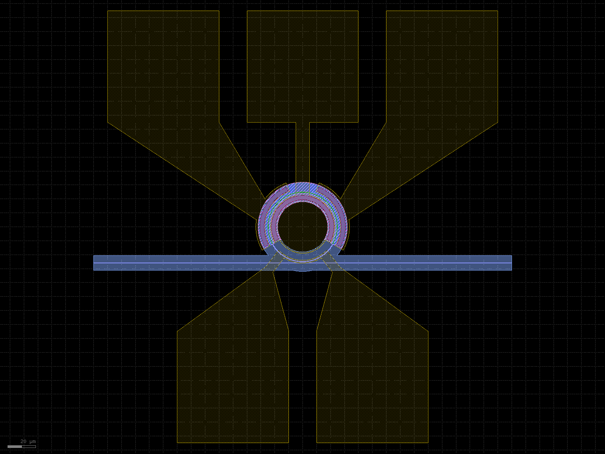
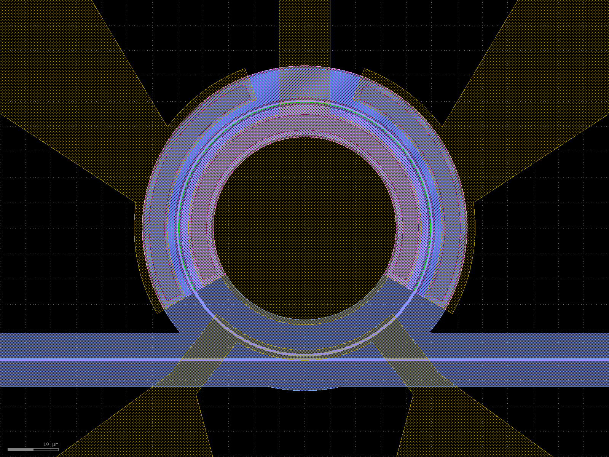
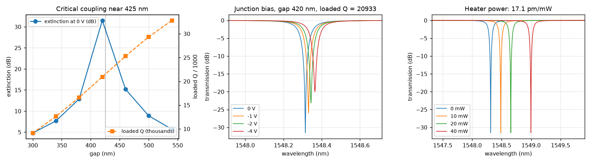

# CORNERSTONE SOI220A: the second example

[Course front page](../../README.md) | [Ring modulator simulations](lumerical_simulations/ring_modulator/README.md)

This folder is a complete, self-contained second example of the flow. It takes the same
steps as the main example: a technology file, a device builder, a DRC, a process file for
the Layer Builder, and simulations of a heater-tuned microring modulator. The process is
different. It is CORNERSTONE SOI220A, a real open foundry process, and its data is public.

> **Status of this example.** This folder is kept as released in v0.2. The corrections made to the
> main example in v0.3 were not ported to it. Its absolute effective index can be off by several
> 10⁻³, because its mode-solver mesh has no line on every interface. Its heat source is the thermal
> power boundary condition, not a uniform source in the film. Its capacitance is read as Im(Y)/ω,
> which is right only when ωR_sC ≪ 1. Its resonances are read on the simulation grid. Read the
> numbers here as those of v0.2, and use the main example as the reference method.

## What CORNERSTONE SOI220A is

[CORNERSTONE](https://www.cornerstone.sotonfab.co.uk/) is an open-source, licence-free silicon
photonics foundry at the University of Southampton. Its active platform, SOI220A, is a 220 nm
silicon-on-insulator process with three silicon etches, four implants and one aluminium
electrode layer. Everything this folder uses comes from two public documents:

- the official PDK repository [cornerstone-uos/cornerstone-pdk](https://github.com/cornerstone-uos/cornerstone-pdk),
  folder `SOI220A`: layer names and numbers, per-layer rules, cross-sections and building blocks;
- the [design guidelines of the 220 nm SOI active MPW call #47](https://cornerstone.sotonfab.co.uk/wp-content/uploads/2025/10/CORNERSTONE-47th-Call-Design-Guidelines_final-1.pdf)
  (October 2025): process flow, doping, rules between layers and mask processing.

The source of each number is tagged in the code and in the tables: `[YAML]` for the PDK
repository, `[DG]` for the guidelines, `[assumed]` for a value that the sources do not give.
Where the two public documents disagree, the folder keeps both and says which one it follows.
That is covered in [the process tables](cornerstone_process_file_py/cornerstone_csv/README.md).

| GDS | official layer name | meaning |
|---|---|---|
| 3/0 | `Si_Etch2_LF_120nm` | waveguide core; drawn shapes keep the full 220 nm |
| 5/0 | `Si_Etch3_LF_100nm_to_BOX` | rib protect; drawn shapes keep a 100 nm slab |
| 6/0 | `Si_Etch1_DUV_DF_70nm` | grating couplers, etched 70 nm |
| 7/0, 8/0 | `P_Implant_Low_DF`, `N_Implant_Low_DF` | low-dose implants that form the junction |
| 9/0, 11/0 | `P_Implant_Hi_DF`, `N_Implant_Hi_DF` | high-dose implants for ohmic contacts |
| 12/0 | `Via_DF` | via through the top cladding |
| 13/0 | `Electrode_LF` | aluminium electrodes, pads and heater filaments |

GDS 3/0 is drawn at the full core width. The foundry etches the silicon around it, so the
layer name and the drawn shape are not the same thing. The table of the process tables
explains how each drawn shape becomes a silicon region.

## Why this is the second example

The main example uses a generic process that is built from public sources and has a full
back end: three aluminium metals, a titanium-nitride heater, and germanium and nitride
layers. CORNERSTONE SOI220A has less. It has one metal layer and no heater layer. Two
consequences follow.

- **The heater shares the electrode layer.** The junction electrodes and the heater are both
  drawn in `Electrode_LF`, so they cannot overlap. The junction takes the upper 240° of the
  ring, and the heater takes the lower 76°. After the two leads are subtracted, 17 % of the
  ring length is heated, against 71 % in the main example.
- **There is no full back end to teach.** The main example shows how a process with several
  metals is routed to pads. This process has one metal, so there is no routing to show.

Why, then, is it a useful second example? Because it teaches what the generic process
cannot. Three things are specific to a real foundry process.

1. **Official layer names.** The layers carry the names of the foundry, and the device code
   uses them. A layout that a student draws for this process can be checked against the
   official building blocks.
2. **Public sources that disagree.** The guidelines and the PDK repository give different
   values for the buried oxide, the top cladding and the electrode gap. The folder shows the
   table of the disagreement, and states which value it uses and why. A student who learns
   this habit will need it for every real process.
3. **Process steps that change the device.** The n implant is self-aligned, so the junction
   sits 110 nm inside the sidewall, not where the mask edge is drawn. The foundry also etches
   trenches around every waveguide. Both are part of the process, and both are modelled in
   the code.

## The worked example

<p align="center">
  
  
</p>

**Figure 1.** The ring modulator on CORNERSTONE SOI220A, as drawn by `cornerstone_rm_builder.py`.
Left: the whole device, with the three electrode pads of the junction in the north and the
two heater pads in the south (20 µm scale bar). Right: the ring, the coupler and the doped arc
(10 µm scale bar).

The device has a 25 µm radius, a 0.45 µm rib on a 100 nm slab, and a point coupler at the
bottom of the ring. The junction takes the upper 240° of the ring, and the heater takes the
lower 76°, above the undoped part next to the coupler.

The results come from the six simulation steps. Each value below names the step that
produced it. The method and the limits of each step are in the
[simulation README](lumerical_simulations/ring_modulator/README.md).

| result | value | from |
|---|---|---|
| power coupling | κ² = 3.73 · exp(−gap / 101.6 nm) | step 1, FDTD |
| effective and group index | 2.5515 and 3.912 | step 2, MODE |
| junction capacitance at 0 V and −4 V | 0.43 and 0.22 fF/µm | step 3, CHARGE |
| heater efficiency | 1.37 K/mW in the heated section | step 4, HEAT |
| modulation efficiency VπL at −2 V | 1.4 V·cm | step 5, MODE |
| gap for critical coupling | 425 nm | step 6, INTERCONNECT |
| loaded Q and free spectral range | 20 900 and 3.90 nm | step 6 |
| resonance shift at −4 V | 50 pm | step 6 |
| thermal tuning | 17.1 pm/mW | step 6 |

Step 6 returns the gap for critical coupling. That value is the default gap of
`ring_modulator()`, so the layout and the circuit model agree.

The plots of this folder keep the plain style of v0.2. The main example carries the course's
figure style, so the figures there are the ones to study first. The plots here are only
there to show the results.

<p align="center">
  
</p>

**Figure 2.** Step 6 of this folder: extinction against gap, spectra against junction bias and
against heater power.

## Differences from the main example

| | main example (GSiP teaching PDK) | this folder (CORNERSTONE SOI220A) |
|---|---|---|
| process | a teaching process built from the public GSiP data of Chrostowski and Hochberg and of Baehr-Jones et al. | the official open process of CORNERSTONE, with its official names |
| core and slab | 220 nm core on a 90 nm slab, 6 µm wide | 220 nm core on a 100 nm slab, 14 µm wide |
| ring radius | 10 µm | 25 µm |
| bus and ring width | 0.5 µm rib | 0.45 µm rib |
| default gap | 0.37 µm | 0.42 µm |
| PN section | upper 240°, 67 % of the ring | upper 240°, 67 % of the ring |
| implants | nested N+ / N++ and P+ / P++ masks | low-dose n self-aligned to the sidewall, high-dose contacts |
| metal layers | three aluminium metals and a TiN heater | one aluminium layer, which also carries the heater |
| heater | TiN, 1.6 µm wide, 270°, 280 Ω | aluminium, 2 µm wide, 76°, 0.23 Ω |
| heated part of the ring | 71 % | 17 % |
| waveguide loss used | 2.2 dB/cm, from [BJ] | 4 dB/cm, the upper bound of [DG] Table 4 |
| design-rule check | `gsip_drc.py`, complete for the back end | `cornerstone_drc.py`, a pre-check; the foundry runs the binding DRC |
| simulation steps | seven, starting with a Layer Builder check | six, starting with the coupler |
| process file | compiled from tables, reloaded and compared with them | compiled from tables with the column names of the Ansys template |

The two folders follow the same method. The difference is what the process gives you to work
with. The main example is the place to learn the flow with a full back end. This folder shows
the same flow on a real process, with its official names and its disagreements.

## The files of this folder

| file | what it does |
|---|---|
| [cornerstone_technology.py](cornerstone_technology.py) | The PDK. Layers with the official names, design rules, the layer stack, the cross-sections and the cells. Importing it activates the PDK. |
| [cornerstone_drc.py](cornerstone_drc.py) | Design-rule check in pure Python (klayout.db). `run_drc(component)` returns a result with a `passed` flag. |
| [cornerstone_rm_builder.py](cornerstone_rm_builder.py) | The device: `ring_modulator()`, built from the PDK cross-sections. Running it writes the GDS and the preview images. |
| [rm_ring.gds](rm_ring.gds) | The layout that the builder writes, flat, for the Layer Builder. |
| [cornerstone_process_file_py/](cornerstone_process_file_py/) | The process as CSV tables, the compiler that writes `cornerstone_process.lbr`, and the compiled file. |
| [cornerstone_process_file_py/cornerstone_csv/README.md](cornerstone_process_file_py/cornerstone_csv/README.md) | Every table and the source of every number, with the known inconsistencies. |
| [lumerical_simulations/ring_modulator/](lumerical_simulations/ring_modulator/) | The six simulation steps, their results, their plots, and [the README](lumerical_simulations/ring_modulator/README.md). |
| `tests/` | pytest: the PDK, the layout with its DRC, and the process tables. |
| `klayout_tech/` | `layers.lyp` and `tech.lyt` for viewing layouts in KLayout. |
| `pytest.ini` | the test settings of this folder. |

## Run it

The commands run from this folder. The root of the repository holds the Python environment
(`uv sync` there, once). The layout, the DRC and the tests need no Lumerical.

```bash
cd more_processes/cornerstone_soi220a

uv run python cornerstone_technology.py      # list the layers and the cross-sections
uv run python cornerstone_rm_builder.py      # write rm_ring.gds, the DRC report and the preview images
uv run pytest                                # the tests of this folder
```

The simulations need Ansys Lumerical. The commands are in
[the simulation README](lumerical_simulations/ring_modulator/README.md), which also says how
long each step takes. The process file is compiled with
`uv run python cornerstone_process_file_py/cornerstone_process_file_compiler.py`.

## Sources

- CORNERSTONE, [open PDK repository](https://github.com/cornerstone-uos/cornerstone-pdk),
  `SOI220A/process_overview.yaml` (v1.2.0) and the cross-section file of the same folder.
- CORNERSTONE, [Design Guidelines, 220 nm SOI Active MPW #47](https://cornerstone.sotonfab.co.uk/wp-content/uploads/2025/10/CORNERSTONE-47th-Call-Design-Guidelines_final-1.pdf)
  (October 2025).
- N. Nedeljkovic, R. Soref and G. Z. Mashanovich, "Free-carrier electrorefraction and
  electroabsorption modulation predictions for silicon over the 1–14 µm infrared wavelength
  range", IEEE Photonics Journal 3, 1171 (2011),
  [doi:10.1109/JPHOT.2011.2171930](https://doi.org/10.1109/JPHOT.2011.2171930). The Soref-Bennett
  coefficients of the index perturbation.
- Ansys Optics, [Layer builder - Simulation object](https://optics.ansys.com/hc/en-us/articles/360034382394-Layer-builder-Simulation-object)
  and [Ring Modulator](https://optics.ansys.com/hc/en-us/articles/360042322794-Ring-Modulator).
- gdsfactory, [documentation](https://gdsfactory.github.io/gdsfactory/).

The tags used in the code: `[YAML]`, `[DG]`, `[XS]` (the cross-section file of the PDK
repository), `[MZM]` and `[HTR]` (values measured on the official building blocks, MZM and
heater), and `[assumed]`.

This project is not affiliated with or endorsed by CORNERSTONE, the University of Southampton,
Ansys or the gdsfactory team. "Ansys" and "Lumerical" are trademarks of ANSYS, Inc. The values
are for teaching and for setting up simulations. Before a tape-out, take every value from the
design guidelines of the call you submit to, and run the foundry's own DRC.
