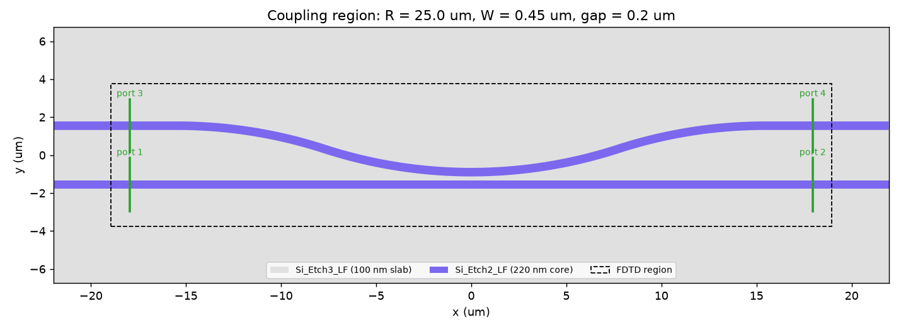
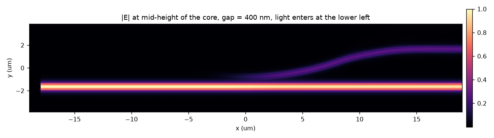
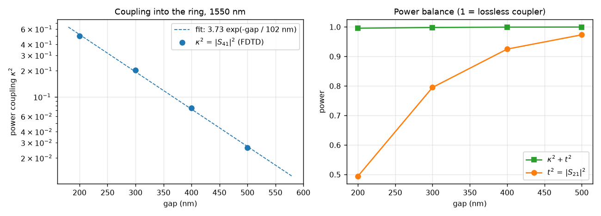
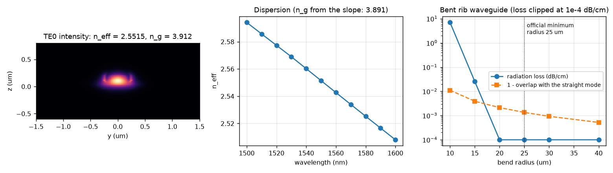
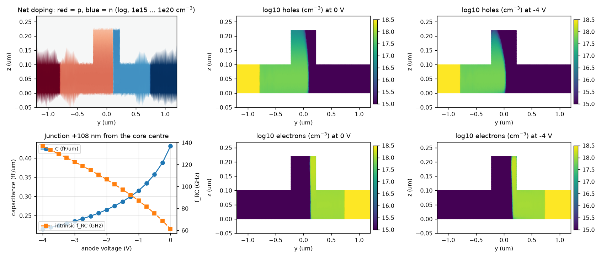
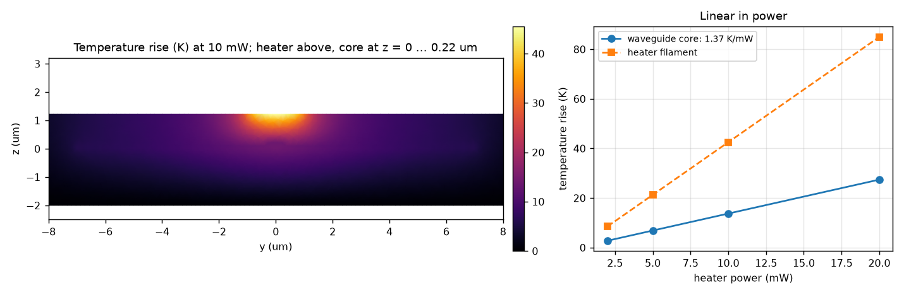
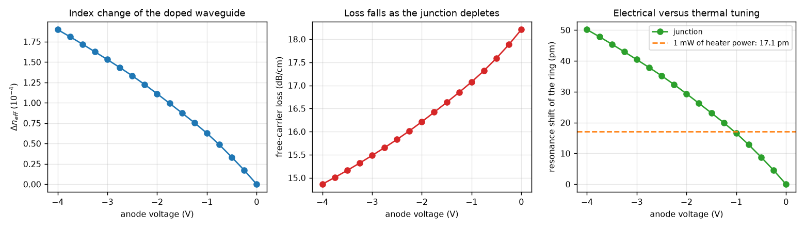
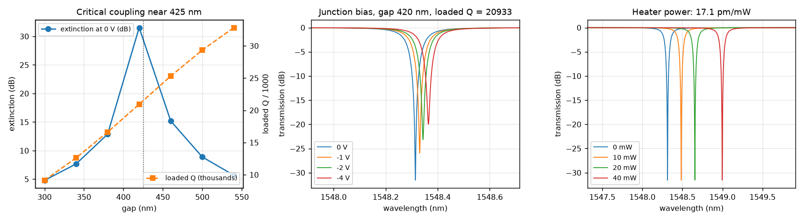

# Ring modulator: six simulation steps

> **Status.** This folder is kept as released in v0.2. The v0.3 corrections of the main example were
> not ported: the absolute effective index can be off by several 10⁻³ (no mesh line on every interface),
> the heat source is the thermal power boundary condition, C is read as Im(Y)/ω, and the resonances are
> read on the grid.

A heater-tuned microring modulator on CORNERSTONE SOI220A, simulated from the layout to the
circuit. The steps follow the Ansys application example
[Ring Modulator](https://optics.ansys.com/hc/en-us/articles/360042322794-Ring-Modulator), with a
HEAT step added for the heater.

Every step builds its structure the same way:

```text
small GDS drawn with the PDK   +   cornerstone_process.lbr   →   Layer Builder object
```

No script contains a layer thickness, a material or a doping level. Change the process tables,
recompile the `.lbr`, and all six steps follow.

| step | solver | script | question it answers | passes on |
|---|---|---|---|---|
| 1 | FDTD | `coupling_coefficient_fdtd.py` | How much power crosses from the bus into the ring, for a given gap? | κ²(gap) |
| 2 | MODE FDE | `passive_mode_fde.py` | What are n_eff, n_g and the bend loss of the rib waveguide? | n_eff, n_g |
| 3 | CHARGE | `charge_profile.py` | Where are the carriers at each bias? What are C and Rs? | carriers (`.mat`), f_RC |
| 4 | HEAT | `heat_profile.py` | How warm does the waveguide get per mW of heater power? | temperature (`.mat`) |
| 5 | MODE FDE | `active_mode_fde.py` | How do n_eff and loss change with voltage and with heater power? | Δn_eff(V), loss(V), Δn_eff/mW |
| 6 | INTERCONNECT | `ring_modulator_interconnect.py` | What does the whole ring do? | spectra, Q, tuning, design gap |

## Run it

Prerequisites: `uv sync`, a compiled `cornerstone_process.lbr`, and Ansys Lumerical with licences
for FDTD, MODE, CHARGE, HEAT and INTERCONNECT. Set `LUMERICAL_ROOT` if Lumerical is not in a
standard location.

```bash
cd lumerical_simulations/ring_modulator/scripts

uv run python coupling_coefficient_fdtd.py --preview   # check the layout and the FDTD window first
uv run python coupling_coefficient_fdtd.py --dry       # coarse mesh, about 2 min
uv run python coupling_coefficient_fdtd.py             # 4 gaps, about 10 min each on 16 threads
uv run python passive_mode_fde.py                      # about 2 min
uv run python charge_profile.py                        # about 8 min
uv run python heat_profile.py                          # about 1 min
uv run python active_mode_fde.py                       # about 2 min, needs steps 2, 3 and 4
uv run python ring_modulator_interconnect.py           # under 1 min, needs steps 1, 2, 3 and 5
```

Each step has its own plot script, which needs neither Lumerical nor gdsfactory:

```bash
cd ../plots
uv run python 1_coupling_coefficient/plot_coupling_coefficient.py
uv run python 6_interconnect_ring_modulator/plot_ring_modulator.py
```

## What is kept in the repository

Each step folder holds its GDS and a `.txt` summary; step 1 also holds the `.csv` that step 6
reads. Plots are in `plots/<step>/`. Lumerical projects (`.fsp`, `.lms`, `.ldev`, `.icp`), carrier
and temperature maps (`.mat`) and raw arrays (`.npz`) are rebuilt by the scripts and are ignored by
git. A full run produces about 70 MB.

## The device

| quantity | value | set in |
|---|---|---|
| ring radius | 25 µm (official minimum for the rib waveguide) | `cornerstone_rm_builder.ring_modulator` |
| core width | 0.45 µm on a 100 nm slab | same |
| circumference | 157.1 µm | derived |
| PN section | upper 240° of the ring, 104.7 µm | same |
| heater | Al filament, 2 µm wide, lower 76°; 26.7 µm between its two leads | same |
| wavelength | 1.55 µm, TE | `scripts/common.py` |

The simulation scripts read these values from the signature of `cornerstone_rm_builder.ring_modulator`.

## Step 1: coupling coefficient (FDTD)

<p align="center">
  <br>
  <br>
  
</p>

Only the coupling region is simulated. The ring arc is continued by reverse bends, so that all four
ports are normal to x. Light enters at port 1; κ² = |S41|² is the power that crosses into the ring.

| gap (nm) | κ² | t² | κ² + t² |
|---|---|---|---|
| 200 | 0.5015 | 0.4942 | 0.9957 |
| 300 | 0.2031 | 0.7951 | 0.9983 |
| 400 | 0.0744 | 0.9250 | 0.9994 |
| 500 | 0.0263 | 0.9734 | 0.9998 |

Fit: **κ² = 3.73 · exp(−gap / 101.6 nm)**. Reflections are below 2·10⁻⁵.

Things to know:

- The slab covers the whole window, as in the device, where the slabs of ring and bus merge.
- The script starts the CPU engine directly. On some machines the job manager selects a GPU
  resource or fails without a message. Use `--job-manager` to go through Lumerical's own settings.
- After extracting the S-parameters the project is saved in layout mode. A project with fields is
  several hundred MB. `--keep-results` keeps them.
- The coupling depends on the ring radius. Rerun this step when you change the radius.

## Step 2: passive waveguide (MODE FDE)

<p align="center"></p>

| quantity | value |
|---|---|
| n_eff at 1550 nm | 2.5515 |
| n_g | 3.912 (3.891 from the slope of an 11-point wavelength sweep) |
| radiation loss at R = 25 µm | below 10⁻⁴ dB/cm |
| radiation loss at R = 15 µm, 10 µm | 0.03 dB/cm, 7.0 dB/cm |
| mode shift at R = 25 µm | 13 nm outwards, overlap with the straight mode 0.9987 |
| free spectral range of the ring | 3.91 nm |

Things to know:

- A search near the maximum index also returns slab and PML modes. The script keeps the mode that
  is mostly TE and concentrated in the core.
- The wavelength sweep calls the mode solver once per wavelength. The built-in frequency sweep can
  jump to a PML mode.
- The two n_g values differ by 0.5 % because the silicon data is tabulated.

## Step 3: carriers, capacitance, resistance (CHARGE)

<p align="center"></p>

The cross-section is the PDK's `rib_1550nm_TE_pn` with the via bands of `cornerstone_rm_builder`. The process
file splits the via into `Via_P` and `Via_N`, so the anode goes on one and the cathode on the other.
The simulation is 2D and normalised to the doped arc: currents, C and Rs are those of the whole PN
section.

| anode voltage | C (fF/µm) | Rs (Ω) | intrinsic f_RC (GHz) |
|---|---|---|---|
| 0 V | 0.431 | 57.6 | 61 |
| −1 V | 0.315 | 55.3 | 87 |
| −2 V | 0.265 | 53.8 | 107 |
| −4 V | 0.215 | 51.7 | 137 |

The junction forms 108 nm from the core centre on the n side. The expected position is 115 nm,
which is 110 nm inside the sidewall: the n implant is self-aligned to the rib and enters through
the sidewall, wherever the mask edge is drawn inside the core. The `.txt` summary compares the
simulated doping of each region with the published concentrations.

Things to know:

- Steady state uses the gummel solver with steps of 0.25 V. Small signal (ssac) needs newton.
- A mesh constraint of 8 nm covers the rib. With the automatic mesh alone, C(V) is not smooth and
  changes by several percent from run to run.
- C is taken at 100 MHz, Rs at 30 GHz. f_RC excludes pads, traces and the driver impedance.
- Do not call `deleteall` in a DEVICE project: it removes the materials group that the process
  file fills.

## Step 4: heater (HEAT)

<p align="center"></p>

SOI220A has no heater layer. Heaters are drawn in the Al electrode layer, on 1 µm of oxide above
the waveguide.

| quantity | value |
|---|---|
| core temperature in the heated section | 1.37 K/mW |
| averaged over the ring (17 % of it is heated) | 0.23 K/mW |
| heater filament temperature | 4.2 K/mW |
| filament resistance, bulk Al resistivity [assumed] | 0.23 Ω |

Things to know:

- The heat source is a thermal power boundary condition on the *solid* `Electrode`. The heat sink
  is a temperature boundary condition on the *solid* `Si_Substrate`, which the simulation region
  must include.
- The region must stay inside the layers of the process file. Otherwise the solver stops with
  "No thermal material properties defined for domain".
- The heated length is the free filament between the two leads. The leads are 6.5 µm wide and
  cover both ends of the filament.
- Still air is modelled as a conductor. Convection and radiation are neglected.

## Step 5: active waveguide (MODE FDE)

<p align="center"></p>

The silicon of the process file is an index-perturbation material. An "np Density" grid attribute
loads the carriers of step 3, and a "temperature" grid attribute loads the temperature of step 4.

| anode voltage | Δn_eff | loss (dB/cm) | ring shift (pm) | VπL (V·cm) |
|---|---|---|---|---|
| 0 V | 0 | 18.2 | 0 | |
| −1 V | 6.3·10⁻⁵ | 17.1 | 16.5 | 1.24 |
| −2 V | 1.11·10⁻⁴ | 16.2 | 29.3 | 1.40 |
| −4 V | 1.90·10⁻⁴ | 14.9 | 50.1 | 1.63 |

Thermal: Δn_eff = 2.54·10⁻⁴ per mW in the heated section, which is **17.1 pm/mW** for the ring.
The junction at −4 V shifts the resonance as much as 2.9 mW of heater power.

## Step 6: the ring modulator (INTERCONNECT)

<p align="center"></p>

The element is INTERCONNECT's *Optical Ring Modulator*, driven by a DC source and measured with an
optical network analyser.

Round-trip loss at 0 V:

| contribution | dB |
|---|---|
| waveguide, 4 dB/cm (upper bound of the design guidelines) | 0.063 |
| bend radiation | 0.000 |
| free carriers in the PN section | 0.191 |
| total | 0.254 |

Critical coupling needs κ² = 0.057, which the fit of step 1 gives at a gap of **425 nm**. The
default gap of `cornerstone_rm_builder.ring_modulator` is therefore 0.42 µm.

| at a gap of 420 nm | value |
|---|---|
| loaded Q | 20 900 |
| linewidth | 74 pm |
| free spectral range | 3.90 nm |
| extinction at 0 V | 31.5 dB |
| resonance shift at −1, −2, −4 V | 17, 30, 50 pm |
| transmission at the 0 V resonance, at 0 / −1 / −2 / −4 V | −31.5 / −7.6 / −3.9 / −1.7 dB |
| optical bandwidth, c / (λQ) | 9.2 GHz |
| electrical bandwidth, intrinsic f_RC at 0 V | 61 GHz |
| thermal tuning | 17.1 pm/mW |

What the numbers say about the design:

- **Free carriers set the loss**, three times more than the waveguide itself. The waveguide loss
  used here is an upper bound, so the real Q may be higher and the critical gap larger.
- **The photon lifetime limits the speed**, not the junction. A faster modulator needs a lower Q:
  a smaller gap, at the cost of extinction and modulation depth.
- **The Al heater is a trimming element.** Shifting by a full free spectral range would take
  228 mW. The filament has a fraction of an ohm, so it is current-driven. The heater covers only
  17 % of the ring, because the junction electrodes use the same metal layer.
- **The extinction is very sensitive to the gap**: 31 dB at 420 nm, 13 dB at 380 nm and 15 dB at
  460 nm. A real design sweeps the gap on the mask.

Interface of the INTERCONNECT element, checked against the analytic all-pass ring:

- `coupling coefficient 1` is the *power* coupling κ².
- `loss` is in dB/m.
- The third column of the `measurement` table is the *imaginary* part of the index.
- Element properties can only be changed after `switchtodesign()`.

## Limits of the model

- Vertical sidewalls, a planar top cladding and bulk aluminium are assumptions.
- Implant profiles are fitted to the published average concentrations, not to SIMS data.
- The heater and the junction are simulated as straight cross-sections. Bending is included only in
  step 2, where its effect at R = 25 µm is negligible.
- Optical absorption by the metal above the waveguide is not included: the mode-solver windows end
  below the Al layer. The heater and its leads sit 1 µm above the core.
- The circuit model has no self-heating, no two-photon absorption and no RF model of the pads.
- Nothing here has been compared with a measured device.
